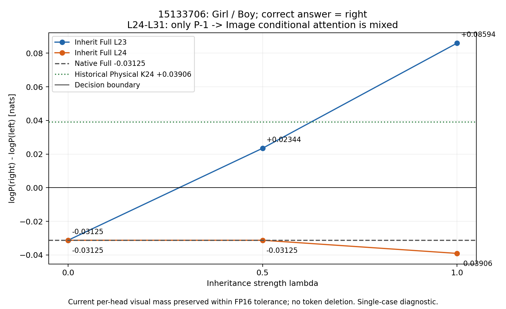

# 15133706 Attention 继承

**2026-10-28：六条件真实GPU实验已完成。** 请使用 [完成报告](completed_20261028_2245/report.md)、[逐条件CSV](completed_20261028_2245/per_condition_results.csv) 和 [验收](completed_20261028_2245/validation.json)。

L23 λ0/.5/1 Margin为−.03125/+.0234375/+.0859375；L24为−.03125/−.03125/−.0390625。仅L23非零λ转为正确right；正确候选绝对概率未提高。历史Physical K24 +.0390625仅作对照。

本目录根部旧 [report.md](report.md)、CSV/JSON/validation.json/图仍保留首次未完成尝试的状态，不能当作当前完成数据。`initial_attempt_fp16_validation/`、`resource_blocked_attempt/`不覆盖、不合并。`summarize_attention_inheritance.py`只重建旧partial摘要，不用于完成目录。

单案、近零FP16 Margin，不证明Sink有害或Physical Exit改善机制；本次不扩展样本。
