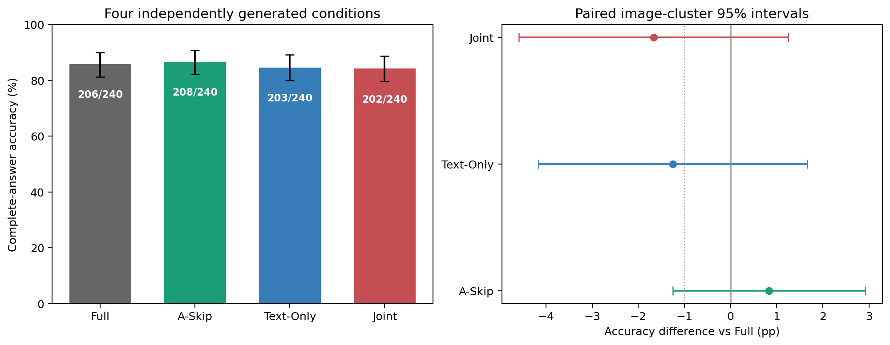
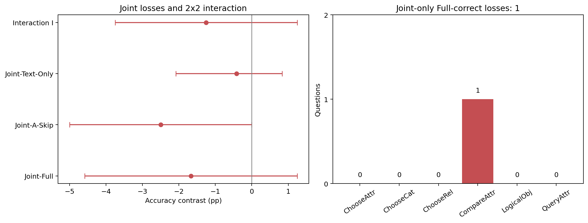
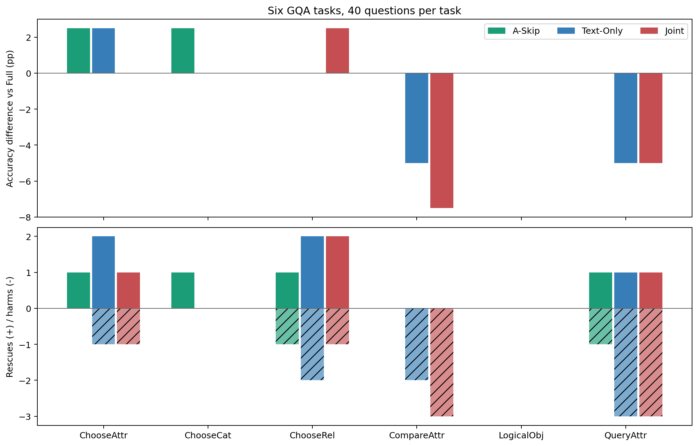

# 实验二：Dead Attention × Text Relay 联合可组合性

**状态：complete。240题、六类各40题、240张互异图片；四条件全部重新生成，共960条完整答案。**
历史来源上的探索性研究，不是独立确认集或严格非劣效认证。

## 主要结果

|条件|正确/240|完整答案Accuracy|ΔFull(pp)及配对95%CI|原对→错|原错→对|首Token Flip|平均signed LogP Loss(nat)|
|---|---:|---:|---|---:|---:|---:|---:|
|Full|206/240|85.833%|+0.000 [+0.000, +0.000]|0|0|0|+0.000000|
|A-Skip|208/240|86.667%|+0.833 [-1.250, +2.917]|2|4|6|-0.002986|
|Text-Only|203/240|84.583%|-1.250 [-4.167, +1.667]|8|5|13|+0.026490|
|Joint|202/240|84.167%|-1.667 [-4.583, +1.250]|8|4|13|+0.035691|

Full固定首Token的signed LogP Loss使用FP32全词表log_softmax；负值允许，不能解释为Gold概率或Accuracy。首Token Flip不是完整VQA准确率。

|联合比较|估计(pp)|图像簇配对95%CI|
|---|---:|---|
|Joint-Full|-1.667|[-4.583, +1.250]|
|Joint-A-Skip|-2.500|[-5.000, +0.000]|
|Joint-Text-Only|-0.417|[-2.083, +0.833]|
|Interaction I|-1.250|[-3.750, +1.250]|
|Joint unique harm rate|+0.417|[+0.000, +1.250]|

`I=(AccJoint−AccTextOnly)−(AccASkip−AccFull)`；负值表示联合有超出加性期望的损害，正值相反。
Joint独有损害（Full及两个单独干预都正确、Joint错误）：**1题**。其他Joint损害/纠正也完整保留，不以净均值代替逐题风险。

## 直接回答

1. **两个单独低敏感现象是否复现？** A-Skip呈现较低净损害：相对Full为+0.833pp，损害2题、纠正4题，但区间不能证明提升或严格无损。Text-Only仍保留较高Accuracy，但相对Full为-1.250pp，损害8题、纠正5题；不能把它表述成已满足-1pp参考边界。两者并未共同复现为可认证的无损方案。
2. **Joint是否有额外损害？** 相对Full为-1.667pp，CI [-4.583, +1.250]；相对A-Skip为-2.500pp，相对Text-Only为-0.417pp；交互I为-1.250pp，CI [-3.750, +1.250]。逐题Joint独有损害1题。CI包含0既不能证明额外损害，也不能证明安全等价。
3. **是否集中在某些任务？** Joint相对Full的8题损害中，CompareAttr和QueryAttr各3题，ChooseAttr和ChooseRel各1题；净下降主要在CompareAttr（-7.5pp）和QueryAttr（-5pp）。唯一Joint独有损害来自CompareAttr。每类仅40题，这是描述性分布，不能确认为任务特异性效应。
4. **是否支持联合用于短答案VQA？** 本批可以同时施加两种干预并保留202/240个正确答案，但不支持将它宣布为可安全同时省略的优化：Joint相对Full净降1.667pp，相对两个单独干预均更低，且有真实Joint独有损害。交互区间包含0，既未证实总体功能耦合/补偿，也未证明可加、等价或无损。
5. **统计性低损害与严格无损？** 所有点估计、普通95%区间和零翻转观察都不是严格无损证明；−1pp仅是后续验证的参考，不作本轮非劣效认证。零差异的退化Bootstrap区间同样不证明总体零风险。
6. **未来哪些计算可以尝试真实跳过？** 只能将L2–L5答案Query的Attention输出更新、以及答案Query到原始Image Key的直接读取视为待验证的候选，不是本轮已省略的计算。Prefill其他Query的视觉读取和文本中继不能由本轮结果推断可删除。
7. **哪些KV仍需保留？** 本轮全部层原始图像、Prompt文本及真实生成前缀KV均完整维护。非目标Prefill Query需要视觉KV；后续答案Query仍需可读的文本/生成KV，L2–L5的KV正常更新。Mask不能证明图像KV可安全物理删除，也不能证明对应Q/K/V投影都可省略。
8. **是否值得开发真实加速？** 这批证据不足以批准“联合方案已安全”的真实加速实现；不应直接把两种单独低敏感现象拼接为部署结论。A-Skip单独仍是相对更稳妥的研究候选，但本轮不开发任何Kernel或KV剪枝，也不报告FLOPs、显存、延迟或吞吐收益；本次到此停止。

## 六任务损益

|任务|Full|A-Skip|Text-Only|Joint|Joint对→错 / 错→对|Joint独有损害|
|---|---:|---:|---:|---:|---|---:|
|ChooseAttr|80.0%|82.5%|82.5%|80.0%|1 / 1|0|
|ChooseCat|92.5%|95.0%|92.5%|92.5%|0 / 0|0|
|ChooseRel|80.0%|80.0%|80.0%|82.5%|1 / 2|0|
|CompareAttr|80.0%|80.0%|75.0%|72.5%|3 / 0|1|
|LogicalObj|97.5%|97.5%|97.5%|97.5%|0 / 0|0|
|QueryAttr|85.0%|85.0%|80.0%|80.0%|3 / 1|0|

### 联合相对单独干预的逐题变化

|参照条件|参照正确→Joint错误|参照错误→Joint正确|Joint相对参照净变化|
|---|---:|---:|---:|
|A-Skip|8|2|-2.500pp|
|Text-Only|2|1|-0.417pp|

完整按任务配对转移见[joint_pair_transitions.csv](joint_pair_transitions.csv)。
唯一Joint独有损害是CompareAttr题12624151：问题“What is common to the sign and the pole?”，Gold为material；Full、A-Skip、Text-Only均回答Material，Joint回答Color。该案例是事后列出的错误说明，不是预选代表案例，也不能单独证明普遍补偿机制。逐题信息见[joint_unique_harm_cases.csv](joint_unique_harm_cases.csv)。

## 图表

## 协议、样本和验证

- 历史基准bd171312fd0489e8bc027744b7a976367da11668；冻结执行代码f2ba0a0c6519948a55249cd3f25d96eae9d37e12；独立分支codex/attention-relay-joint-240，main及实验一Worktree未修改。
- LLaVA-1.5-7B revision b234b804b114d9e37bb655e11cbbb5f5e971b7a9，FP16/eager、Transformers4.49.0，Greedy/max32、原Prompt/官方完整答案精确评分器。
- A-Skip在L2–L5仅置零原始P−1及每个真实Decode Query的o_proj输出；不是全Prefill关闭。V-Off在全部32层只对这些答案Query的576个原始Image Key做Softmax前−inf；其他Prefill Query原生读图。Joint同时安装两种历史Hook，不修改历史实现或第三方源码。
- t=0为原始P−1，t≥1为真实增量Decode，包括EOS预测位置；每个条件从空Cache独立维护真实前缀，未使用反事实Cache、跨条件Cache或旧Full/Text-Only答案。所有32层KV逐步长度与实际位置严格检查。
- 20,000次整Image SHA256簇配对Bootstrap，seed20261102，题目加权，同一指标族共用图像抽样。全部比较探索性普通双侧95%区间，不作多重比较后的确认性或非劣效宣称。Token/层/Head不是独立统计单位。
- 样本选择时实验一Manifest可用：True。本轮来源：/data/lk/ATE-worktrees/query-role-attention-boundary-240/vlm_research/results/query_role_attention_boundary_240/sample_manifest.json。报告时逐题集合比较：{'experiment_one_available_at_selection': True, 'available_at_reporting': True, 'same_samples': True, 'overlap_questions_images': 240, 'experiment_one_sha256': '258c32d470270829e126ae9abf3a030dbc1485b2f329fdfc326f4d6e9b3e686c'}。未等待或依照运行结果重选样本。
- CPU测试及至少三题真实7B Smoke先于正式采集；Full/No-op所有有效Logits、完整Token及初始Cache指纹精确一致，Full与原生HF Greedy一致。两个单独条件与历史引擎逐步Logits一致；Joint逐层实际概率归零及输出置零同时通过。非目标Prefill Attention/Hidden/Logits精确不变，异常Hook清理和恢复原生通过。
- 首次GPU Smoke的额外HF默认分数精确比较失败后立即停止，日志保留。原因是HF默认logits_to_keep=1与历史完整Prefill Logits的LM-head矩阵形状不同；默认HF生成Token仍精确一致。成功Smoke既保留默认HF Token检查，也要求logits_to_keep=0对齐参考的逐步Logits精确一致；记录默认首步最大差0.0078125/0.015625/0.015625，后续步均0，未放宽任何容差。详见execution_notes.md及attempts/。
- 模型仅加载一份、四条件串行、只用物理GPU0和冻结UUID。未终止或抢占其他任务；GPU释放信息见gpu_release.json。无训练、无物理Attention跳过、无额外条件扫描。
- 全部条件EOS/截断/空答案/重复输出计数见accuracy_summary.csv；正式异常总数0（保留所有样本，不静默排除）。失败记录如存在保存在failures/，不放宽数值容差。
- 首Token原始Logits仅保留于服务器本地，不虚称提交GitHub：raw_logits_manifest.csv逐文件列出绝对路径、SHA256和字节数。GitHub包含所有960份检查点、完整Token/文本、审计、CSV及PNG/PDF，不包含这批大型原始Logits。
- 冻结采集/统计源码保持原样。supplement_transitions.py只从冻结逐题CSV列出配对转移和Joint独有错误；render_presentation.py只移动Figure1计数标签并将Figure2计数轴改成整数刻度，不修改统计值或置信区间。中文解释据真实表格补充，所有最终文件再做SHA256审计。

## 解释边界

Attention输出置零与Hard Mask仍执行原生Attention及KV更新；本轮是功能干预，不是真实算子优化。低净Accuracy损害不等于逐题无损；交互CI包含0不等于两路径独立或可安全同时删除。若出现负交互，也只能支持条件性功能耦合，不能单独定位补偿语义或唯一中介。历史重复使用数据、短答案/语言先验、Hard Mask重归一化以及有限样本均限制外推。

完成本实验后停止，不追加Query角色扫描、跨模型实验、训练、KV剪枝或Kernel实现。
