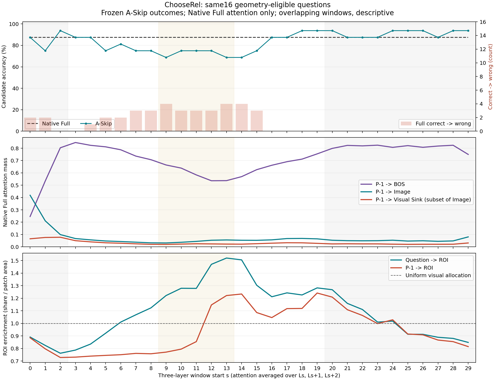

# Native Full attention vs frozen A-Skip sensitivity

Complete. No A-Skip reruns. Base: `2360834fae22cdb28dd66758893948066e84e69b`.

## Coverage and definitions

- Original64 unchanged: ChooseRel32, ScienceQA16, TextVQA16. Primary same-image comparison:16 ROI-eligible ChooseRel (9 left / 7 right), chosen only by frozen Phase3.4 geometry.
- Phase3.4 actual processor resize/crop and official object boxes are reused, not remapped heuristically. Both objects >=2 intersecting patches; union4..192; area ratio<=16. ROI is the union of both objects, not segmentation. All32 accuracy is reported separately; geometry-ineligible ROI is never pooled into the primary figure.
-6 frozen Sink lists reused,26 identified with exactly the Phase3.4 two-discovery/one-holdout neutral prompts. Sink selection never uses answers, margins, or A-Skip results. Sink includes ROI overlap; non-ROI Sink columns are also available. A Sink is a persistent neutral hotspot, not proven task-irrelevant noise.
- ScienceQA/TextVQA: BOS and Image masses only; no invented ROI or Sink. TextVQA retains fixed-Full-first-token diagnostics, not VQA accuracy.
- Raw masses are head means. Question rows average actual question tokens within each head first. ROI share is ROI mass/visual mass per head, then heads averaged; enrichment is share/(ROI patches/576), matching Phase3.4. Area denotes positive-intersection patch area, not continuous box pixel area. Question and P-1 use their real frozen input positions.
- Every x=s combines Ls..Ls+2 with equal layer weights within image, then equal image weights. It is Native Full attention, not attention after A-Skip. Sink mass is a subset of Image mass; do not add both.

## Same16 comparison

| Layer band (windows wholly inside) | Mean A-Skip accuracy | Full accuracy | Mean correct->wrong/window | Mean abs Margin change | BOS | Image | Sink | Q ROI enrichment | P-1 ROI enrichment |
|---|---:|---:|---:|---:|---:|---:|---:|---:|---:|
| early_L0_L4 | 85.42% | 87.50% | 1.33 | 0.9096 | 0.5277 | 0.2429 | 0.0730 | 0.826 | 0.804 |
| middle_L9_L15 | 72.50% | 87.50% | 3.40 | 1.5858 | 0.5919 | 0.0444 | 0.0227 | 1.354 | 0.958 |
| deep_L20_L31 | 91.25% | 87.50% | 0.00 | 0.3722 | 0.8092 | 0.0526 | 0.0233 | 1.001 | 0.977 |

Band values average overlapping windows, NOT extra independent samples or a simultaneous multi-layer ablation.

## Descriptive association

### Core findings

- Late windows wholly inside L20-L31 have mean absolute Margin change0.3722,
  versus1.5858 for windows wholly inside L9-L15. Their mean BOS mass is0.8092
  versus0.5919. Across30 overlapping windows, sensitivity vs BOS mass has
  Pearson r=-0.626 and Spearman rho=-0.625: a descriptive association, not a mechanism proof.
- Question ROI enrichment is stronger in the middle (1.354) than early
  (0.826) or deep (1.001); its correlation with sensitivity is r=0.533.
  P-1 ROI enrichment itself has essentially no linear association (r=-0.046).
  Thus the simple claim that low P-1 ROI enrichment explains low sensitivity
  is not supported across all30 windows.
- Raw Visual Sink mass has almost no linear association with sensitivity
  (r=-0.086); conditional Sink share is weakly positive (r=0.183, rho=0.406),
  not the predicted negative association. A high Sink allocation is not a
  sufficient explanation for low sensitivity. Sink and ROI can overlap.
- Full is14/16 correct (87.50%). Every deep window start20..29 has zero
  Full-correct->wrong cases. Its mean per-window accuracy is91.25%, not a
  new pooled accuracy estimate or evidence of a general improvement.
  The strongest Margin perturbation, L13-L15, has accuracy11/16 (68.75%),
  with4 correct->wrong and1 wrong->correct.
- Early windows are not uniformly harmless: starts0..2 average85.42%
  candidate accuracy, with1.33 correct->wrong per window, and absolute
  Margin effect0.9096 (larger than deep windows). The earliest window
  also has much more Image mass and less BOS mass than later windows.
  Treating all of L0-L4 as one uniformly low-sensitivity region is too coarse.

| Native Full feature | Pearson with mean abs Margin change | Spearman |
|---|---:|---:|
| p_bos | -0.626 | -0.625 |
| p_image | 0.073 | -0.284 |
| p_sink_mass | -0.086 | -0.067 |
| p_sink_share | 0.183 | 0.406 |
| q_roi_enrichment | 0.533 | 0.495 |
| p_roi_enrichment | -0.046 | -0.049 |

Within the same16, smallest absolute Margin effect is L28–L30 (0.1426); largest is L13–L15 (1.8230).
These layer profiles can be consistent with competing BOS/Sink allocation or weaker ROI alignment, but cannot establish either as the cause of local Attention-update sensitivity. The30 windows overlap, layer depth confounds all profiles, heads/layers are not independent image samples; no significance test or causal claim is made. Attention mass alone does not measure update size, useful information, or later-layer compensation. High Sink mass does not imply low ROI enrichment because Sink may overlap ROI.

## Validation and cost

- Small CPU tests passed (see cpu_tests.txt); one observer/native GPU smoke exact. All64 new Full P-1 logits are bitwise identical to the historical same-GPU Full with the exact N+1 candidate layout (TextVQA N). No changed tolerance, no new baselines mixed with historical intervention scores.
-32 layers/sample, actual BOS at token0 validated, finite logits/attention and original row-sum tolerance checked; validated observer hooks clean up and model parameter versions remain unchanged. 90 all-cohort A-Skip summary rows reproduce the original window_summary.csv within1e-12 reduction rounding.
-64 task forwards +78 neutral forwards +1 observer-off smoke,0 intervention reruns. GPU wall time including model load: 54.71s. No generation, training, additional datasets, or speedup claim.

## Files

- `per_layer.csv`:2048 original layer rows (64x32).
- `per_question_window_alignment.csv`:1920 frozen A-Skip rows joined with three-layer mean Full attention.
- `window_alignment_summary.csv`:four explicitly separated cohorts,30 windows each.
- `coverage.json`, `manifest.json`, `sink_manifest.json`:sample definitions, input/source hashes, exclusion reasons and Sink provenance.
- `descriptive_correlations.csv`, `band_summary.csv`, `summary.json`:descriptive statistics.
- `checkpoints/`:per-question statistics, exact-baseline validation and real input mappings.
- `neutral_maps/`:small FP16 neutral maps for26 new Sink definitions; no full attention matrices retained.
