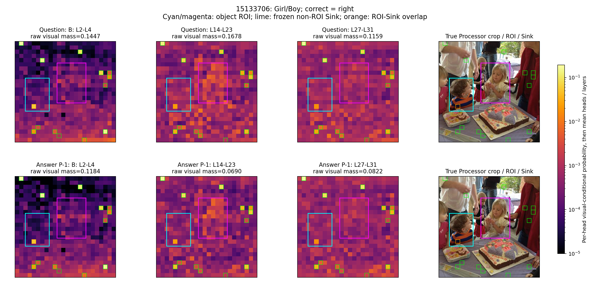
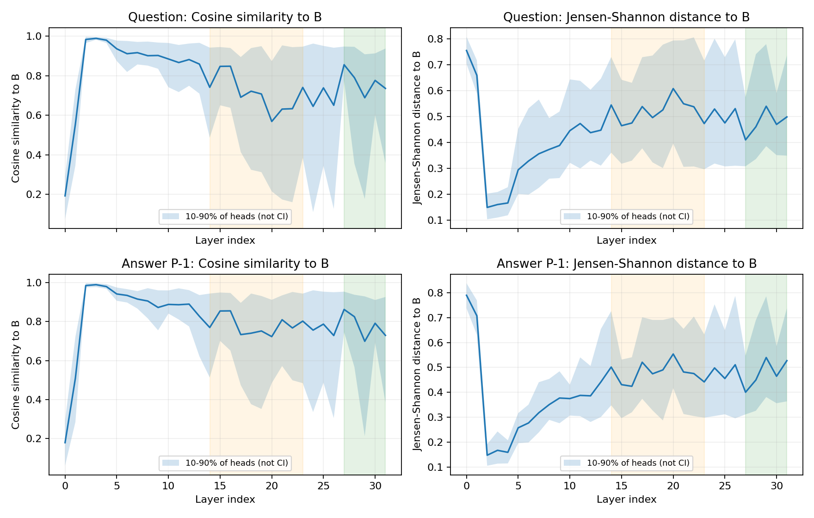
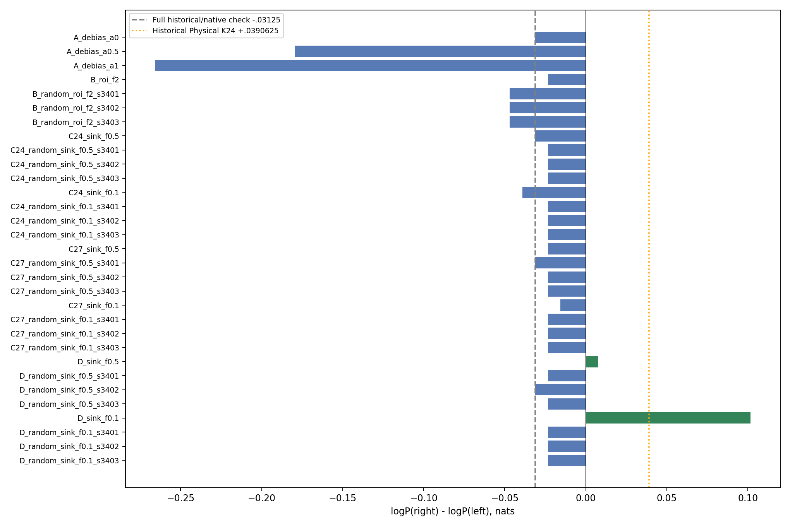
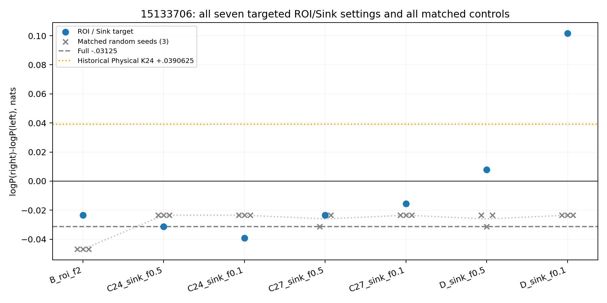

# 15133706 Attention Sink 去偏与 ROI 增强

问题：**Is the young girl to the left or to the right of the boy?**；正确答案 **right**，候选顺序保持left/right。只研究这一事后选出的近零Margin历史案例，不扩样本。

## 当前真实状态

**completed**；完整GPU条件 31/31。Full历史Margin=−0.03125，Physical K24历史Margin=+0.0390625；历史值不冒充本轮新GPU结果。

## 离线分层空间比较

只读Phase3.4原始FP16缓存[32层,32Head,2组,576Patch]。每层每Head先除以自身视觉总质量，B[h,g]=L2～L4条件分布均值；对L14～L23及L27～L31同样按层平均，Q和P−1分别计算。表中的Head指标按相同编号Head比较后平均，map指标为上述分布再平均Head。JS Distance=sqrt(JSD in bits)，范围[0,1]，0相同；Cosine为相似度，1相同。Top58稳定行优先打破并列，不预设重合。

| Query | 比较窗口 | 逐Head均值Cosine | 逐Head均值JS Distance | 平均图Cosine | 平均图Top58重合 |
| --- | --- | ---: | ---: | ---: | ---: |
| question | L14-L23 | 0.8930 | 0.4564 | 0.9156 | 26/58 |
| question | L27-L31 | 0.8832 | 0.4196 | 0.9107 | 27/58 |
| answer | L14-L23 | 0.8906 | 0.4164 | 0.9095 | 25/58 |
| answer | L27-L31 | 0.8817 | 0.4213 | 0.9048 | 30/58 |

ROI共133Patch，冻结Sink共14，非ROI Sink 13，交集[364]单独记录。标记：cyan/magenta为两对象框、lime为非ROI Sink、orange为ROI/Sink交集。实际本地Processor重建并逐像素校验336裁剪，原图500×375→448×336→中心裁剪横移56；逐Patch映射与历史精确相同。这里的早层B仅是该任务提示下的早层分布，不重新将B的所有热点认定为无关Sink。冻结Sink仍来自Phase3.4中性提示规则。





## 预先固定的干预与对照

全部只在P−1=602→视觉位置5..580，逐Head做 `new_visual=m_current*normalize(p_current*factors)`，在FP32 Softmax转成原生FP16后、乘当前V前编辑；非视觉、其他Query和因果Mask不改。不做全行归一化；FP16不可避免的舍入用原有行和.002、Mass atol2e−5+rtol.001与dtype推导界验证，不改变容差追求结果。

- A L14～L23：factor=(B_answer+1e−6)^(-alpha)，alpha=0/.5/1；alpha0直接跳过写入。
- B L14～L23：ROI factor2，等价视觉相对log偏置ln2；三组等133Patch背景增强对照，沿用历史冻结集合。
- C L24～L31、L27～L31：非ROI Sink factor.5/.1，各配三组等13Patch背景抑制。
- D L2～L4：同一13个非ROI Sink、同两强度，同样配三背景集合。不将早层Sink视为可安全删除。
- 31条件在任何新分数之前固定；不追加成功配置。随机种子标签3401/3402/3403及具体索引复用旧Manifest；Sink对照6×6位置bin精确匹配100%，ROI对照约65.4%，残余位置混杂必须保留。

### 空间重合的实际范围

- question L14-L23：平均图Top58与早层重合26/58，其中12个是冻结非ROI Sink、6个在ROI内。逐Head Top58平均只重合22.56/58；低视觉质量(<.001)的Head×Layer有0个，保留在主结果。不能用平均图相似代替每个Head都在同一位置聚焦。
- question L27-L31：平均图Top58与早层重合27/58，其中13个是冻结非ROI Sink、1个在ROI内。逐Head Top58平均只重合25.44/58；低视觉质量(<.001)的Head×Layer有0个，保留在主结果。不能用平均图相似代替每个Head都在同一位置聚焦。
- answer L14-L23：平均图Top58与早层重合25/58，其中12个是冻结非ROI Sink、4个在ROI内。逐Head Top58平均只重合23.50/58；低视觉质量(<.001)的Head×Layer有0个，保留在主结果。不能用平均图相似代替每个Head都在同一位置聚焦。
- answer L27-L31：平均图Top58与早层重合30/58，其中13个是冻结非ROI Sink、3个在ROI内。逐Head Top58平均只重合26.09/58；低视觉质量(<.001)的Head×Layer有0个，保留在主结果。不能用平均图相似代替每个Head都在同一位置聚焦。

这些计数直接检验热点是否重合，不能仅凭相似图案命名Sink，也不能从单图的重合数推导跨样本稳定性或功能。

## GPU结果与验证

本次尝试资料：[gpu_attempts/20261028_230938](gpu_attempts/20261028_230938/)。

| 条件 | right logP | left logP | Margin | Gain vs Full | right胜出 |
| --- | ---: | ---: | ---: | ---: | --- |
| A_debias_a0 | -18.59919714 | -18.56794714 | -0.03125000 | +0.00000000 | False |
| A_debias_a0.5 | -18.66839469 | -18.48870719 | -0.17968750 | -0.14843750 | False |
| A_debias_a1 | -18.76905915 | -18.50343415 | -0.26562500 | -0.23437500 | False |
| B_roi_f2 | -18.60696045 | -18.58352295 | -0.02343750 | +0.00781250 | False |
| B_random_roi_f2_s3401 | -18.60683991 | -18.55996491 | -0.04687500 | -0.01562500 | False |
| B_random_roi_f2_s3402 | -18.59902943 | -18.55215443 | -0.04687500 | -0.01562500 | False |
| B_random_roi_f2_s3403 | -18.59161332 | -18.54473832 | -0.04687500 | -0.01562500 | False |
| C24_sink_f0.5 | -18.70062967 | -18.66937967 | -0.03125000 | +0.00000000 | False |
| C24_random_sink_f0.5_s3401 | -18.59172521 | -18.56828771 | -0.02343750 | +0.00781250 | False |
| C24_random_sink_f0.5_s3402 | -18.59171039 | -18.56827289 | -0.02343750 | +0.00781250 | False |
| C24_random_sink_f0.5_s3403 | -18.59166333 | -18.56822583 | -0.02343750 | +0.00781250 | False |
| C24_sink_f0.1 | -18.87963958 | -18.84057708 | -0.03906250 | -0.00781250 | False |
| C24_random_sink_f0.1_s3401 | -18.59172532 | -18.56828782 | -0.02343750 | +0.00781250 | False |
| C24_random_sink_f0.1_s3402 | -18.60691402 | -18.58347652 | -0.02343750 | +0.00781250 | False |
| C24_random_sink_f0.1_s3403 | -18.60684284 | -18.58340534 | -0.02343750 | +0.00781250 | False |
| C27_sink_f0.5 | -18.66164014 | -18.63820264 | -0.02343750 | +0.00781250 | False |
| C27_random_sink_f0.5_s3401 | -18.61467029 | -18.58342029 | -0.03125000 | +0.00000000 | False |
| C27_random_sink_f0.5_s3402 | -18.60690714 | -18.58346964 | -0.02343750 | +0.00781250 | False |
| C27_random_sink_f0.5_s3403 | -18.59166838 | -18.56823088 | -0.02343750 | +0.00781250 | False |
| C27_sink_f0.1 | -18.78640862 | -18.77078362 | -0.01562500 | +0.01562500 | False |
| C27_random_sink_f0.1_s3401 | -18.59168127 | -18.56824377 | -0.02343750 | +0.00781250 | False |
| C27_random_sink_f0.1_s3402 | -18.60692548 | -18.58348798 | -0.02343750 | +0.00781250 | False |
| C27_random_sink_f0.1_s3403 | -18.60686193 | -18.58342443 | -0.02343750 | +0.00781250 | False |
| D_sink_f0.5 | -18.50656282 | -18.51437532 | +0.00781250 | +0.03906250 | True |
| D_random_sink_f0.5_s3401 | -18.59919454 | -18.57575704 | -0.02343750 | +0.00781250 | False |
| D_random_sink_f0.5_s3402 | -18.62220552 | -18.59095552 | -0.03125000 | +0.00000000 | False |
| D_random_sink_f0.5_s3403 | -18.59920766 | -18.57577016 | -0.02343750 | +0.00781250 | False |
| D_sink_f0.1 | -18.17673724 | -18.27829974 | +0.10156250 | +0.13281250 | True |
| D_random_sink_f0.1_s3401 | -18.59161141 | -18.56817391 | -0.02343750 | +0.00781250 | False |
| D_random_sink_f0.1_s3402 | -18.59920681 | -18.57576931 | -0.02343750 | +0.00781250 | False |
| D_random_sink_f0.1_s3403 | -18.62225599 | -18.59881849 | -0.02343750 | +0.00781250 | False |



31条件全部完成。四窗口no-op全部logits精确Full；alpha0两候选精确；新Full Attention精确缓存；每条件两候选P−1 logits与局部行一致；Question最终hidden全条件精确Full；所有局部非目标连接bitwise不变，收尾原生Full精确、库源码SHA未改、无NaN/Inf/OOM。峰值allocated13640.877MiB/reserved13734.000MiB；诊断Forward合计8.9445秒，含审计，无严格预热重复计时，不作加速主张。

- A实际目标：strength=0, Margin=-0.03125000, Gain=+0.00000000；strength=0.5, Margin=-0.17968750, Gain=-0.14843750；strength=1, Margin=-0.26562500, Gain=-0.23437500。
- B实际目标：strength=2, Margin=-0.02343750, Gain=+0.00781250。
- C24实际目标：strength=0.5, Margin=-0.03125000, Gain=+0.00000000；strength=0.1, Margin=-0.03906250, Gain=-0.00781250。
- C27实际目标：strength=0.5, Margin=-0.02343750, Gain=+0.00781250；strength=0.1, Margin=-0.01562500, Gain=+0.01562500。
- D实际目标：strength=0.5, Margin=+0.00781250, Gain=+0.03906250；strength=0.1, Margin=+0.10156250, Gain=+0.13281250。

每个条件的原始/局部编辑前/后热图、逐Head ROI/Sink质量、原始logits及审计均在尝试目录。局部before来自已受前层干预影响的当前Forward，不等于Native Full；两者明确分栏。各图内部三列共享线性色标，跨条件比较请读原始NPZ和Mass而非假设颜色范围相同。

## 实际结论：本例并非“深层Sink有害”的统一模式

- **早晚热点部分重合得到定量支持**：P−1平均图早→中/深Cosine=.9095/.9048、JS Distance=.3902/.3831；Top58重合25/30，其中分别12/13个是冻结非ROI Sink。逐Head的相似性和Top58重合更弱，不能说全分布相同。Q/A晚期模式有公共热点，同时仍有明显分布变化。

这里Cosine列明确是相似度；另外保存[Cosine Distance=1−Cosine及JS Distance表](offline_similarity_with_distances.csv)，P−1平均图早→中/深Cosine Distance分别.09052/.09523，避免把相似度和距离方向混淆。
- **A去偏变差**：alpha.5/1的Margin为−.1796875/−.265625。即使ROI份额提高且非ROI Sink份额大降，答案Margin仍下降；对整张早层B做逆权重并不等于只移除已定义Sink，也不能据此认定早层视觉信息整体有害。
- **B中层ROI增强很小**：Margin−.0234375，比Full高+.0078125，但仍答错；三背景增强均−.046875。目标比随机好+.0234375，属于单例、一个FP16步长的Full改善，未进行联合Sink+ROI条件，不能声称额外叠加收益。
- **C深层Sink抑制没有复现Physical K24转正**：L24～L31 factors.5/.1为−.03125/−.0390625，反而不优于背景−.0234375；L27～L31为−.0234375/−.015625，至多改善+.015625，仍为left。强抑制只比随机多+.0078125，近零数值敏感性明显。历史Physical K24 +.0390625是不同整体干预，本轮未重跑。
- **D早层同一13个非ROI Sink的P−1路径抑制转正**：factors.5/.1为+.0078125/+.1015625，三背景均未转正。强度.1的right logP从−18.59919714升到−18.17673724，绝对概率也提高；但仍只有约1.28e−8，并非自由生成成功。该结果没有显示这条特定早层路径在此例中是保持二选一正确的必要条件；不能推广为早层Sink没有功能、所有Query均可无损抑制。

D强抑制后，未被抑制的ROI/Sink交集Patch364的视觉内份额从.05311增至.20104，占干预后ROI总份额.28294的约71%。这说明“抑制非ROI Sink”也会重新分配到另一个冻结Sink，不能简单描述为消除了全部Sink或只增强了真实物体；本轮没有单独干预该交集，不能证明它驱动了Margin变化。

只有D的两个目标条件转正，31条件里其他29个均未转正。没有按输出再调参、换Head/窗口/样本。两次历史继承L23转正属于先前实验，不混入本轮对照。Sink注意力相关性、正向重分布的局部干预效应、Physical整体退出必须分别讨论。

## 数值与文件复核

108项CPU回归（含7项新测试）通过；四窗口no-op、alpha0精确Full；396个局部层审计通过。Attention行和最大误差0.000331223，视觉Mass最大绝对误差7.2360e−5，最大相对误差.00192952；Mass按原先的**组合**atol2e−5+rtol.001检查，小Mass不能仅用相对误差判定。40个层审计超过原条件L1 .002告警（两候选重复计算），均满足原dtype推导界及逐元素FP16舍入公式检查，未放宽容差。非视觉/其他Query局部bitwise不变，Q最终hidden不变。没有FP32主干实验，微小Margin翻转不等于稳健能力提升。

纯CPU复核逐条件CSV/JSON、完整原始logits/logP、31个NPZ重加权公式、396个审计、4窗口no-op及冻结源码/源数据hash，见[artifact_validation.json](artifact_validation.json)。`summarize_sink_steering_case.py`可完全离线重建配对表与最终报告/图，不运行模型。初始空间/干预图保留；clean版独立色条避免遮挡，heatmaps目录的原生Full Mass注释用FP64求和统一口径，原始FP16数组和模型结果未改。GPU加载5.412696秒；69次诊断Forward合计8.944490秒，图表/主机端写盘及模型加载不计入，不宣称稳定吞吐或加速。

[完整31条件CSV](per_condition_results.csv) · [配对随机对照](paired_control_comparison.csv) · [所有条件热图索引](heatmap_gallery.md)



## 解释边界与恢复

Cosine/JS与热点重合只描述空间相关；ROI是标注框不是分割，高注意力或早晚重合不证明有害Sink。Sink候选来自冻结中性提示，不能用本轮Margin重新定义。ROI增强使用真实对象框，属于oracle诊断，不是无需标注的方法。重分布保留视觉Mass但改变区域份额，也可能使其他视觉Patch得到补偿；这种干预与Physical删除全部视觉位置不同。正确候选绝对概率和二选一相对Margin须分开；单FP16弱Margin案例不能支持泛化、无损抑制或机制证明。没有FP32主干复验，不排除数值敏感性。

```bash
conda activate vlm_research
cd /home/zsy/ATE/vlm_research
CUDA_VISIBLE_DEVICES='' HF_HUB_OFFLINE=1 TRANSFORMERS_OFFLINE=1 python -m unittest test_attention_sink_steering -v
# protocol已冻结，不重复prepare；GPU空闲时手动恢复同31条件
CUDA_VISIBLE_DEVICES=0 HF_HUB_OFFLINE=1 TRANSFORMERS_OFFLINE=1 python attention_sink_steering_case.py --stage gpu
CUDA_VISIBLE_DEVICES='' HF_HUB_OFFLINE=1 TRANSFORMERS_OFFLINE=1 python attention_sink_steering_case.py --stage summarize
```

失败不覆盖，下一次GPU尝试使用新的时间戳子目录；不混合不同尝试凑完成条件。代码/源数据/图片/库指纹变更时拒绝运行，须调查差异。没有自动轮询、不终止其他任务、不重装环境或下载模型。本轮只此案例，完成后停止。
