# BOS-Guided Cheap Bypass Predictor Discovery

Status: completed exploratory study; NOT independent confirmation.

Chinese nine-question interpretation: [research_summary.md](research_summary.md).
The original auto-generated report and inventory are preserved in `audit/pre_review/`.

Code `899222303032aace505c45250c941ecf3062fad5`. Original3000 training/calibration questions; 554 unused-image exploratory questions instead of required600. LogicalObj shortfall is explicit, no replacement, resampling or synthetic labels.
All original96000 single-layer labels reused. Old questions receive only one new native feature forward. New questions receive Full plus32 original single-layer P-1 Attention-output ablations. No LLaVA training, Decode study, joint gate or custom accelerated kernel.
True BOS mass, Attention/MLP output norms are post-computation oracle/mechanism features, excluded from online predictor inputs. All risks concern Full original top1, not answer accuracy. All policies and thresholds froze before new-image model outputs.

## Frozen Thresholds and Risk

Primary epsilon=.03 below; all .01/.03/.05 results retained in CSV. Maximum calibration coverage under observed1% risk is exploration, not a guarantee. Ordinary2000 image-cluster bootstrap intervals do not certify zero-event risk. Additional bounded-cluster simultaneous Hoeffding upper bounds assume independent image clusters and are conservative; they are not unconditional population safety guarantees. Task shortfall also prevents the requested confirmation claim.

| Predictor | Threshold | New skip coverage | Dangerous/skipped | Risk | Bootstrap95%CI | Simultaneous upper95 |
|---|---:|---:|---:|---:|---|---:|
| Layer-only | 0.02 | 12.50% | 13/2216 | 0.587% | [0.181%,1.128%] | 100.00% |
| Length-only | 0 | 0.00% | 0/0 | undefined | undefined | 100.00% |
| BOS-QK+Layer | 0.02 | 12.61% | 13/2235 | 0.582% | [0.179%,1.119%] | 100.00% |
| BOS-QK+Value | 0.02 | 12.70% | 13/2252 | 0.577% | [0.177%,1.111%] | 100.00% |
| BOS-QK+Residual | 0.02 | 14.26% | 16/2528 | 0.633% | [0.234%,1.132%] | 100.00% |
| Sampled6Keys | 0.02 | 13.66% | 15/2422 | 0.619% | [0.206%,1.127%] | 100.00% |
| Global-noLayer | 0.02 | 6.18% | 7/1096 | 0.639% | [0.182%,1.189%] | 100.00% |
| Early-separate | 0.01 | 6.25% | 5/1108 | 0.451% | [0.090%,0.993%] | 100.00% |
| Region-grouped | 0.01 | 7.61% | 4/1349 | 0.297% | [0.000%,0.678%] | 100.00% |
| BOS-cos | 0.652654 | 5.13% | 7/909 | 0.770% | [0.223%,1.354%] | 100.00% |
| BOS-score | 3.24211 | 0.01% | 1/1 | 100.000% | [100.000%,100.000%] | 100.00% |
| BOS-Mass-Oracle | 0.9 | 1.43% | 0/254 | 0.000% | [0.000%,0.000%] | 100.00% |
| Early-never-skip | 0.02 | 14.26% | 16/2528 | 0.633% | [0.234%,1.132%] | 100.00% |
| Region-threshold | Six regional cosine cuts, see below | 15.53% | 23/2754 | 0.835% | [0.404%,1.348%] | 100.00% |
| Layer-threshold | 32 per-layer cosine cuts in frozen JSON | 11.39% | 18/2019 | 0.892% | [0.444%,1.413%] | 100.00% |

Probability rules skip when calibrated danger probability is at most the threshold;
scalar cosine/score/oracle rules above skip when the scalar is at least the threshold.
The regional cosine cuts for L0-1, L2-5, L6-13, L14-16, L17-24, L25-31 are respectively
`0.5379461705684662, 0.042720645666122437, 0.6699848771095276, 0.6114981174468994, 0.6390846610069275, 0.6453733384609223`.
CSV scalar `threshold=0` for regional/per-layer rules is only a serialization placeholder;
the actual `per_layer_thresholds` array in `frozen_predictors.json` is used by all scoring paths.

Calibration-only recommended names (never chosen from new-set performance):
`{"0.01": "Layer-threshold", "0.03": "Region-threshold", "0.05": "Region-grouped"}`

## Findings and Negative Results

Across old L2-31 layer means, BOS mass versus absolute Delta LogP has Pearson -0.729;
after centering within task/layer, the coefficient is only -0.072. This is primarily
a depth-associated observation, not a reliable per-question safety test.
All old3000 questions have exactly equal BOS K/V at each layer/head. We read actual
current K/V, never substitute an unverified anchor. Value features therefore largely
encode depth here; Value-plus-length and residual-plus-query-norm feature blocks
must not be interpreted as isolated causal effects of Value norm or residual norm.

At epsilon=.03, QK+Value+Residual adds312 conditions beyond Layer-only, with3 dangerous
events (0.962%; image-bootstrap95%CI [0,2.222%]). The paired coverage increase is
1.760 percentage points [1.506,2.031]. Already87.66% of its selected conditions are
selected by Layer-only. Coverage increases do not demonstrate safety or accuracy gains.
The calibration-recommended regional rule makes8/110 dangerous selections at L28
(7.27%), despite an aggregate risk below1%. No layer or failed example was removed.
At epsilon=.01 the calibration-recommended Layer-threshold rule has4/122 dangerous
conditions (3.28%) on the new set. Relaxing epsilon changes the label and is not a fix.

The554 unused images are exploratory holdout, not the requested600-image confirmation:
LogicalObj has only54 available images after exclusions. All other tasks have100 each.
Full baseline and all17728 new single-layer labels are present, with no failed or omitted
checkpoints. These are single-layer P-1 conditions, not joint-gate generation trials.

## Cost and Validity

CPU10 tests and four-GPU Smoke passed; native observer logits are bit-exact. Historical
Full max difference is0 across3000 questions; matched19200 decomposition residual
norms have max difference0. Independent selected-row RMSNorm/projection/RoPE checks
use the original frozen tolerances, not relaxed post-run thresholds. All raw arrays
were checked finite and hashed again at release; hooks/inputs/weights passed checks.

`native_dtype_cost_audit.csv` uses actual FP16 QK/AV and native FP32-to-FP16 Softmax.
GPU0 measures about84.6us for BOS-QK features,45.5us for cloned BOS K/V reads,
and418.1us for one native query's full Attention operations. The actual frozen51-parameter
predictor alone takes265.5-269.4us on GPU, or33.6-34.4us on CPU, excluding feature
assembly/transfers. These separately measured PyTorch dispatch costs are not additive
kernel savings or end-to-end results. Original Smoke's `full_query_attention` uses
FP32 reference arithmetic; do not label it native FP16 timing. No actual speedup is shown.

## Boundaries

Single-layer labels cannot be added to infer joint-gate harm. Joint dynamic paths and full-answer accuracy were intentionally not executed. No safe skipping, actual computation omission, end-to-end latency improvement or cross-model generality is claimed. A P-1 row is a small fraction of full Prefill. Microbenchmarks report PyTorch operations and dispatch, not a custom kernel speedup.

## Artifacts

cheap_features_per_question.csv retains train/calibration/new-exploratory labels, all32 layers and online fields. Its byte-identical lossless gzip is in Git (`question_artifact_manifest.json`). Full per-head CSV remains locally with SHA256; identical lossless gzip task partitions are in Git. Per-question raw q/k/v, sampled Keys, residuals and full/ablated logits remain in external resources with SHA256. CPU-only review adds false-skip examples, paired incremental coverage, image-bootstrap calibration intervals and readable figures without refitting or changing thresholds.

## Reviewed Main Figures

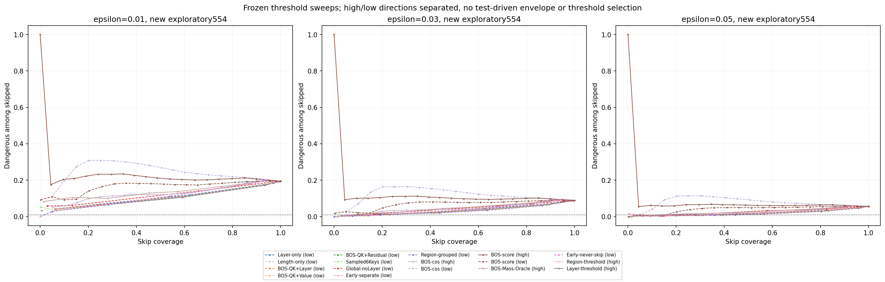

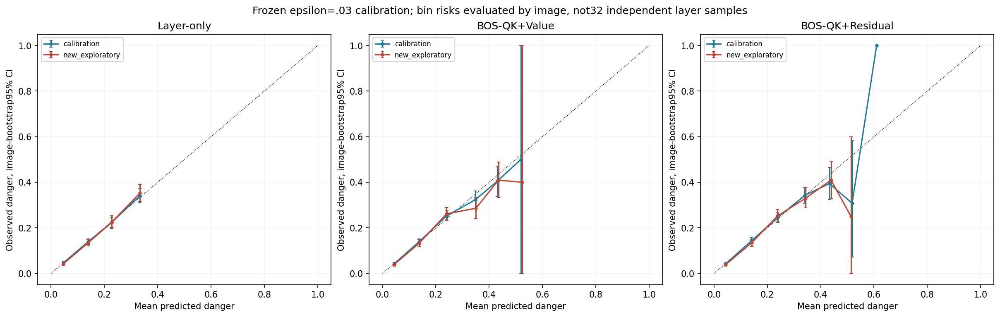

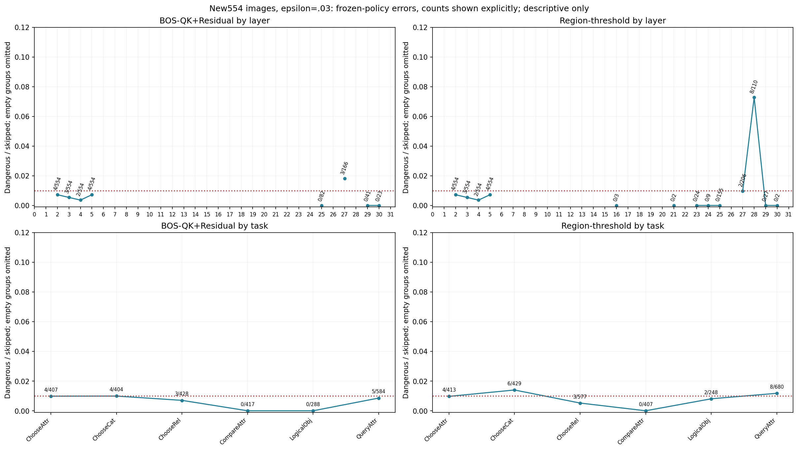

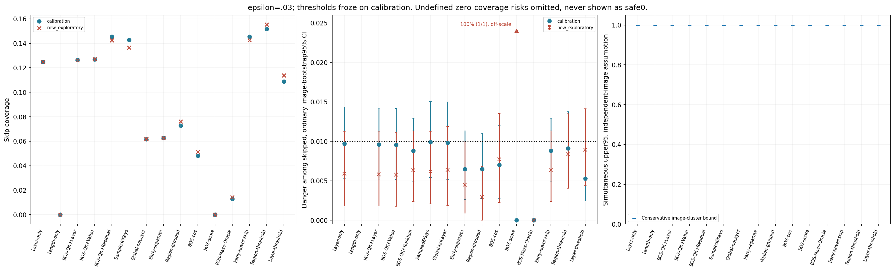

The original unzoomed figures remain below. The reviewed threshold plot explicitly
labels the score-only100% outlier (1/1); it does not silently clip or remove the failure.

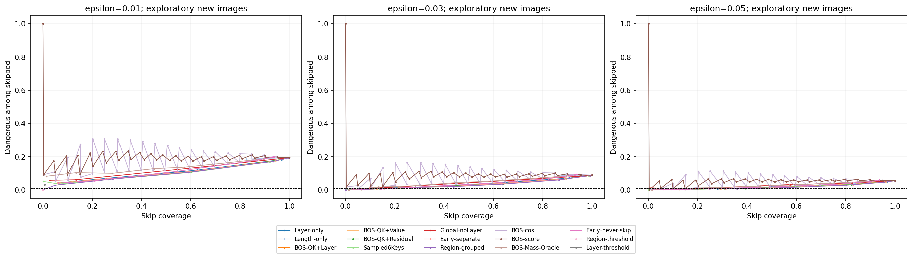

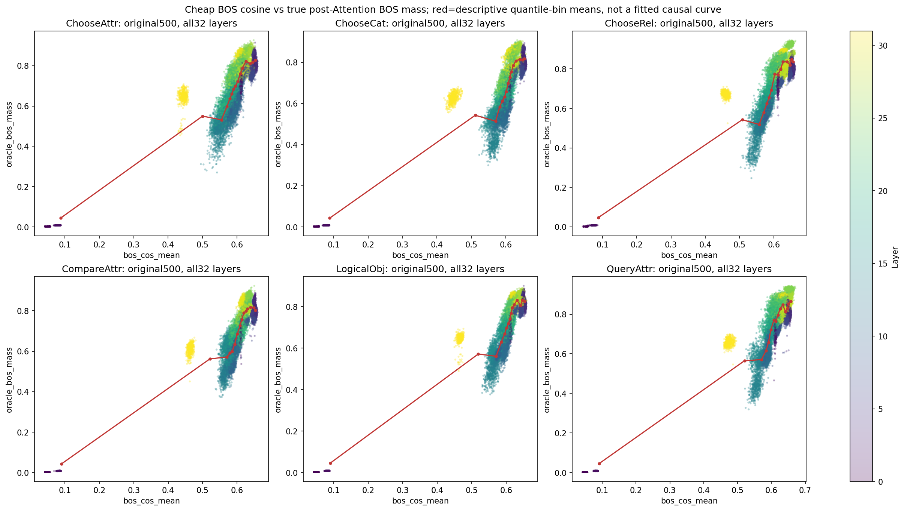

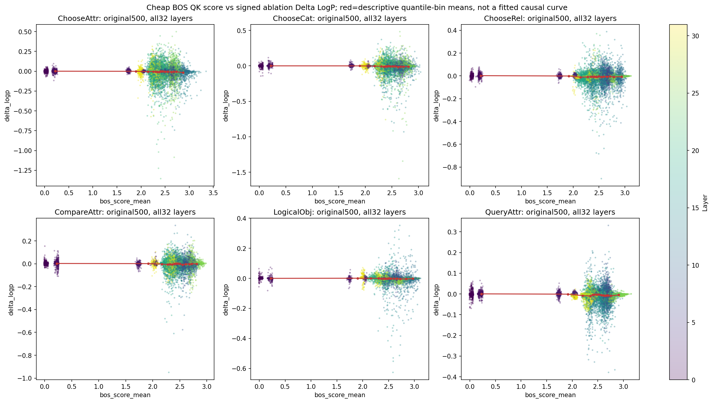

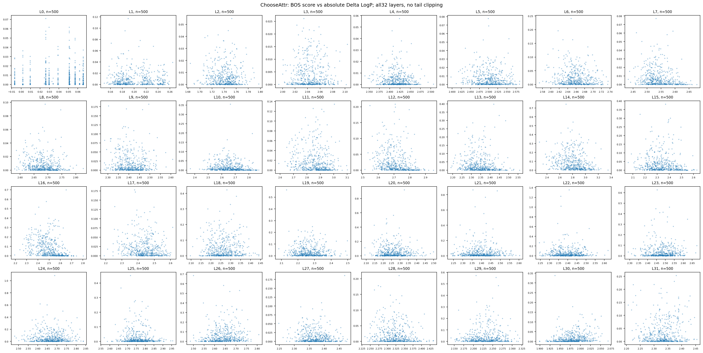

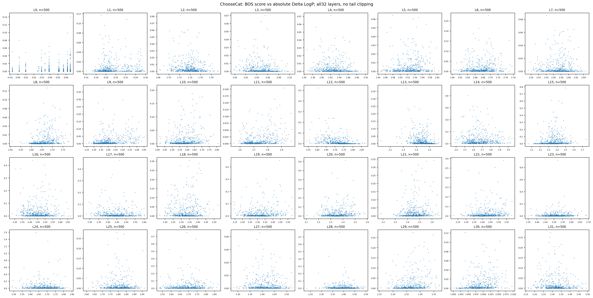

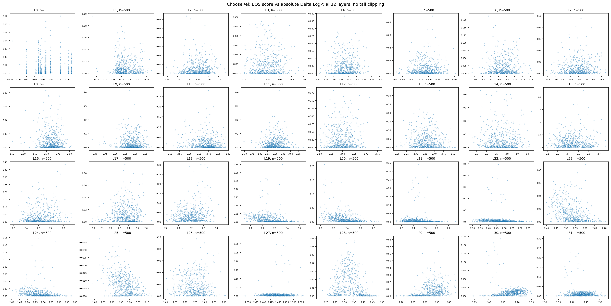

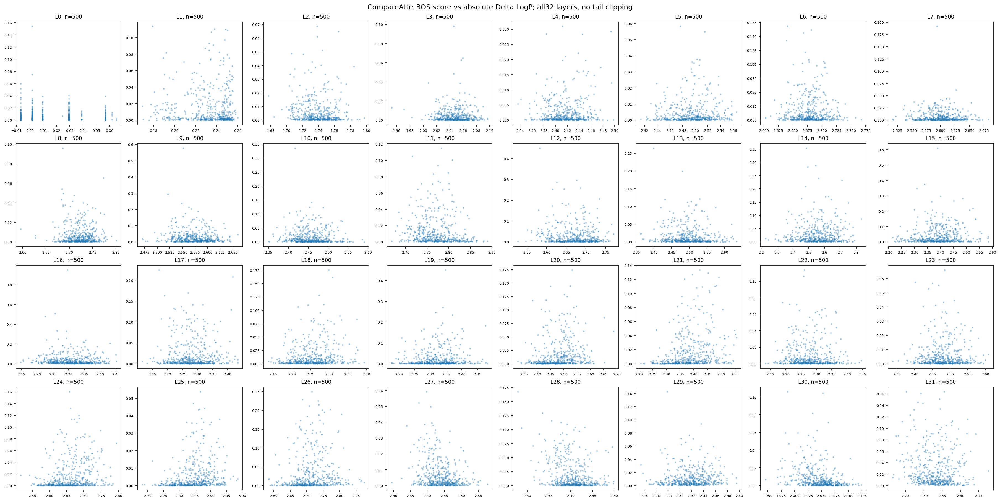

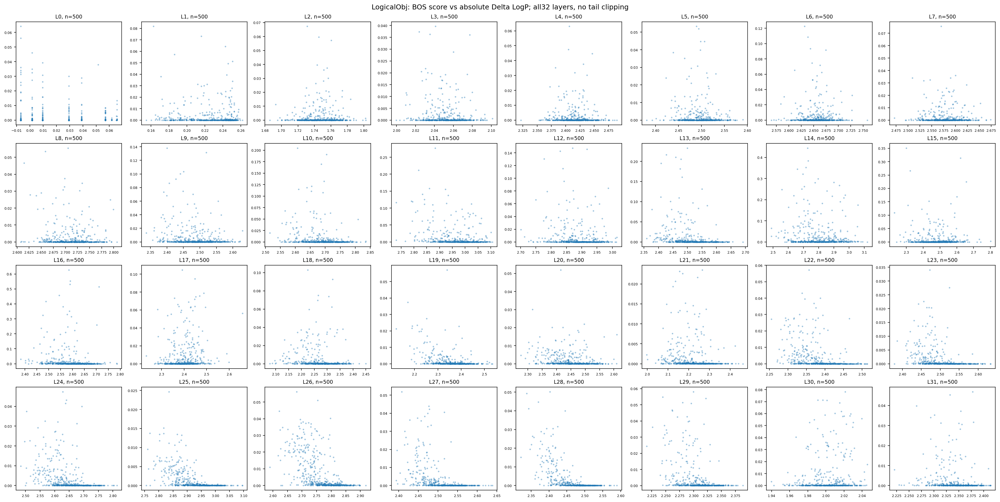

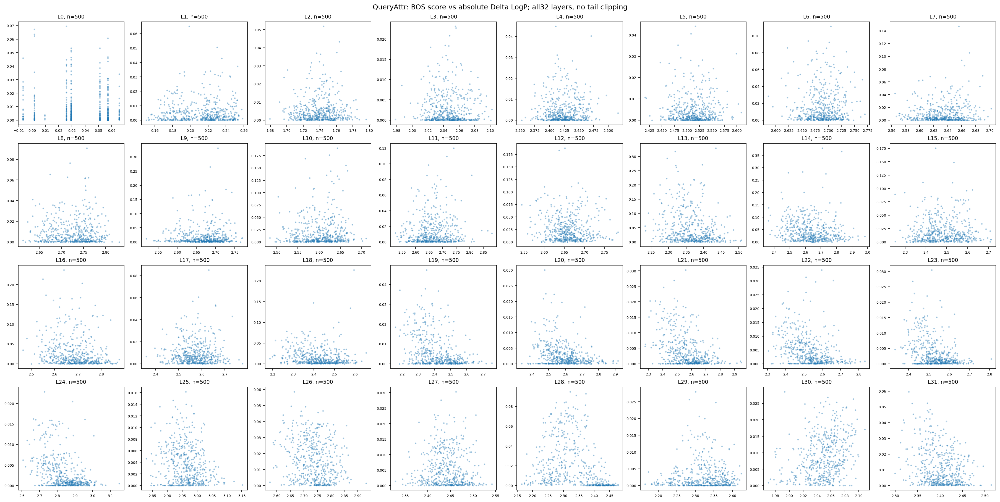

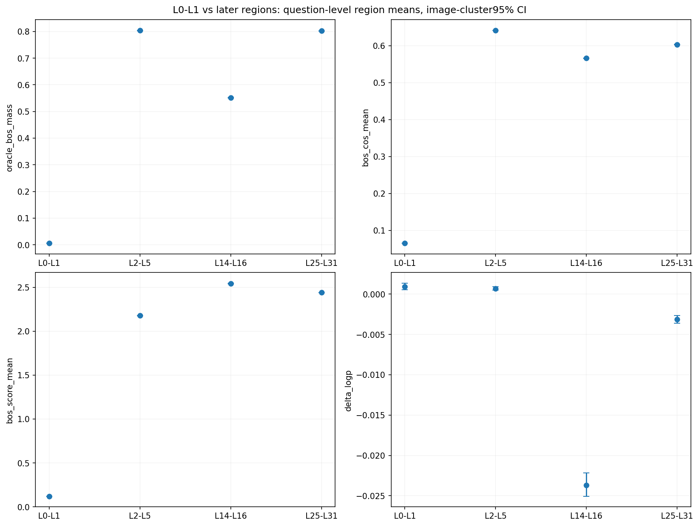

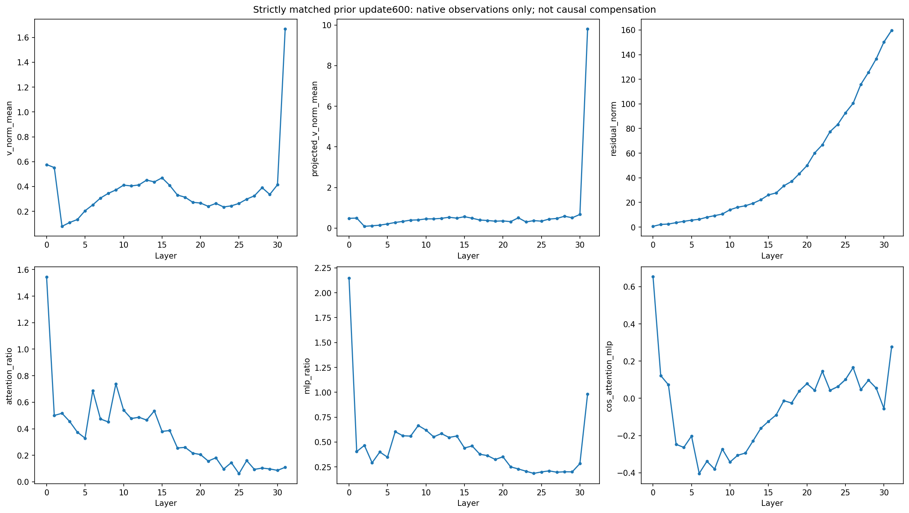

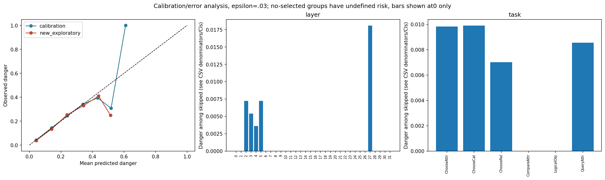

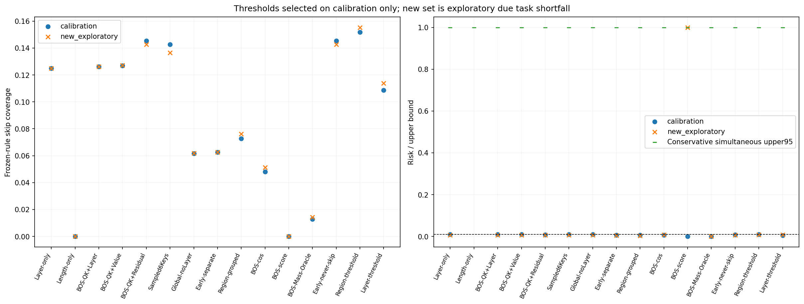
