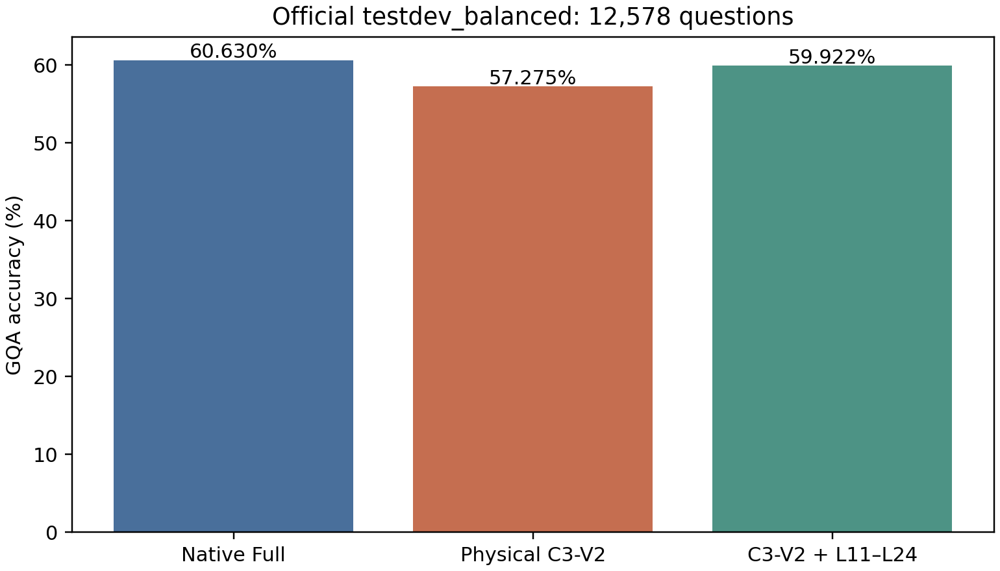

# GQA官方testdev_balanced：三条件完整质量对照

状态：COMPLETE。官方12,578题、398张Stanford原图，37,734条完整生成。不同于此前132,062题val_balanced；没有复用其分数或预测。

| Condition | Correct / 12578 | ACC (%) | ΔNative (pp) | 95%CI |
|---|---|---|---|---|
| Native Full | 7626 / 12578 | 60.6297 | — | — |
| Physical C3-V2 | 7204 / 12578 | 57.2746 | -3.3551 | [-4.0707, -2.6646] |
| C3-V2 + L11–L24 | 7537 / 12578 | 59.9221 | -0.7076 | [-1.1618, -0.2671] |

Reaccess − C3-V2 = +2.6475 pp [+2.0498, +3.2634]。回看原对变错327题、原错变对660题。

Published Reference：LLaVA公开GQA 62.0%，仅外部参考，不代替本地Native，不参与配对CI。本轮保持历史HF聊天模板、短答案指令、固定revision b234b804b114d9e37bb655e11cbbb5f5e971b7a9、FP16/Eager、Transformers4.49.0、Greedy、max_new_tokens32、logits_to_keep1、H1末行LM Head。未为公开分数修改Prompt。

C3原版保持L0–L19 R写入、L20视觉Hidden退出、P−1/Decode禁图和L2–L5物理Attention跳算。回看仅在L11–L24为P−1/Decode保留Image KV，L25前退出视觉Hidden，L20以上R不新增写入。Native完整执行。严格复用参考Commit的物理算法，没有训练、层搜索、Kernel优化或测速。

每条件语言KV独立；当前图像视觉特征复用经GPU严格验证。短中长Smoke含Native/HF/No-op有效Logits、Mask、真实跳算、物理退出、RoPE、KV和Hook审计。详见CPU/GPU日志及源码/输入冻结文件。

问题、官方Gold来自Stanford questions1.2.zip的testdev_balanced_questions.json。图片通过lmms-lab-encoder/GQA镜像取得，398张JPEG的字节长度和CRC全部与官方images.zip成员相符；其中80张还与从Stanford直接下载的文件逐字节一致。其余图片记录了本地SHA，但未独立从Stanford重下载做第二次SHA对照。镜像Parquet SHA为ba0a57a72c483d6e4a390ecbbee05d07a55365aeac3e93f4a923ac61c9e465eb。全部图片可读，无重编码或跳题；来源、等价性审计与完整Manifest见source_dataset_audit.json、data_audit.json、protocol.json及sample_manifest.jsonl.gz。

主评分为text.rstrip('.').lower()后与官方短答案严格匹配。官方GQA工具（LLaVA官方文档指定的兼容修订）独立执行，结果及差异见official_score_crosscheck.csv，完整stdout保留；不静默更改主指标。全部EOS、截断、空答案、重复、负面案例均保留。

全部三组比较按图片SHA整簇配对20000次Bootstrap，seed20261106，探索性95%CI，不是非劣效证明。Query、Verify、Choose、Compare、Logical及Semantic分组见task_accuracy.csv。原val_balanced结果保持不变；资源释放见resource_release.json。

<!-- final-audit -->
直接回答：原版Physical C3-V2相对同协议Native的差值为-3.3551 pp；L11–L24回看相对原版C3-V2为+2.6475 pp，回看相对Native为-0.7076 pp。以上全部来自同一testdev_balanced队列，不使用公开62.0%作为配对基线。

| Comparison | ΔACC (pp) | 基线正确→干预错误 | 基线错误→干预正确 | 首Token变化 |
|---|---:|---:|---:|---:|
| C3-V2 minus Native | -3.3550643981555197 | 841 | 419 | 2303 |
| C3-V2+L11-L24 minus Native | -0.7075846716489096 | 356 | 267 | 1003 |
| C3-V2+L11-L24 minus C3-V2 | 2.64747972650661 | 327 | 660 | 1854 |

| 官方类别 | 题数 | Native ACC (%) | C3 ACC (%) | 回看 ACC (%) | C3−Native (pp) | 回看−Native (pp) |
|---|---:|---:|---:|---:|---:|---:|
| structural/choose | 1129 | 81.4880 | 80.1594 | 80.7795 | -1.3286 | -0.7086 |
| structural/compare | 589 | 62.4788 | 61.2903 | 62.4788 | -1.1885 | +0.0000 |
| structural/logical | 1803 | 75.1525 | 75.3189 | 75.2634 | +0.1664 | +0.1109 |
| structural/query | 6805 | 46.4071 | 40.6760 | 45.4519 | -5.7311 | -0.9552 |
| structural/verify | 2252 | 81.0391 | 80.4618 | 80.2398 | -0.5773 | -0.7993 |
| semantic/attr | 5186 | 66.4288 | 65.0212 | 66.1396 | -1.4076 | -0.2892 |
| semantic/cat | 1149 | 50.8268 | 44.8216 | 51.4360 | -6.0052 | +0.6092 |
| semantic/global | 157 | 60.5096 | 54.1401 | 59.2357 | -6.3694 | -1.2739 |
| semantic/obj | 778 | 87.6607 | 87.1465 | 87.6607 | -0.5141 | +0.0000 |
| semantic/rel | 5308 | 53.1274 | 48.1161 | 51.6390 | -5.0113 | -1.4883 |

分组结果仅作描述：回看相对C3净增加333道正确题，其中Query组净增加325题（+4.7759 pp）。并非所有结构类别都受益，verify: -0.2220 pp, logical: -0.0555 pp。没有据此调整层集合或选择问题。

| Condition | EOS结束 | 截断 | 空答案 | 重复标记 |
|---|---:|---:|---:|---:|
| C3-V2 | 12578 | 0 | 3 | 1 |
| C3-V2+L11-L24 | 12578 | 0 | 2 | 0 |
| Native | 12578 | 0 | 0 | 0 |

官方工具输出精度为两位小数；三条件与主评分在该舍入精度下一致。原始官方工具stdout、逐题预测和两套分数均保留。

正确性边界：Native/HF/No-op有效Logits严格逐位一致；原版C3与冻结的历史物理参考逐位一致。回看Physical与Dense功能参考使用历史已冻结的FP16验收门槛，Smoke最大Logits绝对差为0.0625，未声称二者逐位等价，也未修改门槛。两张卡分别通过全部三个短/中/长输入Smoke。全部37,734条记录重新核验哈希、独立Cache标记和有限Logits标记；同题三条件的实际输入绑定完全一致。

后处理记录：原报告脚本在构造异常表时重复传入condition字段，首次运行报错；失败日志finish.log与修复差异postprocessing_changes.json均保留。独立副本finish_report.py仅修正该字段重复及脚本导入路径，冻结推理源码、输入和全部答案未修改，也没有重新运行GPU。CPU复算顺序为：先运行vlm_research.gqa_testdev_c3.analyze，再运行本目录finish_report.py，最后运行本目录finalize_report.py。仓库保存了两份results.sqlite.gz，解压可恢复原始SQLite；official_testdev_balanced_questions.json.gz可恢复官方原问题文件，official_gqa_evaluator.py是实际使用评测器的逐字节副本。

源数据：[Stanford GQA](https://cs.stanford.edu/people/dorarad/gqa/download.html)；[LLaVA官方GQA评测入口](https://github.com/haotian-liu/LLaVA/blob/main/scripts/v1_5/eval/gqa.sh)。图片传输和字节等价性限制见source_dataset_audit.json。本轮没有进行测速或扩展条件。源码、Manifest和Checkpoint索引见execution_freeze.json、sample_manifest.jsonl.gz及result_hashes.json。
