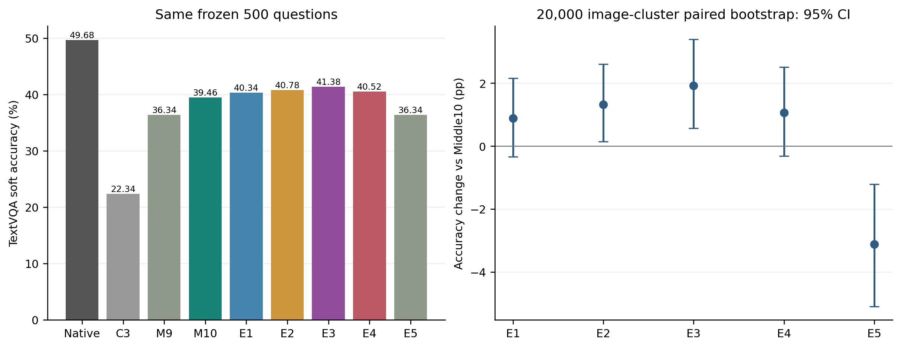

# Middle10剩余TextVQA损失与固定恢复实验

**质量：全部完成。性能：用户要求提前停止，PARTIAL，不作加速结论。**

2026年11月6日，用户指示“如何得分不高，就不要测速了，直接提交”。收到指示后仅向本任务两个Worker发送SIGINT，退出码-2为主动中断，不是数值验证失败。未启动额外GPU诊断。

## 结论

最佳已测E3为41.38%，比Middle10提高1.92pp，图片簇配对95%CI [0.57, 3.39]；仍比Native低8.30pp。只恢复原10.22pp质量缺口的约18.8%，不能称为解决主要瓶颈，不建议直接将其作为接近Native的方案。

E1=L20 R视觉写入；E2=额外开放P−1在L0、L1、L6–L10读图；E3=E1+E2；E4=E3并恢复仅Prefill P−1的L2–L5文本Attention；E5=Middle9仅将视觉Hidden退出推迟至L21前。全部规则、KV和原位置语义在protocol.json中固定。

## 完整质量

|条件|Accuracy|ΔMiddle10 pp|ΔNative pp|
|---|---:|---:|---:|
|Native|49.68%|+10.22|+0.00|
|C3-V2|22.34%|-17.12|-27.34|
|C3+Middle9|36.34%|-3.12|-13.34|
|C3+Middle10|39.46%|+0.00|-10.22|
|E1|40.34%|+0.88|-9.34|
|E2|40.78%|+1.32|-8.90|
|E3|41.38%|+1.92|-8.30|
|E4|40.52%|+1.06|-9.16|
|E5|36.34%|-3.12|-13.34|

500题、309个图片SHA簇。官方十答案共识软分；2,000条历史基线经绑定和双卡Smoke重现审计复用，新增E1–E5共2,500条完整答案。未筛题、未改Prompt和评分。

## 配对变化

|比较|ΔAccuracy pp|图片簇95%CI|逐题软分升/降|
|---|---:|---|---:|
|E1 - C3+Middle10|+0.88|[-0.33, +2.15]|9/4|
|E2 - C3+Middle10|+1.32|[+0.14, +2.60]|10/3|
|E3 - C3+Middle10|+1.92|[+0.57, +3.39]|14/4|
|E3 - E1|+1.04|[+0.24, +2.02]|7/2|
|E3 - E2|+0.60|[-0.26, +1.55]|5/2|
|E4 - E3|-0.86|[-2.00, +0.18]|4/7|
|E5 - C3+Middle9|+0.00|[+0.00, +0.00]|0/0|
|C3+Middle10 - E5|+3.12|[+1.22, +5.09]|27/7|
|E1 - Native|-9.34|[-12.44, -6.38]|15/69|
|E2 - Native|-8.90|[-12.11, -5.78]|19/69|
|E3 - Native|-8.30|[-11.46, -5.25]|18/65|
|E4 - Native|-9.16|[-12.34, -6.08]|16/67|
|E5 - Native|-13.34|[-16.69, -10.16]|10/92|

2×2交互E3−E2−E1+Middle10为-0.28pp，95%CI [-1.47, +0.89]。没有明确正协同证据，CI跨0不等于没有功能效应。

E4比E3低0.86pp，CI跨0，未观察到额外稳定恢复。E5与Middle9的500题软分全部相同，但有1题Token序列改变；单纯推迟退出没有观察到得分收益。Middle10比E5高3.12pp，因此相同L21退出下，L20答案视觉回看比只延长Hidden保留更有用；不外推为唯一信息路径。

Middle10低于Native的74题中，E3改善11题，全部恢复到至少Native软分；但对Middle10原满分题新增2题损害。总体相对Middle10升14题、降4题，负面结果完整保留。

## 案例与未解释的损失

事后查看原图的例子：35026中E3将Alcohol恢复为可见品牌Sheppy's；35487将1恢复为1 pound。反例36550从50%变为50而失分，不能当成数值识别错误；35882从2xu变为Zoot，产生新品牌错误。这里只是固定样本中的输出观察，不是OCR机制证明。

此前重点展示的34822时钟、39376球衣、39441瓶身数字、39065作者，E1–E4均未恢复到Native满分，见four_previous_visual_cases.csv。未逐题人工归因其余全部损失。

## 验证与停止范围

19项CPU测试通过；每卡3道真实Smoke通过。Native/No-op全部返回有效Logits严格torch.equal，历史四基线Token与首Logits哈希一致；新物理路径与Dense参考在冻结FP16门槛下通过且生成Token一致。禁止概率为0、非目标Prompt、32层MLP、RoPE、独立KV与Hook清理通过。未放宽容差。

真实投影Shape见tensor_shape_audit.csv；数值记录见numerical_audit.csv。E1–E4只持久保留L11–L20的Image KV，E2/E3/E4的Early7 P−1回看使用临时KV而不额外持久缓存。E5只保留L11–L19。完整位置与容量见physical_kv_audit.csv。

已保存性能请求：正式3096条、预热1877条，均为中断前实际完成记录。固定48图矩阵未完整结束，不聚合或排名其速度，不报告完整性能或质量与速度同时改善。partial_timing_index.csv列出已有记录，原始值保留在断点包。

额外E4逐层Hidden传播诊断未运行，标记NOT_RUN_USER_STOP；不得把Smoke中有限的Hidden数值对齐审计冒称完整传播结果。其余未完成项目均不视为已有结果。

## 统计边界和复现

20,000次按图片SHA整簇配对Bootstrap，问题等权、固定种子20261105，普通探索性95%CI。500题为历史探索队列，未使用未校正扫描结果宣称独立确认、非劣效或无损。

全部逐题答案见per_question.csv；负面与恢复见recovery_and_harm_cases.csv。源码/模型/输入绑定见execution_freeze.json和source_manifest.json。归档中的原始断点可按相对路径还原；result_hashes.json逐文件校验。

仅CPU复算：`python -m vlm_research.middle10_recovery.analyze --quality-only-stop`。原GPU运行命令仅供审阅，当前已停止，不应自动续跑。gpu_release_audit.json记录进程退出和显存释放。

本轮按用户要求提交并停止，不追加搜索。
