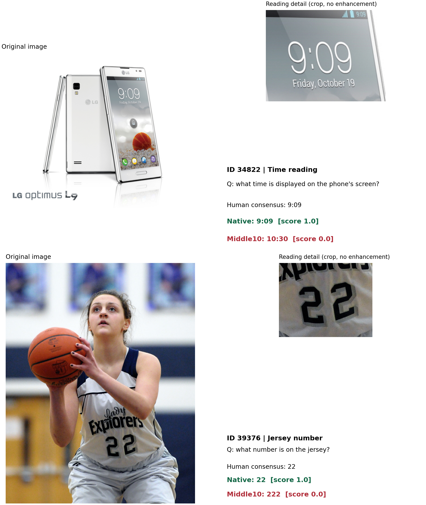
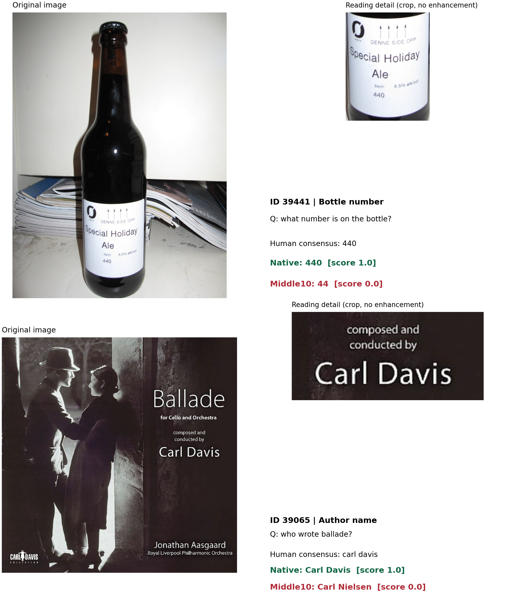

# Native correct / Middle10 incorrect: TextVQA examples

These four cases are selected **post hoc** from the completed 500-question experiment.
The strict filter is Native official ten-answer soft score = 1.0 and Middle10 score = 0.0.
There are 48 eligible questions on 45 distinct images. Cases are chosen for readable
source text and distinct images, not to estimate the overall distribution of errors.
Original images are shown alongside explicitly labeled detail crops. No enhancement,
generated visual evidence, new inference, or changes to the frozen experiment are used.
These are output comparisons, not attention maps or evidence of a specific causal mechanism.

| ID | Question | Human majority | Native | Middle10 |
|---|---|---|---|---|
|34822|what time is displayed on the phone's screen?|9:09|9:09 (1.0)|10:30 (0.0)|
|39376|what number is on the jersey?|22|22 (1.0)|222 (0.0)|
|39441|what number is on the bottle?|440|440 (1.0)|44 (0.0)|
|39065|who wrote ballade?|carl davis|Carl Davis (1.0)|Carl Nielsen (0.0)|





`cases.csv` preserves all ten human answers. `selection.json` includes
the full eligible pool, image/input hashes, crop coordinates and source hashes.

Reproduce from this worktree with:

```bash
/data/lk/深度学习/.envs/ate-vlm-research/bin/python vlm_research/visualize_middle10_failures.py
```
