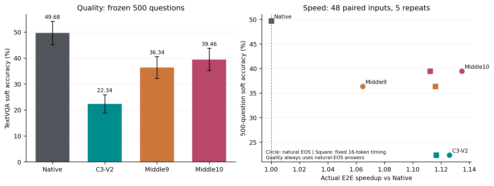

# C3-V2 + Middle9/Middle10视觉回看

C3+Middle9相对C3恢复+14.00pp，与Native差-13.34pp；自然EOS E2E相对C3开销+5.75%，相对Native为1.065x；固定16 Token为1.116x。
C3+Middle10相对C3恢复+17.12pp，与Native差-10.22pp；自然EOS E2E相对C3开销-0.77%，相对Native为1.135x；固定16 Token为1.112x。



## 完整500题质量

|条件|Accuracy|ΔNative pp|ΔC3 pp|
|---|---:|---:|---:|
|Native|49.68%|+0.00|+27.34|
|C3-V2|22.34%|-27.34|+0.00|
|C3+Middle9|36.34%|-13.34|+14.00|
|C3+Middle10|39.46%|-10.22|+17.12|

|配对比较|差值 pp|图片簇95%CI|软分上升/下降|
|---|---:|---|---:|
|C3+Middle9 - C3-V2|+14.00|[+10.85, +17.29]|82/7|
|C3+Middle10 - C3-V2|+17.12|[+13.69, +20.77]|101/7|
|C3+Middle9 - Native|-13.34|[-16.69, -10.16]|10/92|
|C3+Middle10 - Native|-10.22|[-13.41, -7.14]|15/74|
|C3+Middle10 - C3+Middle9|+3.12|[+1.22, +5.09]|27/7|
|C3-V2 - Native|-27.34|[-31.47, -23.35]|7/160|

共500题、309个图片SHA簇，官方十答案共识软评分；分数上升/下降不等同二值正确/错误。四条件均重新生成；500题C3与冻结历史的完整Token和首Token Logits哈希全部一致。
95%CI来自20,000次按图片SHA整簇配对Bootstrap，问题等权；本轮是重复使用历史样本的探索分析，CI跨0不能解释成等效或无损。

## 真实物理性能

|条件/模式|Prefill ms|TTFT ms|E2E ms|Decode ms/token|KV Live/Capacity MiB|Peak Allocated MiB|加速比|相对C3开销|
|---|---:|---:|---:|---:|---:|---:|---:|---:|
|Native / natural_eos|203.75|203.99|402.14|72.55|305.38/305.38|13925.6|1.000x|+12.59%|
|C3-V2 / natural_eos|153.53|155.58|357.18|66.66|15.33/27.57|13646.9|1.126x|+0.00%|
|C3+Middle9 / natural_eos|153.86|156.77|377.73|66.63|96.46/108.57|13730.0|1.065x|+5.75%|
|C3+Middle10 / natural_eos|158.18|161.06|354.43|66.70|105.28/117.57|13740.0|1.135x|-0.77%|
|Native / fixed16|203.60|203.85|1292.63|72.54|311.51/311.51|13925.6|1.000x|+11.65%|
|C3-V2 / fixed16|153.45|155.43|1157.75|66.77|20.57/20.57|13642.9|1.117x|+0.00%|
|C3+Middle9 / fixed16|153.76|156.69|1158.35|66.73|101.57/101.57|13726.0|1.116x|+0.05%|
|C3+Middle10 / fixed16|157.93|160.85|1162.22|66.71|110.57/110.57|13735.7|1.112x|+0.39%|

测速48张不同图片在读取输出前按输入长度四分位与哈希冻结，两卡各24张；同题全部条件在同一卡。每模式每条件3次预热、5次交错重复，冷KV且每请求重算Vision。表格为等输入平均，Decode为总Decode时间/总Decode步数；速度比为Native均值/候选均值。
Prefill是CUDA事件记录的Vision+Language首次前向；TTFT是请求开始至首Token就绪的墙钟时间。E2E包括控制器/Mask/KV准备及自然EOS，排除评分、Token转字符串和输出审计。固定16 Token使用自身预测前缀，忽略EOS仅用于长度控制，不计入质量分。
Peak Allocated是重置统计后的实际峰值（含模型）；Reserved受PyTorch分配器跨请求复用影响，不能当作单独KV容量。重复标记是三Token子串重复的启发式，不自动认定为无效答案。
全部计时均来自实际请求；Dense参考不参与速度排名。Peak Reserved、同完整序列子集和各层Image/Text KV容量见latency_summary.csv及physical_kv_layer_audit.csv。

自然EOS平均生成Token数（含EOS）：Native 3.73，C3-V2 4.02，C3+Middle9 4.31，C3+Middle10 3.90。Middle10自然EOS略快于C3，但输出也更短，不能据此称其执行路径更省计算。C3+Middle9固定16 Token相对C3 E2E开销+0.05%，相对Native加速1.116x；同完整自然序列子集为1.210x（27题）。C3+Middle10固定16 Token相对C3 E2E开销+0.39%，相对Native加速1.112x；同完整自然序列子集为1.190x（29题）。各条件的同序列子集不同，不可直接把子集加速比横向比较。

## 物理路径与正确性

Native保持32层原生Image KV；C3无持久Image KV。Middle9仅在L11–L19持久保留原Image KV，进入L20前删除视觉Hidden；Middle10仅保留L11–L20的Image KV，进入L21前删除视觉Hidden。其余层缓存仅含文本。L2–L5物理省掉P−1/Decode Attention，MLP/Norm/Residual完整保留，不分配未来无用KV。
R→Image始终只在L0–L19开放；Middle10的L20仅允许P−1/Decode读图，R仍被Softmax前-inf屏蔽。所有逻辑位置与RoPE保持原始编号，KV原地追加，无历史KV复制或拼接，无跨条件复用。
12项CPU测试、每卡3题GPU Smoke通过：Native/No-op与原C3同形状H1 Logits严格torch.equal；与Dense功能参考按历史固定FP16门槛比较，并要求完整Greedy Token一致。P−1和真实Decode的选定层实际Image Attention均为正，其他层为0；Middle10 L20 R→Image概率严格为0；完整MLP、物理行数、独立Cache及Hook清理通过。
阈值未放宽：logit_atol=0.10、rtol=0.003、Hidden relative RMSE≤0.01、cosine distance≤1e-4。详细逐项结果见worker*/smoke.json。

开发期CPU测试曾发现审计函数试图读取已被物理省略的P−1 Attention行，已修正为显式识别该行不存在；正式冻结前12项回归全部通过，没有改变计算语义或数值阈值。

首次CPU汇总时，资源检查错误地要求进程退出前分配器统计必须为0，因两卡各剩32MiB而中止。保留原始失败日志；资源释放改用实际进程退出、任务PID不在nvidia-smi及退出后显存状态判定，GPU结果与数值门槛未修改、未重跑。

## 异常与复现

所有EOS、截断、空答案、重复和负面样本完整保留，见accuracy_summary.csv、per_question.csv及negative_and_rescue_cases.csv。资源状态：RELEASED；任务进程已退出，详细显存和PID记录见gpu_release_audit.json。
源码冻结及模型/数据/依赖绑定见execution_freeze.json、protocol.json与worker*/environment.json；逐记录SHA见result_hashes.json。

GitHub使用raw_checkpoints.tar.gz原样归档全部5,072份质量/计时断点（2,000质量＋1,920正式计时＋1,152预热），避免数百万行重复JSON影响审阅。CSV保持直接可读；归档逐文件SHA与result_hashes.json一致，打包审计见packaging.json。本地断点保留不变。

```bash
/data/lk/深度学习/.envs/ate-vlm-research/bin/python -m vlm_research.c3v2_middle_reaccess.tests
tar -xzf vlm_research/results/c3v2_middle_visual_reaccess/raw_checkpoints.tar.gz -C vlm_research/results/c3v2_middle_visual_reaccess
/data/lk/深度学习/.envs/ate-vlm-research/bin/python -m vlm_research.c3v2_middle_reaccess.run --driver
/data/lk/深度学习/.envs/ate-vlm-research/bin/python -m vlm_research.c3v2_middle_reaccess.analyze
```

已有冻结与Checkpoint不得覆盖；同一源码可安全断点续跑。完成本轮即停止，不进行其他条件搜索。
