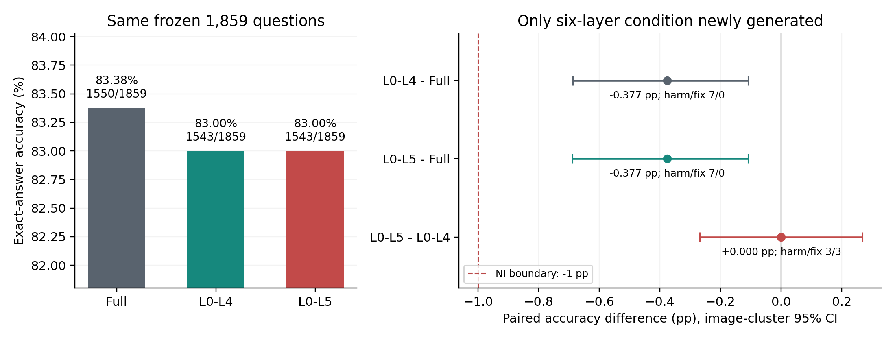

# Decode-only：前五层与前六层最小增量比较

基线：`7c2475717ffaacc1f351978bf59eeaf0197c3109`。严格复用原冻结的1,859题、1,453张图片及Full/五层结果；仅新增L0–L5 Decode-only。模型、FP16/eager、Prompt、评分、Greedy及32 Token上限不变。Prefill和首答案Token原生，后续Decode同时置零六层`o_proj`输出，MLP及各条件独立KV Cache正常执行。

| 条件 | 正确/总数 | Accuracy | 相对Full | Full正确→错误 | Full错误→正确 |
| --- | --- | --- | --- | --- | --- |
| Full（历史） | 1550/1859 | 83.378% | — | — | — |
| L0–L4 Decode-only（历史） | 1543/1859 | 83.002% | −0.377 pp | 7 | 0 |
| L0–L5 Decode-only（新增） | 1543/1859 | 83.002% | −0.377 pp | 7 | 0 |

| 配对差异（前项减后项） | 差异/pp | 图片聚类95%CI/pp | 正确→错误 / 错误→正确 | 三比较校正95%CI/pp |
| --- | --- | --- | --- | --- |
| 五层 − Full | −0.377 | [−0.687, −0.109] | 7 / 0 | [−0.755, −0.105] |
| 六层 − Full | −0.377 | [−0.689, −0.109] | 7 / 0 | [−0.755, −0.106] |
| 六层 − 五层 | 0.000 | [−0.268, +0.268] | 3 / 3 | [−0.323, +0.323] |

**结论：推荐前六层L0–L5作为下一步候选。** 本批样本未观察到六层带来更大的净Accuracy损失；按事先冻结的规则，六层相对Full和五层的校正区间下界均高于−1 pp，且没有新增EOS/重复异常。六层和五层的错误集合不同：六层新增损害3题，同时恢复五层损害的3题，不能把净差0解释成逐题完全相同。两者相对Full均实际损害7题，且差异区间不包含0；**通过非劣效不等于无损、等价或可安全加速**。

统计：固定种子20261031，按图片整体重采样200,000次，题目加权，保留同图多题关联；同时给出普通95%区间和三项预设比较的Bonferroni校正区间。非劣效要求校正下界严格高于−1 pp。本批为既有不均衡任务混合（ChooseAttr500、ChooseCat353、ChooseRel500、CompareAttr6、QueryAttr500；LogicalObj0），不外推到均衡六类或其他任务。

验证：29项CPU测试通过；GPU1–3各使用两张既有Smoke图片验证历史Full logits逐元素一致、历史五层Token一致、No-op logits一致、首步logits及Prefill缓存一致、MLP正常、六层Hook仅在Decode激活，并用独立HF生成驱动核对Token。另各回放本卡两道正式题的Full/五层，均一致。未重复运行旧条件全集。

覆盖：新增1,859/1,859检查点，无重复；三条件均1,859题到EOS，截断0、空答案0、重复异常0。无NaN/Inf/OOM，输入/参数版本保持不变，Hook清理通过。三个Shard正式生成分别203.0/188.1/199.6秒（不含加载、Smoke和统计）；完成后GPU1–3各27 MiB、0%利用率，GPU0其他任务未动。

产物：[准确率CSV](accuracy.csv)、[配对差异CSV](paired_differences.csv)、[逐题答案/Token/评分](per_question.csv)、[PDF图](comparison.pdf)、[冻结配置](execution_manifest.json)、[CPU验证](cpu_validation.json)、[GPU门控](gpu_gate.json)。原始新增检查点、环境与Smoke审计见`shard0`～`shard2`，执行日志见`gpu1_console.txt`～`gpu3_console.txt`。
