# Early Source-Specific Attention Necessity and Delayed Compensation

**状态：complete；仅240题探索，不是3,000题新增实验。**
六类各40题，239个图像SHA256聚类；复用240条Full完整答案，只新增2,640条干预完整生成。

## 直接回答

1. **L0/L1哪些来源有可观察贡献？** 本批观察到完整答案退化的路径为：A1（原对→错1题，纠正1题）；A3（原对→错4题，纠正5题）；A5（原对→错1题，纠正0题）；A6（原对→错3题，纠正3题）。未观察到退化的路径为：A2、A4。Accuracy退化证明该具体屏蔽在这些题上有因果影响；只有LogP变化时，只能说预测分布受到影响。A1–A6是探索性比较，不能因未翻转或CI包含0就断言不必要。
2. **Question→Image与P−1→Image是否不同？** L0：P−1→Image造成1题退化/1题纠正；Question→Image造成4题退化/5题纠正；L1：P−1→Image造成0题退化/0题纠正；Question→Image造成3题退化/3题纠正。前者改变多个真实Question Query，后者仅改变原始P−1。本轮未加入两路径组合或中介恢复条件，不能据此确认H3的间接视觉链。
3. **早层关闭后L2依赖是否显著增加？** 预声明正方向为D>0；两比较校正95%CI严格大于0的来源为：无。两个D的数值与区间见下表；正点估计但区间跨0不是确认性证据。
4. **是否支持Delayed Attention Compensation？** 本轮两个条件性交互均未提供经两比较校正的正向支持，因此现有结果不足以确认Delayed Attention Compensation；这不是证明不存在补偿。Mass增大本身不构成补偿证据。即使D显著，也不能证明读取了特定视觉语义。替代解释包括残差/Query重定向、Softmax归一化竞争、层间冗余及输出阈值非线性。

## 完整答案Accuracy与预测变化

| 条件 | Accuracy | ΔFull(pp) [普通95%CI] | 原对→错 | 原错→对 | 首Token Flip | 平均LogP Loss(nat) |
|---|---:|---|---:|---:|---:|---:|
| Full | 210/240 = 87.500% | +0.000 [0.000, 0.000] | 0 | 0 | 0 | +0.000000 |
| A1 | 210/240 = 87.500% | +0.000 [-1.250, 1.250] | 1 | 1 | 2 | +0.000956 |
| A2 | 210/240 = 87.500% | +0.000 [0.000, 0.000] | 0 | 0 | 0 | +0.000274 |
| A3 | 211/240 = 87.917% | +0.417 [-2.083, 2.917] | 4 | 5 | 9 | +0.005524 |
| A4 | 210/240 = 87.500% | +0.000 [0.000, 0.000] | 0 | 0 | 0 | -0.000925 |
| A5 | 209/240 = 87.083% | -0.417 [-1.255, 0.000] | 1 | 0 | 1 | +0.000339 |
| A6 | 210/240 = 87.500% | +0.000 [-2.083, 2.083] | 3 | 3 | 6 | +0.003605 |
| EarlyOFF | 210/240 = 87.500% | +0.000 [-1.667, 1.667] | 2 | 2 | 4 | -0.001244 |
| L2Image | 210/240 = 87.500% | +0.000 [0.000, 0.000] | 0 | 0 | 0 | -0.000289 |
| EarlyOFF_L2Image | 211/240 = 87.917% | +0.417 [-0.837, 2.066] | 1 | 2 | 3 | -0.002482 |
| L2Question | 210/240 = 87.500% | +0.000 [0.000, 0.000] | 0 | 0 | 0 | -0.000042 |
| EarlyOFF_L2Question | 208/240 = 86.667% | -0.833 [-2.917, 1.245] | 4 | 2 | 6 | -0.000282 |

Accuracy采用历史完整答案评分器，不是首Token命中率。LogP Loss = logP_Full(t_Full) − logP_condition(t_Full)，使用FP32全词表log_softmax；t_Full固定为历史Full首Token。有符号负值不是错误，不能将它误称Gold答案概率。
普通、A六比较校正区间、绝对Accuracy区间、翻转/损害/纠正率及LogP Loss区间完整保存在 `accuracy_summary.csv`。零损益导致的退化Bootstrap区间不证明等价或功能不必要。
空答案数：0；截断答案数：0。

### 条件定义

| 条件 | 原始Prefill干预 |
|---|---|
| A1 / A2 / A3 | L0：P−1→Image / P−1→Question / Question→Image |
| A4 / A5 / A6 | L1：P−1→Image / P−1→Question / Question→Image |
| EarlyOFF | L0、L1的o_proj输出仅原始P−1置零 |
| L2Image / EarlyOFF_L2Image | 原生 / EarlyOFF基础上，L2 P−1→Image屏蔽 |
| L2Question / EarlyOFF_L2Question | 原生 / EarlyOFF基础上，L2 P−1→Question屏蔽 |

**所有Decode步骤均不追加干预**，但自然继承各条件自己的真实Prefill KV。MLP及其他路径保留。Question只含真实问题文本，不含答题指令、模板、BOS或特殊Token。A3/A6不是P−1-only消融。

## 两个条件性交互

`D_s = [Acc(EarlyOFF)−Acc(EarlyOFF_L2s)] − [Acc(Full)−Acc(L2s)]`。正值表示早层关闭后，该L2来源的额外功能必要性增加。

| 来源 | 原生L2屏蔽损害(pp) | EarlyOFF下L2屏蔽损害(pp) | D(pp) | 普通95%CI | 两比较同时95%CI |
|---|---:|---:|---:|---|---|
| Image | +0.000 | -0.417 | -0.417 | [-2.092, 1.255] | [-2.510, 1.667] |
| Question | +0.000 | +0.833 | +0.833 | [0.000, 2.092] | [0.000, 2.500] |

200,000次按图像SHA256整簇配对Bootstrap，题目加权，种子20261031。直接对逐题四格对比重采样，共用图级重采样；不相减独立CI。预声明比较族只有D_visual和D_question，报告双侧普通95%CI及Bonferroni同时95%CI；支持正方向要求校正下界>0。六个A对比单独视作探索族；任务分组不做全局确认性推断。
**设计边界：** B只检验整体P−1-only EarlyOFF后的L2必要性；没有A1–A6各自与L2屏蔽的交叉条件，因此不能回答每个单独A路径之后的条件性必要性。没有为此擅自增加生成条件。

## 六类结果

| 类型（各40题） | Full | A1 | A2 | A3 | A4 | A5 | A6 | EarlyOFF | L2Image | EarlyOFF_L2Image | L2Question | EarlyOFF_L2Question |
|---|---:|---:|---:|---:|---:|---:|---:|---:|---:|---:|---:|---:|
| ChooseAttr | 82.5% | 82.5% | 82.5% | 87.5% | 82.5% | 82.5% | 87.5% | 85.0% | 82.5% | 82.5% | 82.5% | 85.0% |
| ChooseCat | 92.5% | 92.5% | 92.5% | 90.0% | 92.5% | 90.0% | 90.0% | 87.5% | 92.5% | 92.5% | 92.5% | 87.5% |
| ChooseRel | 85.0% | 87.5% | 85.0% | 90.0% | 85.0% | 85.0% | 85.0% | 85.0% | 85.0% | 87.5% | 85.0% | 82.5% |
| CompareAttr | 82.5% | 82.5% | 82.5% | 82.5% | 82.5% | 82.5% | 82.5% | 82.5% | 82.5% | 82.5% | 82.5% | 82.5% |
| LogicalObj | 100.0% | 100.0% | 100.0% | 100.0% | 100.0% | 100.0% | 100.0% | 100.0% | 100.0% | 100.0% | 100.0% | 100.0% |
| QueryAttr | 82.5% | 80.0% | 82.5% | 77.5% | 82.5% | 82.5% | 80.0% | 85.0% | 82.5% | 82.5% | 82.5% | 82.5% |

逐题错误交集、Full正确条件下的联合受损/并集及Jaccard见 `error_intersections.csv`；每题全部受损/纠正条件见 `per_question_error_patterns.csv`。不能把不同条件的净Accuracy相同理解为答案相同。

## L2来源分配

下表为240题在首答案预测P−1的原始Mass均值，先对Head取平均，再对题取平均。Question与Template分开，Template包含原答题指令。

| 条件 | BOS(%) | Image(%) | Question(%) | Template(%) |
|---|---:|---:|---:|---:|
| Full | 71.975 | 15.423 | 1.206 | 11.397 |
| A1 | 73.091 | 15.292 | 1.129 | 10.488 |
| A2 | 72.792 | 15.409 | 1.138 | 10.661 |
| A3 | 73.544 | 15.278 | 0.560 | 10.618 |
| A4 | 69.999 | 20.955 | 1.228 | 7.819 |
| A5 | 74.166 | 14.972 | 0.981 | 9.881 |
| A6 | 71.306 | 15.292 | 2.164 | 11.237 |
| EarlyOFF | 5.364 | 57.325 | 9.308 | 28.003 |
| L2Image | 85.321 | 0.000 | 1.442 | 13.236 |
| EarlyOFF_L2Image | 17.403 | 0.000 | 21.262 | 61.335 |
| L2Question | 72.847 | 15.625 | 0.000 | 11.528 |
| EarlyOFF_L2Question | 5.847 | 62.423 | 0.000 | 31.731 |

`layer_source_mass.csv`保留每题每条件L0–L5的四来源Mass、相对Full变化及有效Attention输出范数；`hidden_query_changes.csv`保存L2–L5的层输入/输出Hidden、post-RoPE Query和实际BOS K/V变化。全部条件BOS K/V逐位不变已断言；这不排除Query及其他Key竞争造成Mass变化。
输出置零位于Attention权重计算之后，因此EarlyOFF的L0权重不变是预期现象，不是干预失败。Pathway Mask通过原生加性因果Mask克隆添加−inf；目标概率归零，保留其余合法边并由原生Softmax重新归一化。

## 图表

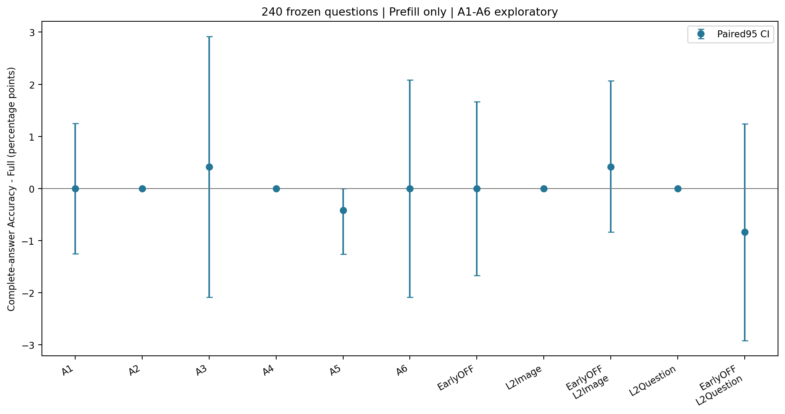
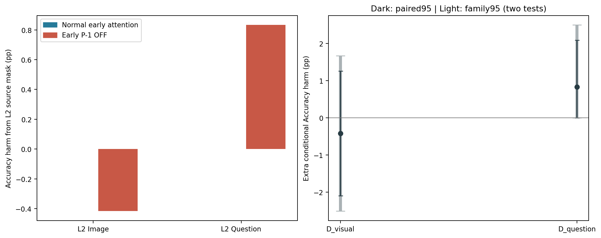
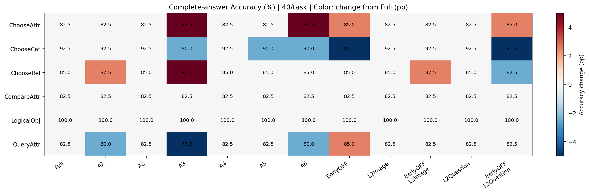
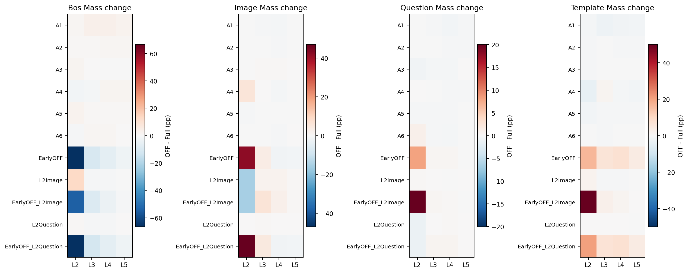
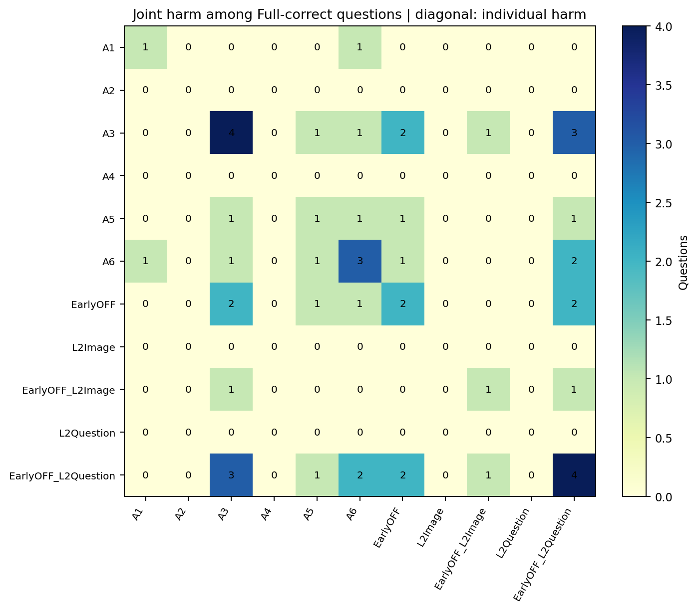

所有PNG都有同名矢量PDF。以下6个代表案例在结果产生前固定，每类按抽样哈希取第一题，不按正确性、Margin或变化选例。Patch图显示实际CLIP336裁剪；原始Image Mass写在标题，24×24分布为对Query/Head求原始均值后再视觉内部归一化，并明确采用对数色标。逐Head图为L2各条件BOS/Image/Question原始Mass，不是视觉内部概率。

### ChooseAttr__19131690
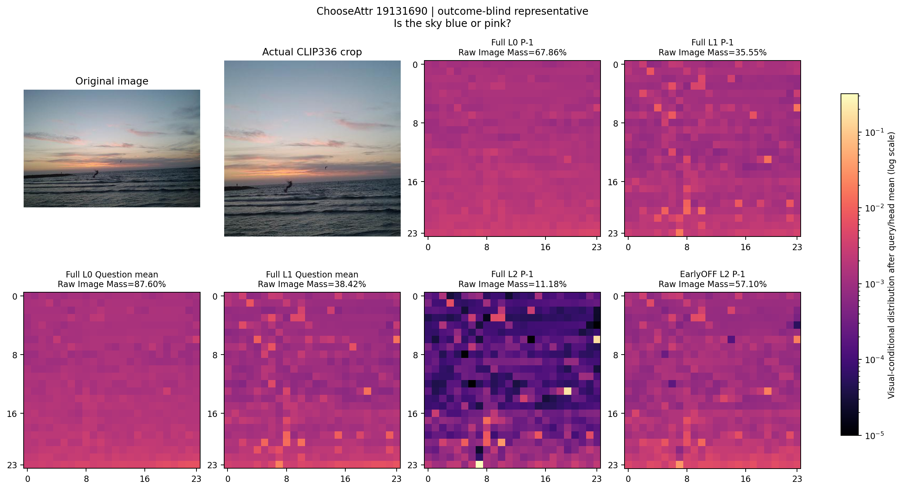
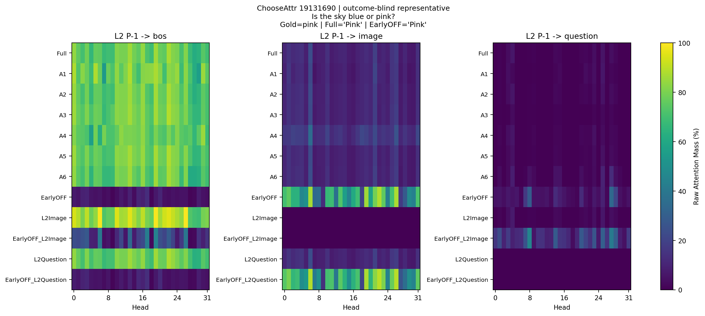

### ChooseCat__19690103
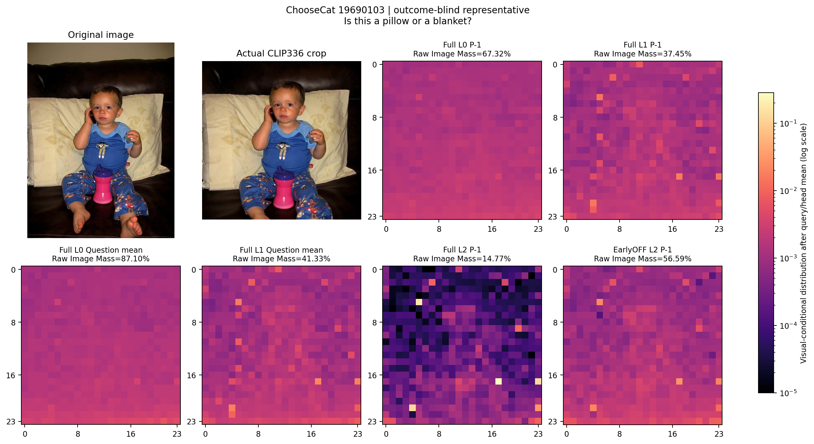
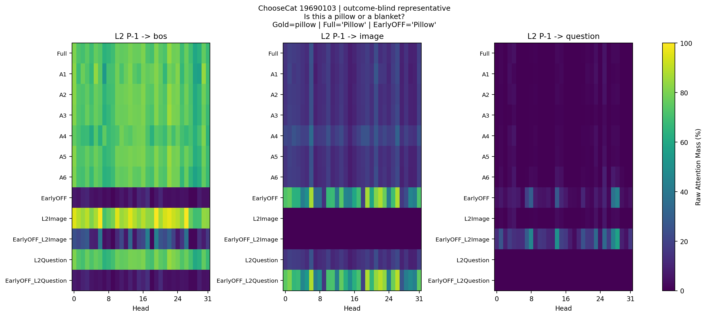

### ChooseRel__18584332
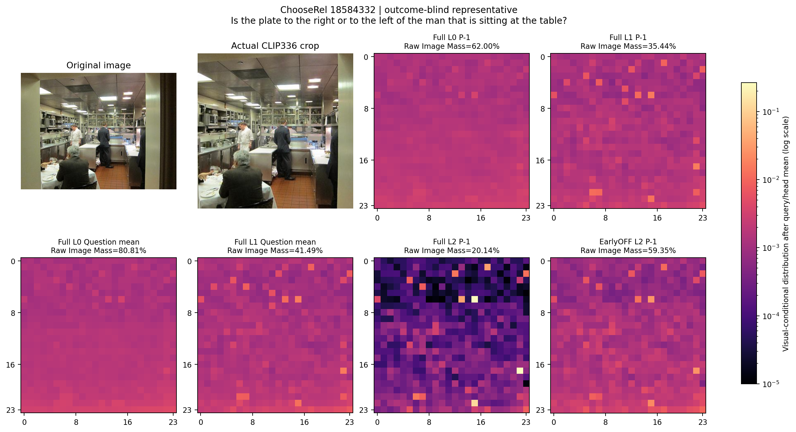
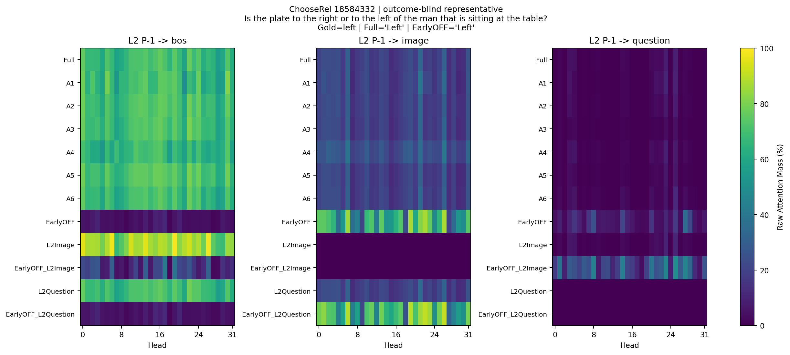

### CompareAttr__06894896
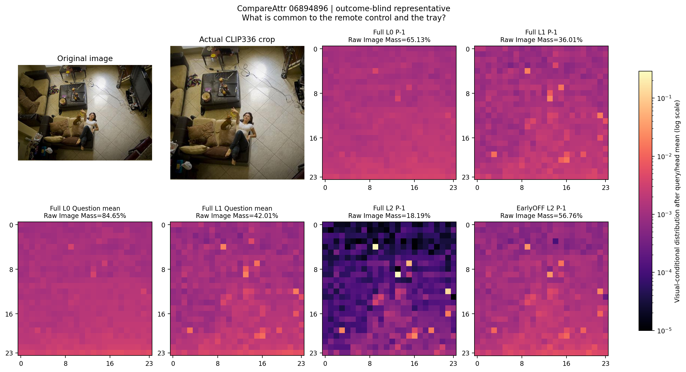

### LogicalObj__13136946
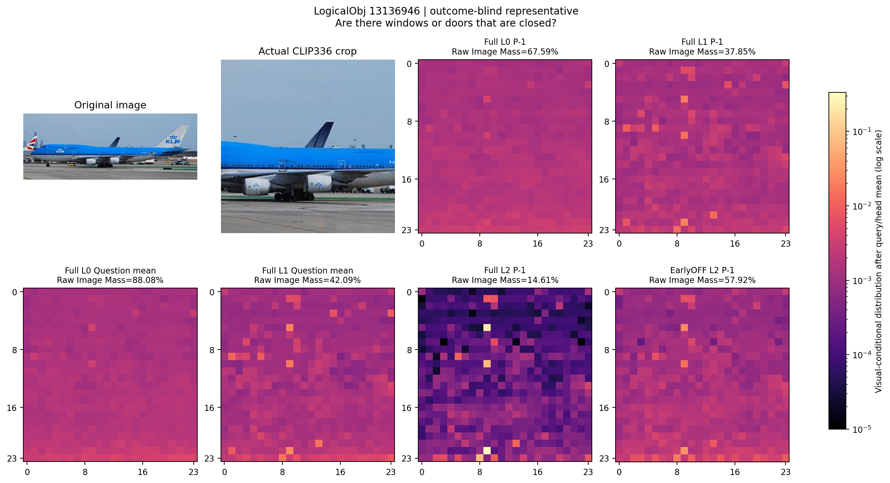

### QueryAttr__13547757
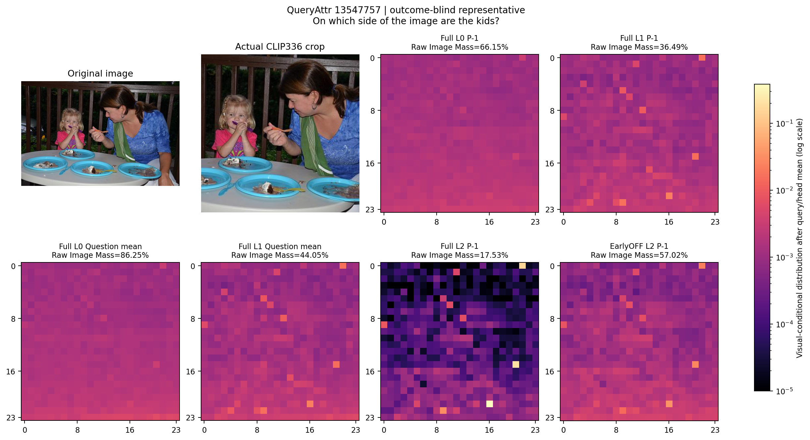
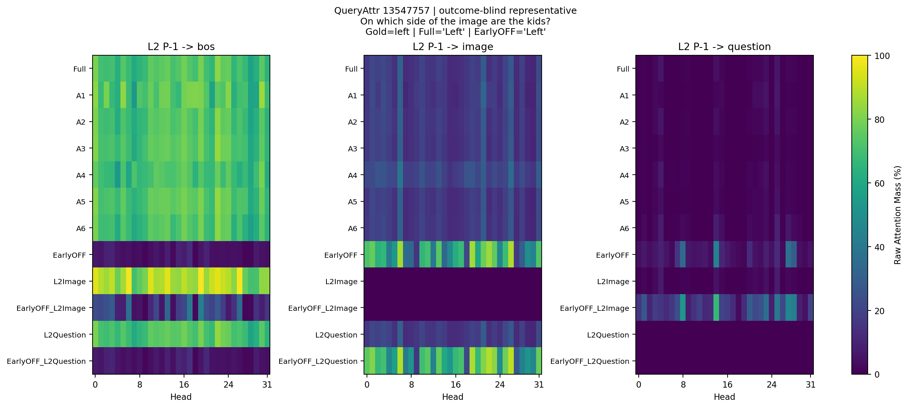

## 复用、验证和审计

- 历史版本：f1e661fd（Phase3.7路径代码/16例先导，只审查不重跑）、c67bc7d1（原3,000题L0/L1 OFF）、e495adf4（完整Full/评分/数据绑定）。Phase3.7使用的DirectedSuffixKnockout、knockout_mask及Token定位原语与本分支逐文件哈希一致；旧封装不能处理缓存且绑定两层，本轮仅在新目录增加单层、Prefill-only缓存时序适配。
- 成功采集冻结代码：`10c028a94fb93f2a04de17fee14130b922a575e2`；源码、样本、协议、CPU验证哈希均绑定到检查点。独立分支 `codex/early-source-delay-240`；不修改main或历史文件。
- 固定LLaVA-1.5-7B revision b234b804b114d9e37bb655e11cbbb5f5e971b7a9，FP16/eager、Transformers4.49.0，Greedy/32/EOS2，原Prompt、评分器及条件独立KV Cache。环境和空闲GPU检查见smoke.json。
- 哈希抽样精确定义、全部题号/图像SHA256/字符和Token位置/历史绑定保存在sample_manifest.json；真实Question逐字符重建精确，不包含末尾答题指令。
- 复用240条Full完整答案；每题一次原生cached Prefill仅用于来源Mass/Hidden观测及历史首logits逐位核对，不是完整生成。EarlyOFF首logits逐题精确核对历史P−1+Decode OFF，但完整答案全部重新以P−1-only生成。
- CPU审计与两例真实GPU Smoke先于正式240题。Smoke检查11条件No-op每步logits和初始KV指纹精确Full；目标权重归零、相同局部Hidden下非目标Query权重逐位不变；所有32层MLP正常、Prefill/Decode时序、独立HF生成、BOS KV、原生恢复及Hook/Input清理。
- 首次CPU异常注入测试误替换Attention.forward，触发原有签名保护而不是预期的运行时异常；失败记录保留。改为在q_proj注入异常，并新增签名保护测试；没有禁用保护或放宽容差。其他失败如发生，同样记录于failures/和attempts/，不得将其伪装通过。
- 正式采集/观测阶段耗时约16.5分钟，不含加载、Smoke和CPU统计；不据此推断算子加速。逐题逐条件原子检查点支持安全断点续跑。
- 只使用预检空闲的物理GPU2，不终止其他任务；工作结束释放模型，释放记录见gpu_release.csv。未训练、未扩展至3,000题、未扫描额外层/窗口或额外A×B条件。

## 交付文件

`protocol.json` / `sample_manifest.json` / `execution_manifest.json`；`per_question.csv`（2,880行，含240条复用Full）；`accuracy_summary.csv` / `task_accuracy.csv`；`source_interactions.csv` / `task_source_interactions.csv`；`layer_source_mass.csv` / `hidden_query_changes.csv`；`error_intersections.csv` / `per_question_error_patterns.csv`；PNG/PDF、6例小型NPZ；CPU/GPU验证、运行日志、完成记录和result.json的产物哈希。

**解释底线：** Attention Mass改变、被屏蔽路径的因果贡献、L2功能性补偿，以及具体视觉语义整合不是同一个结论。本轮240题是探索性样本，不把假说作为既定结论，也不把不显著等同于不存在。
