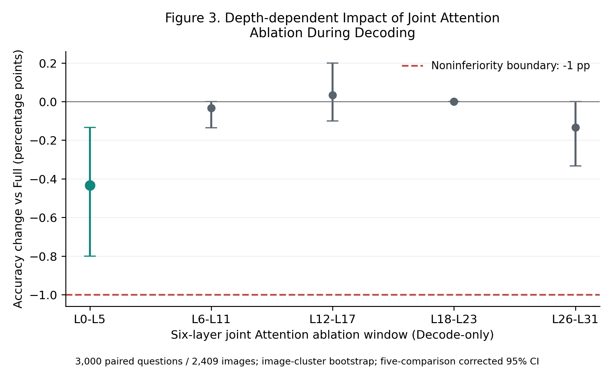

# Research 1 · Figure 3：六层Decode Attention联合消融

**结论：不支持L0–L5比其他六层窗口损害更低。** 它通过总体−1 pp非劣效筛查，但其Accuracy损失点估计在五个窗口中最大。其他深度同样低损害，不能将早层指定为独有的低损害区。

## 总体结果

| 条件 | Attention窗口 | 正确/3000 | Accuracy/% | ΔAccuracy/pp | 普通95%CI/pp | 五项校正95%CI/pp | 原对→错 / 原错→对 |
| --- | --- | --- | --- | --- | --- | --- | --- |
| Full | 原生 | 2627 | 87.567 | — | — | — | — |
| W0 | L0–L5 | 2614 | 87.133 | −0.433 | [−0.702, −0.200] | [−0.801, −0.134] | 13 / 0 |
| W1 | L6–L11 | 2626 | 87.533 | −0.033 | [−0.101, 0.000] | [−0.135, 0.000] | 1 / 0 |
| W2 | L12–L17 | 2628 | 87.600 | +0.033 | [−0.067, +0.165] | [−0.101, +0.200] | 1 / 2 |
| W3 | L18–L23 | 2627 | 87.567 | 0.000 | [0.000, 0.000] | [0.000, 0.000] | 0 / 0 |
| W4 | L26–L31 | 2623 | 87.433 | −0.133 | [−0.269, −0.033] | [−0.334, 0.000] | 4 / 0 |

五窗口的总体校正下界均高于−1 pp，按冻结判据通过；**这不是无损或等价证明**。W3没有准确率翻转，Bootstrap退化为零宽区间，不能把主图中的[0,0]解释为总体风险为零。W2的+1题净收益也不构成优于Full的统计证据。

预设的四项直接比较（各窗口减W0；单独的四项校正区间）为：W1 **+0.400 pp [0.133, 0.741]**；W2 **+0.467 pp [0.135, 0.849]**；W3 **+0.433 pp [0.164, 0.794]**；W4 **+0.300 pp [−0.034, 0.692]**。前三项支持这些窗口比W0损害更低；W4与W0的校正差异证据不足。两组校正不声称共同九项同时覆盖。

## 六类任务

| 任务（各500题） | Full/% | W0/% | W1/% | W2/% | W3/% | W4/% |
| --- | --- | --- | --- | --- | --- | --- |
| ChooseAttr | 82.6 | 81.8 | 82.6 | 82.4 | 82.6 | 82.4 |
| ChooseCat | 89.6 | 87.8 | 89.4 | 90.0 | 89.6 | 89.4 |
| ChooseRel | 83.6 | 83.6 | 83.6 | 83.6 | 83.6 | 83.6 |
| CompareAttr | 89.2 | 89.2 | 89.2 | 89.2 | 89.2 | 88.8 |
| LogicalObj | 95.8 | 95.8 | 95.8 | 95.8 | 95.8 | 95.8 |
| QueryAttr | 84.6 | 84.6 | 84.6 | 84.6 | 84.6 | 84.6 |

W0的13题损害全部来自ChooseAttr（4题，−0.8 pp）和ChooseCat（9题，−1.8 pp）。总体非劣效不能掩盖任务内风险。[六任务补充图](task_scores.png)、[矢量PDF](task_scores.pdf)及[分任务完整统计](task_accuracy.csv)保留所有窗口结果。

## 答案长度与EOS

| Full后续生成类型 | 题数 | 占比 | Full Accuracy/% | W0 Δ/pp | W1 Δ/pp | W2 Δ/pp | W3 Δ/pp | W4 Δ/pp |
| --- | --- | --- | --- | --- | --- | --- | --- | --- |
| 首Token后只剩EOS | 2526 | 84.2% | 87.846 | 0.000 | 0.000 | 0.000 | 0.000 | −0.119 |
| 首Token后仍有内容Token | 474 | 15.8% | 86.076 | −2.743 | −0.211 | +0.211 | 0.000 | −0.211 |

长度按Full生成的非EOS Token数划分，**不是词数**；分组在干预前冻结定义，不用于筛选数据。W0在474题内容尾部组损害13题，校正95%CI为[−5.021, −0.858] pp，未达到−1 pp组内筛查标准。**总体低损害受到大量“只生成EOS”样本稀释，不能推广到较长回答或长文本Decode。** 该分组描述Native Full的尾部，干预仍可能生成额外内容。

Full/W0/W1/W2/W3均3000/3000到EOS；W4为2998/3000，2题达到既有32-Token上限：ChooseAttr `03294922`（Full正确→错误，额外续写问答）与QueryAttr `18956847`（Full和W4均错误，额外续写描述）。两题均保留并正常计分；空答案和既定重复启发式标记均为0，不据此忽略截断异常。

## 协议与验证

原始`221cdde5`的Manifest经Git blob及SHA256核验，六类各500题、2409张图片；Question ID、Image ID、Prompt及真实输入映射完全复用，无重新采样。原Figure1只生成每类80题，故本轮**全部重新生成Full**，共18,000次正式生成，在同一GPU上逐题配对。模型revision `b234b804b114d9e37bb655e11cbbb5f5e971b7a9`，FP16/eager、Transformers4.49.0，沿用官方GQA主准确率转换和精确匹配。

直接复用既有`JointAttention/generate`；Prefill、首答案Token正常，仅后续Decode的六层`o_proj`输出置零，MLP及各条件独立实际前缀/KV Cache正常。Greedy，到EOS或既有32-Token上限；不是固定Full前缀，不修改权重，也不代表真实计算省略或加速。

33项CPU测试、六类各一题的三卡GPU Smoke通过：No-op logits、Prefill logits/缓存、原生HF生成Token均一致，三卡Smoke一致，32层MLP正常。全部逐题绑定、首Token一致性、无重复覆盖、输入/参数不变和Hook清理检查通过，无NaN/Inf/OOM。三个分片耗时1750.0/1939.5/1760.2秒（正式生成）；GPU1–3已释放，GPU0未干扰。

Bootstrap以图片SHA256为聚类单位，整体重采样200,000次、种子20261031，题目加权配对估计。主比较五项Bonferroni校正；分任务/长度各自在组内五项校正，仅作描述，不宣称全部子组同时覆盖。有限次Bootstrap区间是近似，退化区间和CI包含0均不等于无风险或等价。

产物：[主图矢量PDF](figure3.pdf) · [总体CSV](accuracy_summary.csv) · [六任务CSV](task_accuracy.csv) · [长度分组CSV](full_length_groups.csv) · [与W0直接配对CSV](depth_vs_W0_paired.csv) · [逐题答案/Token/评分CSV](per_question.csv) · [冻结配置](execution_manifest.json) · [分片与样本哈希](assignments.json) · [CPU记录](cpu_validation.json) · [GPU门控](gpu_gate.json) · [GPU释放记录](gpu_release.csv)。原始检查点、环境、Smoke及执行日志见`shard0`～`shard2`和`gpu1_console.txt`～`gpu3_console.txt`。
