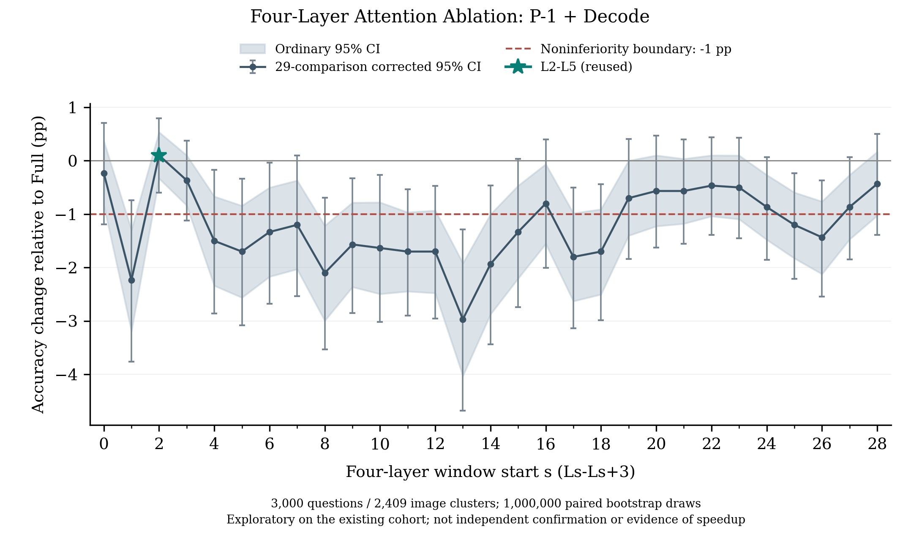

# 四层 Attention 滑窗：中文结论

已完成原六类 GQA 各500题、共3,000题及全部29个四层窗口。复用 Full 和 L2–L5，共新增84,000次生成；90,000条逐题结果完整保留。

| 条件 | Accuracy | ΔFull（pp） | 29项校正95%CI（pp） | 原对→错 | 原错→对 |
|---|---:|---:|---|---:|---:|
| Full | 87.567% | 0 | N/A | N/A | N/A |
| L2–L5 | 87.667% | +0.100 | [−0.594, +0.795] | 20 | 23 |
| L0–L3 | 87.333% | −0.233 | [−1.193, +0.708] | 44 | 37 |
| L3–L6 | 87.200% | −0.367 | [−1.123, +0.371] | 30 | 19 |
| L13–L16 | 84.600% | −2.967 | [−4.673, −1.286] | 172 | 83 |

- **仅L2–L5通过本轮总体−1pp非劣效标准**，首Token翻转率1.433%。它是本批数据上的候选，不表示显著优于Full，更不表示没有个别损害。
- 早层并非连续、均匀的低损害区域：L1–L4下降2.233pp；L13–L16的点估计损害最大。L0–L3、L3–L6和部分后层点估计损害较低，但校正区间不足以支持−1pp非劣效。
- 全部90,000条生成均到达EOS，无截断；L1–L4有1条空答案，保留并按原协议计分。46项CPU检查通过，三个分片的真实GPU Smoke通过，未出现数值异常或OOM，本轮GPU已释放。
- 本轮为同一3,000题上的探索性比较，**不是L2–L5的独立确认**。只将指定`o_proj`输出置零，不能声称真实计算加速，也不能据此证明某个Attention来源的因果机制。

统计：按2,409个图像SHA256簇配对Bootstrap，1,000,000次；Bonferroni29校正。非劣效要求校正区间下界严格大于−1pp。

资源：GPU1被外部任务占用，原分片0在GPU3空闲后接续，历史Full/E答案与首Logits精确复现后才正式运行；模型、生成、评分和数值标准不变。GPU0及外部任务未被干预，变更完整记录于`scheduling_amendment.json`。

完整数字：[总体CSV](accuracy_summary.csv)、[六类子任务CSV](task_accuracy.csv)、[逐题CSV](per_question.csv)、[全部29窗口与审计说明](report.md)。论文图：[PDF](publication/four_layer_window_curve.pdf)。初版图及统计哈希保持不变，修正版只调整排版，见`publication/presentation.json`。
