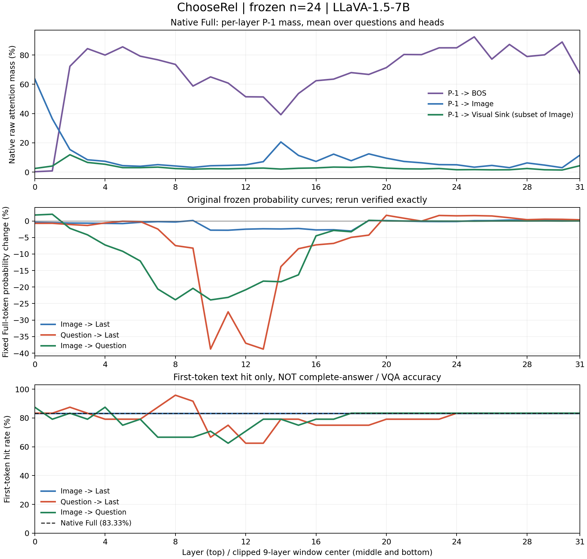
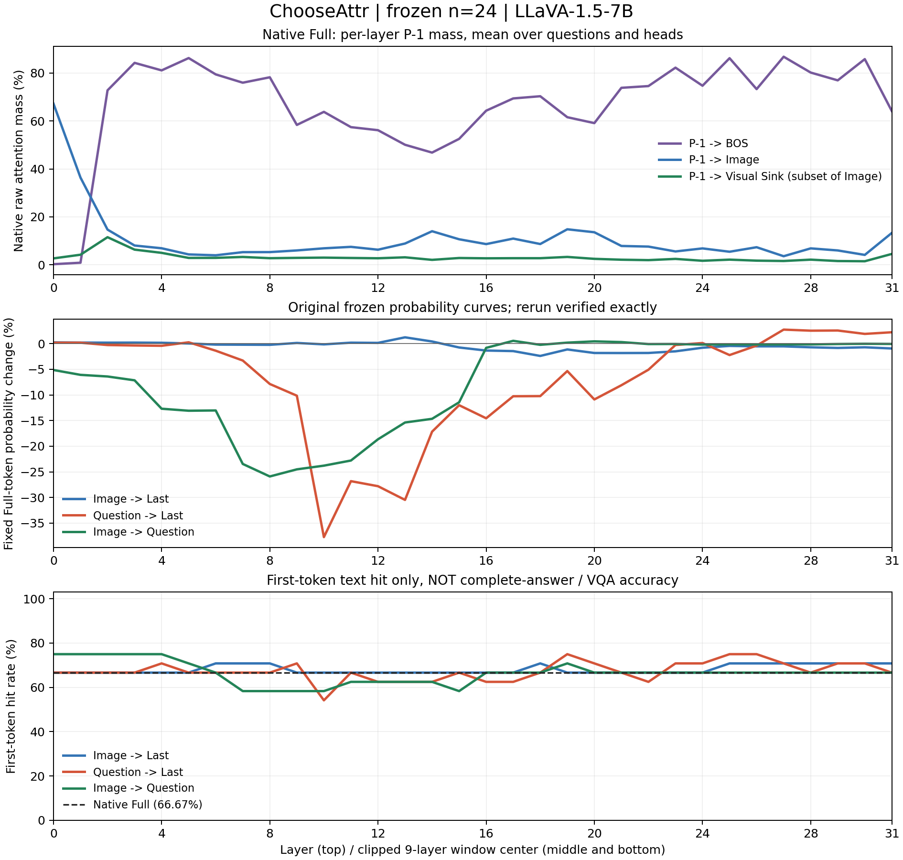
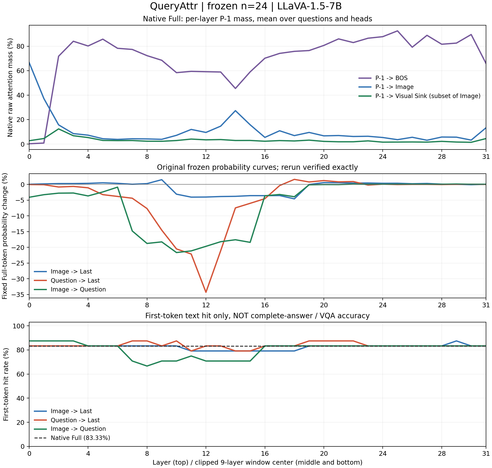
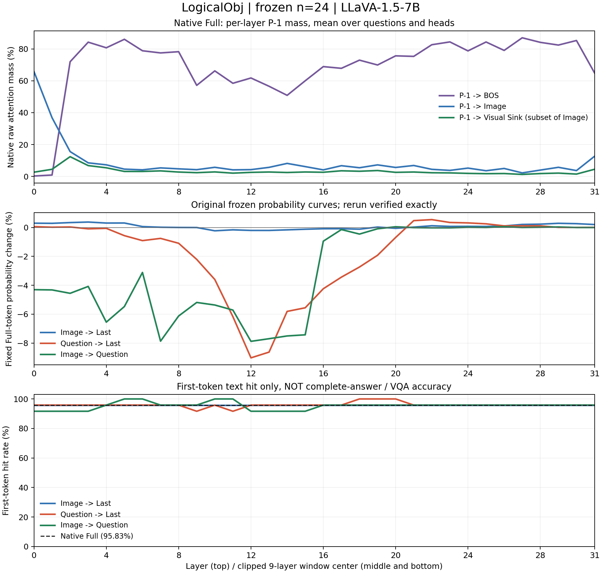

# GPU1 window9 continuation: first-token hits and Native attention mass

Status: complete scan and aggregation, **96 original questions / 9,216 masked sample conditions / 3,072 Native layer rows**. The masked conditions were evaluated in 2,304 batch4 model calls, in addition to Native/restoration and smoke calls. No resampling, training, full Decode or other window lengths. Old source/results and main were not edited.

**Every hit rate below is FIRST-TOKEN TEXT HIT, NOT full-answer exact match or VQA accuracy.** The parent strip/lower comparison with the first Gold token is unchanged, including its capitalization/BPE and multi-token-prefix limitations.

## Brief interpretation

- At the original probability-selected peaks, Image->Question lowers first-token hit rate in all four tasks: -12.50, -8.33, -12.50 and -4.17 percentage points for ChooseRel, ChooseAttr, QueryAttr and LogicalObj. Question->Last lowers it in ChooseRel (-20.83 pp) and ChooseAttr (-12.50 pp); QueryAttr and LogicalObj have unchanged net rates but each contains one hit->miss and one miss->hit. Image->Last has small, mixed hit changes.
- Probability-sensitive windows and hit troughs broadly overlap in the early/middle range but are not equivalent. QueryAttr Question->Last loses 34.28% of the fixed Native token probability at center L12 without a net hit-rate decrease; its first minimum-hit center is L11. A fixed-token probability decrease does not itself imply an argmax error. The minimum-hit center uses the first tie and is descriptive only, not a replacement for the frozen probability peak.
- Higher window-mean P-1 BOS mass accompanies a smaller signed probability drop in 11/12 task/path median within-question correlations; the exception is ChooseAttr Image->Last (+0.190). This is a descriptive depth association, not evidence that BOS attention protects prediction.
- There is **no universal high-Visual-Sink-share -> lower sensitivity relationship**. For Image->Question, Question Sink/Image share is positively associated with probability drop in ChooseRel (+0.406), ChooseAttr (+0.377) and QueryAttr (+0.588), and nearly unrelated in LogicalObj (+0.020). The two Last paths have mixed or near-zero signs across tasks. Large BOS mass, large raw visual Sink mass and large Sink/Image share must not be treated as interchangeable.
- Each task has only 24 questions. Windows overlap, layer depth is shared, and no causal intervention specifically on Sink was performed. These results describe the frozen cohort; they do not establish full VQA accuracy, a Sink mechanism or statistical generalization.

## Probability-sensitive windows and hit changes

| Task | Path | Probability peak center/window | Probability change (%) | Full first-token hit (%) | Masked hit (%) | Delta (pp) | Hit->miss / Miss->hit |
|---|---|---|---:|---:|---:|---:|---:|
| ChooseRel | Image -> Last | L18 / L14-L22 | -3.04 | 83.33 | 83.33 | +0.00 | 0 / 0 |
| ChooseRel | Question -> Last | L13 / L9-L17 | -38.79 | 83.33 | 62.50 | -20.83 | 6 / 1 |
| ChooseRel | Image -> Question | L10 / L6-L14 | -23.90 | 83.33 | 70.83 | -12.50 | 4 / 1 |
| ChooseAttr | Image -> Last | L18 / L14-L22 | -2.40 | 66.67 | 70.83 | +4.17 | 0 / 1 |
| ChooseAttr | Question -> Last | L10 / L6-L14 | -37.71 | 66.67 | 54.17 | -12.50 | 3 / 0 |
| ChooseAttr | Image -> Question | L8 / L4-L12 | -25.90 | 66.67 | 58.33 | -8.33 | 3 / 1 |
| QueryAttr | Image -> Last | L18 / L14-L22 | -4.58 | 83.33 | 79.17 | -4.17 | 1 / 0 |
| QueryAttr | Question -> Last | L12 / L8-L16 | -34.28 | 83.33 | 83.33 | +0.00 | 1 / 1 |
| QueryAttr | Image -> Question | L10 / L6-L14 | -21.65 | 83.33 | 70.83 | -12.50 | 4 / 1 |
| LogicalObj | Image -> Last | L10 / L6-L14 | -0.23 | 95.83 | 95.83 | +0.00 | 0 / 0 |
| LogicalObj | Question -> Last | L12 / L8-L16 | -9.02 | 95.83 | 95.83 | +0.00 | 1 / 1 |
| LogicalObj | Image -> Question | L12 / L8-L16 | -7.88 | 95.83 | 91.67 | -4.17 | 2 / 1 |

The peak is selected only by the **original frozen probability curve**, not by the new hit rate. At these 12 path/task peaks, 7/12 have lower first-token hit rate than Native. One question is 4.17 percentage points (n=24); probability changes are relative percentages, while hit-rate deltas are percentage points. `sensitivity_hit_summary.csv` also retains each path's minimum-hit center, without replacing the original peak.

## Figures

### ChooseRel

### ChooseAttr

### QueryAttr

### LogicalObj

Top: Native raw P-1 attention masses, summed over the named keys and mean over heads/questions. Sink is a subset of Image, not a separate partition. Middle: immutable original all-question probability curves, reproduced exactly by the rerun. Bottom: the three new masked first-token-hit curves with Native baseline. Top x is a single layer; middle/bottom x is the centered nine-layer window, clipped at boundaries.

## BOS/Sink association (descriptive only)

| Task | Path | Median rho(BOS, drop) | Median rho(Sink/Image share, drop) |
|---|---|---:|---:|
| ChooseRel | Image -> Last | -0.413 (n=24) | -0.339 (n=24) |
| ChooseRel | Question -> Last | -0.507 (n=24) | -0.081 (n=24) |
| ChooseRel | Image -> Question | -0.327 (n=24) | +0.406 (n=24) |
| ChooseAttr | Image -> Last | +0.190 (n=24) | -0.207 (n=24) |
| ChooseAttr | Question -> Last | -0.568 (n=24) | +0.035 (n=24) |
| ChooseAttr | Image -> Question | -0.341 (n=24) | +0.377 (n=24) |
| QueryAttr | Image -> Last | -0.624 (n=24) | -0.473 (n=24) |
| QueryAttr | Question -> Last | -0.464 (n=24) | -0.034 (n=24) |
| QueryAttr | Image -> Question | -0.581 (n=24) | +0.588 (n=24) |
| LogicalObj | Image -> Last | -0.467 (n=24) | +0.410 (n=24) |
| LogicalObj | Question -> Last | -0.437 (n=24) | +0.445 (n=24) |
| LogicalObj | Image -> Question | -0.469 (n=24) | +0.020 (n=24) |

Each rho is computed **within a question** across the same 32 overlapping windows, comparing mean Native window occupancy against signed probability drop (-relative change); the table takes the median rho over questions. Negative rho means higher occupancy accompanies lower drop. Constant/undefined sequences are excluded and valid question counts are explicit. These are not independent layer samples, significance tests or evidence that Sink causes robustness. Shared layer depth, overlapping windows and prompt routing can confound the association. BOS always refers to P-1; Sink/Image share uses Question queries for Image->Question, P-1 for the two Last paths. Raw-Sink-mass associations and per-question rhos are also saved.

## Sink and mass protocol

- Exactly the original manifest, sample order, prompts, batch4, FP16/eager LLaVA-1.5-7B, Transformers 4.49.0, no-cache prefill, GPU1 UUID GPU-b08489af-0a8a-eb48-55ba-8346733af417.
- Reused Phase 3.4 `sink_candidates` unchanged: two discovery neutral prompts x Question/P-1 views; visual-conditional probability >=5/576 and top58, persistence in >=8 layers, candidate in >=3/4 views. Third neutral prompt is holdout only. All Sink candidates used, with no ROI exclusion or answer/hit-based selection. Empty sets remain empty.
- 6 unique images reuse hash-verified Phase 3.4 labels/maps; 89 unique images use the identical three neutral prompts and the same two-stage FP16 rounding. All 95 unique-image Sink definitions frozen before masked scoring. One cross-task shared image keeps its own single definition.
- Native raw mass: sum key weights, then equal head mean; Question mass additionally averages true Question queries, excluding template/instruction tokens. Five measurements per head: P-1->BOS/Image/Sink, Question->Image/Sink. Stored head summaries are [32 layers,32 heads,5] FP32, NOT full attention matrices.
- Sink/Image share = aggregate raw Sink mass / aggregate Image mass. No division by BOS or total text mass. Zero Image denominator -> null. For window means, average raw masses over exactly the same clipped window, then take their ratio (not mean per-head/layer ratios).
- Every Native prediction ID/LogP and every masked fixed-token LogP matches the old checkpoint exactly. Original probabilities/curves were not overwritten. Native vocabulary logits restore bitwise after intervention for all 96 questions. Observer-on/off equality and mask-direction checks passed in four real smoke questions; CPU tests cover mass/ratio/flip/rank calculations and cleanup. No OOM/nonfinite scores.

## Provenance and files

- Parent result commit: `4d800f0971f8c97bdfbc8db9728fc87247ea376c`.
- Frozen execution commit: `85606d8d2a68a9fdef4c2ac62f7d824b5be70a24`; full source SHA256/config bindings saved.
- `per_question.csv`: masked argmax ID/text, Native token, first-token hit/flip flags, original probability and LogP changes (9,216 rows).
- `baselines.csv`, `curves.csv`, `sensitivity_hit_summary.csv`: Native hits, every window's hit rates and flips, frozen-peak comparison.
- `native_layer_mass.csv`, `native_window_mean_mass.csv`: all five raw masses plus both Sink/Image ratios per question/layer or clipped window (3,072 rows each).
- `native_head_mass/*.npz`: per-head raw masses, field order in `attention.py:FIELDS`.
- `association_per_question.csv`, `association_summary.csv`: descriptive question-level associations, no p-values.
- `sink_manifest.json`, `sinks/`, `neutral_maps/`: old/new Sink provenance and neutral-only definitions.
- `config.json`, source bindings, environment, CPU/GPU logs, `smoke.json`, `completion.json`, checkpoints: validation/provenance. Parent hashes rechecked during aggregation.
