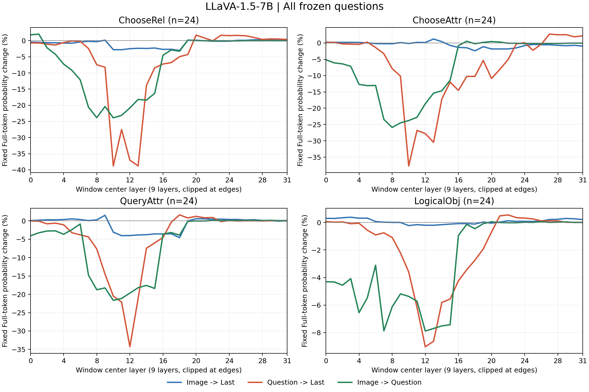
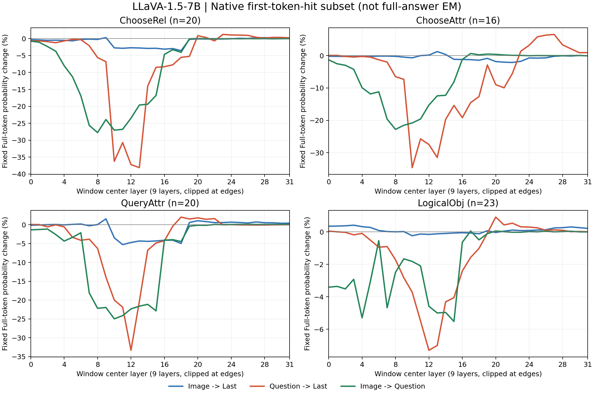

# GPU1 nine-layer information-flow experiment

Scan status: **complete**, 96/96 frozen questions, 9,216/9,216 masked prefills. No Decode, training or extra window lengths. The exact full-answer-correct subgroup is **not established**; its explicitly labeled first-token proxy is reported below.

## Main result

| Task | Path | n | Peak center | Sensitive window | Maximum mean drop (%) | Mean delta LogP |
|---|---|---:|---:|---|---:|---:|
| ChooseRel | Image -> Last | 24 | L18 | L14-L22 | 3.04 | -0.033 |
| ChooseRel | Question -> Last | 24 | L13 | L9-L17 | 38.79 | -0.609 |
| ChooseRel | Image -> Question | 24 | L10 | L6-L14 | 23.90 | -0.300 |
| ChooseAttr | Image -> Last | 24 | L18 | L14-L22 | 2.40 | -0.026 |
| ChooseAttr | Question -> Last | 24 | L10 | L6-L14 | 37.71 | -0.583 |
| ChooseAttr | Image -> Question | 24 | L8 | L4-L12 | 25.90 | -0.358 |
| QueryAttr | Image -> Last | 24 | L18 | L14-L22 | 4.58 | -0.049 |
| QueryAttr | Question -> Last | 24 | L12 | L8-L16 | 34.28 | -0.450 |
| QueryAttr | Image -> Question | 24 | L10 | L6-L14 | 21.65 | -0.265 |
| LogicalObj | Image -> Last | 24 | L10 | L6-L14 | 0.23 | -0.002 |
| LogicalObj | Question -> Last | 24 | L12 | L8-L16 | 9.02 | -0.114 |
| LogicalObj | Image -> Question | 24 | L12 | L8-L16 | 7.88 | -0.132 |

Maximum drop is the minimum over the 32 means of **per-question** relative probability changes, not the relative change of mean probabilities. A sensitive window is not evidence that a single layer alone is responsible. Edge windows have 5-8 rather than 9 layers; overlapping windows are not independent.

## Cohorts and supplementary result

- ChooseRel: all n=24; Native first-token hit n=20; multi-token Gold n=0.
- ChooseAttr: all n=24; Native first-token hit n=16; multi-token Gold n=4.
- QueryAttr: all n=24; Native first-token hit n=20; multi-token Gold n=0.
- LogicalObj: all n=24; Native first-token hit n=23; multi-token Gold n=0.

"Correct" here is explicitly **Gold-first-token text hit after strip/lower normalization**, not complete-answer exact match. No full Decode was run. Multi-token answers may share a prefix; punctuation and tokenization can affect this check. Strict token-ID agreement is additionally saved in baselines.csv. Thus this supplementary cohort must not be reported as the official paper's full-answer-correct cohort or as VQA accuracy. Main curves always include all 24 questions per task, including Native errors.

The requested full-answer-correct subset is **not established** under the no-Decode constraint; the first-token-hit plot is a clearly labeled proxy, not completion of that exact correctness protocol. Capitalized tokens can also have a different BPE split from lowercase Gold, so even the normalized first-token-hit count is not an accuracy estimate. For a Native error, a lower fixed-token probability need not mean a worse answer.

These are 96 questions on 95 distinct image hashes (one cross-task shared image, not removed). The untouched random cohorts have ChooseRel right/left=15/9, QueryAttr right/left=13/11, LogicalObj yes/no=16/8. QueryAttr here is the frozen author-selected **position-query** cohort, not general GQA attribute coverage.

## Protocol

- Fixed seed 20261029. For each frozen 240-question pool, sort by question_id/image_id, independently sample 24 with Python Random(seed), then sort selected IDs. No prediction-based selection, replacement, or rebalancing. The official author-filtered source pools themselves are not an unfiltered GQA population.
- ChooseRel questions/images come from Phase 3.2; the other tasks from the Phase 4.0 frozen suite. All selected local images match their frozen SHA256. Uniform existing short-answer instruction and original HF chat template. For ChooseRel this appends the instruction relative to the historical bare-question pilot; historical Full scores are not used as baselines.
- LLaVA-1.5-7B-hf b234b804b114d9e37bb655e11cbbb5f5e971b7a9, FP16/eager, Transformers 4.49.0, only physical GPU1. Four identical image/prompt replicas per microbatch, each assigned a different center. Native Full uses the identical batch shape. No cross-question padding or mixed baselines.
- At center c, mask layers max(0,c-4)..min(31,c+4). Instance-local attention prehooks set only the specified query/key pairs to negative infinity in the existing causal additive mask, before softmax. All heads; original positions, MLP and tokens retained. Image-to-Question does not edit Last's direct links. Original true Question spans are dynamically located, excluding the added instruction and chat-template tokens.
- No KV cache; prefill only. Track the Native Full vocabulary argmax token even when the masked argmax changes. FP32 full-vocabulary log_softmax of FP16 model logits; relative change = 100*expm1(masked LogP - Full LogP). Also save both probabilities and delta LogP. Only the final position's LM head projection is needed (logits_to_keep=1); no hidden computation is skipped.

## Validation and provenance

CPU tests and four real GPU smoke questions pass: target mask positions only, blocked softmax weights exactly zero, original inputs intact, correct clipped layer coverage, hook cleanup on normal/exceptional exit. Native Full last-position vocabulary logits restore **bitwise exactly** after intervention for every formal question. No nonfinite scores, OOM, training or full Decode. This experiment launched no model jobs on GPUs 0/2/3 and did not terminate other users' processes. GPU1 was released after the scan (27 MiB display/context footprint, 0% utilization; `gpu1_after.txt`).

Eight CPU tests passed. The first smoke's strict token-ID correctness labels were misleading for capitalization; that initial log/snapshot is retained as `gpu_smoke_initial_strict_id.txt` / `smoke_initial_strict_id.json`. Before the formal run, supplementary text matching was normalized with the official strip/lower rule, the same four smoke questions passed again, and the formal source was frozen. No selected question, mask, window or probability metric was changed in response to the formal results.

- Frozen execution commit: `8e9e7a9a5d4cf7c076fc43d5024f1f39e23e4eeb`
- Base: `7ccb44941cb48e901e6e23e96bae6da173fe2ce5`
- Full source hashes, model/environment, config, selection, smoke details and completion are saved beside this report. Checkpoints are per question and bound to the same execution commit/config/manifest; exact coverage checked before aggregation.
- Official reference: [code](https://github.com/FightingFighting/cross-modal-information-flow-in-MLLM/tree/c9a1111dac4baa175f67716fab473789320187c0), [paper](https://arxiv.org/abs/2411.18620). Verified official centered window and probability-change metric in InformationFlow.py / methods.py. The paper's main examples use LLaVA-1.5-13B and retain full-answer-correct generations; this is a small 7B HF adaptation, not an exact numerical reproduction.

## Descriptive peak locations

- Image -> Last: ChooseRel L18 (3.0%), ChooseAttr L18 (2.4%), QueryAttr L18 (4.6%), LogicalObj L10 (0.2%).
- Question -> Last: ChooseRel L13 (38.8%), ChooseAttr L10 (37.7%), QueryAttr L12 (34.3%), LogicalObj L12 (9.0%).
- Image -> Question: ChooseRel L10 (23.9%), ChooseAttr L8 (25.9%), QueryAttr L10 (21.7%), LogicalObj L12 (7.9%).

## Brief interpretation

- **Early / early-middle:** Image -> Question is important, with peak centers L8/L10 for ChooseAttr/ChooseRel/QueryAttr and L12 for LogicalObj. Its strongest mean drops are 25.90/23.90/21.65/7.88%. This supports an indirect visual route through Question representations rather than a large direct Image -> Last contribution.
- **Middle:** Question -> Last has the largest peak mean drop in every task: 38.79%, 37.71%, 34.28%, 9.02% for ChooseRel/ChooseAttr/QueryAttr/LogicalObj respectively. Its peak centers are L13/L10/L12/L12, not the final layers. These overlapping nine-layer windows identify a broad sensitive segment, not an isolated causal center layer.
- **Late (centers L22-L31):** effects are small, sometimes slightly positive; the mean changes for every path/task lie between -0.89% and +0.92%. Late Question -> Last is not the strongest route in this configuration. Direct Image -> Last is weak throughout, with maximum mean drops only 0.23%-4.58%.
- **Paper comparison: partial agreement, not full reproduction.** The paper describes lower/middle image-to-question integration followed by propagation to Last in higher layers. The weak direct visual route and earlier Image -> Question sensitivity broadly agree, but the dominant Question -> Last sensitivity is middle-layer here, and a clean two-stage image-to-question separation is not consistent across the four curves. We did not reproduce a dominant final-third transfer stage. Model size/HF implementation, prompt/cohort differences and the first-token correctness proxy prevent a matched numerical comparison; this run cannot identify which difference explains the mismatch.

The 24-question cohorts, overlapping windows, fixed Native-token metric and nonidentical correctness protocol limit generalization. No statistical significance claim, post-result tuning, extra window length or additional condition is introduced. Treat these as descriptive information-flow measurements, not changes in VQA accuracy.

## Files

- `per_question.csv`: every masked path/center/question, fixed token, probabilities, LogP changes.
- `baselines.csv`: question, Gold, Native token, normalized first-token text hit, strict token-ID hit and true positions.
- `curves.csv`: all-sample and first-token-hit means, including mean delta LogP.
- `sensitivity_summary.csv`: peak windows plus descriptive early (centers 0-10), middle (11-21), late (22-31) means.
- `checkpoints/`, `manifest.json`, `config.json`, `execution_binding.json`, `environment.json`, `smoke.json`, `completion.json`, CPU and GPU text logs.
