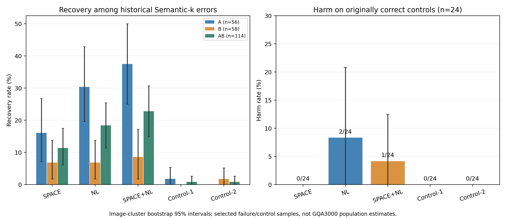

# Semantic-k失败题的SPACE/NL定向恢复验证

**状态：FAILURE_PROBE_COMPLETE。只执行本轮冻结的小规模定向实验，未启动3000题矩阵。**

冻结138道、138张独立图片：A组56道（All对/S错）、B组58道（All错/S错）、C组24道（S对）。主要分母是114道历史S错误题；这不是随机总体ACC评估，不能将恢复率换算为3000题ACC提升。

## 选样与冻结

原3000题S正确2514、错误486，完整错误名单见historical_S_errors.csv。先打印每任务A/B/C原始候选数，再按固定任务顺序、A/B/C顺序分配；优先避开pilot120/historical12题及图片，各层按SHA256("space-nl-failure-recovery-v1|task|stratum|question_id|image_sha256")升序，图片跨所有层全局去重。Quick24和Diagnostic4的全部题及图片均硬排除。抽样不使用新增生成、Gold NLL或补位成功率。

LogicalObj原始仅7道A、8道B；排除已测图片后A剩6道、B剩8道，因此总数比目标144少6，不跨层补齐。该任务的2道A和1道B只能从优先排除的旧pilot/history备选中选入，preference_tier=1逐题记录；其余135道均为tier0。所有本轮图片互不重复。各层原始/排除后/优先池/实际数量见candidate_counts.csv。即使未测试过边界干预，按历史S错误条件选样也不是独立外部验证。

基线commit `f2fb54df59a1a04bbfc1a59403df4c1155976d79`；冻结执行commit `9ff24a937062732ffce491155a89f378454740a4`。输入sample_manifest.csv SHA256=`895c6e5717df2897c6aa2ab2d1fa35bca126b51932f7b88ff3e20feda19fb3af`；sample_plan.json SHA256=`29baf6a9f87ca254169c3d45cc6fc2196a72c9300ede64701de8abd5ae339447`；原3000题token_plan SHA256=`cf694839e83e467c1eb10a894ba2d3dd18979346afd7214158243ca01024c42e`。全部3000题原All/S记录和本轮选中记录均通过既有审计；本轮再对选中历史JSON核对提交字节、原始Logits文件SHA与首Token。

## 条件与真实Token

只改变Prefill R→原始Image Key的Softmax前Hard Mask。S严格复用原集合；SPACE原生位置581/ID29871，NL位置582/ID13；模板单Token为Instruction中的Answer，双Token为Answer+the，均来自原输入，逐题无S重叠、位于R，单/双新增预算严格为1/2。SPACE与NL的原生offset可能覆盖同一换行字符，但它们是两个不同Tokenizer位置；没有向Prompt插入标签。逐题ID、piece、decode与offset见token_audit.json。

所有32层P−1和每个真实Decode Query始终禁读图像Key，所选Prefill R可以在全部32层直接读图。模型LLaVA-1.5-7B，revision b234b804b114d9e37bb655e11cbbb5f5e971b7a9，FP16/Eager/Transformers4.49.0，Greedy32、logits_to_keep=1，使用原GQA归一化完整答案评分。每条件独立真实KV/前缀，原生QKV、MLP、Residual与完整KV保留，无o_proj旁路。只评价功能效果，不代表计算节省。

## 恢复与负面控制

| 条件 | A恢复 | B恢复 | 合并恢复率 | 合并95%CI | C损害 | C答案改变但评分不变 |
|---|---:|---:|---:|---|---:|---:|
| S+SPACE | 9/56 | 4/58 | 13/114 (11.40%) | [6.14, 17.54]% | 0/24 | 0 |
| S+NL | 17/56 | 4/58 | 21/114 (18.42%) | [11.40, 25.44]% | 2/24 | 0 |
| S+SPACE+NL | 21/56 | 5/58 | 26/114 (22.81%) | [14.91, 30.70]% | 1/24 | 0 |
| S+Template-Control-1 | 1/56 | 0/58 | 1/114 (0.88%) | [0.00, 2.63]% | 0/24 | 0 |
| S+Template-Control-2 | 0/56 | 1/58 | 1/114 (0.88%) | [0.00, 2.63]% | 0/24 | 0 |

All-Writer在A/B/C中的正确数分别是56/56、0/58及24/24；S分别0/56、0/58及24/24。这些数由选样定义决定。accuracy_summary.csv额外保留所选样本的条件ACC、相对All/S差值、损害与纠正、输出与首Token变化、实际R预算；ALL_SELECTED仅为定向混合样本描述，不能当成总体ACC。六任务在task_accuracy.csv按A、B、AB和C分别统计，未根据结果重选任务或预算。

负面控制中零事件的经验Bootstrap区间可能退化为[0,0]；它只反映24道观测样本的重采样分布，不代表总体损害率为零或已证明安全。

## 五项预设配对比较

按Image SHA整簇配对Bootstrap20000次，seed=20261104。此次各题图片唯一，但重采样单位仍显式按图片构建。下表主比较家族仅为合并A+B，给出普通探索性95%区间及五比较Bonferroni99%区间。分层、任务和负面控制为探索性描述，不将CI跨0解释成非劣效。单位均为恢复率百分点。

| 左−右 | 差值pp | 95%CI | 调整99%CI | 右对→左错 / 右错→左对 |
|---|---:|---|---|---:|
| S+NL − S+SPACE | +7.018 | [-0.877, +14.912] | [-2.632, +17.544] | 6/14 |
| S+NL − S+Template-Control-1 | +17.544 | [+10.526, +25.439] | [+7.895, +27.193] | 1/21 |
| S+SPACE − S+Template-Control-1 | +10.526 | [+4.386, +16.667] | [+2.632, +19.298] | 1/13 |
| S+SPACE+NL − S+Template-Control-2 | +21.930 | [+14.890, +29.825] | [+12.281, +32.456] | 0/25 |
| S+SPACE+NL − S+NL | +4.386 | [+0.000, +8.772] | [-0.877, +10.526] | 1/6 |

## 直接回答

1. NL修复21/114题，恢复率18.42%；A为17/56，B为4/58。
2. SPACE修复13/114题（11.40%），NL与SPACE净差+8题；差异的不确定性见配对CI。
3. 联合修复26/114题。NL已修复但联合破坏1题；NL失败但联合修复6题；相对NL净+5题。完整非单调案例见nonmonotonic_cases.csv。
4. 同预算模板Control-1和Control-2各修复1/114题（0.88%）。NL比单Token模板净多20题（+17.54pp；调整99%CI [7.89, 27.19]）；SPACE净多12题（+10.53pp；[2.63, 19.30]）；联合比双Token模板净多25题（+21.93pp；[12.28, 32.46]）。三项在预设五比较的Bonferroni调整区间下均高于0，支持本批定向失败样本中边界位置优于这两个固定模板位置，不能推广为优于所有模板选择。
5. C组24道上，S+SPACE损害0题；S+NL损害2题；S+SPACE+NL损害1题；S+Template-Control-1损害0题；S+Template-Control-2损害0题。同预算控制的损害差见negative_control_summary.csv；24题只能发现本批负效应，不能精确估计总体损害率。
6. 本批支持继续研究Boundary Receiver：边界补位在相同新增Token预算下显著超过两个冻结模板对照，说明不仅是增加接收Token数量。但效应依赖位置和样本：NL高于SPACE、联合高于NL都只是点估计趋势，其调整99%区间均跨0；联合仍破坏1道NL成功案例，负面控制也出现损害。恢复主要来自A组（NL 17/56、联合21/56），B组仅4/58和5/58。该结果提供限定样本中的干预效应，不证明高Attention Mass等于因果重要性，更不证明唯一视觉存储位置或3000题总体提升。下一步若研究边界接收者，应另行授权、在未按S失败选样的数据上验证净收益；本轮未追加任何实验。

## 正负案例（预设类别，按冻结SHA首例）

类别允许重叠，完整成员由per_question.csv中的布尔列保留。代表题按冻结selection_sha256最小选择，不以答案好坏挑展示；未恢复和负面案例同样列出。类别数量：{"NL_fix_joint_fail": 1, "SPACE_fix_NL_fail": 6, "joint_only_fix": 5, "both_template_controls_fix": 0, "either_template_control_fixes": 2, "none_of_five_fix": 81, "S_correct_boundary_harm": 2}。

### NL_fix_joint_fail：06707378 / CompareAttr / A

What do the coffee cup and the coffee mug have in common?

Gold：color。

| 条件 | 真实回答 | 正确 | Writer位置 |
|---|---|---:|---|
| All-Writer | Color | 1 | [581, 582, 583, 584, 585, 586, 587, 588, 589, 590, 591, 592, 593, 594, 595, 596, 597, 598, 599, 600, 601, 602, 603, 604, 605, 606, 607, 608, 609, 610, 611] |
| Semantic-k | Material | 0 | [583, 586, 587, 588, 590, 591, 592, 594, 595] |
| S+SPACE | Material | 0 | [581, 583, 586, 587, 588, 590, 591, 592, 594, 595] |
| S+NL | Color | 1 | [582, 583, 586, 587, 588, 590, 591, 592, 594, 595] |
| S+SPACE+NL | Material | 0 | [581, 582, 583, 586, 587, 588, 590, 591, 592, 594, 595] |
| S+Template-Control-1 | Material | 0 | [583, 586, 587, 588, 590, 591, 592, 594, 595, 598] |
| S+Template-Control-2 | Material | 0 | [583, 586, 587, 588, 590, 591, 592, 594, 595, 598, 599] |

### SPACE_fix_NL_fail：091039050 / ChooseAttr / A

Is the crowd beside the truck large or small?

Gold：small。

| 条件 | 真实回答 | 正确 | Writer位置 |
|---|---|---:|---|
| All-Writer | Small | 1 | [581, 582, 583, 584, 585, 586, 587, 588, 589, 590, 591, 592, 593, 594, 595, 596, 597, 598, 599, 600, 601, 602, 603, 604, 605, 606, 607, 608] |
| Semantic-k | Large | 0 | [585, 586, 588, 589, 590, 591, 592] |
| S+SPACE | Small | 1 | [581, 585, 586, 588, 589, 590, 591, 592] |
| S+NL | Large | 0 | [582, 585, 586, 588, 589, 590, 591, 592] |
| S+SPACE+NL | Large | 0 | [581, 582, 585, 586, 588, 589, 590, 591, 592] |
| S+Template-Control-1 | Large | 0 | [585, 586, 588, 589, 590, 591, 592, 595] |
| S+Template-Control-2 | Large | 0 | [585, 586, 588, 589, 590, 591, 592, 595, 596] |

### joint_only_fix：10584099 / ChooseAttr / A

Is the water brown or blue?

Gold：blue。

| 条件 | 真实回答 | 正确 | Writer位置 |
|---|---|---:|---|
| All-Writer | Blue | 1 | [581, 582, 583, 584, 585, 586, 587, 588, 589, 590, 591, 592, 593, 594, 595, 596, 597, 598, 599, 600, 601, 602, 603, 604] |
| Semantic-k | Brown | 0 | [585, 586, 587, 588] |
| S+SPACE | Brown | 0 | [581, 585, 586, 587, 588] |
| S+NL | Brown | 0 | [582, 585, 586, 587, 588] |
| S+SPACE+NL | Blue | 1 | [581, 582, 585, 586, 587, 588] |
| S+Template-Control-1 | Brown | 0 | [585, 586, 587, 588, 591] |
| S+Template-Control-2 | Brown | 0 | [585, 586, 587, 588, 591, 592] |

### either_template_control_fixes：06199300 / CompareAttr / B

What do both the bottle and the tray have in common?

Gold：material。

| 条件 | 真实回答 | 正确 | Writer位置 |
|---|---|---:|---|
| All-Writer | Color | 0 | [581, 582, 583, 584, 585, 586, 587, 588, 589, 590, 591, 592, 593, 594, 595, 596, 597, 598, 599, 600, 601, 602, 603, 604, 605, 606, 607, 608, 609, 610, 611] |
| Semantic-k | Color | 0 | [583, 585, 587, 588, 589, 591, 592, 594] |
| S+SPACE | Material | 1 | [581, 583, 585, 587, 588, 589, 591, 592, 594] |
| S+NL | Material | 1 | [582, 583, 585, 587, 588, 589, 591, 592, 594] |
| S+SPACE+NL | Material | 1 | [581, 582, 583, 585, 587, 588, 589, 591, 592, 594] |
| S+Template-Control-1 | Color | 0 | [583, 585, 587, 588, 589, 591, 592, 594, 598] |
| S+Template-Control-2 | Material | 1 | [583, 585, 587, 588, 589, 591, 592, 594, 598, 599] |

### none_of_five_fix：10282798 / CompareAttr / B

What do both the train and the gate have in common?

Gold：material。

| 条件 | 真实回答 | 正确 | Writer位置 |
|---|---|---:|---|
| All-Writer | Color | 0 | [581, 582, 583, 584, 585, 586, 587, 588, 589, 590, 591, 592, 593, 594, 595, 596, 597, 598, 599, 600, 601, 602, 603, 604, 605, 606, 607, 608, 609] |
| Semantic-k | Color | 0 | [583, 585, 587, 588, 590, 592, 593] |
| S+SPACE | Color | 0 | [581, 583, 585, 587, 588, 590, 592, 593] |
| S+NL | Color | 0 | [582, 583, 585, 587, 588, 590, 592, 593] |
| S+SPACE+NL | Color | 0 | [581, 582, 583, 585, 587, 588, 590, 592, 593] |
| S+Template-Control-1 | Color | 0 | [583, 585, 587, 588, 590, 592, 593, 596] |
| S+Template-Control-2 | Color | 0 | [583, 585, 587, 588, 590, 592, 593, 596, 597] |

### S_correct_boundary_harm：0953474 / ChooseAttr / C

Is this fire hydrant black or white?

Gold：white。

| 条件 | 真实回答 | 正确 | Writer位置 |
|---|---|---:|---|
| All-Writer | White | 1 | [581, 582, 583, 584, 585, 586, 587, 588, 589, 590, 591, 592, 593, 594, 595, 596, 597, 598, 599, 600, 601, 602, 603, 604, 605, 606] |
| Semantic-k | White | 1 | [584, 585, 586, 587, 588, 589, 590] |
| S+SPACE | White | 1 | [581, 584, 585, 586, 587, 588, 589, 590] |
| S+NL | Black | 0 | [582, 584, 585, 586, 587, 588, 589, 590] |
| S+SPACE+NL | White | 1 | [581, 582, 584, 585, 586, 587, 588, 589, 590] |
| S+Template-Control-1 | White | 1 | [584, 585, 586, 587, 588, 589, 590, 593] |
| S+Template-Control-2 | White | 1 | [584, 585, 586, 587, 588, 589, 590, 593, 594] |

## 执行、审计与资源释放

两GPU UUID：`GPU-a63c6362-dcfd-4a26-c44b-014b40127c89`、`GPU-a50cb044-679e-9a05-557d-4ddbd19ac3c6`；每卡69题、345条新生成，一卡一模型、独立目录/文件锁/原子JSON与NPZ，Image SHA确定性排序交替分片，所有正式题与图片互斥。每Worker只为自身分片准备模型输入并写自身检查点；共享冻结计划只读。固定三道Smoke属于验证输入，不计入正式样本。两卡均完成各自三道真实7B Smoke后，CPU关卡才统一放行主实验。

两卡Smoke均通过HF/No-op所有有效Logits严格torch.equal、历史All/S完整答案Token及首Token向量严格复现、独立KV、32MLP与Hook正常/异常清理。690条新增逐层记录全部复核：禁止实际概率0，非目标Mask完全不变，原输入和权重版本不变、投影视觉Hash同题一致，实际Writer严格匹配计划，原始有效Logits逐步argmax等于保存Token。Attention行和沿用冻结FP16审计界限0.002，没有改精度或放宽容差。12项原CPU测试和本轮实际七条件集合/预算/分片/Mask审计通过。

历史复用276条All/S，新增690条，共966个条件记录，全部有答案与检查点，无NOT_GENERATED。输出异常标签数0，详细字段见validation.json。双GPU采集墙钟174.1秒（2.90分钟，含模型加载、两卡各自Smoke及主生成，不含CPU准备、统计、提交）。worker0/1时间见各自completion。

可复现命令：先运行failure_probe freeze，提交冻结源码与协议，再运行failure_probe driver，之后运行failure_analyze和failure_delivery；均以本包为Python module执行。CPU结果审计可按checkpoint_index重算，GPU阶段不得自动重新启动。

原始首Token/全部有效Logits、逐层审计数组保存在服务器资源目录；checkpoint_index.csv给出逐文件绝对路径、字节数、SHA256，Git交付JSON检查点及可验证索引，不声称GitHub包含NPZ。history_byte_audit.json绑定所有历史复用JSON的提交字节。必要CPU/Worker日志、两卡资源选择/预检/释放记录均保留。

资源释放：{"all_own_children_exited": true, "selected_devices_no_compute_processes": true, "selected_uuids": ["GPU-a50cb044-679e-9a05-557d-4ddbd19ac3c6", "GPU-a63c6362-dcfd-4a26-c44b-014b40127c89"]}。gpu_release.json记录结束时实际显存与进程，不能当作未来空闲保证。main及旧Quick24/3000历史输出未改写。

