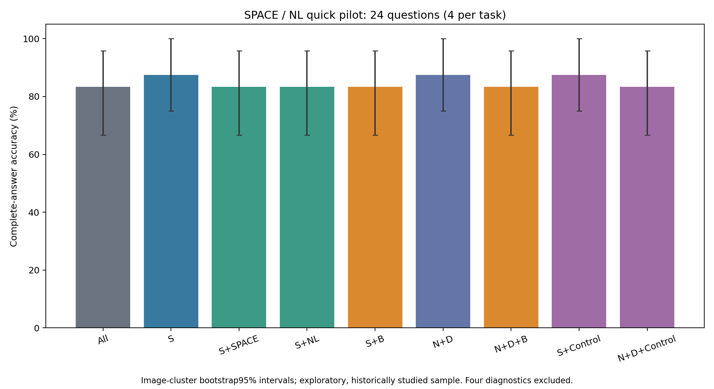
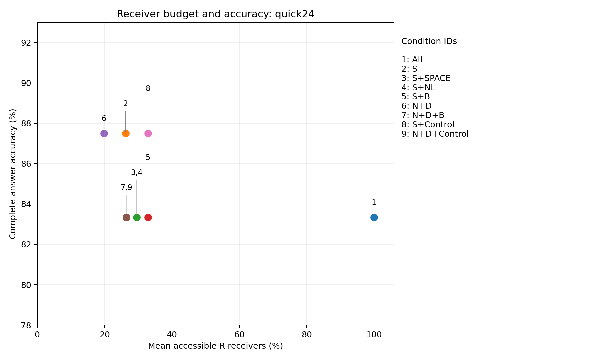
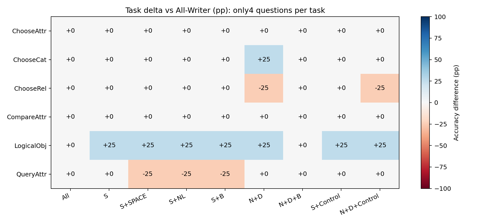

# SPACE / NL快速验证：24题均衡样本与4题诊断

**状态：QUICK24_COMPLETE；3000题正式实验未完成。** 本次按用户授权先做小规模快速验证，原3000题名单与接收集合未改动。

24题来自原pilot120，按固定SHA规则每任务4题，图像互不重复；4道用户指定历史失败题单列，不并入24题ACC。选择未使用本次输出，但原120题已有研究历史，因此并非独立确认样本。24题ACC每题相差4.167pp，不能外推3000题。

单卡GPU1，FP16/Eager/Transformers4.49.0，Greedy32与logits_to_keep=1。所有32层P−1和Decode禁读Image Key，只有原生Prefill R中选中位置可直接读图。SPACE=29871/位置581、NL=13/位置582；模板等预算对照是原Instruction中的Answer和the。原Prompt未改。

共252个条件标签：审计复用84条All/S/N+D历史生成，新增168条；成功采集墙钟89.2秒（包含模型加载与三道Smoke，不含CPU准备/统计）。首次环境记录字段错误发生在任何forward之前，失败现场保存在父目录attempts/pre_collection_environment_failure；修复并重新冻结后才启动本次采集。

## 24题完整答案ACC

| 条件 | 正确/24 | ACC | 相对All pp | S对→错 / 错→对 | 平均R预算 |
|---|---:|---:|---:|---:|---:|
| All-Writer | 20/24 | 83.333% | +0.000 | 2/1 | 100.00% |
| Semantic-k | 21/24 | 87.500% | +4.167 | 0/0 | 26.26% |
| S+SPACE | 20/24 | 83.333% | +0.000 | 1/0 | 29.57% |
| S+NL | 20/24 | 83.333% | +0.000 | 1/0 | 29.57% |
| S+SPACE+NL | 20/24 | 83.333% | +0.000 | 1/0 | 32.88% |
| Noun+Article | 21/24 | 87.500% | +4.167 | 2/2 | 19.80% |
| Noun+Article+SPACE+NL | 20/24 | 83.333% | +0.000 | 2/1 | 26.43% |
| S+Template-Control-2 | 21/24 | 87.500% | +4.167 | 0/0 | 32.88% |
| N+D+Template-Control-2 | 20/24 | 83.333% | +0.000 | 2/1 | 26.43% |

## 五组预设配对比较

Image SHA整簇配对Bootstrap20000次，seed20261104；下列为普通探索性95%CI。另列五项家族Bonferroni99%区间，不以跨0作为非劣效证明。小样本为方向与正确性检查，不做确认性结论。

| 左−右 | pp | 95%CI | 调整99%CI | 右对→左错 / 右错→左对 |
|---|---:|---|---|---:|
| S+SPACE+NL − Semantic-k | -4.167 | [-12.500, +0.000] | [-16.667, +0.000] | 1/0 |
| Noun+Article+SPACE+NL − Noun+Article | -4.167 | [-16.667, +8.333] | [-25.000, +12.500] | 2/1 |
| S+SPACE+NL − S+Template-Control-2 | -4.167 | [-12.500, +0.000] | [-16.667, +0.000] | 1/0 |
| Noun+Article+SPACE+NL − N+D+Template-Control-2 | +0.000 | [-12.500, +12.500] | [-16.667, +16.667] | 1/1 |
| S+SPACE − S+NL | +0.000 | [+0.000, +0.000] | [+0.000, +0.000] | 0/0 |

## 四道历史诊断题（不并入24题）

| ID / Gold | All | S | S+SPACE | S+NL | S+B | N+D | N+D+B | S+模板 | N+D+模板 |
|---|---|---|---|---|---|---|---|---|---|
| 001020372 / white | White | Black | Black | Black | Black | White | White | Black | White |
| 09662582 / train | Train | Truck | Truck | Train | Truck | Train | Train | Truck | Train |
| 10763612 / right | Right | Left | Left | Left | Left | Right | Right | Left | Right |
| 0160501 / yes | Yes | Door | Door | Yes | Yes | Yes | Yes | Door | Yes |

## 直接结论

本批24题没有观察到SPACE/NL带来的净ACC提升：S为21/24，而S+SPACE、S+NL和S+B均为20/24；S+B比S少1题（−4.167pp），同时低于等预算S+模板的21/24。N+D为21/24，N+D+B与N+D+模板均为20/24；后两者净ACC相同，但逐题各有1次相互损害/纠正，因此不是相同输出。置信区间和样本规模都不足以断言总体优劣。

4题诊断中，单加NL修复truck/train和Yes/Door两题；联合B只修复Yes/Door，truck/train在补SPACE后又回到Truck，说明单加NL的恢复不能直接组合。斑马黑白和原S为k=0的侧别题均未被B修复。4题的N+D基线已全部正确，补B没有新增修复。这里只说明特定案例的干预效果，不证明边界接收者总体有效。

主24题新增损害18509693：On which side is the fence?，Gold=left，S=Left，而SPACE、NL和联合B均变成Right；负面案例完整保留，没有用诊断题的成功掩盖主样本损害。

## 正确性与解释边界

三道固定真实7B Smoke通过：HF/No-op所有有效Logits严格torch.equal；All/S历史答案Token和首Token完整Logits向量严格一致；实际禁止概率0、非目标Mask不变、独立KV、32层MLP、Hook正常与异常清理检查通过。全部168条新生成逐层Mask与概率审计复核；每条件独立真实KV和前缀，原输入Hash与权重版本不变，同题投影视觉特征Hash一致。模型全部冻结文件、依赖实现及评分器SHA256重算通过。

输出异常（包含复用标签计数）共0条，详见validation.json。全部答案、Token IDs、真实接收位置、首Token变化及正负案例见CSV；没有计算Gold NLL。

24题上S+B相对S净变化-1题，N+D+B相对N+D净变化-1题。是否超出同预算模板，以预设配对表的直接比较为准；四个历史失败题的修复也必须结合模板结果解读。即使单题补位答对，也不证明该边界唯一存储视觉信息。

这是小样本探索结果，不能据此确认3000题提升或选择新词表。本次没有自动启动3000题矩阵，没有追加搜索或训练。原3000题设计与132题历史结果保持不变。

