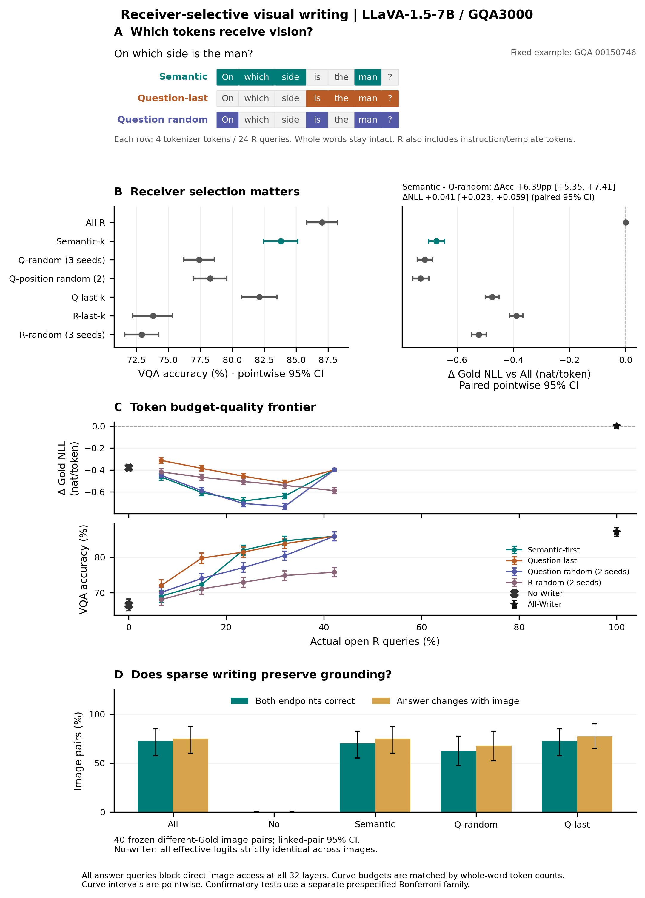

# Receiver-Selective Visual Writing: Which Tokens Need to See?

本实验属于 *The Visual Handoff: Efficient Visual Writing and Lightweight Answer Reading*。全部3000题均执行冻结协议；先报告全样本描述性结果，再报告与历史Semantic240图片不重叠的预先固定确认性子集。

**主要结果：** 全量完整答案ACC经独立重评分核验：All-Writer 2611/3000（87.03%），No-Writer 1998/3000（66.60%），自然Semantic-k 2514/3000（83.80%）。Semantic-k的ACC优于同预算问题内部随机，但预设Gold NLL优效检验未通过；图像不重叠确认集相对All-Writer下降3.56pp，亦未通过−2pp非劣效检验。较高预算仍有ACC增益，未证明早期无损平台。以下保留全部负面点和指标分歧。

## 1. 协议与实际样本

- 执行源码冻结Commit：`fd6da3078dba44429f72d9a26d3e934d7ea02eb7`；原始数据Manifest SHA256：`b5f6dec34cc5c96c6cce2d080b141bbbc8379d3d4b72e67f322ac1e63aa8e9f2`。
- LLaVA-1.5-7B，revision `b234b804b114d9e37bb655e11cbbb5f5e971b7a9`；FP16、Eager、Transformers4.49.0；Greedy最多32 Token，每条件、每指标独立真实KV Cache；自由生成与Teacher Forcing均使用 `logits_to_keep=1`。
- 3000道冻结GQA，六任务各500题，2409个Image SHA256簇。原Prompt、图像预处理、Tokenizer、Gold及评分器保持一致；原生Full不作为All-Writer。
- 44个逻辑条件、132000条逐题标签记录；同题完全相同写入集合去重为109518组独立生成与Gold NLL。去重不跨问题，不丢弃标签；主实验未以历史240题准确率替代任何3000题数据。
- 所有条件在32层均屏蔽原始P−1及所有真实Decode Query→原始576个Image Key；只改变Prefill R的开放接收位置。R为图像之后、P−1之前的非视觉文本，包含问题及模板。只做Softmax前Hard Mask；Image Query、其他连接、32层MLP、Residual和完整KV保持原生。
- 两张RTX3090以UUID固定，一卡一模型；按Image SHA256整簇分片，每卡1500题，同图不跨Worker。其他GPU任务未被干预。

## 2. 接收Token规则与预算审计

- Semantic-k逐字节复用历史STOP词表及完整选择器，240道重叠问题的完整自然选择结果逐项一致。其规则保留词法候选（包含疑问词、空间关系等），不能简单改称仅名词选择。Question-Only Random是新增的关键控制。
- 曲线以实际Question tokenizer token数的20/40/60/80/100%为目标，先向下取整，再取不超过目标的最大完整问题后缀Token预算；它构成所有策略可实现的共同预算。Semantic-first在精确整词预算下最大化词法候选Token数，确定性优先较早组；Question-Last为完整后缀；随机策略为固定随机优先级后首个可行整词子集，并非声称对全部子集均匀采样。
- 随机种子：[20261103, 20261107, 20261111]。曲线使用前两种子；自然预算使用三种子。先在每题内平均随机策略，再进行图片整簇统计，绝不把三种子当9000道独立题。
- 15000个逐题非零名义预算点中，1320个因整词共同可行性低于向下取整目标。原始Semantic-k在4题为k=0；全部保留且与No-Writer按集合去重，未删除或改选。
- `100% Question`仅开放问题Token，绝不等于`All-Writer = 100% R`。曲线横轴为逐题k/R后取平均，连接预算为全部32层576个Image Key下的理论可访问比例，不是实际FLOPs、显存或时延节省。
- 位置分层随机按Question Token索引的前/中/后三段精确匹配Semantic的逐段Token数，整词不拆分；两种子全部3000题均可行。
- 不嵌套题数：`{'Question-Last': 0, 'Question-Random-20261103': 236, 'Question-Random-20261107': 233, 'R-Random-20261103': 1139, 'R-Random-20261107': 1155, 'Semantic-first': 263}`。除Question-Last外，部分曲线集合不嵌套，因此相邻预算差异不能解释为逐Token边际因果增益。所有逐题集合、实际k和预算偏差在 `token_manifests/`。

## 3. 两套指标与统计设计

- 主机制指标为固定官方Gold完整答案的平均Teacher-Forced NLL（nat/token）。将一个ASCII空格和原Gold附加到展开后的原生Prompt，严格检查Prompt前缀不变、只保留原始BOS；Gold续写不含额外BOS或EOS。3430个Gold Token，326个多Token答案；所有3000题的续写IDs与旧输入映射一致。
- 每个Gold Token在原始P−1或真实后续Decode位置预测。保存原始FP16全词表Logits，以CPU FP64计算log_softmax和答案Token均值；符号保留，负ΔNLL不截断。它与首Token signed LogP Loss是不同指标。Greedy答案独立生成，不将Gold缓存混入生成缓存。
- 每个条件报告完整答案Accuracy、All原对→错/原错→对、首Token变化和异常。20,000次Image SHA256整簇配对Bootstrap，seed=20261104；每次保留被抽图片的全部问题，按题加权。所有曲线区间是普通点位95%CI，不是同时置信带。
- 确认子集按特定Semantic240的Question ID及全部Image SHA256排除，共2640题、2169图簇，排除360题；不是预设2656题。
- 两项确认检验预先固定为：(1) Semantic-k减Question-Only Random三种子均值的Gold NLL优效；(2) Semantic-k减All-Writer的Accuracy非劣效，界限−2pp。Bonferroni控制两项单侧检验家族α=.05，每项α=.025；分别要求NLL上97.5%界<0和Accuracy下2.5%界>−2pp。数值端点与普通双侧95%CI相同，但推断角色不同。−1pp仅敏感性判据；CI跨0不构成非劣效证明。

## 4. 自然Semantic-k的独立复现

| 条件 | 全3000题 Accuracy | 相对All ΔAcc(pp)及95%CI | ΔGold NLL及95%CI(nat/token) | 对→错 / 错→对 | 实际R预算 |
|---|---:|---|---|---:|---:|
| All-Writer | 87.033% | +0.000 [+0.000, +0.000] | +0.0000 [+0.0000, +0.0000] | 0.000 / 0.000 | 100.00% |
| No-Writer | 66.600% | -20.433 [-22.281, -18.613] | -0.3772 [-0.4037, -0.3504] | 754.000 / 141.000 | 0.00% |
| Semantic-k | 83.800% | -3.233 [-4.315, -2.148] | -0.6737 [-0.7016, -0.6455] | 184.000 / 87.000 | 25.79% |
| Question-Last-k | 82.133% | -4.900 [-6.070, -3.759] | -0.4753 [-0.4994, -0.4505] | 233.000 / 86.000 | 25.79% |
| R-Last-k | 73.800% | -13.233 [-14.880, -11.609] | -0.3894 [-0.4131, -0.3653] | 538.000 / 141.000 | 25.79% |
| Question-Random-k mean3 | 77.411% | -9.622 [-10.726, -8.488] | -0.7150 [-0.7420, -0.6881] | 394.667 / 106.000 | 25.79% |
| R-Random-k mean3 | 72.933% | -14.100 [-15.487, -12.738] | -0.5225 [-0.5480, -0.4964] | 544.000 / 121.000 | 25.79% |
| Question-Stratified-k mean2 | 78.267% | -8.767 [-9.983, -7.542] | -0.7298 [-0.7584, -0.7008] | 366.500 / 103.500 | 25.79% |
| Drop-Semantic | 74.667% | -12.367 [-13.962, -10.805] | -0.2877 [-0.3139, -0.2609] | 492.000 / 121.000 | 74.21% |

随机均值行的对→错/错→对为种子内逐题事件数的平均，可为非整数；每个固定种子的实际整数损害题数和全部输出保留在逐题表中。

## 5. 预算—质量曲线

| 策略 | 名义Question预算 | 实际R预算 | Accuracy | ΔAcc(pp) | ΔGold NLL(nat/token) |
|---|---:|---:|---:|---:|---:|
| Semantic-first | 20% | 6.65% | 69.033% | -18.000 | -0.4637 |
| Semantic-first | 40% | 14.99% | 72.333% | -14.700 | -0.6050 |
| Semantic-first | 60% | 23.50% | 81.933% | -5.100 | -0.6827 |
| Semantic-first | 80% | 32.00% | 84.567% | -2.467 | -0.6373 |
| Semantic-first | 100% | 42.14% | 85.833% | -1.200 | -0.3988 |
| Question-Last | 20% | 6.65% | 72.000% | -15.033 | -0.3123 |
| Question-Last | 40% | 14.99% | 79.733% | -7.300 | -0.3849 |
| Question-Last | 60% | 23.50% | 81.400% | -5.633 | -0.4564 |
| Question-Last | 80% | 32.00% | 83.767% | -3.267 | -0.5178 |
| Question-Last | 100% | 42.14% | 85.833% | -1.200 | -0.3988 |
| Question-Random mean2 | 20% | 6.65% | 70.083% | -16.950 | -0.4479 |
| Question-Random mean2 | 40% | 14.99% | 74.017% | -13.017 | -0.5893 |
| Question-Random mean2 | 60% | 23.50% | 77.067% | -9.967 | -0.7056 |
| Question-Random mean2 | 80% | 32.00% | 80.417% | -6.617 | -0.7324 |
| Question-Random mean2 | 100% | 42.14% | 85.833% | -1.200 | -0.3988 |
| R-Random mean2 | 20% | 6.65% | 68.067% | -18.967 | -0.4173 |
| R-Random mean2 | 40% | 14.99% | 71.100% | -15.933 | -0.4661 |
| R-Random mean2 | 60% | 23.50% | 72.933% | -14.100 | -0.5049 |
| R-Random mean2 | 80% | 32.00% | 74.833% | -12.200 | -0.5401 |
| R-Random mean2 | 100% | 42.14% | 75.767% | -11.267 | -0.5886 |

每个点的Accuracy和ΔNLL区间详见 `budget_curve.csv`；全部44固定标签和种子均值见 `condition_summary.csv`。没有拟合平滑曲线、删去负面点或按任务重选预算。

## 6. 确认性结果

Semantic-k确认子集：83.561%（ΔAcc -3.561pp，95%CI [-4.735, -2.405]）；ΔNLL -0.6732 nat/token [-0.7038, -0.6440]。
主检验1，Semantic-k−Question-Only Random均值：ΔGold NLL=+0.04324 nat/token；Bonferroni单侧上界=+0.06248；未达到预设词法选择优效判据。
主检验2，Semantic-k−All-Writer：ΔAccuracy=-3.561pp；Bonferroni单侧下界=-4.735pp；未达到−2pp非劣效判据。−1pp敏感性：未达到。
两项结果以 `confirmatory_tests.json` 为准；全样本、任务和其他预算比较均为描述/探索性，不用于替换预设主比较。

## 7. 图像交换控制

预先从相同问题、相同完整Prompt IDs、不同图片与不同Gold中构建40组，无图片跨组重复；40组均位于旧Semantic240图片之外。五条件端点全部来自本轮同协议主实验的严格审计复用，换图指标单独统计，不增加主样本数。
| 条件 | 两端均正确/40 | 随图改变/40 | 端点正确/80 | 首Token JS(nat) | 首Token TV |
|---|---:|---:|---:|---:|---:|
| All-Writer | 29 | 30 | 68 | 0.367848 | 0.678201 |
| No-Writer | 0 | 0 | 40 | 0.000000 | 0.000000 |
| Semantic-k | 28 | 30 | 66 | 0.251102 | 0.553532 |
| Question-Random-k-20261103 | 25 | 27 | 63 | 0.162069 | 0.417913 |
| Question-Last-k | 29 | 31 | 67 | 0.218897 | 0.536784 |

No-Writer在全部40组相同文本/视觉布局下，所有返回有效Greedy Logits（含EOS预测）严格`torch.equal`，不是只比较答案或首Token。不同Gold前缀的Teacher-Forcing后续Logits不作错误的跨图等值比较。每组两个图簇作为关联区块进行20,000次Bootstrap，保持两端配对；每组图SHA均不出现在其他组。JS/TV来自真实首Token完整分布。

## 8. 验证、负面案例与文件说明

- 57项CPU测试通过；统计实现另有4项合成数据测试。两卡各四道真实7B Smoke，含冻结三题及一个预先选定多Token Gold题；原生与多种No-op的全部有效Greedy和Gold Logits严格相等，跨卡原生Logits严格相等。
- 正式记录逐次检查32层实际禁止概率为0、非目标Mask精确不变、BOS/自环合法、Cache长度与绝对位置准确；MLP在Smoke中逐层检查；权重版本、输入Hash及Hook清理在每次条件中验证。完整原始Audit矩阵及所有Gold Logits可按SHA复核，所有保存NLL均重新计算且逐值一致。
- `per_question/`按六任务拆分132000条完整标签记录，`per_question_index.json`提供总数与SHA；`token_manifests/`为全部冻结集合；`shard*/checkpoints/`为109518份不可变科学记录；`accuracy_harm_cases.csv`保留All对→错，`all_incorrect_cases.csv`保留全部错误输出。
- `bootstrap/`保存原始20,000次重采样均值，`paired_comparisons.csv`保存所有预定对比；随机种子先逐题平均。`figures/`提供PNG和矢量PDF，作图输入CSV及脚本完整保留。
- 全词表原始数组位于服务器资源目录 `/data/lk/ATE-resources/experiments/gqa3000_token_visual_writing`，每份路径、字节数、SHA见检查点及 `raw_logits_hashes.json`。GitHub保存答案、Token IDs、Gold逐Token NLL和验证摘要，不声称包含这些服务器数组。

## 9. 研究回答与边界

**视觉写入性能是否随接收预算增加出现平台期？** 本轮没有建立两套指标共同支持的“少量接收Token即可无损饱和”平台。Semantic-first随名义Question预算20/40/60/80/100%增加，ACC依次为69.03/72.33/81.93/84.57/85.83%，实际开放R比例为6.65/14.99/23.50/32.00/42.14%。高预算处增益减缓，但80→100%仍增加1.267pp，配对95%CI [+0.470,+2.060]；Question-Last同期仍增加2.067pp [+1.204,+2.934]，Question-Random增加5.417pp [+4.499,+6.347]。因此不能宣称在80% Question预算已经饱和。100% Question与All-Writer之间没有采样额外预算点，不能推断该区间的曲线形状。

同时，Gold NLL并不随预算单调改善：Semantic-first的ΔNLL为−0.4637/−0.6050/−0.6827/−0.6373/−0.3988 nat/token，80→100%反而上升+0.2385 [+0.2218,+0.2553]，尽管ACC提高。这些是固定规则下完整曲线的描述性结果；部分集合不嵌套，不能解释成逐Token边际贡献，也不能凭某一点CI跨0宣称等效。Question全开放的ACC为2575/3000=85.83%，比All-Writer的2611/3000=87.03%低1.20pp，是更宽预算的探索性候选；图片不重叠子集差值−1.25pp，普通95%CI [−2.042,−0.485]，仍未构成预设−2pp的确认性结论。

**同等预算下，词法关键Token是否明显优于问题内部随机及位置选择？** 答案依赖指标和预算，不能给出统一肯定。自然Semantic-k开放逐题平均25.79%的R（平均7.899个Token；总连接池口径26.47%），ACC为83.80%，Question-Only Random三种子平均77.41%，两者相差+6.389pp，普通配对95%CI [+5.355,+7.415]。图片不重叠子集仍为+6.313pp [+5.203,+7.426]；与位置分层随机相比为+5.360pp [+4.276,+6.413]，与Question-Last相比为+1.402pp [+0.266,+2.552]。这提供了自然预算下“选择哪些问题Token影响最终答案”的探索性证据，不能简单归因于只要避开模板Token即可。

然而，预设的机制主检验是Gold NLL：确认集中Semantic-k减Question-Only Random为**+0.04324 nat/token**，普通95%CI [+0.02407,+0.06248]，Bonferroni单侧上界+0.06248，未达到NLL优效标准，且点估计方向相反。相对位置分层随机的NLL也更高+0.06131 [+0.04179,+0.08059]，相对Question-Last才更低−0.20193 [−0.22271,−0.18169]。因此本轮不支持“词法选择在预设机制主指标上优于问题内部随机”的论文主张。ACC优势是探索性伴随结果，不能事后替代确认性主终点。

预算扫描也存在明显负面点：20%和40% Question预算下，Semantic-first相对Question-Last的ACC分别低2.967pp [−4.377,−1.587]和7.400pp [−9.106,−5.711]；相对Question-Random也分别低1.050pp [−2.064,−0.034]和1.683pp [−2.944,−0.432]。自然Semantic-k的有效性不能外推成任何极低预算下的词法优先策略都有效。到100% Question预算，三种Question内部策略集合相同、输出相同，重合不是额外独立复现。

**少量关键Token直接读图，能否在图像不重叠确认子集中保留接近All-Writer的回答能力？** 按事前声明的−2pp标准，**不能在本轮确认**。确认集2640题、2169图簇中，All-Writer为2300/2640=87.12%，Semantic-k为2206/2640=83.56%；差值−3.561pp，配对95%CI [−4.735,−2.405]。Bonferroni单侧下界−4.735pp低于−2pp，−1pp敏感性标准亦未达到。真实事件为169题原对→错、75题原错→对；全3000题对应184题损害、87题纠正，不能只报告净下降97题。该图像不重叠划分避免了历史Semantic240图片复用，但GQA3000本身是历史复用数据，不是全新独立采集的外部盲测集。

**稀疏写入是否保留视觉依赖？** 预先冻结的40组异图同问题控制中，Semantic-k两端均正确28/40，All-Writer为29/40；二者均有30/40组答案随图变化。Semantic端点66/80正确，All为68/80；不能把这种小样本接近解释成统计等效，Question-Last也达到29/40两端均正确。No-Writer两端均正确0/40、随图变化0/40，全部有效Greedy Logits含EOS预测严格相同，JS=TV=0。该控制支持选定Token仍能传递图像相关信息，同时不证明Semantic是唯一或最优的接收者。

本轮的结论是：**接收Token选择会显著改变自由生成ACC，较宽的Question写入预算保留了较多能力；但自然Semantic-k在3000题上存在明确质量损失，两个预设确认性目标均未达到，Gold NLL与ACC亦出现方向分歧。** 不应将历史240题的近无损结果升级为论文级无损机制结论。本轮仅验证功能性接收Token稀疏，没有实现或证明实际计算、显存或时延节省；不追加层×Token搜索、Router、Kernel、KV剪枝或跨模型实验，完成交付后停止。

## 10. 输出异常汇总

| 条件 | 非EOS | 空答案 | 截断 | 重复3gram |
|---|---:|---:|---:|---:|
| All-Writer | 0 | 0 | 0 | 0 |
| No-Writer | 0 | 0 | 0 | 0 |
| Semantic-k | 0 | 0 | 0 | 0 |
| Question-Last-k | 0 | 0 | 0 | 0 |
| R-Last-k | 0 | 0 | 0 | 0 |
| Question-Random-k-20261103 | 0 | 0 | 0 | 0 |
| Question-Random-k-20261107 | 0 | 0 | 0 | 0 |
| Question-Random-k-20261111 | 0 | 0 | 0 | 0 |
| R-Random-k-20261103 | 0 | 0 | 0 | 0 |
| R-Random-k-20261107 | 0 | 0 | 0 | 0 |
| R-Random-k-20261111 | 0 | 0 | 0 | 0 |
| Drop-Semantic | 0 | 0 | 0 | 0 |
| Question-Stratified-k-20261103 | 0 | 0 | 0 | 0 |
| Question-Stratified-k-20261107 | 0 | 0 | 0 | 0 |
| Semantic-first-Q20 | 0 | 0 | 0 | 0 |
| Question-Last-Q20 | 0 | 0 | 0 | 0 |
| Question-Random-20261103-Q20 | 0 | 0 | 0 | 0 |
| Question-Random-20261107-Q20 | 0 | 0 | 0 | 0 |
| R-Random-20261103-Q20 | 0 | 0 | 0 | 0 |
| R-Random-20261107-Q20 | 0 | 0 | 0 | 0 |
| Semantic-first-Q40 | 0 | 0 | 0 | 0 |
| Question-Last-Q40 | 0 | 0 | 0 | 0 |
| Question-Random-20261103-Q40 | 0 | 0 | 0 | 0 |
| Question-Random-20261107-Q40 | 0 | 0 | 0 | 0 |
| R-Random-20261103-Q40 | 0 | 0 | 0 | 0 |
| R-Random-20261107-Q40 | 0 | 0 | 0 | 0 |
| Semantic-first-Q60 | 0 | 0 | 0 | 0 |
| Question-Last-Q60 | 0 | 0 | 0 | 0 |
| Question-Random-20261103-Q60 | 0 | 0 | 0 | 0 |
| Question-Random-20261107-Q60 | 0 | 0 | 0 | 0 |
| R-Random-20261103-Q60 | 0 | 0 | 0 | 0 |
| R-Random-20261107-Q60 | 0 | 0 | 0 | 0 |
| Semantic-first-Q80 | 0 | 0 | 0 | 0 |
| Question-Last-Q80 | 0 | 0 | 0 | 0 |
| Question-Random-20261103-Q80 | 0 | 0 | 0 | 0 |
| Question-Random-20261107-Q80 | 0 | 0 | 0 | 0 |
| R-Random-20261103-Q80 | 0 | 0 | 0 | 0 |
| R-Random-20261107-Q80 | 0 | 0 | 0 | 0 |
| Semantic-first-Q100 | 0 | 0 | 0 | 0 |
| Question-Last-Q100 | 0 | 0 | 0 | 0 |
| Question-Random-20261103-Q100 | 0 | 0 | 0 | 0 |
| Question-Random-20261107-Q100 | 0 | 0 | 0 | 0 |
| R-Random-20261103-Q100 | 0 | 0 | 0 | 0 |
| R-Random-20261107-Q100 | 0 | 0 | 0 | 0 |

## 11. Gold NLL与ACC分歧的表面形式诊断

`accuracy_export_validation.json`记录了132000条完整生成答案经冻结GQA评分器独立重评分，并对44个实际条件×8个人群的352组正确数、ACC、差值和损害/纠正数逐项精确复核，全部通过；未用首Token准确率或Teacher-Forced NLL代替完整答案ACC。全部109518份原始Gold Logits重算NLL亦逐值一致，位置、前缀、Token IDs及Cache审核通过。本节是看到指标分歧后的**CPU事后诊断**，不是新终点，也未更换Gold拼写或重跑GPU。

冻结NLL评价官方Gold的精确大小写和Token序列，而GQA评分器会归一化生成答案。All-Writer全部2611个判对答案、Semantic-k全部2514个判对答案，其去EOS后的实际生成Token序列都不等于冻结Gold序列；这些判对文本均能在casefold后与Gold一致。故“判对”并不意味着模型给精确Gold拼写较高概率。全样本绝对NLL为All-Writer 11.2331、No-Writer 10.8559、Semantic-k 10.5595 nat/token；与ACC次序不同，不能隐去绝对尺度或把负ΔNLL解释成更强视觉依赖。

以原Manifest第一题 `001020372` 为固定诊断例：Gold为`white`（Token 4796，`▁white`），All-Writer生成`White`（8037，`▁White`）而判对，精确Gold首Token仅排第14，NLL=11.6952。No-Writer生成`Black`判错，Gold NLL却降到11.4562；Semantic-k同样生成`Black`判错，NLL进一步降到9.7625。该例证明精确官方答案NLL与归一化ACC确实可以反向，不能据此断言全部差异只由大小写造成。完整诊断和原始路径见 `gold_surface_form_audit.json`，脚本见 `../../gqa3000_token_visual_writing/gold_surface_audit.py`。

本轮严格保留预设精确Gold NLL为机制主指标及其失败结论，不事后改成首字母大写Gold、答案同义词概率和或生成首Token指标。其表面形式敏感性限制了把该单一数值解释为语义视觉写入强度的有效性；ACC、换图控制与NLL必须并列阅读。

## 12. 六任务差异与预算口径

每类500题，以下为完整答案ACC（%）；所有点位的Gold NLL、配对差值及CI保留在 `task_accuracy_nll.csv`、`condition_summary.csv`、`paired_comparisons.csv` 及六任务图中，不按任务重新选择Token规则。

| 任务 | All-Writer | No-Writer | Semantic-k | Question-Random均值 | Question-Last-k | 100% Question |
|---|---:|---:|---:|---:|---:|---:|
| ChooseAttr | 82.40 | 64.60 | 74.60 | 69.80 | 75.40 | 81.40 |
| ChooseCat | 89.20 | 59.00 | 88.40 | 79.53 | 87.20 | 89.20 |
| ChooseRel | 82.60 | 55.20 | 79.80 | 74.47 | 73.80 | 81.40 |
| CompareAttr | 87.60 | 80.80 | 83.40 | 82.00 | 82.20 | 84.80 |
| LogicalObj | 95.80 | 92.60 | 97.00 | 90.13 | 94.40 | 96.20 |
| QueryAttr | 84.60 | 47.40 | 79.60 | 68.53 | 79.80 | 82.00 |

Semantic-k相对All的点估计从ChooseAttr的−7.80pp到LogicalObj的+1.20pp，不能以总体净值掩盖任务差异。它在ChooseAttr与QueryAttr也略低于Question-Last；词法选择并非每个任务最优。No-Writer在LogicalObj仍有92.60%，而QueryAttr仅47.40%，说明不读图的语言/数据先验也高度依赖任务，不能把其整体66.60%当作无视觉能力的零点。

自然Semantic-k的实际R预算，图中使用逐题比例均值25.7946%；按全部连接总数计算则为26.4670%。100% Question为逐题R比例均值42.1430%，而All-Writer为100% R；二者不可混写。预算统计文件同时保留宏平均与连接池总量口径及每题实际k。自然四题k=0仍全部保留。位置分层随机在所有3000题精确匹配三段Token配额，但它与Semantic集合存在较高重叠（两种子分别432/418题完全相同），是位置分布控制，不是与Semantic无交集的控制。

## 13. 可复现交付

执行源码冻结Commit为 `fd6da3078dba44429f72d9a26d3e934d7ea02eb7`。统计及作图源码哈希在读取汇总结果前冻结于 `postprocessing_freeze_v3.json`（并保留此前版本）；之后新增的ACC重评分与表面形式诊断仅作CPU质检，来源哈希各自记录。中文解释在读取固定结果后撰写，不改变实验、统计或作图规则。

PNG、矢量主图PDF与八页补充PDF已逐页渲染检查，检查记录见 `visual_layout_review.json`。`completion.json`在全部答案、原始数组、检查点、模型文件、源码、统计、ACC复核、图表和资源释放审核完成后才写入COMPLETE；它列出交付文件SHA。GPU资源释放记录同时保留生成结束时的即时快照和交付前快照。原始全词表数组仅存服务器，不属于GitHub交付文件。
