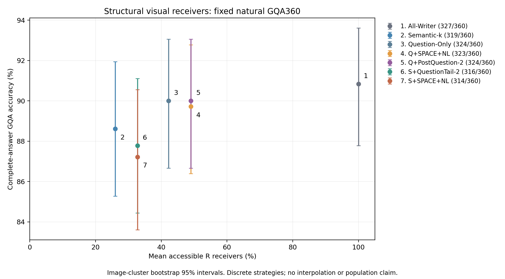
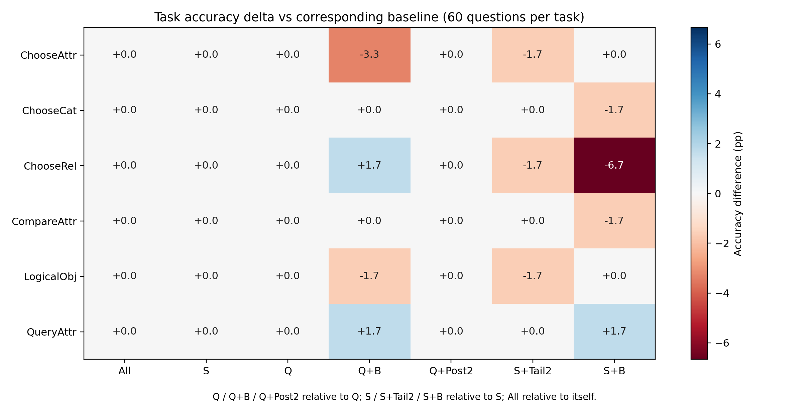

# Structural Receiver Selection：Question、Boundary与Question-tail（GQA360）

**状态：GQA360_STRUCTURAL_RECEIVER_COMPLETE。** 本轮仅完成冻结360题、四个新增策略，没有启动3000题矩阵、增加条件或修改Token规则。

## 研究设置与选样

从原GQA3000取六任务各60题，共360题、360张不同图片。选样只使用任务、图像SHA、Token可行性与历史图片排除规则；不读取S/All正确性、NLL、Attention Mass或恢复结果作为选择输入。先硬排除Quick24/Diagnostic4/Failure Probe全部图片，优先排除Semantic240与Noun+Article Pilot120图片，再按SHA256("structural-receiver-gqa360-v1|task|question_id|image_sha256")在固定任务顺序中升序选择并全局去重。360张图片全部在优先未测池内，无回填；这是内部探索样本，不是独立外部验证。全部3000候选及排除/未入选理由见candidate_audit.csv。历史失败Probe图片的排除及任务均衡也会改变样本分布，因此本360题较高的历史基线ACC不能直接外推3000题。

CPU阶段逐题核验原Prompt、Tokenizer IDs、冻结Offset与Question范围：3000题均满足定义，Token不可行排除数为0。Question-final-token严格为Q最后一个真实Token；PostQuestion-NL为紧邻其后的原生ID13；Instruction-Answer是再后一个独立单Token。S+Tail新增final+post，S+B新增位置581/582；Q+Post新增post+Answer，Q+B新增581/582。四策略均严格多2个Token，没有臆造、替换或插入Prompt。逐题角色、ID、piece、decode、offset、原文与S/Q/R成员关系见token_audit.csv。

基线commit `1159c2197a6611fa236b520b4653424eaf192125`；冻结执行commit `be8264ecb505116bdf541f4e2aecf9064698ed70`。sample_manifest.csv SHA256=`621d8325b62fd32ff5a1beb215dd72dfae6dea8041bb3fec126e9ea4c53f0486`；sample_plan.json SHA256=`738903280c387af78a48173815196afbed3937d3d5fba562e984b5897e7c726e`。原模型revision `b234b804b114d9e37bb655e11cbbb5f5e971b7a9`，模型文件在执行前及统计时两次完整SHA256核验，见model_preflight_sha256.json与validation.json。

## 严格区分各条件

Native Full开放原生全部连接；本轮未执行Native Full，不能将历史3000题87.567%作为本360题数值。All-Writer为全部Prefill R读图、所有32层P−1/真实Decode禁读原始Image Key。Question-Only只开放完整Q，Semantic-k只开放冻结自然S。历史Question-Only实际来自Semantic-first-Q100，已对3000题逐题确认Writer位置等于完整Q（包括末尾标点），并对所选360题审计原Prompt/input/image/Writer/Token/答案/归一化评分/独立KV协议和提交字节，不能仅凭名称复用。

新增四条件只有R→Image Key的Softmax前Hard Mask不同；全部32层P−1/Decode始终禁读图，Image Query、QKV、MLP、Residual和完整KV计算保持原生，每条件独立真实KV及前缀。LLaVA-1.5-7B，FP16/Eager/Transformers4.49.0，Greedy32，logits_to_keep=1，沿用原GQA完整答案评分，不计算Gold NLL。不涉及物理视觉Token删除或实际加速。Q+Post的两个新增位置中一个是词法Instruction-Answer，因此其效应不能称为两个纯边界的效应。

## 完整答案Accuracy与正负翻转

| 条件 | 来源 | 正确/360 | ACC | 相对All pp | 对应基线 | 对应差值pp | 原对→错 / 原错→对 | 平均k | 平均k/R |
|---|---|---:|---:|---:|---|---:|---:|---:|---:|
| All-Writer | 历史审计复用 | 327/360 | 90.833% | +0.000 | All-Writer | +0.000 | 0/0 | 29.903 | 100.00% |
| Semantic-k | 历史审计复用 | 319/360 | 88.611% | -2.222 | Semantic-k | +0.000 | 0/0 | 7.972 | 25.95% |
| Question-Only | 历史审计复用 | 324/360 | 90.000% | -0.833 | Question-Only | +0.000 | 0/0 | 12.903 | 42.20% |
| Q+SPACE+NL | 新增生成 | 323/360 | 89.722% | -1.111 | Question-Only | -0.278 | 6/5 | 14.903 | 49.00% |
| Q+PostQuestion-2 | 新增生成 | 324/360 | 90.000% | -0.833 | Question-Only | +0.000 | 1/1 | 14.903 | 49.00% |
| S+QuestionTail-2 | 新增生成 | 316/360 | 87.778% | -3.056 | Semantic-k | -0.833 | 4/1 | 9.972 | 32.75% |
| S+SPACE+NL | 新增生成 | 314/360 | 87.222% | -3.611 | Semantic-k | -1.389 | 10/5 | 9.972 | 32.75% |

全部答案改变数、首Token翻转、相对All/S/Q的差值与EOS/截断/空答案/重复三元组计数见accuracy_summary.csv及per_condition.csv。Writer比例先逐题k/R再求均值，不将Question100%误称为R100%。

## 五个预先固定的配对比较

Image SHA整簇配对Bootstrap20000次、seed=20261104，Question等权；本轮每图只有1题，但仍按图片构建簇。第一项为主要探索性比较，其余为预设辅助比较；同时提供普通95%及五比较Bonferroni99%区间。不以跨0证明无损或非劣效。单位pp。

| 左−右 | 差值 | 95%CI | 调整99%CI | 右对→左错 / 右错→左对 |
|---|---:|---|---|---:|
| Q+SPACE+NL − Question-Only | -0.278 | [-2.222, +1.667] | [-2.778, +2.222] | 6/5 |
| Q+PostQuestion-2 − Question-Only | +0.000 | [-0.833, +0.833] | [-1.111, +1.111] | 1/1 |
| Q+SPACE+NL − Q+PostQuestion-2 | -0.278 | [-2.222, +1.667] | [-2.778, +2.222] | 7/6 |
| S+QuestionTail-2 − S+SPACE+NL | +0.556 | [-1.389, +2.500] | [-1.944, +3.333] | 6/8 |
| S+SPACE+NL − Semantic-k | -1.389 | [-3.611, +0.556] | [-4.167, +1.389] | 10/5 |

## 七项研究判断

1. Q+B为323/360，Q为324/360，净-1题（-0.278pp）；调整99%区间跨0，优劣仍不确定。这里比较同批360题的审计历史Q，而非直接对比3000题历史百分比。
2. 相同新增2个Token，Q+Post为324/360，Q+B为323/360；Q+B−Q+Post=-0.278pp，调整99%区间跨0，优劣仍不确定。
3. S+Tail为316/360，S+B为314/360；S+Tail−S+B=+0.556pp，调整99%区间跨0，优劣仍不确定。
4. 新策略对各自基线的纠正/损害分别为：Q+SPACE+NL纠正5、损害6；Q+PostQuestion-2纠正1、损害1；S+QuestionTail-2纠正1、损害4；S+SPACE+NL纠正5、损害10。不能只报告纠正数。
5. 最好的预算取舍仍来自原有Question-Only：平均R预算42.20%时324/360（90.00%），与约49.00%预算的Q+Post相同，且高于同预算Q+B的323题。更低预算的原Semantic-k为25.95%、319/360；两种S+2策略均用32.75%预算但答对更少。所有四个新增条件在本批点估计上均被其原S或Q基线支配；非支配前沿仅为S、Q、All-Writer。这不是总体最优或非劣效证明。
6. 没有足够证据支持Question-conditioned Receiver优于前置边界：Q+Post比Q+B多1题（+0.278pp），S+Tail比S+B多2题（+0.556pp），但两项普通95%及调整99%区间均跨0，且它们都没有超过各自原Q/S基线。后置位置在因果时序上可以读取完整问题，并不保证开放直接读图权限有净收益；Q+Post还混入词法Answer，不能将差异纯归因于边界。
7. 本批没有出现值得优先带入大规模验证的新结构策略，不建议仅因历史失败题恢复而扩展S+B。若之后获得独立授权，更合理的固定验证对象是Question-Only这一较好的现有预算折中，而不是继续搜索边界或尾部位置。任何更大规模、图像不重叠验证都未在本轮执行。

## 六任务与非单调案例

六任务全部条件的ACC、对应基线差值和翻转见task_accuracy.csv；没有根据任务表现改策略。必需五类案例及额外S→Tail损害、等预算输出变化全部保存在required_case_categories.csv。类别允许重叠：{"S_correct_SB_wrong": 10, "Q_correct_QB_wrong": 6, "Q_correct_QPost_wrong": 1, "STail_correct_SB_wrong": 8, "SB_correct_STail_wrong": 6, "S_correct_STail_wrong": 4, "Q_equal_budget_answer_change": 13, "S_equal_budget_answer_change": 14}。harm_cases/recovered_cases保留各新策略相对对应S/Q的完整损害与纠正，nonmonotonic_cases保留全部指定方向的不单调评分案例。per_question.csv保留每题所有答案、Token IDs、Writer与预算。代表题按冻结SHA最小选择，不只展示成功。

### S_correct_SB_wrong：14209478 / ChooseRel

Is the car to the left or to the right of the man that is wearing a shirt?

Gold：left。

| 条件 | 完整回答 | 正确 | 新增位置 |
|---|---|---:|---|
| All-Writer | Right | 0 | [] |
| Semantic-k | Left | 1 | [] |
| Question-Only | Right | 0 | [] |
| Q+SPACE+NL | Right | 0 | [581, 582] |
| Q+PostQuestion-2 | Right | 0 | [604, 605] |
| S+QuestionTail-2 | Right | 0 | [603, 604] |
| S+SPACE+NL | Right | 0 | [581, 582] |

完整Writer集合：`{"All-Writer": [581, 582, 583, 584, 585, 586, 587, 588, 589, 590, 591, 592, 593, 594, 595, 596, 597, 598, 599, 600, 601, 602, 603, 604, 605, 606, 607, 608, 609, 610, 611, 612, 613, 614, 615, 616, 617, 618], "Q+PostQuestion-2": [583, 584, 585, 586, 587, 588, 589, 590, 591, 592, 593, 594, 595, 596, 597, 598, 599, 600, 601, 602, 603, 604, 605], "Q+SPACE+NL": [581, 582, 583, 584, 585, 586, 587, 588, 589, 590, 591, 592, 593, 594, 595, 596, 597, 598, 599, 600, 601, 602, 603], "Question-Only": [583, 584, 585, 586, 587, 588, 589, 590, 591, 592, 593, 594, 595, 596, 597, 598, 599, 600, 601, 602, 603], "S+QuestionTail-2": [585, 586, 588, 589, 590, 592, 593, 595, 596, 598, 599, 601, 602, 603, 604], "S+SPACE+NL": [581, 582, 585, 586, 588, 589, 590, 592, 593, 595, 596, 598, 599, 601, 602], "Semantic-k": [585, 586, 588, 589, 590, 592, 593, 595, 596, 598, 599, 601, 602]}`。

### Q_correct_QB_wrong：187436 / QueryAttr

On which side is the fence?

Gold：left。

| 条件 | 完整回答 | 正确 | 新增位置 |
|---|---|---:|---|
| All-Writer | Right | 0 | [] |
| Semantic-k | Left | 1 | [] |
| Question-Only | Left | 1 | [] |
| Q+SPACE+NL | Right | 0 | [581, 582] |
| Q+PostQuestion-2 | Left | 1 | [591, 592] |
| S+QuestionTail-2 | Left | 1 | [590, 591] |
| S+SPACE+NL | Right | 0 | [581, 582] |

完整Writer集合：`{"All-Writer": [581, 582, 583, 584, 585, 586, 587, 588, 589, 590, 591, 592, 593, 594, 595, 596, 597, 598, 599, 600, 601, 602, 603, 604, 605], "Q+PostQuestion-2": [583, 584, 585, 586, 587, 588, 589, 590, 591, 592], "Q+SPACE+NL": [581, 582, 583, 584, 585, 586, 587, 588, 589, 590], "Question-Only": [583, 584, 585, 586, 587, 588, 589, 590], "S+QuestionTail-2": [583, 584, 585, 588, 589, 590, 591], "S+SPACE+NL": [581, 582, 583, 584, 585, 588, 589], "Semantic-k": [583, 584, 585, 588, 589]}`。

### Q_correct_QPost_wrong：03586731 / ChooseRel

Is the blue vehicle to the left or to the right of the person that is wearing trousers?

Gold：left。

| 条件 | 完整回答 | 正确 | 新增位置 |
|---|---|---:|---|
| All-Writer | Left | 1 | [] |
| Semantic-k | Left | 1 | [] |
| Question-Only | Left | 1 | [] |
| Q+SPACE+NL | Left | 1 | [581, 582] |
| Q+PostQuestion-2 | Right | 0 | [605, 606] |
| S+QuestionTail-2 | Left | 1 | [604, 605] |
| S+SPACE+NL | Left | 1 | [581, 582] |

完整Writer集合：`{"All-Writer": [581, 582, 583, 584, 585, 586, 587, 588, 589, 590, 591, 592, 593, 594, 595, 596, 597, 598, 599, 600, 601, 602, 603, 604, 605, 606, 607, 608, 609, 610, 611, 612, 613, 614, 615, 616, 617, 618, 619], "Q+PostQuestion-2": [583, 584, 585, 586, 587, 588, 589, 590, 591, 592, 593, 594, 595, 596, 597, 598, 599, 600, 601, 602, 603, 604, 605, 606], "Q+SPACE+NL": [581, 582, 583, 584, 585, 586, 587, 588, 589, 590, 591, 592, 593, 594, 595, 596, 597, 598, 599, 600, 601, 602, 603, 604], "Question-Only": [583, 584, 585, 586, 587, 588, 589, 590, 591, 592, 593, 594, 595, 596, 597, 598, 599, 600, 601, 602, 603, 604], "S+QuestionTail-2": [585, 586, 587, 589, 590, 591, 593, 594, 596, 597, 599, 600, 601, 602, 603, 604, 605], "S+SPACE+NL": [581, 582, 585, 586, 587, 589, 590, 591, 593, 594, 596, 597, 599, 600, 601, 602, 603], "Semantic-k": [585, 586, 587, 589, 590, 591, 593, 594, 596, 597, 599, 600, 601, 602, 603]}`。

### STail_correct_SB_wrong：187436 / QueryAttr

On which side is the fence?

Gold：left。

| 条件 | 完整回答 | 正确 | 新增位置 |
|---|---|---:|---|
| All-Writer | Right | 0 | [] |
| Semantic-k | Left | 1 | [] |
| Question-Only | Left | 1 | [] |
| Q+SPACE+NL | Right | 0 | [581, 582] |
| Q+PostQuestion-2 | Left | 1 | [591, 592] |
| S+QuestionTail-2 | Left | 1 | [590, 591] |
| S+SPACE+NL | Right | 0 | [581, 582] |

完整Writer集合：`{"All-Writer": [581, 582, 583, 584, 585, 586, 587, 588, 589, 590, 591, 592, 593, 594, 595, 596, 597, 598, 599, 600, 601, 602, 603, 604, 605], "Q+PostQuestion-2": [583, 584, 585, 586, 587, 588, 589, 590, 591, 592], "Q+SPACE+NL": [581, 582, 583, 584, 585, 586, 587, 588, 589, 590], "Question-Only": [583, 584, 585, 586, 587, 588, 589, 590], "S+QuestionTail-2": [583, 584, 585, 588, 589, 590, 591], "S+SPACE+NL": [581, 582, 583, 584, 585, 588, 589], "Semantic-k": [583, 584, 585, 588, 589]}`。

### SB_correct_STail_wrong：02110288 / ChooseAttr

Does the paper cup appear to be red or white?

Gold：red。

| 条件 | 完整回答 | 正确 | 新增位置 |
|---|---|---:|---|
| All-Writer | Red | 1 | [] |
| Semantic-k | Red | 1 | [] |
| Question-Only | White | 0 | [] |
| Q+SPACE+NL | White | 0 | [581, 582] |
| Q+PostQuestion-2 | White | 0 | [594, 595] |
| S+QuestionTail-2 | White | 0 | [593, 594] |
| S+SPACE+NL | Red | 1 | [581, 582] |

完整Writer集合：`{"All-Writer": [581, 582, 583, 584, 585, 586, 587, 588, 589, 590, 591, 592, 593, 594, 595, 596, 597, 598, 599, 600, 601, 602, 603, 604, 605, 606, 607, 608], "Q+PostQuestion-2": [583, 584, 585, 586, 587, 588, 589, 590, 591, 592, 593, 594, 595], "Q+SPACE+NL": [581, 582, 583, 584, 585, 586, 587, 588, 589, 590, 591, 592, 593], "Question-Only": [583, 584, 585, 586, 587, 588, 589, 590, 591, 592, 593], "S+QuestionTail-2": [585, 586, 587, 588, 590, 591, 592, 593, 594], "S+SPACE+NL": [581, 582, 585, 586, 587, 588, 590, 591, 592], "Semantic-k": [585, 586, 587, 588, 590, 591, 592]}`。

### S_correct_STail_wrong：14209478 / ChooseRel

Is the car to the left or to the right of the man that is wearing a shirt?

Gold：left。

| 条件 | 完整回答 | 正确 | 新增位置 |
|---|---|---:|---|
| All-Writer | Right | 0 | [] |
| Semantic-k | Left | 1 | [] |
| Question-Only | Right | 0 | [] |
| Q+SPACE+NL | Right | 0 | [581, 582] |
| Q+PostQuestion-2 | Right | 0 | [604, 605] |
| S+QuestionTail-2 | Right | 0 | [603, 604] |
| S+SPACE+NL | Right | 0 | [581, 582] |

完整Writer集合：`{"All-Writer": [581, 582, 583, 584, 585, 586, 587, 588, 589, 590, 591, 592, 593, 594, 595, 596, 597, 598, 599, 600, 601, 602, 603, 604, 605, 606, 607, 608, 609, 610, 611, 612, 613, 614, 615, 616, 617, 618], "Q+PostQuestion-2": [583, 584, 585, 586, 587, 588, 589, 590, 591, 592, 593, 594, 595, 596, 597, 598, 599, 600, 601, 602, 603, 604, 605], "Q+SPACE+NL": [581, 582, 583, 584, 585, 586, 587, 588, 589, 590, 591, 592, 593, 594, 595, 596, 597, 598, 599, 600, 601, 602, 603], "Question-Only": [583, 584, 585, 586, 587, 588, 589, 590, 591, 592, 593, 594, 595, 596, 597, 598, 599, 600, 601, 602, 603], "S+QuestionTail-2": [585, 586, 588, 589, 590, 592, 593, 595, 596, 598, 599, 601, 602, 603, 604], "S+SPACE+NL": [581, 582, 585, 586, 588, 589, 590, 592, 593, 595, 596, 598, 599, 601, 602], "Semantic-k": [585, 586, 588, 589, 590, 592, 593, 595, 596, 598, 599, 601, 602]}`。

## 图表

图1各点对应离散策略，无平滑或插值连线，误差条为点位95%CI；图2按各自S/Q基线显示六任务pp差，不能把两个不同基线的颜色直接解释成策略间差。另提供可编辑矢量SVG。

## 正确性、执行与资源

两卡UUID：`GPU-a63c6362-dcfd-4a26-c44b-014b40127c89`、`GPU-b08489af-0a8a-eb48-55ba-8346733af417`，按Image SHA排序交替分片，各180题、720条新生成；每Worker独立模型、KV、样本文件、Checkpoint目录和文件锁，原子JSON/NPZ。启动前均重新满足无Compute进程、util=0、used<200MiB/free>22000MiB。两卡各自真实7B Smoke全部完成后CPU GO关卡才放行主采集。

每卡三道固定Smoke严格复现Native/No-op全部有效Logits，以及历史All/S/Q答案Token和首Token完整Logits向量torch.equal；独立KV、32MLP、原输入/权重、Hook正常及异常清理通过。另在每卡对四种冻结新增结构Writer进行实际Mask Smoke。1440条主生成全部逐层复核禁止概率0、非目标Mask不变、MLP32层执行、权重版本/输入Hash不变、同题投影视觉特征一致、Writer精确匹配、有效Logits逐步argmax与保存Token一致。Attention FP16行和仍使用历史0.002审计界限，没有改精度或放宽断言。

历史复用1080条，新增1440条，共2520个条件标签，无NOT_GENERATED。异常标签数0（详见validation.json）。双GPU采集墙钟332.1秒/5.54分钟，含加载、各自Smoke与正式生成，不含CPU冻结、统计和提交；不将该时间解释为推理优化加速。

GPU释放审计：{"all_own_children_exited": true, "selected_devices_no_compute_processes": true, "selected_uuids": ["GPU-a63c6362-dcfd-4a26-c44b-014b40127c89", "GPU-b08489af-0a8a-eb48-55ba-8346733af417"]}。只停止/退出本轮自有Worker，不影响其他实验；显存和进程以gpu_release.json的当时快照为准。

Git保存完整JSON检查点、Worker日志及checkpoint_index/smoke_raw_index；原始FP16首Token/有效Logits和逐层数值数组位于服务器资源目录，索引给出绝对路径、字节数与SHA256，不声称GitHub包含NPZ。历史复用的输入、Token组与生成JSON提交字节审计见history_byte_audit.json。执行命令：本包run freeze，提交冻结源码/协议，run driver；完成后CPU运行analyze及delivery。历史输出、main保持不变。本轮停止，不追加3000题、规则搜索、物理删除、Router、Kernel或跨模型实验。
