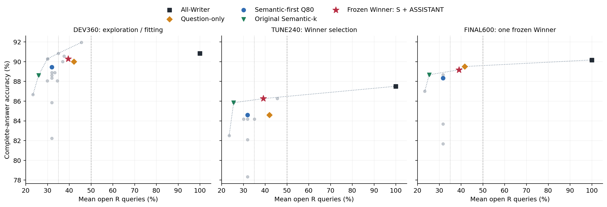
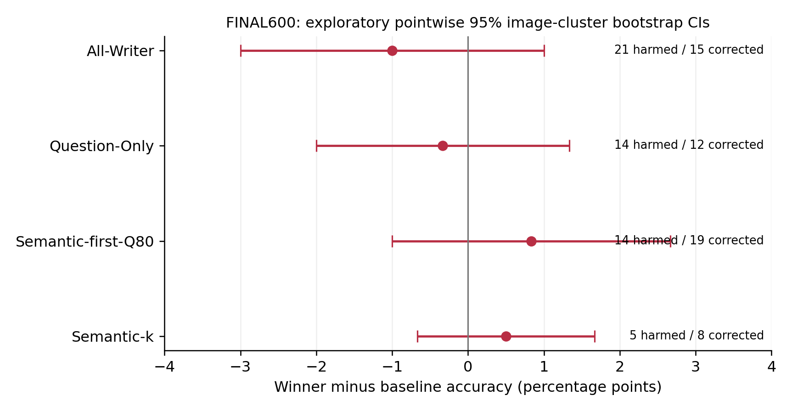

# 五小时自主搜索：文本视觉 Receiver 选择

本轮在用户追加授权的**平均 R 预算严格小于50%**约束下，冻结的 Winner 为 **原 Semantic-k 集合 S，加上原生 Prompt 中最后一个 R 完整词组 ASSISTANT 的4个Subword位置**。FINAL600 为 **535/600，89.167%**，平均 R 预算 **39.071%**。相对 All-Writer −1.000pp，相对 Question-Only −0.333pp，相对 Q80 +0.833pp，相对原 S +0.500pp。四组配对区间均不能确认优势，Holm校正后均无显著差异；不能将区间包含0解释为非劣效。

**原始≤35%目标没有获得可迁移的新方法胜利。** DEV上学习型预算路由的表观收益在TUNE消失。新的约39%方案只是在放宽后的预算内给出接近All-Writer的点估计，不冒充原始35%目标的成功。原协议、追加预算授权和全部失败尝试均保留。

保持Winner不变补齐GQA3000后为 **2560/3000（85.333%），R=39.408%**；原S为2514，Q80为2537，Question-Only为2575，All为2611。对S净增46题，但额外增加了4个接收Token；图片隔离的扩展764题仅比S多对1题。**本轮自动搜索未发现优于现有策略的可验证方案；在已审计完整3000题、平均R<50%的方法中，当前准确率最高的既有基线仍是Question-Only：2575/3000（85.833%），R=42.143%。** 新方案提供较低预算的描述性前沿点，不等于稳定超越该基线。

## 1. 时间、数据和协议

保守起点 2026-11-03T20:55:17.960269+00:00，硬截止 2026-11-04T01:55:17.960269+00:00。本报告生成时保守累计 97.25 分钟，包含首次读取附件的5分钟预留；最终Commit/Push实测收据另存服务器资源目录 delivery_receipt.json，最终完整提交号见交付消息与Git历史。没有重置时钟。到225分钟停止设计、270分钟停止GPU的边界始终保留。本轮完成了 19 个有结果的任务，其中包含开发筛选、1094次词组删除、958次等预算交换、TUNE和单Winner FINAL；注册 45 个输入规则/模型定义，未实际推理的CPU定义明确标记，干预索引不冒充独立选择器。

DEV360为原固定360题，TUNE240每任务40题，FINAL600每任务100题；三者图片SHA完全不重叠，确定性SHA抽样，无回填。FINAL另排除旧Semantic240、名词冠词Pilot、错误案例及定向探针图片。全部来自历史GQA3000，因此FINAL是**本次搜索隔离的内部Holdout**，不是新的外部确认数据。冻结前分析入口禁止读取其Gold、历史答案、正确性、NLL或Attention指标；数据保管代码仅序列化独立Gold资源，公开input_specs不含Gold或输出。

LLaVA-1.5-7B revision b234b804b114d9e37bb655e11cbbb5f5e971b7a9，FP16/Eager/Transformers4.49.0，Greedy32，logits_to_keep=1。全部32层P−1及真实Decode禁止读原始576个Image Key，仅选择Prefill R的开放位置。原始图片、Prompt、Token ID、位置、QKV、MLP、Residual及真实独立KV保持不变。All-Writer也禁止答案阶段直接读图，**不是Native Full**。仅功能性Hard Mask，没有物理跳过及加速测量。

## 2. 搜索过程及负面证据

- **固定Q80预算反向剪枝优先执行。** 四种角色/位置规则先筛60题、扩到180题；成熟role-balanced扩360为319，semantic-edges为320，均低于相同360题Q80的322。Q75精确整词预算为29.961%，仅317/360。
- **Question-Only词组LOO：96题、1094次。** 30次使原对变错，22次使原错变对。第一词组96次删除0损害/2纠正，但直接删除Question头部的180题策略仍低于Question-Only，不能据此宣布疑问词统一冗余。`the`158次中4损害/1纠正，`or`64次中3损害/1纠正，`to`41次中1损害/1纠正，同一词在不同问题及组合中的作用不同。
- **LOO因果风险学习失败。** 初始单折只有一个正标签，较高AUC不可靠；五个图片隔离折的OOF AUC约0.45–0.56。POS/no-POS、绝对/题内中心化标签和轻量Ridge均保留参数、特征、折及训练耗时。未约束模型的180题ACC降至154–158/180；强制保留原core覆盖后的混合方案为161–162，仍不胜Q80的163。
- **固定k的958次整词Swap：** 50损害、24纠正，其余884不变。交换标签训练的跨图片折预测力仍弱；据此得到的两个实际选择器均为161/180，未出现可迁移收益。不是只保存有效补词。
- **结构剪枝未泛化：** 去头部及标点的候选曾在180题持平Q80，扩360为317，低于Q80的322和Question-Only的324。首词组LOO安全不能推出联合剪枝安全。
- **DEV训练的自适应预算：** 60/80路由达到325/360、29.997%预算；80/100路由达到327/360、34.976%。这些是训练数据上的表观分数。TUNE二者均202/240，分别30.091%、35.092%，既无准确率收益，也发生预算阈值漂移；绝不事后调阈值满足30%/35%。
- **较晚的接收位置：** ASSISTANT单独开放仅132/180，单个末尾指令词仅115/180，不能替代Question接收者。Q80+ASSISTANT在180题为168、扩360为331；同样逐题增加4 Token的末尾指令词对照为162/180。该DEV对照净增6题，探索性区间[+1.111,+6.111]pp，未校正所有搜索，不作为确认性证据。Q85+ASSISTANT仍168/180而预算更高，未晋级。
- **候选按完整360题比较：** S+ASSISTANT325，Q50+ASSISTANT320，Q60+ASSISTANT324，Q80+ASSISTANT331。小样本180分数不与360或600混合排序。

所有候选定义在对应推理前保存配置、源码快照和SHA。CPU后续实现修改不会改写既有候选的selection_source.py；每个任务绑定实际配置/源码、输入和接收位置。原S/历史基线仅在输入、位置、模型协议、提交记录和原始资源SHA全部一致后复用。

## 3. TUNE一次选择，FINAL只测一个Winner

TUNE开始前锁定四个新方法：Q80+ASSISTANT、S+ASSISTANT、≤30%目标路由、≤35%目标路由；原S、Q80、Question-Only也有资格胜出。规则是平均R<50%下最大化完整答案正确数，同分依次更低预算、更简单规则、固定ID字典序。

TUNE：All210；原S206；Q80及Question-Only各203；两种路由各202；两种ASSISTANT方案各207。按预算同分规则选择S+ASSISTANT，TUNE预算39.195%，而Q80+ASSISTANT为45.549%。冻结时间 **2026-11-03T22:07:34.496235+00:00**。随后600题全部**重新完整生成**，无历史答案代替Winner，未试第二个新方法，未根据FINAL结果修改规则。

| 条件 | 正确数 | Accuracy | 平均k/R |
| --- | --- | --- | --- |
| Winner: 原S + 原生ASSISTANT词组 | 535/600 | 89.167% | 39.071% |
| All-Writer | 541/600 | 90.167% | 100.000% |
| Question-Only | 537/600 | 89.500% | 41.721% |
| Semantic-first-Q80 | 530/600 | 88.333% | 31.742% |
| Semantic-k | 532/600 | 88.667% | 25.359% |

| Winner减对照 | ΔACC pp | 探索性95%CI pp | 原对→错 | 原错→对 | Holm p |
| --- | --- | --- | --- | --- | --- |
| All-Writer | -1.000 | [-3.000, +1.000] | 21 | 15 | 1.0000 |
| Question-Only | -0.333 | [-2.000, +1.333] | 14 | 12 | 1.0000 |
| Semantic-first-Q80 | +0.833 | [-1.000, +2.667] | 14 | 19 | 1.0000 |
| Semantic-k | +0.500 | [-0.667, +1.667] | 5 | 8 | 1.0000 |

按Image SHA整簇配对Bootstrap20000次，seed20261104。区间为普通逐点95%，不冒充多重校正区间；FINAL四项精确配对sign/McNemar检验做Holm校正。三个随机/多策略输出不充当独立题。没有非劣效假设检验或严格无损结论。FINAL相对S仅5损害/8纠正，不能确认稳定增益。

## 4. 原始预算前沿

下表每格只在**同一划分、实际完整评估的方法**内比较；FINAL未评估所有DEV候选，不能说它找到了FINAL预算最优解。原30%/35%路由在TUNE真实预算越界，按真实值处理。

| 划分 | 预算上限 | 实测最好方法 | 正确数 | 真实平均R |
| --- | --- | --- | --- | --- |
| DEV | 30% | adaptive-60-80-budget30 | 325/360 | 29.997% |
| DEV | 35% | adaptive-80-100-budget35 | 327/360 | 34.976% |
| DEV | 42% | adaptive-80-100-budget35 | 327/360 | 34.976% |
| DEV | 50% | q80-late-R-group | 331/360 | 45.606% |
| TUNE | 30% | Semantic-k | 206/240 | 25.543% |
| TUNE | 35% | Semantic-k | 206/240 | 25.543% |
| TUNE | 42% | natural-S-late-R-group | 207/240 | 39.195% |
| TUNE | 50% | natural-S-late-R-group | 207/240 | 39.195% |
| FINAL | 30% | Semantic-k | 532/600 | 25.359% |
| FINAL | 35% | Semantic-k | 532/600 | 25.359% |
| FINAL | 42% | Question-Only | 537/600 | 41.721% |
| FINAL | 50% | Question-Only | 537/600 | 41.721% |

完整不利点及小样本阶段均在candidate_registry/dev_results/jobs中，图中仅同规模结果形成描述性Pareto前沿。连接线仅为观测点导引，不是平滑模型或逐Token边际效益。





## 5. 保持Winner不变的GQA3000扩展

FINAL完成后，仅把同一个冻结Winner补齐至原GQA3000：原DEV/TUNE/FINAL共1200题使用相同接收集合的已审计记录，剩余1800题新生成。扩展名单、全部位置、源码与输入SHA在推理前冻结；重新确认两卡空闲、每卡再次通过固定三题真实Smoke。没有重新搜索、阈值调整、选择第二个Winner或改写原三划分。扩展只是授权范围内提高描述精度，不能把3000题混合池称为新的确认集。

扩展不改写原split_manifest或common.authorized源码；独立进程仅安装允许冻结1800个新增ID的授权wrapper。数值路径仍调用原prepared、generate、ReceiverMask和collect，后端文件SHA不变。初始常驻进程已正常退出，扩展使用新进程、重新检查空闲及重新Smoke；wrapper不改变任何Mask、精度、输入或生成形状。

| 样本群 | 条件 | 正确数 | ACC | 平均R |
| --- | --- | --- | --- | --- |
| ALL3000_mixed_historical_pool | Winner | 2560/3000 | 85.333% | 39.408% |
| ALL3000_mixed_historical_pool | All | 2611/3000 | 87.033% | 100.000% |
| ALL3000_mixed_historical_pool | Q100 | 2575/3000 | 85.833% | 42.143% |
| ALL3000_mixed_historical_pool | Q80 | 2537/3000 | 84.567% | 31.997% |
| ALL3000_mixed_historical_pool | S | 2514/3000 | 83.800% | 25.795% |
| EXPANSION1800 | Winner | 1493/1800 | 82.944% | 39.520% |
| EXPANSION1800 | All | 1533/1800 | 85.167% | 100.000% |
| EXPANSION1800 | Q100 | 1511/1800 | 83.944% | 42.294% |
| EXPANSION1800 | Q80 | 1482/1800 | 82.333% | 32.093% |
| EXPANSION1800 | S | 1457/1800 | 80.944% | 25.942% |
| EXPANSION_clean_images | Winner | 661/764 | 86.518% | 39.445% |
| EXPANSION_clean_images | All | 671/764 | 87.827% | 100.000% |
| EXPANSION_clean_images | Q100 | 668/764 | 87.435% | 41.922% |
| EXPANSION_clean_images | Q80 | 660/764 | 86.387% | 31.755% |
| EXPANSION_clean_images | S | 660/764 | 86.387% | 25.780% |

| 样本群 | Winner减对照 | ΔACC pp | 探索性95%CI pp | 损害 | 纠正 |
| --- | --- | --- | --- | --- | --- |
| ALL3000_mixed_historical_pool | All-Writer | -1.700 | [-2.630, -0.779] | 124 | 73 |
| ALL3000_mixed_historical_pool | Question-Only | -0.500 | [-1.442, +0.434] | 110 | 95 |
| ALL3000_mixed_historical_pool | Semantic-first-Q80 | +0.767 | [-0.135, +1.702] | 92 | 115 |
| ALL3000_mixed_historical_pool | Semantic-k | +1.533 | [+0.828, +2.252] | 37 | 83 |
| EXPANSION1800 | All-Writer | -2.222 | [-3.448, -1.007] | 83 | 43 |
| EXPANSION1800 | Question-Only | -1.000 | [-2.306, +0.279] | 80 | 62 |
| EXPANSION1800 | Semantic-first-Q80 | +0.611 | [-0.663, +1.882] | 62 | 73 |
| EXPANSION1800 | Semantic-k | +2.000 | [+1.005, +2.999] | 25 | 61 |
| EXPANSION_clean_images | All-Writer | -1.309 | [-2.995, +0.269] | 26 | 16 |
| EXPANSION_clean_images | Question-Only | -0.916 | [-2.756, +0.913] | 29 | 22 |
| EXPANSION_clean_images | Semantic-first-Q80 | +0.131 | [-1.708, +1.982] | 26 | 27 |
| EXPANSION_clean_images | Semantic-k | +0.131 | [-1.189, +1.463] | 14 | 15 |

EXPANSION_clean_images按输入图片元数据排除DEV/TUNE、FINAL及历史探针图片，实际样本数重新统计；是扩展的描述性干净图片子集，不重新命名为原预先固定的FINAL。其四项比较额外提供自身Holm校正p值，但不升级为外部确认。六任务分解及全部损害/纠正保留在expanded3000/，不筛选有利任务。

完整3000题只有2409张不同图片，扩展1800题有1473张不同图片；不得把题目当作独立图片。扩展p值采用20000次**图片簇内整体交换条件的符号随机化**，再按每个描述群的四项比较做Holm；图片簇Bootstrap区间始终不变。题级p值初稿保留在attempts，不作为最终证据。原FINAL600每题不同图片，预先固定的精确配对检验仍成立。扩展764题相对S为14损害/15纠正，只有+0.131pp，区间[-1.189,+1.463]pp；不能把完整3000混合池对S的正区间视为干净图片上的已确认优势。

同一完整3000题、仅在本轮实际审计的方法内，≤30%最好为原S（25.795%，2514/3000），≤35%最好为Q80（31.997%，2537/3000），≤42%最好为新Winner（39.408%，2560/3000），<50%最好为Question-Only（42.143%，2575/3000）。这只是已观测前沿，不是每个预算的全局最优证明。

## 6. 科学判定

**≤35%的最好新方法是什么？** 开发阶段路由有表观提升，但TUNE不保持收益且预算漂移；没有获得能在冻结FINAL上确认优于原基线的新≤35%方法。各预算实测最好方案见上表，不能把约39%的Winner计入35%。

**为何可能比原S更有效？** 原生ASSISTANT位于问题及指令之后，可以在因果前缀中汇总较完整的文本上下文；允许其直接读图是一个合理机制假说。原S+ASSISTANT既改变位置又增加4个Token预算，因此不能把其对S的差异全归因于位置。Q80下同预算其他指令词对照支持位置值得研究，但只在DEV180检验；尚缺同预算、独立图片上的直接确认。它不是插入新文字，也不是让P−1或Decode重新读图。

**哪些词组真正需要读图？** LOO和Swap给出特定上下文/特定集合下的功能干预效果；不支持某个词性、词汇或高Attention位置具有普遍必要性。同一题多种删除可同时损害，同一功能词可损害也可纠正。不能将所有个案恢复解释为唯一视觉存储位置。历史POS存在歧义；当前Winner不依赖POS或安装新解析器。

**哪条路线有价值？** 本轮固定角色打分、线性因果风险学习及DEV拟合预算路由都缺乏稳健迁移证据；简单原词法集合与晚期中继接收位置的结合值得做一次严格等预算验证。不能从当前有限负面结果宣称所有学习方法不可行。

**DEV能否迁移？** 最高DEV分数Q80+ASSISTANT并未成为预算同分规则下的TUNE Winner；训练路由的DEV收益消失。冻结S+ASSISTANT在FINAL仅对S净增3/600，优势不确定。全部3000混合分数也不能冲淡这个事实。当前支持的是功能性Token级稀疏能够保留较多回答能力，尚未证明最优选择器、严格无损、可泛化提分或真实计算加速。

**是否有测试泄漏？** 选择接口只接受原始文本、Tokenizer分组/位置和确定性的原预算算法；不接受Question ID、图片内容、Gold、模型答案或逐题正确性。最终源码/配置在FINAL之前冻结，随后600题位置清单SHA重建完全一致。公开部署接口从原生Prompt重新分词核对1200题一致，并去掉POS依旧一致。历史writer集合是输入规则输出，不是答案查表。所有题号仅用于数据绑定、图片隔离和审计。

**最小后续实验：** 在额外图片隔离的数据上，预先冻结S+ASSISTANT，与在S之外增加同样4个完整Subword预算的Question/其他模板组作匹配对照，并保留S与All；重点区分位置作用和单纯预算作用。当前没有执行该新实验，不继续词表搜索、层搜索、Router训练或Kernel开发。

## 7. 验证、资源及复现

CPU初始8项及最终8项通过；初始两卡、扩展两卡各固定三题Smoke均要求Native/No-op全部有效Logits **torch.equal**，原S/Q80/Question-Only回放Token及首Token全词表向量也逐位一致。正式记录逐条检查禁止概率严格0、非目标Mask不变、全部32层MLP、原输入SHA、权重版本、独立Cache长度/生成前缀、视觉特征哈希和Hook清理。9460份新生成检查点及其紧凑NPZ审计SHA全数核对；异常计数 {"empty": 0, "no_EOS": 0, "repeated_trigram": 0, "truncated": 0}。模型文件重新计算SHA。

初始启动有GPU环境元数据重复字段错误，发生在Smoke/正式输出之前；已退出自己的失败进程并保存attempts。r01冻结后事件日志重复关键字错误只影响日志，合法任务未变。一次CPU预算阈值扫描因重复JSON读取过慢，SIGINT仅中断自己的确切CPU PID后做等价缓存优化。无数值验证降级、无OOM、无放宽torch.equal，失败现场保留。

扩展统计初稿的题级p值在审阅时被识别为不适用于重复图片，已保存初稿并改为图片簇符号随机化。统计修正未改动答案、ACC、Token集合或原本正确的图片簇Bootstrap区间。最终CPU重测仅把“冻结前禁止访问”的测试改为显式模拟关闭闸门，以便冻结后仍能测试同一安全约束；没有削弱数值检查。

本轮使用物理GPU1/2 UUID见resource_audit，GPU0/3的其他任务未抢占或发信号。正式新生成计时之和 59.81 GPU任务分钟；CUDA Event区间之和 59.75 分钟，这些不是纯Kernel忙碌时间，也不是加速指标。常驻模型等待CPU分析的墙钟时间另列。所有自己的GPU进程已退出，资源释放记录包含实际nvidia-smi状态。

紧凑NPZ保留在服务器资源目录，路径/字节数/SHA见checkpoint_sha_index.csv；GitHub交付JSON答案、Token IDs、接收清单和审计索引，不声称包含服务器NPZ或完整词表Logits。

服务器上CPU重建最终600题接收清单（无需Gold/图片内容/模型推理）：

```bash
cd /data1/likai/ATE-worktrees/gqa5h-adaptive-token-receiver-search
CUDA_VISIBLE_DEVICES='' PYTHONDONTWRITEBYTECODE=1 PYTHONPATH=./vlm_research:/data/lk/ATE-worktrees/gqa360-structural-receiver-selection/vlm_research /data/lk/深度学习/.envs/ate-vlm-research/bin/python -m gqa5h_receiver_search.reproduce --output /tmp/gqa5h-winner-reproduced.json
```

预期SHA256：`8bf47b46017f0074f2efe0c79720d8b3102089628116ab826326515d4bc33958`。可部署接口为gqa5h_receiver_search.deploy.build_input/load_selector，读取冻结selection_rules及对应源码快照；规则对新文本运行，无题号分支。冻结依赖源码52/52与历史完全一致，服务器资源路径及文件SHA详见protocol、validation。完整提交号以Git历史及交付链接为准，不把提交自包含哈希写成循环依赖。
