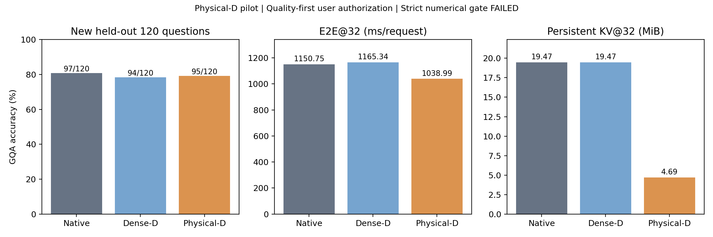

**Physical-D在新的120题上达到 95/120（79.1667%）。相对Dense-D为 +0.8333 pp；相对Native为 -1.6667 pp。Persistent KV@32减少 75.91%，E2E@32加速 1.1076×。**

本轮状态为 **COMPLETE_WITH_NUMERICAL_WAIVER**：物理执行、完整质量/效率与文件核验已完成；原数值门槛仍为FAILED。用户在六样本数值失败诊断后明确要求“0.0004不大吧，在小测试集上得分差不多就行”，因此在任何正式生成前新增协议授权，以真实配对质量为主要判断依据。没有将原数值验收改写为通过，也不能宣称严格数值等价。

| 条件 | Correct/120 | Accuracy | KV@32 MiB | E2E@32 ms | TTFT ms | TPOT ms/token |
|---|---:|---:|---:|---:|---:|---:|
| Native | 97/120 | 80.8333% | 19.4724 | 1150.7528 | 140.0545 | 32.6032 |
| Dense-D | 94/120 | 78.3333% | 19.4724 | 1165.3424 | 141.3145 | 33.0332 |
| Physical-D | 95/120 | 79.1667% | 4.6906 | 1038.9915 | 119.7087 | 29.6543 |

| 配对比较 | ΔAccuracy pp | 普通95%簇Bootstrap CI | 原对→错 | 原错→对 | 首Token翻转 | 文本变化 |
|---|---:|---|---:|---:|---:|---:|
| Physical-D - Dense-D | +0.8333 | [+0.0000, +2.5000] | 0 | 1 | 1 | 2 |
| Physical-D - Native | -1.6667 | [-5.8333, +2.5000] | 4 | 2 | 23 | 28 |

| 任务 | Native | Dense-D | Physical-D | Physical−Dense pp | Physical−Native pp |
|---|---:|---:|---:|---:|---:|
| ChooseAttr | 90.0% | 90.0% | 90.0% | +0.0 | +0.0 |
| ChooseCat | 85.0% | 90.0% | 90.0% | +0.0 | +5.0 |
| ChooseRel | 90.0% | 90.0% | 90.0% | +0.0 | +0.0 |
| CompareAttr | 55.0% | 50.0% | 50.0% | +0.0 | -5.0 |
| LogicalObj | 95.0% | 100.0% | 100.0% | +0.0 | +5.0 |
| QueryAttr | 70.0% | 50.0% | 55.0% | +5.0 | -15.0 |

CompareAttr单列配对统计：

- Physical-D - Dense-D：+0.0000 pp，95%CI [+0.0000, +0.0000]，原对→错 0、原错→对 0。
- Physical-D - Native：-5.0000 pp，95%CI [-15.0000, +0.0000]，原对→错 1、原错→对 0。

全部新增错误见harm_cases.csv，完整Token/答案/Gold/得分/EOS/截断/空输出见per_question.csv。该120题为工程小样本，六任务各20题；每个任务一题即5 pp。20,000次按Image SHA整簇配对Bootstrap，普通95%CI未作多重比较校正。CI跨0不证明等价或非劣效，不据结果重新选层。Native与Dense-D还存在答案直接读图权限差异，不能将全部质量差距归于Hidden退出。

物理执行：进入L20前实际删除256视觉Hidden行；L2–L5只对P−1/Decode跳过Attention，QKV、QK/AV、o_proj均不为这些Query执行，其余Prefill Query原生。全部28层Norm、MLP、Residual保留。Prefill早层临时视觉KV供R访问；Prefill结束后全层持久原始视觉KV清除，L2–L5无持久KV。逻辑位置和RoPE不按物理长度重编号。Native/Dense-D各层KV长度为P+31；Physical-D非跳算层为P−256+31，L2–L5为0。KV Live依据真实K/V tensor字节，Capacity依据唯一底层storage.nbytes核验，无完整Dense后备。全部450个正式效率请求的逐层布局均重核验，见kv_layout.csv。

严格数值门槛保留失败：CPU 28层tiny Qwen2 float64数学对照Logits完全一致，Hidden最大差4.16e−17。六个GPU样本Native/No-op/官方全部有效Logits严格相等，干净Dense-D与历史冻结D严格相等，三个历史D的完整Token/输入/每步Logits SHA复现。六例Dense-D/Physical-D完整Token相同，但Logits最大差1.00–2.50，超过原0.125上限；mean_abs及Hidden relative RMS亦有失败。首分歧L2 AV：同一输入下Q/K/V、RoPE、QK、Softmax前缀严格一致，缩短数学上零概率的末尾Key后，AV的1,139,712元素中33个不同，max_abs=0.00048828125，随后逐层放大。该算子定位解释最早的数值差异，不是豁免数值门槛的依据；继续执行来自用户明确改指令。原失败协议、源码和诊断全部保留在engineering_attempts/attempt01_frozen_gate_failure及diagnostics目录。

计时：GPU准备好的图片/Token输入开始，包含Vision Encoder、Projector、注入、1次Prefill、31次真实Decode，以及方法安装/恢复与中间对象清理；CUDA同步墙钟到第32个Token完成。排除磁盘读取、Tokenizer/图像预处理、H2D、模型加载和输出写盘。正式计时无审计Hook；CUDA Event用于组件辅助时间。TTFT在首Token后同步，TPOT=(E2E−TTFT)/31。每条件2次预热；30题×3条件×5重复=450正式请求，按题与重复轮换方法顺序。表中均值为30个输入各5次均值的算术均值；中位数为这30个输入均值的中位数，原始450次与90个输入均值均保留。实际Attention/投影调用数来自计时外同一32步执行路径审计，详见physical_execution_audit.json，不冒称每次计时均启用了计数Hook。

GPU始终为RTX3090 GPU-e392cec6-7ec8-1fee-397b-fde03a79e79e，BF16/Eager，Torch2.6.0+cu124、Transformers4.49.0，模型Revision 853e3a797a661694b1b8ece0cb72dc2b23e3dac9，logits_to_keep=1、Greedy、256视觉Token。质量正常EOS、最多32Token；效率忽略EOS固定32。未改变权重、层号、系统功耗或挂载；未运行3000题、七Benchmark、OCRBench、训练或Kernel搜索。120个新QID及120个图片SHA与已核验历史3000清单无重叠，来源官方GQA testdev_balanced；未提供的其他探索集不在独立性声明范围内。

正式质量完成360/360，效率完成450/450。是否值得扩大验证应同时看上述质量差值、CompareAttr损害与宽CI；本轮只能提供工程Pilot证据，不能替代大样本独立非劣效验证。更大规模测试需要另外授权，本轮不启动。

有效协议SHA：6e420dcaf42b657d5f2fbf69ea888819ffff4861ca66fbb0eac34bd78874eb7b；源码冻结Commit：937470a34bab2eb24bb8b4fa56375c9fc64dfb0b；模型路径：/home/featurize/ate-local-models/InternVL3-8B。完整服务器SSD原件 /home/featurize/ate-runs/internvl3-svh-physical-d-pilot-3090，持久化目录 /home/featurize/work/ATE-internvl3-svh-physical-d-pilot-3090/vlm_research/results/internvl3_svh_physical_d_pilot_3090。GitHub仅上传本轮轻量源码/冻结清单/CSV/图/配置/报告/校验，服务器保留原始检查点、日志和各版本失败证据。发布文件对应关系见artifact_manifest.json，最终Commit和远端核验见服务器github_push_receipt.json。GPU最终状态见gpu_final_release.json，服务器实例不自动关闭。

| 条件 | EOS /120 | 截断 /120 | 空答案 /120 | @32 Attention调用 | @32 Q/K/V/o_proj调用 |
|---|---:|---:|---:|---:|---:|
| Native | 120 | 0 | 0 | 896 | 3584 |
| Dense-D | 120 | 0 | 0 | 896 | 3584 |
| Physical-D | 120 | 0 | 0 | 772 | 3088 |

上述调用次数在正式计时外实测于同一32步路径；Projection为Q/K/V/o_proj四者总数。组件Event时间、KV Capacity及Peak Allocated/Reserved在efficiency_summary.csv中给出。GPU全程UUID已逐请求与遥测复核。遥测含请求间空闲，不能把频率范围解释为恒频；本轮未预注册专门的5%漂移探针，不作“无漂移”证明。
