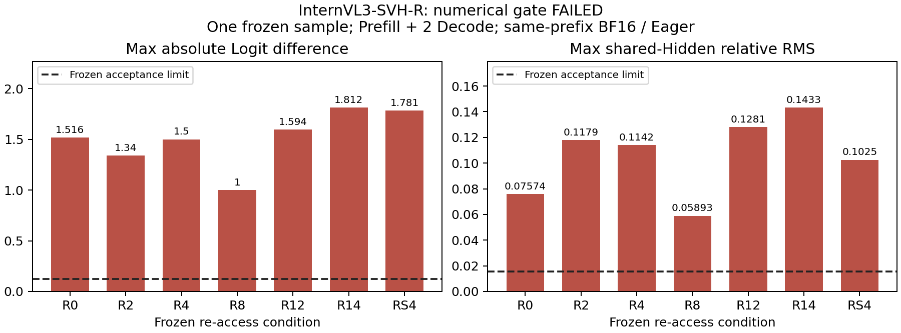

# InternVL3-SVH-R：数值门禁失败，正式搜索未执行

当前无法推荐任何回看层集合，也不能回答最少几层能恢复 Query Accuracy。七个固定配置均未通过预先冻结的 Dense-R / Physical-R 数值门槛，因此按协议停止在 Smoke，Discovery、Holdout、E2E@32 均为 **NOT_RUN**，正式生成 **0 次**。这不是“质量没有改善”的结论；质量尚未测试。

## 已完成的真实范围

只使用指定 RTX 3090：GPU-e392cec6-7ec8-1fee-397b-fde03a79e79e。模型Revision 853e3a797a661694b1b8ece0cb72dc2b23e3dac9，BF16 / Eager、Torch 2.6.0+cu124、Transformers 4.49.0。继承父证据Commit 3297559f21d3de55a6630a5491c9ecf66301c4b7。原Physical-D的NUMERICAL_EQUIVALENCE_FAILED及历史Waiver保留，**不沿用Waiver到本轮**。

七种层集合、选择规则、数值门槛和样本均在GPU前冻结。Discovery240题（160 Query、各20 Choose/Compare/Logical/Verify），199个实际图片簇；Holdout240题、198簇，图片SHA交集 **0**。原全集12578题、398簇，历史汇总已看过，Holdout仅属于内部冻结验证。预先选好20题效率输入、20张不同图片、12题Query，未执行效率推理。

Query子类按题目文字和真实注释划分：Discovery为relation37、attribute26、other20、color27、object25、spatial25；Holdout为relation41、spatial21、color26、attribute22、object30、other20。全集未提供满足冻结quantity规则的题，不虚构数量子类。

CPU数学参考28层、全部7条件、Prefill+3次真实Decode通过。Mock明确使用Float64 Softmax，排除官方CPU Softmax强制Float32的测试噪声；它不是实际BF16 GPU数值通过的证据。

GPU原计划8题，两个实现版本各在第一题（ID 201337043）完成7条件比较即停止。每条答案3 Token（含EOS），1次Prefill+2次真实Decode；未执行余下7题及后续固定8 Token扩展。本例Native / No-op / 官方Chat的完整有效Logits严格torch.equal，历史Native完整Token和输入绑定一致。七种Dense/Physical自由生成完整Token均相同，但仍不能替代数值门禁。

## 冻结门槛与失败数值

每步完整词表Logits Max Absolute≤0.125、Mean Absolute≤0.01；逐层共享Hidden Relative RMS≤0.015625；全部Top1及完整生成Token一致、全部有限。下表为当前V2一个Smoke样本3步骤的最大值。

| 配置 | Max Logits Abs | Max Mean Logits Abs | Max Hidden Rel RMS | 实测Smoke KV Live/Capacity MiB | 相对R0容量增量 MiB | 状态 |
|---|---:|---:|---:|---:|---:|---|
|R0|1.515625|0.4704255163669586|0.07574093341827393|3.140625|0.0|FAILED|
|R2|1.33984375|0.2659345865249634|0.11791284382343292|4.140625|1.0|FAILED|
|R4|1.5|0.4714694023132324|0.1141977533698082|5.140625|2.0|FAILED|
|R8|1.0|0.12975117564201355|0.05892828479409218|7.140625|4.0|FAILED|
|R12|1.59375|0.36318057775497437|0.12814629077911377|9.140625|6.0|FAILED|
|R14|1.8125|0.7665374279022217|0.14325092732906342|10.140625|7.0|FAILED|
|RS4|1.78125|0.372193306684494|0.10254202038049698|5.140625|2.0|FAILED|

此处KV是正常EOS后3 Token请求的真实Tensor/底层存储核算，**不是KV@32**。kv_layout.csv包含逐层真实Shape、dtype、物理长度、Live、Capacity。本例所有KV Live与Capacity相同，不将它们挪入效率主表。

独立CPU重新读取V2原始完整词表Logits Tensor，复算21个逐步比较；同时核验冻结源码与协议、480题与父Manifest字段完全一致、图像隔离、单个Smoke图片SHA和真实KV字节。CPU并行归约造成的已存Mean复算差小于1e-7，仅对归档Mean校验使用1e-7容差，**GPU验收门槛不变**。逐层Hidden只保留差异CSV，另存L20算子Tensor，没有声称对全部Hidden进行原始Tensor复算。

## 物理路径和首个差异

本例L20入口Hidden由321行变65行，真实删除256视觉行。L2–L5仅P−1和Decode不执行QKV/QK/AV/o_proj，其他Prefill Query正常；三步骤合计76次Attention模块调用、304次投影模块调用、168次Norm、84次MLP。RoPE保持原逻辑位置，禁止连接概率为0。仅K层持久保存真实256视觉K/V，非K没有持久视觉KV，L2–L5没有持久KV。

V1在跳算Prefill中增加一个完全屏蔽的零K/V占位，修正旧实现改变归约宽度导致的早层差异。V2进一步在深层Prefill及非K Decode使用**临时纯零K/V Scratch**保持原始Key归约宽度。它不含原始图像信息、不属于持久Cache，Hidden仍删除，目标Query仍真实跳算；但保留部分原始宽度Attention列运算，**不能宣称消除了全部被Mask列的计算量**。没有测速或物理加速结论。

V1、V2的Prefill L0–L19共享Hidden完全相同，首个分歧均在L20。算子诊断：相同文本位置的Input Norm及Q投影完全相同；K投影最大差0.0625，V投影0.03125，随后Attention/MLP及深层放大。最早差异定位到删行后不同矩阵形状的K/V投影，但尚不能归因到某个特定CUDA内核，更不能自动认定误差可接受。

额外只做一次独立进程诊断，将torch.backends.cuda.matmul.allow_bf16_reduced_precision_reduction从True设False，权重/激活仍BF16，Eager不变，K/V差异仍未消失。该设置不构成修复，未据此变更正式协议或继续搜索。[PyTorch 2.6数值文档](https://docs.pytorch.org/docs/2.6/notes/numerical_accuracy.html#reduced-precision-reduction-for-fp16-and-bf16-gemms)说明该标志含义。

## 十项研究问题

1. 推荐层集合：尚无法判定；best_cost_candidate=null、best_query_candidate=null。
2. 最少回看层数恢复Query：NOT_RUN，没有准确率。
3. 连续R4与稀疏RS4谁更好：NOT_RUN；仅本例实际持久容量相同。
4. 哪些Query子类恢复最大：NOT_RUN。
5. 是否损害四类Non-Query：NOT_RUN。
6. 相对Native质量差距缩小多少：NOT_RUN，不填入历史分数。
7. 实际视觉KV成本：只有上表单题Smoke实测，无正式@32结果。
8. E2E、TTFT、TPOT及加速比：NOT_RUN，不使用历史时间补值。
9. 对应Dense功能参考：本例结构与权限检查通过，**数值验收FAILED**。
10. Holdout确认：未运行候选推理、未查看候选预测，既不能称SEARCH_CONFIRMED，也不能据此否定候选质量。

没有正式预测，因此没有运行20,000次Bootstrap或计算准确率CI。空CSV保留Header；状态CSV标记NOT_RUN，缺失准确率留空而非写0分。完整质量驱动、选择后Holdout及正式效率驱动未在核心数值失败后继续开发/执行。

## 存储、限制与交付

新增源码：/home/featurize/work/ATE-internvl3-svh-r-middle-reaccess-search-3090/vlm_research/internvl3_svh_r_middle_reaccess_search

轻量结果：/home/featurize/work/ATE-internvl3-svh-r-middle-reaccess-search-3090/vlm_research/results/internvl3_svh_r_middle_reaccess_search_3090

SSD原始运行：/home/featurize/ate-runs/internvl3-svh-r-middle-reaccess-search-3090

原始Logits、L20算子Tensor、日志及来源收据安全同步到结果目录server_only/，**该目录不上传GitHub**。SHA和文件范围见artifact_manifest.json、SHA256SUMS。

原始证据保留缺口必须披露：V1与V2曾使用同一失败Logits.pt文件名，现有全量Logits Tensor仅为V2。V1逐步CSV、完整Token、协议、源码与日志已独立归档，但V1全量Logits Tensor未保留，不把V2原件冒称V1。

GPU已释放，独立CPU审计未初始化CUDA，最终nvidia-smi无计算进程、显存约1 MiB。未修改历史冻结源码、main或旧结果；未训练、扩大层集合、运行完整GQA或其他Benchmark，未向Windows传输数据。

独立分支：[codex/internvl3-svh-r-middle-reaccess-search-3090](https://github.com/reyuyu/ATE/tree/codex/internvl3-svh-r-middle-reaccess-search-3090)。提交后的远端核验收据位于服务器server_only/delivery_receipt.json；SHA256SUMS不包含自身及提交后收据，避免自引用。

