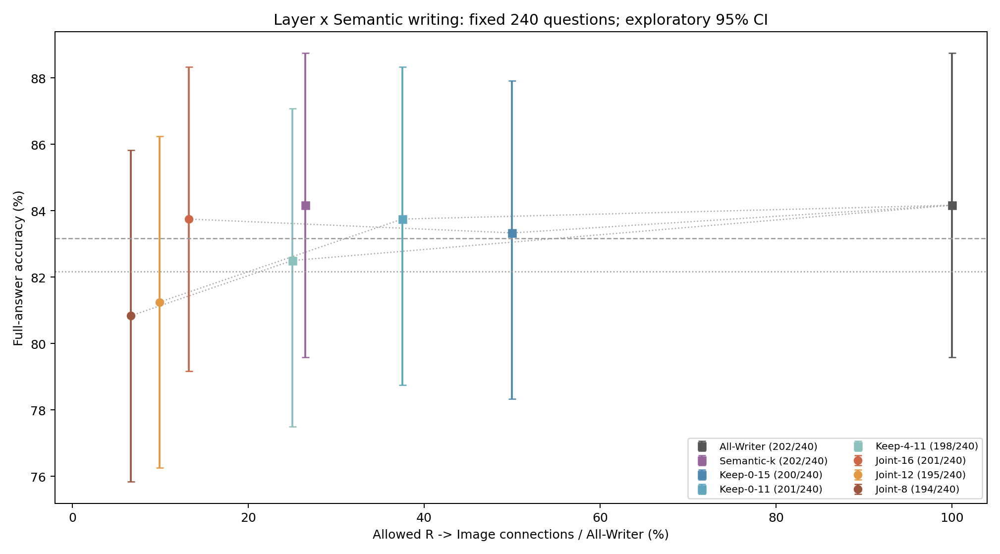
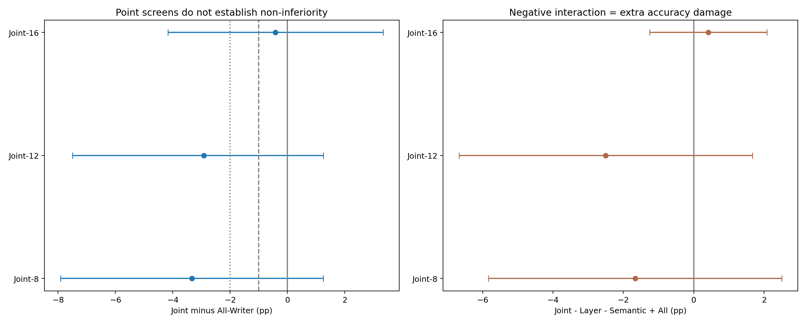
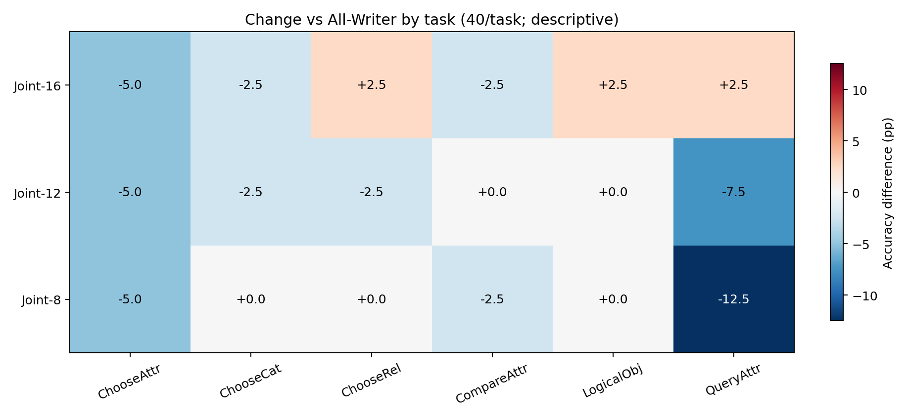

# Layer × Semantic Joint Visual Writing

**COMPLETE：新增3×240＝720条完整答案；严格审计并逐字节复用五组历史对照1200条。**

## 核心回答

Joint-12仅允许冻结Semantic-k Token在L0–L11读图，得到195/240（81.250%），相对All-Writer 202/240为-2.917 pp，探索性95%CI [-7.500, +1.250]。

Semantic-k占R Token的逐题平均为25.7755%，全样本Token数比为26.4792%。因此Joint-12的可访问R→Image连接预算，逐题平均为9.6658%，按实际连接数汇总为9.9297%。两种口径明确分列，不把预算当作FLOPs或延迟。

下面分别判断净准确率、逐题新增损害和配对交互；两种单独条件有效不能自动推出联合安全。所有结论仅限这批历史复用探索样本。

## 完成后的研究判读

**Layer Sparsity与Token Sparsity在本批16层组合的点估计上可以同时成立，但更激进的12层或8层组合未达到预设质量界限，不能从两种单独稀疏条件的良好净表现推出联合安全。** Joint-16为201/240（83.750%），相对All-Writer的202/240为−0.417pp，达到探索性−1pp和−2pp点估计界限；区间[−4.167,+3.333]仍允许较大总体损失，不构成非劣效证明。

**“约25.78%的关键R Token在12/32层看图、约9.67%预算即可接近All”的设想，本轮没有达到预设−2pp点估计要求。** Joint-12为195/240（81.250%），较All低2.917pp，95%CI[−7.500,+1.250]；18题原对变错、11题原错变对。对应Layer-only为201/240，Semantic-only为202/240，联合分别少答对6题和7题。交互为−2.500pp，CI[−6.667,+1.667]。存在5题All、Layer、Semantic全部正确而Joint错误；若仅要求两单独条件正确，则有7题联合错误。这些逐题反例表明两种稀疏性不能无条件组合，但交互CI跨0，尚不能确证总体负交互。

Joint-16相对Semantic-only只改变3题完整答案的首Token，损害2题、纠正1题，差值−0.417pp，CI[−2.083,+0.833]；相对Layer-only为+0.417pp，CI[−3.333,+4.167]。其交互为+0.417pp，CI[−1.250,+2.083]，本样本联合独有损害为0；这既不是普遍零损害保证，也不能忽略其相对All仍有11题损害和10题纠正。历史Semantic-only本身同样有10题损害、10题纠正，净准确率相同不代表答案相同。

Joint-8为194/240（80.833%），相对All为−3.333pp，CI[−7.917,+1.250]，同样未达到−2pp界限；联合独有损害3题，两单独均正确而联合错误4题。交互为−1.667pp，CI[−5.833,+2.500]。三个交互区间均跨0，因此本轮既不证明可加，也不证明不存在额外损害。

任务层面，QueryAttr由All的31/40降到Joint-12的28/40和Joint-8的26/40，即−7.5pp和−12.5pp；这是每任务40题的描述性差异，不能作为新的分层选择规则。例如09502671在All、Layer-only、Semantic-only均答Surfing，Joint-12改为Skating；02420578三组对照均答Right，Joint-12改为Left。所有反例均保留，不筛题、不调整层集合或Token集合。

预算需要区分平均方式：25.7755%是每题Semantic-k/R比例的宏平均，乘12/32得到9.6658%；按240题的实际R→Image连接数汇总，Joint-12是9.9297%。Joint-16对应宏平均12.8878%、汇总13.2396%，是本轮更值得留待独立数据验证的联合候选。所有值只描述读图权限预算；全部Attention矩阵、Image KV和层计算仍然存在，未实现实际FLOPs、延迟或显存节省。

所有条件均已屏蔽P−1和Decode对原始图像的直接访问，因此Joint-16保留的较高性能支持“少量文本Query在部分层获得直接视觉访问后，非图像中继可支持后续作答”的功能证据。未选中R仍可通过其他文本连接间接获取视觉信息；本轮不证明视觉写入只发生在被选中的Token或层，也不直接测量信息存储位置。没有追加独立数据、激活修补或优化实现。

## 冻结协议与历史复用

层稀疏参考 `2a45dcdfb6f203037472801bd99f9731e9a8fffb`；语义选择参考 `9687b298efcdca651cc5446b5cb07da4a2b4e37c`；冻结执行源码 `3992f022e2acbea38781bebfff95d3b08176f79a`。Manifest SHA256 `258c32d470270829e126ae9abf3a030dbc1485b2f329fdfc326f4d6e9b3e686c`。模型revision `b234b804b114d9e37bb655e11cbbb5f5e971b7a9`；FP16/Eager、Transformers4.49.0、Greedy、max_new_tokens=32、logits_to_keep=1。

R为最后Image Token之后、P−1之前的全部非视觉文本Query。所有条件在全部32层屏蔽P−1及每个真实Decode Query（包含EOS预测）对576个原始Image Key的直接读取。Joint仅允许既属于冻结Semantic-k集合、又处于指定层的R Query读图，其余R→Image边屏蔽。只用Softmax前Hard Mask，不含o_proj消融、KV剪枝或Image Query改动；所有Attention、MLP、Residual和KV计算保留。
历史token_group_manifest.json逐字节复制，未重新选词、未调用选择器。逐题核对Prompt IDs、Pixel Tensor、图像SHA、Gold、Tokenizer与评分器；复用检查点和原始首Token向量均经过哈希及内容审计。GPU Smoke进一步检验旧/新入口全部有效Logits严格一致以及保存的Token/首向量一致。复用原始记录保存在reused_checkpoints，来源与原提交见historical_reuse_audit.json。

## Accuracy与连接预算

|条件|层数|正确/240|Accuracy|连接预算：汇总 / 逐题平均|ΔAll pp|对→错 / 错→对|−1pp / −2pp点估计候选|
|---|---:|---:|---:|---|---:|---|---|
|All-Writer|32|202|84.167%|100.0000% / 100.0000%|+0.000|0 / 0|是 / 是|
|Semantic-k|32|202|84.167%|26.4792% / 25.7755%|+0.000|10 / 10|是 / 是|
|Keep-0-15|16|200|83.333%|50.0000% / 50.0000%|-0.833|3 / 1|是 / 是|
|Keep-0-11|12|201|83.750%|37.5000% / 37.5000%|-0.417|10 / 9|是 / 是|
|Keep-4-11|8|198|82.500%|25.0000% / 25.0000%|-1.667|15 / 11|否 / 是|
|Joint-16|16|201|83.750%|13.2396% / 12.8878%|-0.417|11 / 10|是 / 是|
|Joint-12|12|195|81.250%|9.9297% / 9.6658%|-2.917|18 / 11|否 / 否|
|Joint-8|8|194|80.833%|6.6198% / 6.4439%|-3.333|19 / 11|否 / 否|

连接数按每个Head的原始Prefill R→Image潜在边计数：`保留层数 × 选中R数 × 576`，分母为`32 × 全部R数 × 576`；Head数相同而约去。不是非零概率数，也不包括其他Query/Key连接。每题预算和实际Hook允许数量经核对；分母随问题长度变化，宏平均不必等于汇总比。

## 三组联合的配对比较

|前者−后者|ΔAccuracy pp [探索性95%CI]|后者对→前者错 / 后者错→前者对|首Token翻转|
|---|---|---|---:|
|Joint-16 - All-Writer|-0.417 [-4.167, +3.333]|11 / 10|21|
|Joint-16 - Keep-0-15|+0.417 [-3.333, +4.167]|10 / 11|21|
|Joint-16 - Semantic-k|-0.417 [-2.083, +0.833]|2 / 1|3|
|Joint-12 - All-Writer|-2.917 [-7.500, +1.250]|18 / 11|29|
|Joint-12 - Keep-0-11|-2.500 [-6.250, +1.250]|13 / 7|20|
|Joint-12 - Semantic-k|-2.917 [-6.250, +0.000]|11 / 4|15|
|Joint-8 - All-Writer|-3.333 [-7.917, +1.250]|19 / 11|30|
|Joint-8 - Keep-4-11|-1.667 [-4.583, +1.250]|8 / 4|12|
|Joint-8 - Semantic-k|-3.333 [-6.667, +0.000]|12 / 4|16|

按Image SHA256整簇进行20,000次配对Bootstrap，seed=20261103，所有条件和交互共享相同抽样；240题对应240个不同图像簇。区间为未校正的探索性双侧百分位95%CI。首Token翻转不是完整答案正确率。

## 联合交互与联合独有损害

预先冻结交互为 `Joint − Layer-only − Semantic-only + All-Writer`，在每题0/1正确性上计算后对同一图片簇重采样；负值表示超出可加单独效应的额外损害。没有把两个边际CI相减。联合独有损害定义为All、Layer、Semantic均正确而Joint错误；另列不要求All正确、仅两单独条件均正确而联合错误的计数。

|Joint|交互 pp [95%CI]|联合独有损害|两单独均对、联合错|联合独有纠正|
|---|---|---:|---:|---:|
|Joint-16|+0.417 [-1.250, +2.083]|0|0|1|
|Joint-12|-2.500 [-6.667, +1.667]|5|7|1|
|Joint-8|-1.667 [-5.833, +2.500]|3|4|1|

交互CI跨0不能证明可加或无交互。净准确率可能掩盖损害与纠正的抵消；per_question_joint.csv保留720个逐题四条件组合。unique_joint_harm_cases.csv和negative_cases.csv保留全部相关损害，incorrect_answers.csv保留所有条件的所有错误答案。

## 质量界限

预设-1pp点估计界限的Joint候选：Joint-16。
预设-2pp点估计界限的Joint候选：Joint-16。

点估计候选不等于非劣效证明；CI跨0不能证明无损或可安全组合。层集合由已完成探索实验选择，Semantic Token集合也来自同一历史样本，均不是独立确认集；高质量候选应留待独立数据验证。

## 六任务表现

|条件|ChooseAttr|ChooseCat|ChooseRel|CompareAttr|LogicalObj|QueryAttr|
|---|---:|---:|---:|---:|---:|---:|
|All-Writer|82.5%|92.5%|80.0%|75.0%|97.5%|77.5%|
|Semantic-k|80.0%|90.0%|82.5%|72.5%|100.0%|80.0%|
|Keep-0-15|80.0%|92.5%|82.5%|70.0%|97.5%|77.5%|
|Keep-0-11|87.5%|92.5%|82.5%|70.0%|97.5%|72.5%|
|Keep-4-11|82.5%|92.5%|77.5%|72.5%|97.5%|72.5%|
|Joint-16|77.5%|90.0%|82.5%|72.5%|100.0%|80.0%|
|Joint-12|77.5%|90.0%|77.5%|75.0%|97.5%|70.0%|
|Joint-8|77.5%|92.5%|80.0%|72.5%|97.5%|65.0%|

每任务40题，任务差异与交互仅作描述。task_accuracy.csv保留准确率、损害/纠正和Joint任务交互。

## 联合独有损害示例

按题号排序，各条件展示最前两例；全部案例均保留，不按结果筛题。

|Joint|题号|问题|Gold|All|Layer|Semantic|Joint答案|
|---|---|---|---|---|---|---|---|
|Joint-12|02420578|Is the man to the left or to the right of the bags in the middle?|right|Right|Right|Right|Left|
|Joint-12|09502671|Does the man seem to be surfing or skating?|surfing|Surfing|Surfing|Surfing|Skating|
|Joint-8|13648850|Which side of the picture is the skier on?|right|Right|Right|Right|Left|
|Joint-8|16617207|On which side is the drawer?|right|Right|Right|Right|Left|

## 验证与资源

CPU测试、三道冻结题号00150746/11697551/11127723的真实7B Smoke均通过。HF/原生/三种No-op全部有效Logits保持torch.equal，不放宽容差；五种复用对照旧/新入口与保存向量严格匹配。实际Eager Softmax的每个禁止连接概率最大值严格为0；其余Mask不变、BOS/Self合法，行和误差沿用0.002界限。所有32层MLP、独立Cache存储和父Cache指纹、绝对位置、输入/权重版本及正常/异常Hook清理均检查。
仅使用物理GPU1，UUID `GPU-b08489af-0a8a-eb48-55ba-8346733af417`；启动前重新确认空闲，一份模型串行。结束后进程退出，资源释放快照见gpu_release.json。没有抢占或终止其他进程。
采集结束后复核全部模型文件SHA256、720新检查点、1200复用检查点、原始首Token向量和CSV每个单元格。原始大数组位于服务器资源目录，检查点记录路径/SHA256；GitHub不包含这些数组。协议、CPU/GPU验证及完整逐题答案均随本报告保存。
Hard Mask会对剩余连接重新归一化；低敏感不等于没有视觉信息流。文本可通过其他文本状态中继视觉信息，图像KV及全部层计算仍存在。本轮只研究功能性联合稀疏，不证明唯一视觉写入位置、不减少实际FLOPs、不证明延迟或显存收益。

## 图表

## 停止边界

完成后停止；不追加物理Image Token退出、KV剪枝、Kernel优化、Router训练、跨模型或其他实验。
