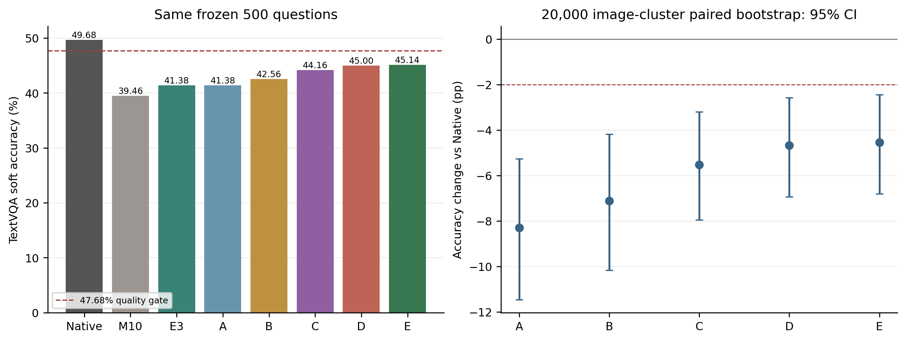

# Middle10/E3剩余质量损失定位与固定恢复

**本轮完成并停止：全部质量完成，未达47.68%门槛；未做物理移植、E2E、FLOPs或性能测试。**

原Middle10为39.46%，相对Native 49.68%差10.22pp；此前E3为41.38%，剩余差距8.30pp。本轮不混淆两者。

## 冻结条件

A：E3 Dense参考，无物理退出；B：A恢复32层R写入；C：A恢复P−1全部32层原生Attention与读图（包括L2–L5）；D：B+C，即Native Prefill；E：D进一步恢复Decode L2–L5文本Attention。所有A–E的Decode仅在L11–L20读图。

C/D恢复P−1时同时取消其L2–L5 Attention跳算，因为否则这四层不可能执行正常视觉Attention。因此C−A不是纯粹的Image Key权限效应，应表述为“完整P−1 Attention/视觉读取恢复”。

## 完整质量

|条件|Accuracy|ΔNative pp|ΔE3 pp|EOS/截断/空答案|
|---|---:|---:|---:|---:|
|Native|49.68%|+0.00|+8.30|499/1/0|
|C3+Middle10|39.46%|-10.22|-1.92|497/3/0|
|E3|41.38%|-8.30|+0.00|498/2/0|
|A|41.38%|-8.30|+0.00|498/2/0|
|B|42.56%|-7.12|+1.18|498/2/0|
|C|44.16%|-5.52|+2.78|498/2/0|
|D|45.00%|-4.68|+3.62|498/2/0|
|E|45.14%|-4.54|+3.76|499/1/0|

同500题、309图片SHA簇，官方十答案共识软分，原Prompt和FP16/eager/H1/最多32 Token。历史1,500条基线严格绑定复用；新增2,500条全部完成，不删除失分、异常或截断。

## 配对比较

|比较|ΔAccuracy pp|图片簇95%CI|软分升/降|
|---|---:|---|---:|
|A - Native|-8.30|[-11.46, -5.27]|18/65|
|A - E3|+0.00|[+0.00, +0.00]|0/0|
|B - Native|-7.12|[-10.16, -4.19]|17/59|
|B - E3|+1.18|[+0.00, +2.46]|9/3|
|C - Native|-5.52|[-7.95, -3.20]|8/41|
|C - E3|+2.78|[+0.43, +5.27]|31/18|
|D - Native|-4.68|[-6.94, -2.57]|6/33|
|D - E3|+3.62|[+1.08, +6.25]|39/20|
|E - Native|-4.54|[-6.81, -2.44]|6/30|
|E - E3|+3.76|[+1.12, +6.46]|42/22|
|B - A|+1.18|[+0.00, +2.46]|9/3|
|C - A|+2.78|[+0.43, +5.27]|31/18|
|D - A|+3.62|[+1.08, +6.25]|39/20|
|D - B|+2.44|[+0.04, +4.95]|33/19|
|D - C|+0.84|[-0.10, +1.87]|8/2|
|E - D|+0.14|[-1.40, +1.63]|10/8|

R与P−1联合恢复的交互D−B−C+A：-0.34pp，95%CI [-1.88, +1.18]。普通探索性区间，不能据此宣称唯一来源或可加贡献。

B−A的区间下界为数值舍入量级的0，按0.00展示，不以此宣称严格排除0。

## 剩余损失最可能来自哪里

1. 物理退出本身不是本轮主要失分解释：A=41.38%，与E3在全部500题软分完全相同、首Token翻转为0。仍有1题完整Token序列不同，见reference_sequence_differences.csv；不声称物理/Dense全部序列或数值逐位相同。

2. 只有晚层R写入恢复的B为42.56%，相对A +1.18pp [0.00, 2.46]。完整P−1恢复的C为44.16%，相对A +2.78pp [0.43, 5.27]，点估计帮助更大，但C含L2–L5 Attention恢复，不能拆成纯视觉权限效应。两者联合D为45.00%，相对A +3.62pp [1.08, 6.25]。

3. D已经在全部500题精确复现Native首Token Logits，但完整答案仍低4.68pp。E继续恢复Decode L2–L5文本Attention只净增0.14pp [−1.40, 1.63]，有10题软分升、8题下降，未得到其为主要损失来源的证据。

4. 最佳E保留Native Prefill与完整Decode Attention/MLP，在语义上与Native剩下的干预仅为“Decode在L11–L20之外不能直接读取Image Key”。E=45.14%，相对Native −4.54pp，图片簇95%CI [−6.81, −2.44]；6题软分上升、30题下降，24题从Native满分变差。经独立原生HF参考Smoke、Cache审计和全500题Native首Logits一致检查后，结果支持：剩余大块损失来自真实Decode的受限视觉重读，而非单纯L20 R写入不足或Decode L2–L5文本跳算。

5. 沿固定顺序A→D→E→Native，8.30pp差距对应3.62pp、0.14pp、4.54pp。它是顺序依赖的已测差值分解，不是可相加的独立信息贡献，也不证明某个未测试层或Token一定负责。没有追加层搜索。

首Token解释边界：Native有117/500题的首生成Token单独解码为空白，因此首Token一致不能自动等同首个语义内容词一致。E与Native有118题完整序列变化；首次分叉类别和逐题内容见decode_divergence_cases.csv。

E相对Native的30道软分下降题，首次分叉为双方均非EOS的内容Token有20题，E提前EOS有10题。因此不能将此次质量损失仅归为终止标记差异。

本轮不能证明具体哪一组非Middle10层可以最小恢复，也没有测试更高成本方案或改变Prompt。最佳仍落后Native 4.54pp，不能称为接近Native或无损。

## 阶段门槛

最佳固定功能性条件为E，Accuracy 45.14%；47.68%门槛：未通过。
若未通过立即停止；若通过仅允许归因和物理移植，仍禁止测速。必须物理版本也达到47.68%并通过正确性检查，才能运行48题性能。

**当前性能请求数：0。** 第一阶段代码无CUDA计时事件、FLOPs/Profiler或性能循环。

## 验证

19项CPU测试通过，双卡各3题真实Smoke通过。Native/No-op所有有效Logits严格torch.equal；官方HF完整生成一致；Native/E3物理路径复现历史完整Token及首Logits哈希。A与冻结E3 Dense的有效Logits精确一致。

全部A–E与独立原生HF Decoder/DynamicCache定向Hook参考在冻结FP16门槛内一致，Smoke固定3 Token与自然EOS序列一致。禁止连接概率为0、合法Key存在、原位置、32层MLP、Cache重放隔离及Hook清理通过。D/E全部500题首Token Logits哈希均严格等于Native。

第一阶段所有条件都是Dense功能性归因，不宣称物理加速。D/E的Native Prefill依赖需要与真正提前删除视觉Hidden的物理版本区分。

## 图与数据

逐题答案：per_question.csv；全部损益和负面：recovery_and_negative_cases.csv；完整Token及审计：原始断点包。输入、源码、权重及协议绑定见execution_freeze.json和source_manifest.json。

20,000次图片SHA整簇配对Bootstrap，问题等权、固定种子20261106；历史探索样本，不宣称独立确认或非劣效。

原始2,500条新断点在raw_quality_checkpoints.tar.gz；原始GPU Smoke在raw_smoke_audit.tar.gz。归档逐文件校验见packaging.json，断点哈希见result_hashes.json。解包时保持相对路径，不覆盖历史实验。

正式双卡质量运行墙钟约8.81分钟；该值是整批作业耗时，不是性能测试或E2E延迟。

CPU-only复算：`python -m vlm_research.middle10_attribution.analyze`。当前禁止自动重启GPU运行器、物理移植或测速。

第一阶段及最终进程释放见gpu_release_audit.json。最终状态见dense_quality_gate.json和completion.json。本轮完成后停止，不追加候选。
