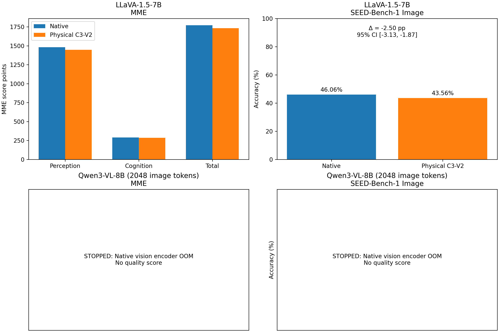

# LLaVA / Qwen3-VL 原版物理 C3-V2：MME 与 SEED-Bench-1 完整质量对照

状态：**PARTIAL**。只报告已完成同题矩阵；未运行或不完整的条件不填入预测分数。本轮仅测质量，没有运行E2E、Kernel搜索、FLOPs优化、训练或额外层搜索。

## 主要实测结果

差值统一为 Physical C3-V2 − Native。MME单位为官方 **Score Points**；SEED终局指标是 **Accuracy**，差值单位为百分点。

| 模型 | Benchmark | 指标 | 本地Native | 本地Physical C3 | C3−Native | 95%CI下界 | 95%CI上界 | 差值单位 |
| --- | --- | --- | --- | --- | --- | --- | --- | --- |
| llava | MME | Perception | 1481.5129 | 1447.5526 | -33.9603 | -80.2395 | 11.8496 | Score Points |
| llava | MME | Cognition | 289.6429 | 284.2857 | -5.3571 | -39.6429 | 26.4286 | Score Points |
| llava | MME | Total | 1771.1558 | 1731.8383 | -39.3174 | -96.6033 | 17.3881 | Score Points |
| llava | SEED | Accuracy | 46.0620 | 43.5607 | -2.5012 | -3.1257 | -1.8738 | Accuracy pp |



图中缺失条件明确标为未测，不将其画成零分。配对区间为探索性95%CI；MME与SEED的单位分别标注。

## 数据和评分

MME经典版全量2,374问、1,187个图片路径，14子任务。两道同图问题均保留。按官方工具的Yes/No解析，逐任务重算Accuracy与Accuracy+（两问均正确的图片比例），任务分数为二者百分数之和；Perception满分2000、Cognition满分800、合计满分2800。原始下载审计、逐文件图片SHA、原生标注对齐及官方工具输出均保留。

SEED-Bench-1 Image全量14,233条原始图像题、5,624个图片路径。官方Question ID有1个重复，因此保留全部记录，以原始记录索引作为唯一键；没有将其去重为14,232题。每个选项按完整候选文本的平均条件负LogP排序，选最小者，再计算选中选项与Gold一致的Accuracy；没有自由生成字母解析，也没有把NLL冒充ACC。保存每个候选的Token、逐Token LogP和聚合分数。

候选首Token在原始P−1预测，其余候选Token全部经过真实增量Decode，因此C3的答案禁图及Attention物理跳算不会被Teacher Forcing绕过。各候选复制真实独立Prompt Cache，Smoke中与四次独立冷请求的全部有效Logits严格torch.equal。

采用官方mean-NLL答案排序机制，并保留本地冻结模型的HF原生聊天模板和历史Processor。LLaVA候选包含原生助手空格及`</s>`；Qwen遵循官方Qwen接口对候选内容取均值，不额外计EOS。官方参考适配器中的聊天模板、图像预处理与本地HF实现可能不同，因此这是同题、本地Native配对对照，不能把公开表格分数直接填入本地列。

具体而言，官方LLaVA适配器使用`llava_v1`会话模板及其视觉预处理管线，本轮按预冻结协议保持HF Native聊天模板与Processor。因此本地SEED Native分数不能声称复现了官方发布表的58.6，也不能把本地分数与该参考分数相减当作C3损失；C3差值只相对于同题、同输入的本地Native。没有另加模板或预处理条件来解释绝对分数差。

## 两模型的固定物理实现

LLaVA固定revision b234b804b114d9e37bb655e11cbbb5f5e971b7a9，FP16/Eager、Transformers4.49.0；R在L0–L19读图，L20前移除Image Hidden，P−1/Decode禁图，L2–L5答案Attention真实跳算。MLP、Norm、Residual、原始RoPE位置和真实压缩KV均保留。没有用Dense输出置零代替主要Physical条件。

Qwen固定revision 0c351dd01ed87e9c1b53cbc748cba10e6187ff3b，BF16/Eager、Transformers4.57.6；R在L0–L21读图，L22前移除Image Hidden，P−1/Decode禁图，L1–L6答案Attention真实跳算，保留mRoPE与DeepStack。复用Physical-Original，不加载cuBLASLt、Zero-Key或后续Repaired路径。**历史Physical-Original尚未通过严格BF16数值等价验收，不能宣称与Dense F严格等价；本轮Qwen因资源门禁停止，没有新的质量分数或数值等价通过结论。** 已完成的LLaVA Smoke数值观察单独保存，前缀已分叉后的Logits差不解释为纯数值误差。

## Qwen统一2,048视觉Token协议

原始最大像素预算可能产生约16,000个视觉Token，超过24GiB RTX3090上Native Eager可行范围。用户明确授权仅将Qwen官方ImageProcessor.size.longest_edge设为2048×32×32，保留其他参数。LLaVA输入协议完全不变。

Qwen主结果若完成，Native与C3均在这一统一2,048视觉Token上限下重新实测，**不是默认分辨率的官方Native分数**，也未用历史无限制预算Native计算差值。逐图真实Processor输出、修改前后Token分布、grid、像素Tensor SHA及完整逐题Prompt Token边界见qwen_*审计文件。没有截断Image Token、删除大图、按结果筛题或OOM后自动下调预算。

## 分任务结果

### MME

| 模型 | 任务 | Native ACC% | C3 ACC% | Native ACC+% | C3 ACC+% | Native分数 | C3分数 | 差值Score Points | CI下界 | CI上界 |
| --- | --- | --- | --- | --- | --- | --- | --- | --- | --- | --- |
| llava | existence | 98.3333 | 96.6667 | 96.6667 | 93.3333 | 195.0000 | 190.0000 | -5.0000 | -15.0000 | 0.0000 |
| llava | count | 81.6667 | 76.6667 | 66.6667 | 63.3333 | 148.3333 | 140.0000 | -8.3333 | -33.3333 | 15.0000 |
| llava | position | 75.0000 | 76.6667 | 53.3333 | 56.6667 | 128.3333 | 133.3333 | 5.0000 | -15.0000 | 25.0000 |
| llava | color | 83.3333 | 83.3333 | 66.6667 | 70.0000 | 150.0000 | 153.3333 | 3.3333 | -13.3333 | 20.0000 |
| llava | posters | 80.9524 | 76.5306 | 62.5850 | 53.0612 | 143.5374 | 129.5918 | -13.9456 | -21.4286 | -7.1429 |
| llava | celebrity | 78.2353 | 77.6471 | 58.8235 | 57.6471 | 137.0588 | 135.2941 | -1.7647 | -7.3529 | 3.8235 |
| llava | scene | 84.5000 | 83.2500 | 72.0000 | 68.0000 | 156.5000 | 151.2500 | -5.2500 | -11.2500 | 0.5000 |
| llava | landmark | 85.7500 | 83.2500 | 72.0000 | 68.5000 | 157.7500 | 151.7500 | -6.0000 | -12.7500 | 0.5000 |
| llava | artwork | 71.0000 | 70.5000 | 46.5000 | 45.0000 | 117.5000 | 115.5000 | -2.0000 | -9.2500 | 5.0000 |
| llava | OCR | 82.5000 | 82.5000 | 65.0000 | 65.0000 | 147.5000 | 147.5000 | 0.0000 | -22.5000 | 22.5000 |
| llava | commonsense_reasoning | 69.2857 | 70.0000 | 42.8571 | 44.2857 | 112.1429 | 114.2857 | 2.1429 | -10.7143 | 15.0000 |
| llava | numerical_calculation | 42.5000 | 42.5000 | 5.0000 | 0.0000 | 47.5000 | 42.5000 | -5.0000 | -22.5000 | 7.5000 |
| llava | text_translation | 50.0000 | 55.0000 | 5.0000 | 10.0000 | 55.0000 | 65.0000 | 10.0000 | 0.0000 | 27.5000 |
| llava | code_reasoning | 50.0000 | 47.5000 | 25.0000 | 15.0000 | 75.0000 | 62.5000 | -12.5000 | -35.0000 | 7.5000 |

### SEED-Bench-1 Image

| 模型 | 任务 | 题数 | Native ACC% | C3 ACC% | 差值pp | CI下界 | CI上界 | 原对变错 | 原错变对 |
| --- | --- | --- | --- | --- | --- | --- | --- | --- | --- |
| llava | Overall | 14233 | 46.0620 | 43.5607 | -2.5012 | -3.1257 | -1.8738 | 1243 | 887 |
| llava | Instance Attributes | 4649 | 45.7088 | 43.2996 | -2.4091 | -3.5560 | -1.2577 | 416 | 304 |
| llava | Instance Identity | 1831 | 45.8766 | 41.6166 | -4.2600 | -6.0969 | -2.4390 | 189 | 111 |
| llava | Instance Interaction | 97 | 41.2371 | 37.1134 | -4.1237 | -11.3402 | 2.5977 | 8 | 4 |
| llava | Instance Location | 978 | 38.6503 | 38.3436 | -0.3067 | -2.6667 | 2.0148 | 69 | 66 |
| llava | Instances Counting | 2447 | 47.7728 | 45.2799 | -2.4928 | -4.0249 | -0.9784 | 207 | 146 |
| llava | Scene Understanding | 3158 | 49.3984 | 46.4218 | -2.9766 | -4.3438 | -1.6341 | 289 | 195 |
| llava | Spatial Relation | 657 | 34.8554 | 35.3120 | 0.4566 | -2.1962 | 3.1447 | 40 | 43 |
| llava | Text Understanding | 85 | 51.7647 | 51.7647 | 0.0000 | -6.6667 | 6.5789 | 4 | 4 |
| llava | Visual Reasoning | 331 | 51.6616 | 49.5468 | -2.1148 | -5.6339 | 1.3073 | 21 | 14 |

## 统计与局限

每个Benchmark、每个模型分别以Image SHA256整簇进行20,000次配对Bootstrap，seed=20261106。SEED每次重算题目加权Accuracy；MME按图片所在子任务集合分层抽取整个SHA簇，保持固定Benchmark任务构成，同一图片跨任务时仍不拆开，逐次重算14项Accuracy、Accuracy+及Perception/Cognition/总分。区间均为探索性、未经多重校正的95%CI，不作“无损”或非劣效证明。

所有下降、恢复和答案改变均保留在逐题CSV及Checkpoint；异常输出不剔除。官方Published Reference独立列于published_references.csv，不参与本地配对统计。

本轮仅对Native和原版Physical C3进行全量质量评估，Dense F只用于已完成Smoke的数值观察。因此Native−Physical的质量差同时包含算法约束与原版物理实现的影响，不能据此单独量化数值误差造成的质量损失，也不能从任务分数直接识别某个层或组件的独立因果贡献。

## 完成覆盖

| 模型 | Benchmark | 应含题数 | 完整配对题数 | 缺失Checkpoint | 状态 |
| --- | --- | --- | --- | --- | --- |
| llava | MME | 2374 | 2374 | 0 | COMPLETE |
| llava | SEED | 14233 | 14233 | 0 | COMPLETE |
| qwen | MME | 2374 | 0 | 4748 | STOPPED_OOM |
| qwen | SEED | 14233 | 0 | 28466 | STOPPED_OOM |

## 输出异常

| 模型 | 条件 | 题数 | EOS结束 | 截断 | 空答案 | 重复3gram | 非Yes/No解析 |
| --- | --- | --- | --- | --- | --- | --- | --- |
| llava | Native | 2374 | 2363 | 11 | 0 | 6 | 0 |
| llava | Physical-C3 | 2374 | 2368 | 6 | 0 | 4 | 0 |

SEED使用完整候选评分，不适用自由生成EOS或截断计数；全部候选NLL在评分复核时检查有限，异常记录不按得分筛除。

## 实测结论

### Qwen逐图实际视觉Token分布

| Benchmark | Processor | 图片数 | 最小 | P50 | P90 | P95 | P99 | 最大 | 超过2048张数 |
| --- | --- | --- | --- | --- | --- | --- | --- | --- | --- |
| MME | cap2048 | 1187 | 65 | 384.0000 | 1980.0000 | 2028.0000 | 2028.0000 | 2048 | 0 |
| MME | original | 1187 | 65 | 384.0000 | 4983.0000 | 11844.0000 | 16224.0000 | 16320 | 167 |
| SEED | cap2048 | 5624 | 400 | 782.0000 | 1950.0000 | 1980.0000 | 2028.0000 | 2048 | 0 |
| SEED | original | 5624 | 400 | 782.0000 | 1950.0000 | 2752.0000 | 11523.0800 | 16384 | 545 |

llava / MME：Native=1771.1558，Physical C3=1731.8383，C3−Native=-39.3174 Score Points，95%CI [-96.6033, +17.3881]；原对变错95题、原错变对62题。

llava / SEED：Native=46.0620，Physical C3=43.5607，C3−Native=-2.5012 Accuracy pp，95%CI [-3.1257, -1.8738]；原对变错1243题、原错变对887题。

MME任务分差最低的四项：posters -13.95 Score Points；code_reasoning -12.50 Score Points；count -8.33 Score Points；landmark -6.00 Score Points。这描述分布，不等于已经隔离OCR或推理机制的因果来源。

预先关心的MME四项：count -8.33；position +5.00；OCR +0.00；text_translation +10.00 Score Points；四项合计+6.67，全14项合计-39.32。这里保留正负号，没有把其他任务的恢复删除后再宣称损失集中。

SEED任务ACC分差最低的四项：Instance Identity -4.26 pp；Instance Interaction -4.12 pp；Scene Understanding -2.98 pp；Instances Counting -2.49 pp。Spatial Relation、Visual Reasoning与Text Understanding的全部结果均保留，未按结论选择类别。

预先关心的SEED三项：Spatial Relation +0.46 pp；Text Understanding +0.00 pp；Visual Reasoning -2.11 pp。三类合计正确题净变化-4，全体正确题净变化-356；不能直接相加不同任务的ACC百分点。

qwen / MME尚未完成，不报告质量损失或集中退化结论。

qwen / SEED尚未完成，不报告质量损失或集中退化结论。

本轮LLaVA没有呈现统一的“OCR、文字理解或空间关系集中退化”模式：相关任务点估计包括持平与上升，实例识别、场景、属性、计数及部分推理任务也出现损害。MME的code_reasoning下降12.50 Score Points，不能将全部推理任务概括为受保护。SEED Text Understanding仅85题，其差值95%CI为[−6.67, +6.58] pp，不能把零点估计解释为无损。这里只描述当前任务划分下的质量分布，不将其归因于单一视觉通路；Qwen没有测得质量分数，无法判断是否存在同样模式。


实际内容SHA簇：MME 1177，SEED 5623。图片路径数与内容簇数不同；全部原始记录仍保留，统计按内容SHA整簇配对。

## 停止记录

Qwen两卡均未完成Native Smoke，也未执行新的Physical C3、HF/No-op全路径或Dense F对照；这些门禁均没有标记通过。2,048个语言侧视觉Token对应最多8,192个ViT内部Patch。原生视觉Attention在这8,192个位置上构建矩阵，FP32 Softmax申请约4GiB时显存不足。此处没有把多层Attention矩阵保留在GPU，且每卡只加载一份模型。完整两卡现场见qwen_stop_summary.json及environment/qwen_rank*_smoke_failure.json。

qwen路径触发停止；完整现场见STOP_qwen.json。未降低2,048预算、未切换Attention Backend，也未补填未完成条件分数。

OOM错误中的GPU0是Worker内的逻辑cuda:0；实际物理设备由环境记录绑定到GPU2/3的UUID。此次OOM发生在Native的视觉编码器，早于语言Decoder与C3干预，因此不能据此评价C3的准确率或新预算下的Dense等价性。

```json
{
  "file": "STOP_qwen.json",
  "kind": "qwen",
  "actual_input_shapes": {
    "attention_mask": [
      1,
      2074
    ],
    "image_grid_thw": [
      1,
      3
    ],
    "input_ids": [
      1,
      2074
    ],
    "pixel_values": [
      8160,
      1536
    ]
  },
  "last_actual_attention_shape": {
    "dtype": "torch.bfloat16",
    "key": [
      1,
      16,
      8160,
      72
    ],
    "layer": null,
    "module": "Qwen3VLVisionAttention",
    "query": [
      1,
      16,
      8160,
      72
    ],
    "value": [
      1,
      16,
      8160,
      72
    ]
  },
  "peak_allocated_bytes": 24173833216,
  "peak_reserved_bytes": 24230494208
}
```

## 复现与文件

源码与输入冻结见protocol.json、source_manifest.json、model_manifests.json；逐题结果见per_question.csv、checkpoints/；官方MME复算见official_mme/；图及其直接输入CSV均在结果目录。SEED完整候选均评分，不以32 Token生成上限截断候选；候选Cache容量取本题最长候选Token数+1，此值及候选全Token保留在执行源码和Checkpoint。GPU释放记录见gpu_release_audit.json。

原始Smoke Logits数组仅保存在服务器资源目录，GitHub保存路径与SHA索引smoke_raw_logits_index.json，不包含数组本身。官方MME工具额外使用隔离CPU目录中的固定版本评分依赖，版本见official_scoring_dependencies.json；没有修改运行中的模型环境。
