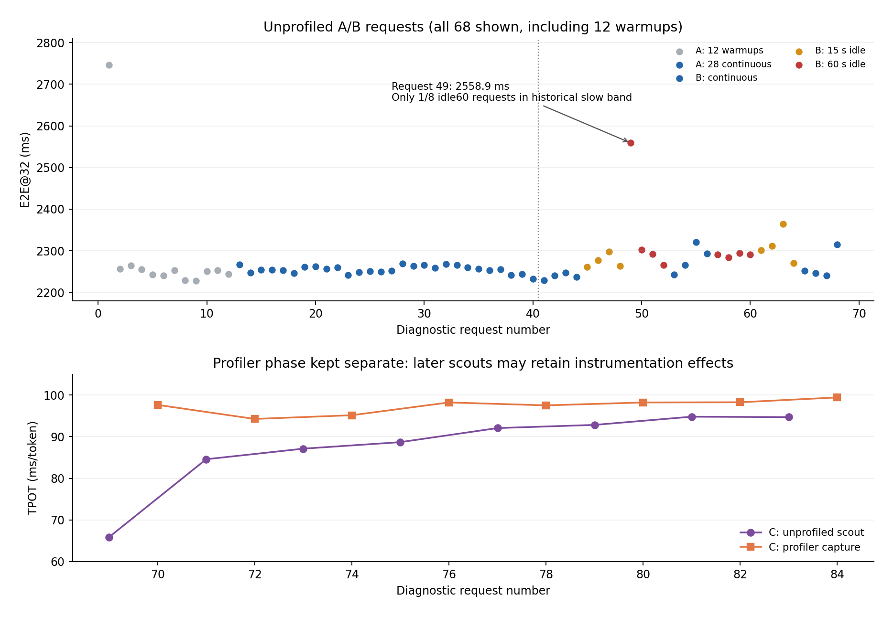
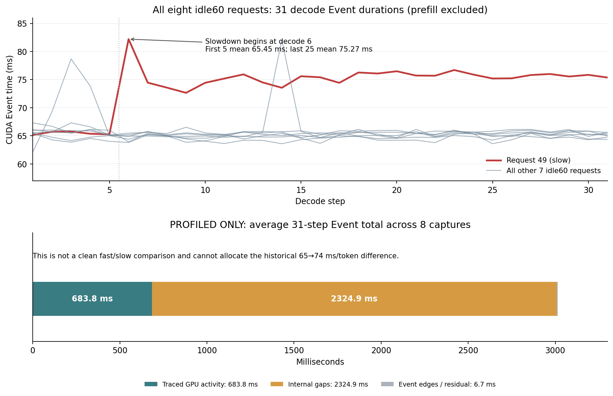

# ATE RTX 3090 Native E2E@32 受控性能诊断

状态：**诊断已执行；物理根因尚未唯一确定；原正式实验继续保留稳定性失败状态**。

生成时间UTC：2026-11-09T19:41:32.299504+00:00。结果目录：`/home/featurize/work/ATE/vlm_research/results/native_e2e32_3090_rootcause_diagnostic`。

本轮实际完成**84次完整Native@32生成**：A预热12次、A/B非预热普通请求56次、C段未插桩探针8次、C段Profiler插桩8次。C段探针可能受前次Profiler影响，全部与A/B普通分布隔离。事先固定84次，硬上限100次；没有新增其他算法、正式Benchmark、质量评测或恢复原75次队列。所有完成的输入/输出一致性和32层KV检查通过。未挑最快结果作为新基线。

## 已缩小的原因范围

固定12次预热后，A阶段28次连续请求E2E均值2254.851ms、范围2232.038–2268.526ms，TPOT均值64.994ms。连续A阶段状态转换记录为 `[]`。

A/B普通非预热请求中，历史快速Decode带（TPOT≤69ms）55次，历史慢速带（TPOT≥71ms）1次，中间带另列。该标签只是预先固定的描述区间，不是剔除标准；首个冷启动预热TTFT显著增加，不与稳态普通请求混合。C段虽有未插桩探针，仍全部单列，不并入本表。

本轮确实复现了历史慢态，但其次数有限，不代表存在两个稳定、可重复控制的分布。

- 请求49，idle60_forward，UTC 2026-11-09T19:10:00.592795+00:00：E2E 2558.889ms，TTFT 266.293ms，TPOT 73.955ms，Event Decode TPOT 73.907ms；主线程runqueue等待0.276ms。

请求49逐步Event显示：前5次Decode平均65.453ms，第6次82.205ms，最后25次平均75.266ms。慢态是在**同一次请求中途**形成并持续到结束，而不是只有首个Token的唤醒惩罚。所有8次60秒条件的32步Event均保存在 `idle60_all_step_events.csv`，包含快速反例。

| 普通非预热状态 | n | E2E均值 ms | TTFT均值 ms | TPOT均值 ms | Event Decode TPOT均值 ms | 主线程runqueue等待均值 ms |
| --- | --- | --- | --- | --- | --- | --- |
| fast_historical_band | 55 | 2266.002 | 245.307 | 65.184 | 65.177 | 0.457 |
| intermediate | 0 | — | — | — | — | — |
| slow_historical_band | 1 | 2558.889 | 266.293 | 73.955 | 73.907 | 0.276 |

小样本慢态均值不能视为稳定慢态基线，n=1时没有可估计的组内波动。全部逐请求记录见 `request_timeline.csv`，没有删除反例。

## A/B：连续、15秒、60秒和反序结果

单一输入为冻结 `GQA:202121628`，与原30题Manifest中对应题完全一致。B阶段按预定顺序：连续4→15秒×4→60秒×4→连续4→60秒×4→15秒×4→连续4；每个idle请求**之前**都独立等待指定时间。两次重复顺序为回文安排，仍不能消除所有时间趋势。

| 阶段/条件 | n | 每次主动空闲秒 | E2E均值 ms | TTFT均值 ms | TPOT均值 ms | Event Decode TPOT均值 ms | E2E范围 ms |
| --- | --- | --- | --- | --- | --- | --- | --- |
| A/fixed_warmup | 12 | 0 | 2288.562 | 276.887 | 64.893 | 64.887 | 2227.73–2746.85 |
| A/continuous_measured | 28 | 0 | 2254.851 | 240.048 | 64.994 | 64.988 | 2232.04–2268.53 |
| B/continuous_before | 4 | 0 | 2238.355 | 239.068 | 64.493 | 64.488 | 2228.61–2247.09 |
| B/idle15_forward | 4 | 15 | 2274.674 | 254.672 | 65.161 | 65.155 | 2261.40–2297.17 |
| B/idle60_forward | 4 | 60 | 2354.658 | 263.460 | 67.458 | 67.441 | 2265.70–2558.89 |
| B/continuous_middle | 4 | 0 | 2280.702 | 243.211 | 65.726 | 65.718 | 2242.82–2320.92 |
| B/idle60_reverse | 4 | 60 | 2289.892 | 260.633 | 65.460 | 65.451 | 2284.33–2294.45 |
| B/idle15_reverse | 4 | 15 | 2311.754 | 258.207 | 66.243 | 66.235 | 2270.54–2363.78 |
| B/continuous_after | 4 | 0 | 2263.252 | 239.958 | 65.268 | 65.256 | 2240.09–2315.18 |

`continuous_vs_idle.csv`提供每条件中位数、标准差和全范围，未把正序/反序简单混成唯一结论。`request_timeline.csv`另列真实请求间墙钟间隔和实际主动等待；`overhead_timeline.jsonl`列CPU准备、校验及本地写盘调用耗时。15/60秒等待均不包含在E2E中，E2E/TTFT/TPOT仍由原冻结计时器返回。

空闲后的GPU唤醒与延迟有部分对应，但同样60秒条件也有快速反例，所以不能把“60秒等待”认定为充分或必然原因。连续A的短窗口稳定，也不能证明未来全部输入/全部Session稳定。

## GPU状态、功耗与采样限制

GPU UUID `GPU-6c96bba5-5cc6-8be2-b277-5533b4cdab27`，RTX3090；驱动610.57.04。开始时空闲P8、SM210MHz、显存405MHz，0计算进程；功耗限制350W。运行时常见P2、SM约1.7–1.965GHz、显存9501MHz。完整样本在 `gpu_telemetry.csv`。

| 普通状态 | GPU样本数 | SM范围/采样均值 MHz | 显存时钟范围 MHz | 采样平均功耗 W | 核心温度范围 ℃ | SW Power Cap激活样本 |
| --- | --- | --- | --- | --- | --- | --- |
| fast_historical_band | 611 | 210–1965 / 1900.0 | 405–9501 | 194.09 | 36–58 | 51 |
| slow_historical_band | 13 | 210–1950 / 1735.4 | 405–9501 | 134.42 | 42–48 | 6 |

这些均值按落在请求wrapper内的采样汇总，并非精确按GPU活动加权；空闲恢复早期也可能被计入，不能把该均值当作31次Decode的恒定频率。200ms读取NVML也不保证设备计数器每200ms独立更新，尤其功耗/利用率存在自身采样窗口。

SW Power Cap掩码0x4表示驱动功耗相关时钟限制状态，定义见 [NVIDIA NVML官方说明](https://docs.nvidia.com/deploy/nvml-api/latest/api/group__nvmlClocksEventReasons.html)。实际记录中它可在P8低功耗或唤醒阶段出现；不能用低平均功耗否定瞬时/驱动事件，也不能仅凭该位判定供电故障或将350W限制改高。本轮未修改任何时钟、功耗、驱动或系统设置。

采样中位间隔0.2000s、最大28.0179s。采集器单独进程运行，CPU共6.758s / 墙钟862.387s（约0.784%的一个逻辑核）；nvidia-smi子进程CPU不计入该process_time，不能据此宣称监控零开销。其他GPU进程事件0次，采集错误0条。

实际仍有6个超过1秒的采样缺口，最长28.018秒；请求57以及C段76–78被缺口跨过，其余较长缺口落在请求外。慢态49自身有13个样本，单次NVML查询最长0.958ms，不在长缺口内。缺口详见 `telemetry_gaps_over1s.csv`。缺口前NVML查询通常不足约1ms，说明长间断发生在同一采集循环的其他操作或调度时段，具体调用没有分项计时，不能唯一归因；后续应把GPU、CPU/procfs及nvidia-smi进程查询分成独立采集器，避免慢操作阻断5Hz流。本轮不能声称全程连续5Hz覆盖。

没有显存结温、VRM温度或板级电气瞬态数据，也未做锁频对照，无法唯一证实/排除功耗管理作为全部根因。

## CPU与调度的直接记录

CPU为Intel Xeon Gold6142，实际可用6个逻辑CPU（0–5）；Torch intra-op=1、interop=6，OMP/MKL/OpenBLAS均1，未设置新亲和性或调度优先级。Governor/cpufreq接口未暴露；/proc/cpuinfo显示约2600MHz但可能是虚拟化固定值，不能当作实际物理核心频率证据。

每请求读取主线程 `/proc/.../schedstat`、上下文切换和运行核心，并保存CPU时间；每秒记录CPU压力、loadavg、cgroup各层cpu.stat/cpu.max、/proc/stat（含steal）及可见频率。全部原始记录见 `cpu_telemetry.csv`。

runqueue等待可以检验“线程已可运行但被OS排队”的时间；它不等于所有CUDA等待、驱动自旋、物理CPU降频或虚拟机调度损失。若慢态请求只等待不足数毫秒，就不能把数百毫秒延迟全部归因于主线程被本机OS抢占。对应逐请求数据已提供；cgroup限流的连续计数增量见 `rootcause_evidence.json/CPU_throttling_counters`，不是用一次初始快照替代全程。

本轮没有安装/启用特权调度跟踪、perf内核采样或更改系统权限，因此缺少每个CPU抢占点的完整sched_switch时间线，不能对更低层宿主机调度作绝对排除。

可读cgroup层级的nr_throttled/throttled_usec计数全程增量均为0；这排除了这些**已观测配额**发生限流的解释，不能排除未暴露的宿主机限制。

## C：Profiler实际证据及缺口

环境未找到nsys；使用已有PyTorch2.6 Profiler（CPU与可用CUDA活动），无安装或环境升级。原始Chrome/Kineto trace在 `profiler/`，索引见 `profiler_capture_index.json`。共成功分析8份；CUDA EventRecord能按64个记录映射32步的trace有8份；分析异常0条。

C段请求69为首个Profiler之前的快速普通探针；请求71以后紧邻之前的Profiler，TPOT明显升高到约90ms，已超出历史约74ms慢态。不能把这些后继探针当作未经采样影响的普通慢态。未取得可证明对应历史快慢两态的Profiler配对，该对照证据不完整；新增观测提示同一进程经历Profiler后须隔离或重新验证稳态，但尚未用新进程对照证实其具体残留机制。

| Prof请求 | 前置普通请求/状态 | 插桩E2E ms | 插桩TPOT ms | Decode Event总量 ms | 匹配GPU活动并集总量 ms | Kernel/活动之间内部空隙总量 ms |
| --- | --- | --- | --- | --- | --- | --- |
| 70 | 69/首次Profiler之前 | 3286.670 | 97.632 | 3024.270 | 682.473 | 2334.965 |
| 72 | 71/前序Profiler之后 | 3180.860 | 94.264 | 2920.073 | 682.419 | 2231.258 |
| 74 | 73/前序Profiler之后 | 3209.621 | 95.153 | 2947.664 | 683.220 | 2258.314 |
| 76 | 75/前序Profiler之后 | 3314.367 | 98.225 | 3042.674 | 684.164 | 2351.603 |
| 78 | 77/前序Profiler之后 | 3286.597 | 97.524 | 3021.045 | 683.927 | 2330.499 |
| 80 | 79/前序Profiler之后 | 3307.306 | 98.221 | 3042.589 | 684.339 | 2351.528 |
| 82 | 81/前序Profiler之后 | 3316.592 | 98.272 | 3044.103 | 684.980 | 2352.375 |
| 84 | 83/前序Profiler之后 | 3344.395 | 99.428 | 3079.934 | 684.589 | 2388.453 |

所有Profiler请求均单独报告，不并入A/B或普通快慢状态均值。Profiler会增加开销，采集本身也可能改变提交节奏，参见 [PyTorch2.6 Profiler文档](https://docs.pytorch.org/docs/2.6/profiler.html)；因此不能把其绝对TPOT当作历史普通慢态的复现。

八份插桩轨迹的31步Decode平均：Event总量3015.294ms，已匹配GPU活动并集683.764ms，活动之间内部空隙2324.875ms。每份完整请求均53642个Kernel及对应Launch API。按相邻同stream GPU活动与后继Launch时间对齐，平均有2100.303ms的空隙发生在后继API尚未开始前，219.179ms与该API调用重叠，5.393ms发生在API返回后、GPU尚未执行期间。

这是**插桩状态下**提交不连续的直接时间线证据：大量GPU空隙不能称为纯GPU算术耗时，也不等于OS抢占。它仍不能证明历史未插桩65→74ms的差额全来自CPU提交，更不能把Profiler制造的时间直接扣减为正式结果。

映射方法：先选择CPU user_annotation（同名GPU annotation另存），并将65个cudaEventRecord中带aten External id的1个算子内部记录单列，保留原外层64个Event的**CPU提交顺序**取得32个提交窗口；将窗口内CUDA Runtime/Driver API correlation id链接到GPU活动，再计算并集及间隙。它没有伪造GPU Event绝对时间戳。Event减已追踪活动的剩余时间还含边缘开销和未映射活动，不能全部命名为CPU等待；具体每步映射数量在 `profiler_per_step.csv`。首次CPU解析因未区分同名annotation而失败的摘要另存 `profiler_summary_parse_attempt_01.json`，修正后8份均完成映射，没有重跑GPU或修改原始trace。

`profiler_summary.json`同时给出Launch次数、API耗时分布、提交间隔、GPU kernel总耗时、Top Kernel名称、GEMM/softmax/normalization/copy等aten算子类别。当前为降低采样扰动关闭shapes/stack；没有精确模块标记，不能把所有GEMM无依据地分成Attention与MLP。softmax等可识别算子提供局部线索，但完整Attention/MLP语义时间对照仍缺失。

例如请求70全程（含Prefill）GPU Kernel类别累计：GEMM/matmul 745.337ms，softmax 7.768ms，copy/concat 59.184ms，已按aten归类的normalization 0.266ms，其他/逐元素81.057ms。RMSNorm拆成的逐元素操作落在其他类别，故不能将0.266ms解释为所有归一化成本。完整逐名Kernel统计保留在JSON。

CUDA Event是在GPU stream中两个标记之间的持续时间，既可能包含Kernel运行，也可能包含GPU尚无下一条工作时的空隙。CPU侧CUDA API持续时间、CPU提交间隔和Kernel执行时间是不同量；Launch API到Kernel开始还可能包含已排队工作。解释依据见 [NVIDIA官方时间线说明](https://developer.nvidia.com/blog/understanding-the-visualization-of-overhead-and-latency-in-nsight-systems/)。本次trace提供了实际分解；若没有同状态的快慢双侧采样，就不能把历史约9ms/token差额全部分配给某一种机制。

## D：原运行器与外围开销

冻结 `e2e32_runtime.generate` 原样导入，SHA `513a122ff5f4da008b74e4d5560b0b6ef50baf8ccf7feb2fa766a0cdcdc51a3b`。模型、Attention、KV扩展及原同步/Event位置均未改。每请求新建position/mask、动态KV及Event，Native对get_image_features的临时Patch沿用原实现，无正式观察Hook或算法controller。

原 `run_native.py` 的clean仅断言函数身份和无Hook；gc.collect/empty_cache只在Session finally执行。该代码没有每请求显式清缓存，因此“每次被empty_cache冷启动”解释不成立。自动GC没有关闭，新诊断用回调记录GC事件，原件未变。

诊断外围在本地ext4目录逐条flush/fsync JSONL，由独立遥测进程采样，结束后同步持久盘；不在每请求间访问NFS或执行UUID子进程查询。**这与原外围执行器不同**，但所有A/B条件均保持这一外围设置，内层计时路径一致。本轮未将“是否NFS/是否UUID查询/是否单输入”做完整因素分离，不能把全部改善归因某一项。

| A/B请求外围操作/范围（含预热） | 平均 ms | 最大 ms |
| --- | --- | --- |
| H2D_enqueue_ms | 3.0192 | 23.2553 |
| seed_ms | 0.2475 | 0.7471 |
| clean_before_ms | 0.3675 | 1.1577 |
| clean_after_ms | 0.3016 | 0.3621 |
| JSON_serialization_ms | 0.2326 | 0.2883 |
| local_JSONL_flush_fsync_ms | 3.1531 | 5.0903 |
| wrapper_generation_ms | 2278.3751 | 2751.1532 |
| outer_without_intentional_idle_before_trace_export_ms | 2289.6115 | 2760.0905 |

H2D列为.to调用耗时，包含调用/同步开销，不是PCIe纯传输带宽测试。wrapper时间包括原计时结束后的Token/KV离线验收，因此大于内层E2E。日志和同步写盘始终在原计时外，完整CPU准备/主动等待/真实请求间隔分别保留。

## 根因可信度、可操作建议与正式复测条件

**已证实**：固定输入和Token下存在记录中的延迟变化；连续A有一段较稳定窗口；空闲与GPU电源状态恢复确实发生；不存在足以解释全部差额的输入/输出长度改变或每请求显式GC/empty_cache。

**与证据一致但未证实**：GPU唤醒/功耗管理可能贡献；CPU/驱动提交节奏和GPU活动间隙可能贡献；原外围NFS同步及混合输入可能影响占空比/分配器。不能把一般机制当作这次物理根因。

**本轮不支持的强结论**：所有60秒空闲都变慢、SM频率一个数即可解释全部差额、CPU被抢占数百毫秒、Profiler慢态就是历史慢态、连续28题通过即永久修复。

**仍待验证**：同一未插桩慢态附近的可比快慢GPU活动时间线；宿主机实际CPU频率/驱动行为；原双探针、NFS外围因素各自的独立作用。验收不要求强行找到唯一根因，本轮按真实证据保留不确定性。

以下按下一步调查的证据优先级排列，并非已确认物理根因的概率排名：

| 优先级 | 候选因素 | 直接证据与可信度边界 |
| --- | --- | --- |
| 1 | CPU/驱动提交节奏及运行时状态 | 插桩C中大量空隙发生在下一Launch API开始前，且Profiler之后普通探针持续变慢；对C的证据强，对历史65→74ms的归因仍弱，缺少未插桩快慢配对。 |
| 2 | GPU动态功耗/频率与唤醒交互 | 慢态49有P8→P2和SW Power Cap记录；但相同唤醒、功耗标记也出现在快速反例中，且慢化在第6步Decode才形成，只能视为可能贡献。 |
| 3 | 外围I/O、请求占空比及混合输入状态 | 新外围连续A的28次稳定；原NFS、UUID查询、双输入没有逐因素对照，不能认定哪一项导致历史漂移。 |
| 低 | 本机OS主线程排队或已观测cgroup配额 | 慢态49排队仅0.276ms、可见配额无throttling，作为数百毫秒差额的单一解释不受支持；宿主机隐藏限制仍未排除。 |

最合理的工作假设是运行时/提交节奏与设备动态状态的交互，而非一个已证实的单一升频原因；目前没有足够证据指定唯一最可能物理根因。

建议优先A+B+D，同时保留E：连续完整预热和稳态准入、减少计时外不必要空闲与同步I/O、未来算法块前后用Native包围配对并保留多Session统计。Profiler必须与正式测量分进程，结束后不直接恢复正式计时；本轮C的后继探针变化支持隔离这一保守操作。尚未验证一个能消除所有漂移的修复方法。C（固定GPU/CPU条件）仅在将来证据与权限支持时另行申请，本轮没有更改。

推荐正式协议只写入 `recommended_protocol.json`：每Session至少60次完整预热且累计生成计时≥180秒，三个互不重叠20请求窗口逐输入检验离散度/趋势，通过后独立20次建基线；每5题做6次双探针校准，保留2%双侧、连续两窗暂停规则。发生>1秒未解释间断需停止或重新作为新阶段验证稳态，不能静默重设旧基线；仍用原30题×3独立Session、逐轮均值及三轮均值中位数。新正式实验应新建目录，不能接续旧第16题冒充同一模型加载Session。

窗口对两个原冻结探针分别统计E2E、TPOT及Event TPOT：robust CV=1.4826×MAD/中位数≤1%，相邻窗口中位数变化≤1%，三个窗口中位数范围/其中位数≤2%；不得合并不同输入的绝对延迟。60次和180秒为同时满足的下限，不是保证稳定的固定魔法次数；最大180次或15分钟仍未准入就停止。保留2%门禁是合理的漂移检测要求，当前失效点主要是原基线准入不足，而不是应该放宽门禁。本建议尚未经正式三Session验证。

## 诊断图

## 保存、原件与GPU释放

持久目录 `/home/featurize/work/ATE/vlm_research/results/native_e2e32_3090_rootcause_diagnostic`；原始本地暂存 `/home/featurize/ate-local-diagnostics/native_e2e32_3090_rootcause_diagnostic`，结束后已同步本轮输出。保留protocol/environment、全部requests及attempts、CPU/GPU原始CSV、逐请求与条件CSV、Profiler原始文件/汇总、GC和外围日志、源码与SHA清单。

原实验 `/home/featurize/work/ATE/vlm_research/results/native_e2e32_3090_recheck` 及原审计 `/home/featurize/work/ATE/vlm_research/results/native_e2e32_3090_stability_audit_20261110` 均只读，保留原15条历史稳定性失败结果；最终SHA/Checkpoint验收见 `validation.json` 和 `protected_files_after.json`。没有Push/PR、修改main或关闭服务器。GPU释放验收以 `gpu_release.json` 及最终 `validation.json` 的实际进程查询为准，不以模型对象置空推断成功。
