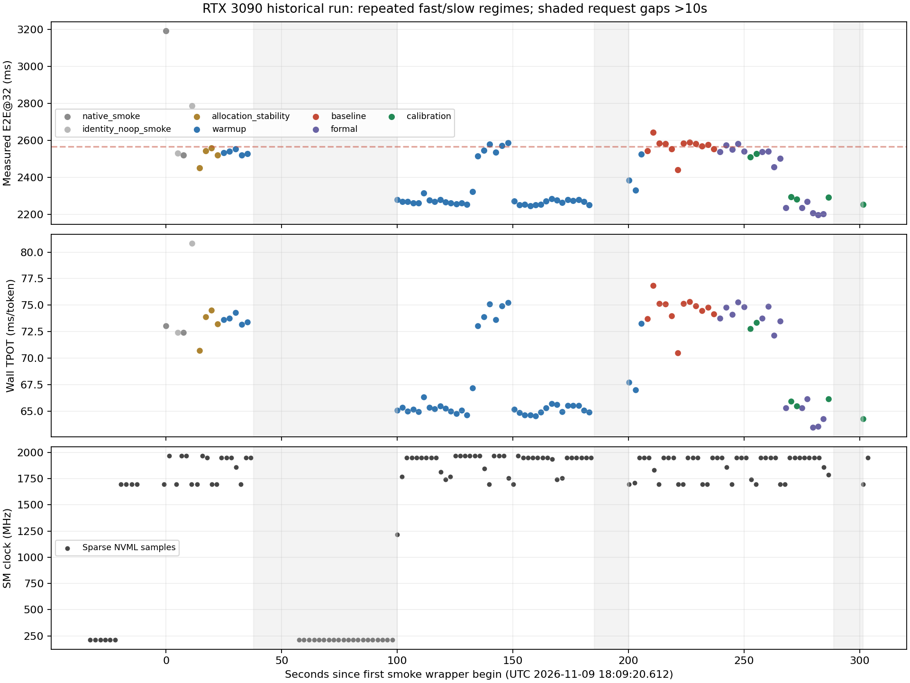

# ATE RTX 3090 Native E2E@32：只读稳定性诊断

审计状态：**CPU_READONLY_AUDIT_COMPLETE；物理根因尚未唯一确认**。审计时间（UTC）：2026-11-09T18:50:11.257508+00:00。

原实验：`/home/featurize/work/ATE/vlm_research/results/native_e2e32_3090_recheck`。本审计和建议独立保存在 `/home/featurize/work/ATE/vlm_research/results/native_e2e32_3090_stability_audit_20261110`。

**2567.11ms不是已验证的稳态基线。已有轨迹是多次快慢切换，而非同一输入持续、单调地变快。预热确实覆盖完整32 Token，但时间退出条件与稳态准入缺失，使基线恰好取到了较慢的一段。至于运行状态为什么切换，现有遥测不能唯一归因。**

原15条正式记录标记为“稳定性未通过的历史实验”，标记仅在本目录 `historical_experiment_status.json`；没有改写原报告、原Checkpoint、原CSV或冻结源码。该15题均为GQA；未完成TextVQA正式题及后续两轮，不能作为原30题或3090的已验收基线。

## 证据范围与完整性

读取原报告、逐题CSV、原协议、环境、输入验收、Smoke、漂移基线/汇总、原始遥测、runner.log、progress.json、SQLite Checkpoint及所有导出台账。SQLite以 `mode=ro&immutable=1` 读取，先确认WAL为0字节，数据库 integrity_check 通过。

原始清单101个文件均与已有SHA匹配；本次前后对原目录全部103个文件（含SQLite/WAL/SHM）逐项比对内容SHA和大小，一致。46项协议源码SHA及两个新入口SHA一致。核对全部85条生成记录的台账payload SHA、导出JSONL、协议/入口/runtime/模型凭据绑定；未重扫模型权重或重下载数据。

共85次已记录Native生成：正式15，完整预热44，建基线12，校准6，Smoke及分配检查8；另有1条暂停异常记录。每次均32输出、1次Vision/Prefill及31次真实Decode，全部输出Token与历史参考逐项一致。30题输入验收记录保持原样；85次实际调用涉及的16个不同题目均与其冻结输入哈希绑定一致。这里只审计已有证据，没有重新Processor处理或GPU重算。

模型 `llava-hf/llava-1.5-7b-hf`，Revision `b234b804b114d9e37bb655e11cbbb5f5e971b7a9`；FP16、Eager、batch1、greedy、use_cache=True、logits_to_keep=1，忽略EOS。PyTorch2.6.0+cu124、Transformers4.49.0、CUDA runtime 12.4、驱动610.57.04。GPU UUID `GPU-6c96bba5-5cc6-8be2-b277-5533b4cdab27`。

冻结计时运行器SHA256：`513a122ff5f4da008b74e4d5560b0b6ef50baf8ccf7feb2fa766a0cdcdc51a3b`。

## 时间顺序重建

以下时间为北京时间2026-11-10（原始UTC为2026-11-09 18时段，UTC+8）。`request_timeline.csv/jsonl`包含全部85次请求，逐条记录开始/结束、相邻间隔、E2E、TTFT、TPOT、Event Prefill、Event Decode总时长/均值、输入输出摘要、显存残留、匹配遥测。`per_step_event_timeline.csv`另含85×32=2720个有序Event耗时。

| 顺序 | 阶段 | 实际请求数 | 时间/说明 |
| --- | --- | --- | --- |
| 1–4 | Native/identity No-op Smoke交替 | 4 | 02:09:20.612起；观察Hook及Logits CPU复制增加开销，不作普通性能样本 |
| 5–8 | 分配稳定性检查 | 4 | 02:09:35.212起；无Smoke观察Hook，完整32 Token |
| 9–52 | 两个固定输入交替预热 | 44 | 02:09:45.512至约02:12:48.667；22轮双探针 |
| 53–64 | 初始建基线 | 12 | 02:12:48.723至约02:13:20.137；6轮双探针 |
| 65–83 | 正式题目与第5/10题后校准交错 | 15+4 | 正式第1题02:13:20.196；第10题02:13:48.672开始出现明显较快状态 |
| 84–85 | 第15题后校准 | 2 | 02:14:07.060及02:14:22.069；随后漂移暂停 |

墙钟开始/结束是入口在调用generate前后的wrapper时间；原始内层perf_counter计时边界没有各自的绝对UTC。Event保存的是逐步持续时间，不含可恢复的逐步绝对时间戳。故能重建顺序和持续时间，不能编造精确到每个Kernel的UTC或其时钟。遥测对齐采用驱动记录时间（与UTC采集时间相差中位约0.064秒、最大0.414秒）；在wrapper区间内取稀疏采样，不能当成整请求连续平均。

固定探针为 `GQA:202121628` 与 `TextVQA:38571`。表中每项是同一固定双输入组合的算术平均，单位ms；E2E变化相对初始12次平均。

| 阶段 | E2E@32 | TTFT | TPOT | Event Decode TPOT | E2E变化 |
| --- | --- | --- | --- | --- | --- |
| 初始基线（12次） | 2567.106 | 257.386 | 74.507 | 74.457 | — |
| 第5题后（2次） | 2519.309 | 254.197 | 73.068 | 73.038 | -1.862% |
| 第10题后（2次） | 2288.138 | 251.780 | 65.689 | 65.682 | -10.867% |
| 第15题后（2次） | 2273.501 | 252.419 | 65.196 | 65.190 | -11.437% |

从基线至第15题后，E2E减少293.605ms：TTFT减少4.967ms，31×TPOT减少288.638ms，占E2E减少量的98.31%。Event Decode TPOT从74.457变为65.190ms，31个Decode位置的配对组合平均Event耗时全部下降，逐步相对变化范围为−13.53%至−9.41%。因此不能用EOS更早结束、少生成Token或只缩短Prefill解释。

22轮预热双探针E2E均值（保留全部，不挑选）：

`2536.28, 2537.39, 2404.56, 2269.93, 2261.22, 2296.14, 2274.99, 2264.63, 2259.20, 2289.64, 2530.17, 2557.72, 2579.41, 2262.31, 2251.16, 2252.98, 2278.68, 2270.34, 2277.22, 2274.40, 2318.79, 2429.36` ms。

第4–10轮已经约2.26–2.30秒，第11–13轮又回到2.53–2.58秒，第14–20轮再次约2.25–2.28秒。第21–22轮又受间断/状态变化影响。这直接否定“一路预热到越来越快”的简单叙述。

六轮建基线双探针均值：`2593.15, 2582.94, 2497.81, 2586.89, 2576.57, 2565.27` ms；峰峰差/总均值为3.71%，建基线阶段没有执行稳定性准入测试。它不能支持“初始基线已稳态”的断言。

正式15题逐条保留如下，绝不以末段较快样本代替全体：

| 正式序号 | 原题ID | E2E@32 ms | TTFT ms | TPOT ms | Event Decode TPOT ms |
| --- | --- | --- | --- | --- | --- |
| 1 | GQA:202121628 | 2539.13 | 252.94 | 73.748 | 73.712 |
| 2 | GQA:20308802 | 2575.36 | 256.64 | 74.797 | 74.743 |
| 3 | GQA:202158870 | 2551.63 | 253.88 | 74.121 | 74.073 |
| 4 | GQA:201759069 | 2582.62 | 249.28 | 75.269 | 75.211 |
| 5 | GQA:20162504 | 2540.88 | 221.67 | 74.814 | 74.764 |
| 6 | GQA:20886934 | 2538.94 | 252.29 | 73.763 | 73.713 |
| 7 | GQA:201889314 | 2541.08 | 219.34 | 74.895 | 74.834 |
| 8 | GQA:201455854 | 2457.04 | 221.13 | 72.126 | 72.106 |
| 9 | GQA:20709953 | 2501.74 | 223.64 | 73.487 | 73.451 |
| 10 | GQA:202246655 | 2236.25 | 212.47 | 65.283 | 65.275 |
| 11 | GQA:202060056 | 2235.87 | 211.88 | 65.290 | 65.285 |
| 12 | GQA:20644736 | 2268.79 | 218.77 | 66.130 | 66.105 |
| 13 | GQA:20922878 | 2207.85 | 241.36 | 63.435 | 63.427 |
| 14 | GQA:201976841 | 2196.61 | 226.38 | 63.556 | 63.539 |
| 15 | GQA:201959618 | 2203.55 | 210.99 | 64.276 | 64.270 |

该15题原始均值E2E=2411.823ms，中位数2501.737ms，样本标准差161.436ms；这些仅描述未通过稳定性验收的部分历史数据，不构成新3090参考。

## 预热覆盖与间断

预热44次全部完整32 Token、同一冻结Native路径，绝非仅Prefill或短Smoke。实际预热首尾墙钟跨度183.155秒，但内层生成E2E之和只有103.353秒（约56.43%）；两者的差包含请求外操作及等待，不能称为持续GPU计算180秒。

请求9至52之间，有62.115秒和14.936秒的明显请求外间断；末次校准两输入之间又有12.712秒。源代码按 `time.monotonic()-begin >= 180` 退出，期间同步台账提交、状态文件、UUID查询、H2D和调度等待均消耗此墙钟预算。具体哪个操作造成长间断没有分项计时，不能事后判定。

`drift_baseline.json` 的 `warmup_seconds=214.679` 在12次建基线完成后才计算，包含约31秒建基线；不是单独预热时长。`progress.json` 的warmup_cycles=20仅每5轮刷新，台账实为22轮，不能据此少算4次预热。以上是审计侧释义，原件未修订。

入口在请求之间使用SQLite WAL、`synchronous=FULL`逐条提交，并刷写进度；后台遥测线程也写文件。当前只读挂载观察显示 `/home/featurize/work` 为NFS。它提供了值得检查的I/O机制，但没有历史逐操作耗时/挂载变更记录，不能把62秒直接定性为NFS故障。即便I/O在计时外，也可能改变相邻请求的空闲/功耗状态与占空比；这仍是待验证机制。

## GPU遥测能说明什么

共133次查询，0查询异常，0次观察到其他GPU计算进程。按驱动时间，相邻采样间隔中位约2.10秒、最大20.936秒，4次超过5秒（采集完成时间口径最大20.949秒）。部分请求只有1次采样；未采到竞争不等于排除采样间隙的短任务。

| 固定探针阶段 | 区间内样本数 | SM Clock范围/采样均值 MHz | 平均GPU温度 ℃ | 平均功耗 W | P-State / Memory Clock MHz / 所列Throttle理由 |
| --- | --- | --- | --- | --- | --- |
| baseline | 15 | 1695–1950 / 1857.0 | 56.67 | 198.22 | P2 / 9501 / 未激活 |
| after5 | 3 | 1695–1950 / 1795.0 | 58.00 | 197.85 | P2 / 9501 / 未激活 |
| after10 | 2 | 1950–1950 / 1950.0 | 59.00 | 218.85 | P2 / 9501 / 未激活 |
| after15 | 2 | 1785–1950 / 1867.5 | 57.00 | 212.09 | P2 / 9501 / 未激活 |

这些探针区间的SW Power Cap、HW/SW Thermal、HW Slowdown、HW Power Brake字段均未激活；功耗限制始终350W。全程其他时间仍记录过SW Power Cap，详见 `telemetry_normalized.csv`，不能宣称整轮从未触发任何限制。正式阶段温度约57–60℃。没有显存结温/热点温度历史记录，不能用GPU核心温度替代这些字段。

第10题后样本显示SM=1950MHz、功耗约218.85W，高于基线采样平均1857MHz/198.22W，与该段加快有部分同步迹象；但这只是少量离散采样。同一GQA探针第9次总请求采到1950MHz、43℃时E2E=2532.68ms，第15次采到1950MHz、44℃时E2E=2270.56ms；基线第63次采到1950MHz时又为2577.02ms。相近/相同采样时钟和温度仍对应快慢两种延迟，因而不能仅凭动态升频解释，也不能反向排除采样间隙的频率变化。

P2没有随快慢阶段转换，Memory Clock采样固定9501MHz；没有记录到能够解释全部变化的P-State/显存频率转换。采样功耗增加也可能是提交效率提高的结果，不能当作因果证据。描述性相关系数见JSON，不把时间相关、稀疏采样或混合阶段的Pearson值当根因检验。

## CPU、运行时与模型状态

CPU为Xeon Gold6142，可用CPU亲和性0–5；Torch intra-op=1、interop=6，OMP/MKL/OpenBLAS均1。只有加载后的配置快照和入口源码约束，没有每请求线程/亲和性快照；未见主动调整的源码，但不能证明OS调度从未改变。cgroup初始快照未见配额限流，缺乏连续增量记录，不能据此排除后续限流/抢占。

CPU PSI some/full的avg10/60/300采样均0.00，some total从8,927,059至9,140,734微秒，说明采样没有显示持续CPU资源压力；它既不衡量主线程每次launch延迟，也不排除微短抢占。主机loadavg随阶段变化，且包含不可运行等待，不能等同CPU利用率或以负载下降直接证明原因。

没有历史CPU核心频率、每线程CPU耗时/迁移/上下文切换、steal、逐时cgroup限流、调度轨迹、CUDA API调用/Kernel Launch延迟、每Kernel持续时间或GPU内存吞吐计数，均**不能事后恢复**。本轮读取当前系统无法补成历史值。

正式请求的wall TPOT减Event TPOT均值仅0.031959ms/token，最大绝对差0.060834ms/token；约9ms/token的主要变化已落在每步Event覆盖区间。但Event包围整个Python `a.model(**kw)`、argmax和finite检查的GPU提交，区间中仍可能包含GPU等待CPU提交Kernel的空隙；这不是纯Kernel算术时间之和。因此不能用“Event也变快”排除CPU launch/调度因素。CUDA异步提交和同步计时的语义见 [PyTorch 2.6官方文档](https://docs.pytorch.org/docs/2.6/notes/cuda.html#asynchronous-execution) 与 [NVIDIA计时说明](https://docs.nvidia.com/cuda/cuda-c-best-practices-guide/index.html#timing)。

源码逐项审计（带行号原文见 `source_excerpts.txt`，AST调用清单见 `source_call_audit.json`）：

| 项目 | 实际实现与诊断含义 |
| --- | --- |
| GC / empty_cache | `run_native.py:125–126`仅Session finally执行；`clean():58–62`只是原函数身份/无Hook断言，不做GC或清缓存。没有每题手动清缓存造成冷启动的证据；自动CPython GC没有轨迹 |
| 计时边界/同步 | `e2e32_runtime.py:107,125,129`分别在开始前、Prefill后、结束时同步；各阶段同一路径，无随题更换同步策略的代码 |
| 输入/临时分配 | H2D在计时前；每请求新建64个Event对象（计时前，但底层懒初始化未追踪）；position/mask在计时内新分配；计时前后日志/离线KV检查不计入E2E |
| KV缓存 | 每请求从past_key_values=None开始；当前安装HF DynamicCache.update在cache_utils.py:440–441用torch.cat扩展K/V。动态Tensor分配仍存在，没有跨请求直接复用上一题KV或答案 |
| 分配器状态 | 缓存分配器可跨请求保留空闲块；现有记录只有活Tensor残留，不能反推出cudaMalloc次数、reserved/peak、碎片或分配器变化。见 [PyTorch 2.6内存管理](https://docs.pytorch.org/docs/2.6/notes/cuda.html#memory-management) |
| 活Tensor残留 | 预热/基线/校准仅两个固定残留值，分别对应两个输入；正式题残留变化不足2KiB，未见随次数持续增长。不能据此证明缓存分配器完全不变 |
| 模型状态/路径 | 同一模型对象单次加载、eval/inference_mode、无训练，Native不创建剪枝controller；每请求原函数身份/无Hook检查，固定32Token及历史Token全匹配。仅Smoke使用观察Hook及identity包装 |

`CUDA_MODULE_LOADING=LAZY` 为已有配置。懒加载可能影响首次测量，这是一般机制，见 [NVIDIA官方说明](https://docs.nvidia.com/cuda/cuda-programming-guide/04-special-topics/lazy-loading.html#impact-on-performance-measurements)。然而相同输入已执行44次完整预热且此前多次达到快速状态，之后又变慢，故“首次Kernel懒加载尚未完成”不足以解释这轮反复切换。没有切换该环境设置做对照。

## 原因排序：证据强弱与边界

1. **证据强：稳态准入缺失、按墙钟退出且基线采到慢状态。** 这解释了为什么2567.11ms不可信为稳态参照，以及为什么固定基线会被后续快状态触发。它是已证实的测量协议问题，**不是已确认的物理根因**；不能保证多跑若干次就永不切换。
2. **候选优先调查：主机运行时/CPU提交调度及请求间占空比变化。证据中等、归因未证实。** 相同采样SM频率下相同输入仍有约0.3秒差异；31步Event区间普遍缩短；有主机侧长间断且计时外同步I/O机制确实存在。缺少调度/launch/存储分项轨迹，尚不能区分CPU频率、抢占、Python/驱动提交、I/O间断的间接影响，不能宣称已找到CPU瓶颈。
3. **GPU动态频率/功耗状态：确有采样波动，可能贡献，但不足以独立解释。** 第10题后有更高SM/功耗的采样支持；同频快慢反例、恒定P2/显存频率和覆盖不足限制结论。不能把平均采样频率差当成精确频率缩放模型。
4. **缓存分配器、库初始化等运行时预热：机制存在，直接证据弱。** 未追踪reserved/分配/模块初始化；全程重复完整路径及多次回退慢状态削弱单次冷启动解释。未见模型/输入/算法变更或持续显存泄漏。
5. **热/功耗限流或其他计算进程解除：支持较弱。** 探针采样没有对应Throttle激活，温度/显存时钟没有匹配的单调变化；GPU竞争未被采到。由于间隙与缺失字段，均不能绝对排除。

结论只能到“Decode区间在不同运行状态间切换，初始基线未达到已验证稳态”；现有资料不足以选择一个唯一的硬件或主机根因。

## 2%门禁及后续建议

2%可保留为同机测量的工程稳定性约束；双侧判定（变快也算漂移）合理，本次11–12.5%的偏移足以维持暂停。问题在于基线先验不稳、每检查点仅两个请求且没有每探针重复，不是应该放宽门限来接受较快结果。当前2%不能称为有置信度保证的统计显著性检验；即便加大样本也须检查时间相关/分段状态。

修订建议见 `protocol_proposal_zh.md`：至少60次独立完整32-Token预热（每固定输入30次）且累计**生成计时**至少180秒；三段互不重叠的20请求稳定窗口通过后，再用独立20请求建基线复核。次数为保守起点，非“60次必然热透”的断言；达到上限仍不稳应停止诊断。

建议未来另行授权一次小规模GPU稳定性诊断，针对同一两个输入采更细GPU/CPU/launch轨迹，区分上述候选因素；本次没有执行。授权诊断与授权恢复90次正式测量是不同范围。本次未启动GPU生成、未继续剩余75次正式请求、未改时钟/功耗、未Push GitHub。

## 交付与保存

`request_timeline.csv/jsonl`（85次全量）、`per_step_event_timeline.csv`（2720步）、`per_step_baseline_vs_after15.csv`、`fixed_probe_pair_cycles.csv`（22预热+6基线+3校准组合）、`telemetry_normalized.csv`、`phase_time_budget.csv`、`audit_statistics.json`、`additional_evidence.json`、源码摘录和审计脚本均在本目录。

原CSV SHA256：`642d49567b50ce76513746b83c6377ef6fd80e57b2ab100bfe40972e79cdf5fc`。

原Checkpoint SHA256：`01c85d0b1298def2e7873f509297a7f12b981dc1a42417e32346121ef311934f`。

`preservation_validation.json`及前后文件清单证明原件完整保留。建议协议状态为**PROPOSED_NOT_EXECUTED**，没有改写冻结模型、冻结算法或原实验协议；没有挑最快样本或把暂停前后状态拼成新基线。
