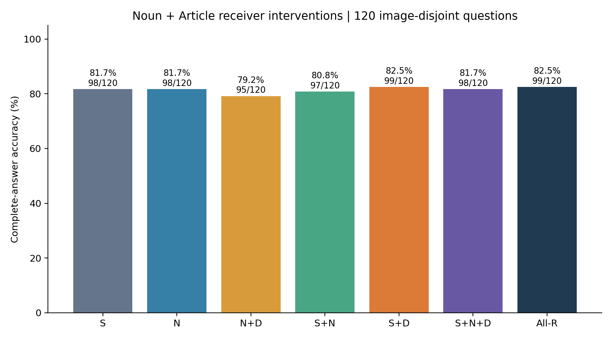
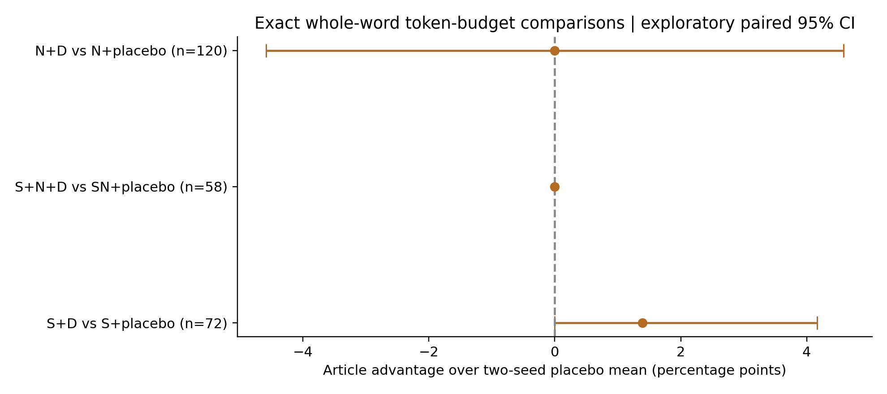
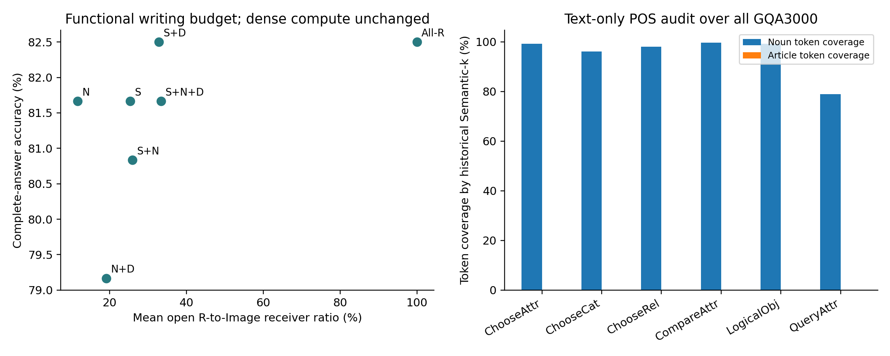

# Noun + Article Visual Writing：120题机制探索与12例诊断

状态：COMPLETE。新增 789 个唯一写入集合的完整 Greedy 生成；有效条件标签 1503 个，复用/同集合计算单列。120题与12例分别统计。

## 直接回答

本轮没有得到冠词作为额外接收者稳定优于同预算随机补位的证据。S+D比S仅净增1题；在72题可比子集中比两种子随机均值高1题（区间下界为0）；补齐名词后，在58题可比子集中冠词与随机补位的逐题正确性完全相同；N+D与N+随机均值净差为0。因此不能断言冠词必须直接读图，也不能把零差或区间跨0当作等效证明。

历史12例中，补名词恢复2题、补冠词恢复1题，名词遗漏确实可以修复部分历史失败；但新120题S+N反而比S少对1题，说明该规则没有显示总体改进。冠词恢复的那例同预算随机补位同样有效，支持预算/接收位置的替代解释。

- S+D 相对 S：+0.833 pp，95%CI [+0.000, +2.500]，n=120，对→错 0、错→对 1
- S+N 相对 S：-0.833 pp，95%CI [-2.500, +0.000]，n=120，对→错 1、错→对 0
- S+D 相对 S+随机补位两种子均值：+1.389 pp，95%CI [+0.000, +4.167]，n=72，对→错 0、错→对 1
- S+N+D 相对 S+N+随机补位两种子均值：+0.000 pp，95%CI [+0.000, +0.000]，n=58，对→错 0、错→对 0
- N+D 相对 N+随机补位两种子均值：+0.000 pp，95%CI [-4.583, +4.583]，n=120，对→错 5、错→对 5

历史12例中，补名词恢复 2 例，补冠词恢复 1 例，至少一个等预算随机补位也恢复 3 例；名词和冠词全部补齐仍错 9 例。类别可重叠，只描述这12例。

## 120题完整答案Accuracy

| 条件 | 正确/120 | Accuracy | 平均k/R |
|---|---:|---:|---:|
| Semantic-k | 98/120 | 81.667% | 25.31% |
| Noun-only | 98/120 | 81.667% | 11.69% |
| Noun+Article | 95/120 | 79.167% | 19.15% |
| Semantic+Noun | 97/120 | 80.833% | 25.87% |
| Semantic+Article | 99/120 | 82.500% | 32.77% |
| Semantic+Noun+Article | 98/120 | 81.667% | 33.33% |
| All-Writer | 99/120 | 82.500% | 100.00% |

所有主策略均在完整120题评分。随机对照不可行的题保留空结果并标记，随机对照统计只使用预先可匹配的子集；不得把不同分母的净Accuracy直接当配对效果。两种子先逐题平均，分数型对→错/错→对表示随机种子的平均计数。

## 冻结、样本与词性审计

历史基线来源 Commit `01c82b1d39360fc73bca3d10d12886672ffee370`；历史12错误例来源 `425286a2566cc6b0387460492a0f99566b142a38`。120题按冻结SHA排序选择，每任务20题、120张不同图片，排除历史Semantic240以及12错误例的全部251个图片SHA。未使用Gold、图片内容或新生成结果做词类判断或选样。

经用户明确授权，在独立CPU虚拟环境安装 spaCy 3.8.7 与 en_core_web_sm 3.8.0；没有改变历史VLM环境。模型通过HTTPS GitHub转发取得，直连超时；下载来源、wheel SHA256及模型逐文件SHA保存在 parser_download_audit.json / parser_environment.json。未独立取得官方发布文件摘要，明确保留此来源核验限制。

N为所有 NOUN/PROPN；D为字面a/an/the、依存det且直接修饰名词的词。依存规则自然允许中间形容词，每个复合名词组成词独立纳入N。完全按解析器结果执行，无手动词性修正。全部3000题使用原生Tokenizer字符Offset核对，与原冻结分组闭包对齐，不拆Subword。所有格、连字符闭包记录于cpu_validation.json；它们可能使接收集合包含相邻符号，不能称每个子词都具有相同词性。

`On which side is the can?` 中 can=NOUN，the --det→ can；`Is the zebra to the left of the bench black or white?` 中 left=NOUN，the --det→ left，纳入D。该句 black 被解析为修饰 bench 的形容词，提示小型统计解析器在问句中的依存结果也可能存在偏差。本实验接受并公开完整解析，不依据模型答案修正算法。can/the left/compound的人工可读结果见 ambiguity_audit.csv。

| 任务 | 题数 | 含名词修饰冠词 | N Token | S覆盖N | D Token | S覆盖D |
|---|---:|---:|---:|---:|---:|---:|
| ChooseAttr | 500 | 443 | 1304 | 1294 | 632 | 0 |
| ChooseCat | 500 | 482 | 2278 | 2189 | 954 | 0 |
| ChooseRel | 500 | 500 | 2984 | 2923 | 2345 | 0 |
| CompareAttr | 500 | 500 | 1541 | 1536 | 990 | 0 |
| LogicalObj | 500 | 64 | 1953 | 1936 | 128 | 0 |
| QueryAttr | 500 | 499 | 1616 | 1275 | 826 | 0 |

## 等预算对照与Swap

随机补位种子固定20261103/20261107，候选限Question内、基集合外、不含a/an/the的完整词组；按SHA排序后精确子集和匹配实际新增D Token数。S对照可比较72/120；S∪N对照58/120；N对照120/120。不能匹配的样本从未按模型结果剔除。历史12例相应可比较8、7、12题。

Article-Swap仅在历史12例执行，按冻结SHA顺序移除同等Token预算的原S完整词组；随机Swap共享同一移除集合，新增随机非冠词词组。Article-Swap不可行 1 例；补冠词答对但可行Article-Swap仍错 0 例。k=0或无法精确匹配时不强行替换。Swap失败只反驳该冻结替换，不代表所有等预算替换均无效。

## 12例实际回答与分类

| ID | Gold | S | S+N | S+D | S+N+D | Article-Swap |
|---|---|---|---|---|---|---|
| 001020372 | white | Black (0) | Black (0) | Black (0) | Black (0) | White (1) |
| 14236062 | cream colored | Black (0) | Black (0) | Black (0) | Black (0) | Black (0) |
| 02760157 | panda bears | Panda (0) | Panda (0) | Panda (0) | Panda (0) | Panda (0) |
| 09662582 | train | Truck (0) | Train (1) | Truck (0) | Train (1) | Truck (0) |
| 08163732 | right | Left (0) | Left (0) | Left (0) | Left (0) | Left (0) |
| 15260602 | right | Left (0) | Left (0) | Left (0) | Left (0) | Left (0) |
| 01445490 | color | Material (0) | Material (0) | Material (0) | Material (0) | Material (0) |
| 12951806 | color | Material (0) | Material (0) | Material (0) | Material (0) | Material (0) |
| 0160501 | yes | Door (0) | Door (0) | Yes (1) | Yes (1) | Yes (1) |
| 03567478 | yes | No (0) | No (0) | No (0) | No (0) | No (0) |
| 0481307 | right | Left (0) | Left (0) | Left (0) | Left (0) | Left (0) |
| 10763612 | right | Left (0) | Right (1) | Left (0) | Right (1) | 不可精确匹配 |

具体修复：09662582中，原S因预算兼容裁掉名词train；S+N恢复Train，随机补位也因补入Is与train而恢复。10763612原S为k=0；N加入side和名词can后恢复Right，单补the或仅补一个随机词未恢复。这里补名词是两处联合干预，不能声称单独can已被因果定位。0160501补a/a后Door变Yes，补Do/are也恢复，故不支持冠词独特性。

必须注意反向的非单调例：001020372补全部三个the仍输出Black；固定k的Article-Swap加入三个the并仅从允许读图集合移除of和bench两个完整词组后输出White，Prompt文字完全不变。它说明这次等预算位置重排有效，不能把恢复归于冠词单独作用，也不能假定更多接收者一定更好。

原Semantic的Panda与Gold panda bears属于严格评分字符串形式差异。主指标遵守历史GQA评分器，不因同义、单复数或诊断解释更改评分。全部真实回答和Token IDs保存在per_question.csv，彩色原图对照见gallery.html和case_cards.pdf。

## 推理、验证与统计边界

严格保持原LLaVA-1.5-7B revision b234b804b114d9e37bb655e11cbbb5f5e971b7a9、FP16、Eager、Transformers4.49.0、Greedy最多32 Token及logits_to_keep=1。32层P−1与全部真实Decode禁止直接读Image Key；只更改Prefill指定R接收位置。其余Attention、图像Query、MLP、Residual、KV均原生；不使用o_proj消融。本轮是功能性连接消融，没有实际计算节省或加速证明。

5项CPU测试、三道真实7B Smoke通过；No-op有效Logits严格torch.equal，实际禁止概率严格0、非目标Mask不变、Cache独立、32层MLP正常、权重/输入哈希与Hook清理通过。原基线检查点与参考Commit逐文件SHA一致，逐题答案和评分复核，原始Logits资源文件也核对SHA。所有实际结果EOS正常、无空答案/截断/重复3gram。首轮环境元数据重复字段错误发生在Smoke及正式生成之前，现场保留于attempts/pre_smoke_metadata_failure，修复后重新冻结并重新检查空闲GPU。没有放宽数值验证。

全部配对统计按Image SHA256整簇重采样20000次，seed20261104，普通探索性95%百分位区间；120题为机制探索，不做非劣效确认。任务结果见task_accuracy.csv及placebo_task_seed_means.csv，全部损害/失败保存在negative_cases.csv。此处多个比较未做确认性多重校正，CI跨0不能解释为无差异，也不能解释为非劣效。

两固定种子并非独立题目或独立实验；受小型可行集合约束，S随机对照60/72题两种子集合相同，SN为42/58，N为17/120。详见placebo_seed_set_audit.csv。SN冠词与随机均值的[0,0]区间来自58题逐题正确性差全为0的退化经验分布，不是总体效应严格为0的证明。

单物理GPU0、UUID GPU-a63c6362-dcfd-4a26-c44b-014b40127c89，模型仅一份，条件串行；成功进程从加载到完成记录用时 326.5 秒，包含Smoke，未包含CPU准备和交付作图。停止后资源状态见gpu_release.json。原始首Token/有效Logits数组位于服务器资源目录，不宣称这些数组已上传GitHub。

## 结论边界

若冠词优于等预算随机补位且区间支持正差，才构成该预定义可比较子集内的位置选择证据；若效果与随机补位相当或区间宽，则不能赋予冠词独特作用。N/S/N+D等集合同时改变词类与接收预算，必须结合配对Placebo和Swap解释。补回恢复仅说明此干预下的因果效果，不证明该Token唯一存储视觉信息。

本轮结束于冻结小实验及交付；未扩样，未修改历史结果，未搜索3000题的新选择策略，未追加训练或物理加速。
