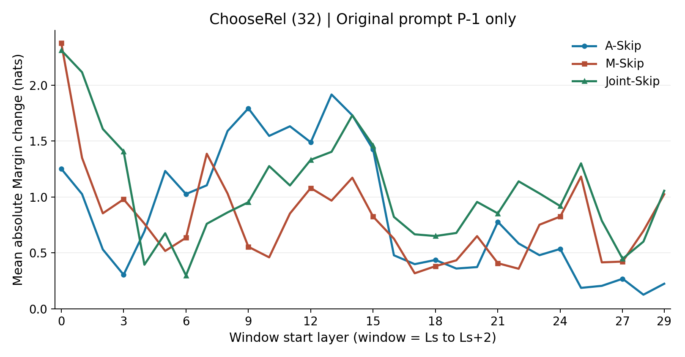
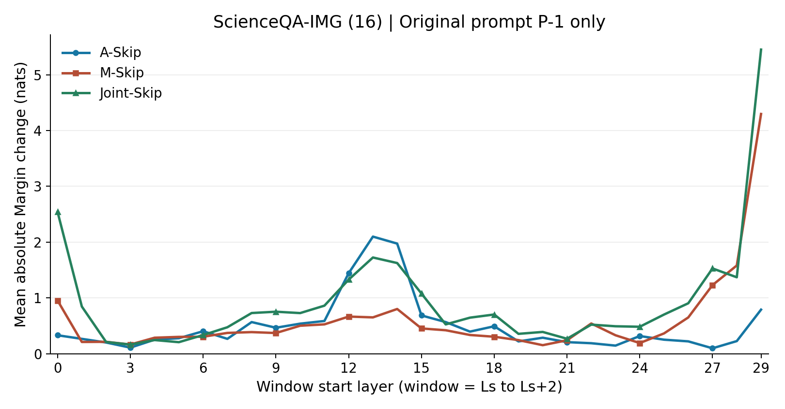
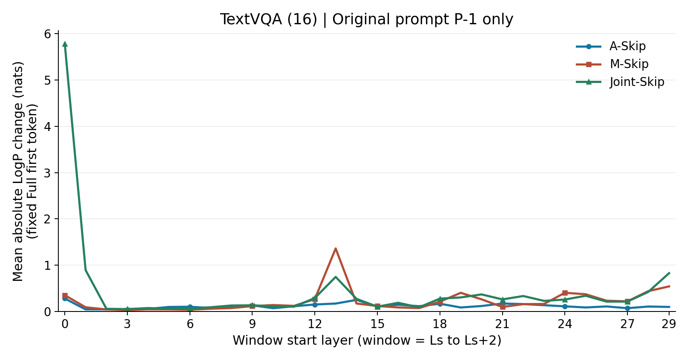

# GPU0 P-1 Sliding-Window Sensitivity

完整复用Residual-only Pilot64题：ChooseRel32（left/right各16）、ScienceQA16、TextVQA16；未重新抽样。
LLaVA-1.5-7B FP16/eager，Transformers4.49.0，GPU0同机Full配对。三层窗口、步长1，L0-L2至L29-L31，30窗口x3干预x64题=5760条结果。
仅原Prompt P-1：A-Skip置零o_proj输出，M-Skip置零MLP输出，Joint-Skip同时置零；其他Token正常计算。无KV Cache、无自由生成、无训练、无额外干预。

## 核心曲线

## 最敏感/最不敏感窗口

以平均绝对变化排序，不是平均有符号增益。表内记号：窗口起始层: 平均绝对变化nats [正确变错/错误变对]；TextVQA方括号为首Token改变题数，不是答案错误翻转。并列按较小起始层优先。

| 数据集 | 干预 | 最敏感3个窗口 | 最不敏感3个窗口 |
|---|---|---|---|
| gqa_chooserel | A-Skip | L13-15: 1.9158 [11/2]; L9-11: 1.7922 [10/1]; L14-16: 1.7297 [9/1] | L28-30: 0.1262 [0/1]; L25-27: 0.1873 [0/1]; L26-28: 0.2053 [0/1] |
| gqa_chooserel | M-Skip | L0-2: 2.3777 [4/2]; L7-9: 1.3862 [1/2]; L1-3: 1.3501 [2/1] | L17-19: 0.3177 [0/0]; L22-24: 0.3580 [0/0]; L18-20: 0.3813 [0/0] |
| gqa_chooserel | Joint-Skip | L0-2: 2.3119 [7/3]; L1-3: 2.1152 [4/2]; L14-16: 1.7300 [8/1] | L6-8: 0.2985 [0/1]; L4-6: 0.3943 [1/1]; L27-29: 0.4471 [0/0] |
| scienceqa_img | A-Skip | L13-15: 2.0996 [3/0]; L14-16: 1.9746 [3/0]; L12-14: 1.4443 [3/2] | L27-29: 0.0986 [0/0]; L3-5: 0.1104 [0/0]; L23-25: 0.1465 [0/0] |
| scienceqa_img | M-Skip | L29-31: 4.2974 [1/0]; L28-30: 1.5820 [2/1]; L27-29: 1.2314 [0/0] | L20-22: 0.1543 [0/0]; L3-5: 0.1665 [0/0]; L24-26: 0.1924 [0/0] |
| scienceqa_img | Joint-Skip | L29-31: 5.4507 [1/0]; L0-2: 2.5415 [4/1]; L13-15: 1.7256 [1/1] | L3-5: 0.1650 [1/0]; L5-7: 0.2080 [1/0]; L2-4: 0.2119 [0/0] |
| textvqa | A-Skip | L0-2: 0.2786 [3]; L14-16: 0.2488 [2]; L21-23: 0.1704 [1] | L3-5: 0.0351 [0]; L2-4: 0.0429 [0]; L1-3: 0.0434 [0] |
| textvqa | M-Skip | L13-15: 1.3606 [4]; L29-31: 0.5408 [4]; L28-30: 0.4374 [3] | L3-5: 0.0282 [1]; L6-8: 0.0350 [0]; L5-7: 0.0420 [1] |
| textvqa | Joint-Skip | L0-2: 5.7814 [16]; L1-3: 0.8908 [4]; L29-31: 0.8263 [4] | L3-5: 0.0501 [1]; L2-4: 0.0560 [0]; L5-7: 0.0590 [1] |

## Attention与MLP相对敏感层

以下仅比较同窗口A/M的平均绝对变化，描述差异，不作显著性或普遍必要性结论。

| 数据集 | A影响大于M最多的3个窗口（差值nats） | M影响大于A最多的3个窗口（差值nats） |
|---|---|---|
| gqa_chooserel | L9-11: 1.2375; L10-12: 1.0858; L13-15: 0.9485 | L0-2: 1.1255; L25-27: 0.9950; L29-31: 0.8002 |
| scienceqa_img | L13-15: 1.4473; L14-16: 1.1719; L12-14: 0.7773 | L29-31: 3.5063; L28-30: 1.3545; L27-29: 1.1328 |
| textvqa | L14-16: 0.0780; L21-23: 0.0743; L6-8: 0.0655 | L13-15: 1.1911; L29-31: 0.4441; L28-30: 0.3321 |

## Hidden扰动衰减

窗口末端与最终L31均用层残差输出（最终RMSNorm之前）与Full同深度比较；另保存RMSNorm后最终Hidden距离。下表选择最终/末端均值比最小的窗口（不含终止于L31的窗口）；比值小于1只表示方向漂移衰减，不证明信息恢复、答案改善或因果补偿机制。

| 数据集 | 干预 | 最强衰减窗口 | 末端平均距离 | 最终平均距离 | 最终/末端 |
|---|---|---|---:|---:|---:|
| gqa_chooserel | A-Skip | L3-5 | 0.221572 | 0.001974 | 0.009 |
| gqa_chooserel | M-Skip | L5-7 | 0.212699 | 0.005963 | 0.028 |
| gqa_chooserel | Joint-Skip | L6-8 | 0.257609 | 0.004998 | 0.019 |
| scienceqa_img | A-Skip | L3-5 | 0.243776 | 0.000982 | 0.004 |
| scienceqa_img | M-Skip | L5-7 | 0.200516 | 0.004573 | 0.023 |
| scienceqa_img | Joint-Skip | L4-6 | 0.244574 | 0.003298 | 0.013 |
| textvqa | A-Skip | L3-5 | 0.264682 | 0.001566 | 0.006 |
| textvqa | M-Skip | L5-7 | 0.245238 | 0.003565 | 0.015 |
| textvqa | Joint-Skip | L7-9 | 0.328441 | 0.004177 | 0.013 |

## 核心结论

- 两个候选任务的P-1 Attention均对中层窗口L13-L15最敏感：ChooseRel平均绝对Margin变化1.9158，11题正确变错、2题错误变对；ScienceQA为2.0996，3题正确变错、0题错误变对。相同窗口，A的平均绝对影响分别比M大0.9485和1.4473，不能认为中层P-1 Attention普遍可省略。
- MLP的敏感层依赖任务：ChooseRel峰值在L0-L2（2.3777），ScienceQA在L29-L31（4.2974），TextVQA固定首Token LogP在L13-L15（1.3606）。不存在本次证据支持的统一“Attention总比MLP更容易省略”结论。
- 联合干预不是两个单独效应的简单相加。TextVQA的L0-L2 Joint使16/16题首Token改变、平均绝对LogP变化5.7814，而该窗口单独A仅改变3/16题；这是首Token分布效应，不是16题VQA答案变错。Joint在L2-L4的ScienceQA候选判断和TextVQA首Token均未翻转，与原Pilot的局部小影响一致。
- 最强Hidden方向漂移衰减主要落在L3-L9内的三层窗口：表中最终/末端距离比约0.004-0.028，提示部分早期P-1扰动可能被后续层抑制。但ChooseRel的A-Skip L13-L15也衰减至末端距离约11.6%，仍损害11题；方向距离缩小不证明答案信息恢复或特定补偿路径。
- 低敏感窗口只是这批32/16/16题的描述性发现，不证明等价或普遍无害；也不支持整层跳过、实际推理提速或TextVQA完整答案准确率结论。

## 验证细节

- ChooseRel与ScienceQA均以完整候选LogP比较，gold减最强wrong，平局算错；不使用自由生成的短答案匹配，避免上轮ChooseRel输出格式混淆。
- 这些封闭候选全部为单Token；保留原N+1 teacher-forcing布局，Smoke已验证各候选在P-1的全词表Logits精确一致，故同一次前向即可得到全部完整候选LogP；遇多Token候选直接停止，不截断。
- TextVQA固定每题Full首次argmax Token，测其LogP变化和首Token是否改变；不运行完整答案生成，不将这些数值当作VQA软评分或答案正确率。
- 只做三数据集各1题Smoke：No-op=Full，局部非目标输出不变，L2-L4的A/M/Joint与原实现精确一致，Full/Joint与上轮原始Logits精确一致；不放宽容差。
- 完整覆盖64个Full和5760条干预；参数版本不变、Hook恢复。遵从任务约束，未做模型全量权重哈希或额外耗时GPU审计。
- 相邻窗口高度重叠，且仅64题Pilot；窗口排序是描述性结果，不能视为独立重复证据，不作统计显著性/等价性声明。
- 只研究P-1局部更新的必要性；输出置零仍执行对应计算，绝不解释为整层可跳过或实际推理加速。

## 文件

- `per_question.csv`：5760条逐题变化、候选LogP、翻转、固定Token及Hidden漂移。
- `full_baselines.csv`、`window_summary.csv`、`top_bottom_windows.csv`：原生基线、全部270个汇总点和54个Top/Bottom条目。
- 各题目录JSON/NPZ：原始P-1全词表Logits、窗口末端/最终Hidden、完整候选LogP和冻结配置绑定；NPZ仅本机保留，不上传二进制。
- `manifest.json`、`environment.json`、`cpu_tests.json`、`smoke.json`、`completion.json`：样本与执行版本、环境和最小验证记录。

## 版本

- 独立分支：`codex/p1-sliding-window-gpu0`，基于原Pilot结果Commit `fa959891fb26d1f5572dc26e2395252a1e01f795`；未修改历史源码、历史结果或main。
- 冻结执行代码Commit：`08653f43ed386ac62d3c24673a8cdcf167101afb`；9项针对性CPU测试和三数据集各1题Smoke通过。
- Full候选基线为ChooseRel27/32、ScienceQA11/16；同GPU0本轮重算。运行结束参数版本不变、Hook恢复，GPU0已释放。
