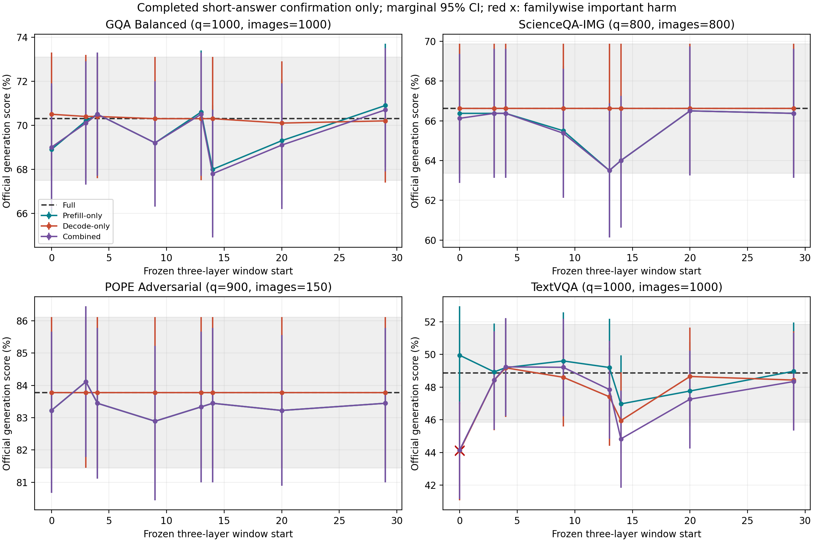

# Paper RQ1: Completed Short-Answer Confirmation

**Status: complete for all four short-answer datasets; the full six-task study remains partial.**

This CPU-only snapshot does not wait for or summarize unfinished COCO Caption/TextCaps. The running GPU worker sources, model, data, windows and protocols are unchanged.

Frozen GPU code: `906103b37b19d56e1752b5b3fc5bc04246ecd6a8`. Questions: 3700; independent images: 2950; actual greedy generations: 92500.

## Full and Frozen-Window Ranges

Ranges show all eight preregistered windows, not a newly selected optimum. TextVQA is the official ten-answer soft score; other rows are accuracy. All entries are percentages.

| Dataset | Questions / images | Full | Prefill-only range | Decode-only range | Combined range | Low-harm supported / 24 |
|---|---:|---:|---:|---:|---:|---:|
| GQA Balanced | 1000 / 1000 | 70.30 | 68.00-70.90 | 70.10-70.50 | 67.80-70.70 | 7 / 24 |
| ScienceQA-IMG | 800 / 800 | 66.62 | 63.50-66.50 | 66.62-66.62 | 63.50-66.50 | 0 / 24 |
| POPE Adversarial | 900 / 150 | 83.78 | 82.89-84.11 | 83.78-83.78 | 82.89-84.11 | 2 / 24 |
| TextVQA | 1000 / 1000 | 48.87 | 46.97-49.95 | 44.09-49.18 | 44.14-49.24 | 2 / 24 |

## All Frozen Conditions

Changes and intervals below are percentage points. In binary tasks, harm = Full-correct to wrong, correction = Full-wrong to correct. TextVQA reports any soft-score decrease/increase instead.

| Dataset | Window | Mode | Score % | Delta pp | Paired 95% CI pp | Harm / correction (soft down / up for TextVQA) | Familywise low-harm |
|---|---|---|---:|---:|---|---:|---|
| GQA Balanced | L0-L2 | Prefill-only | 68.90 | -1.40 | [-2.90, +0.10] | 36 / 22 | False |
| GQA Balanced | L0-L2 | Decode-only | 70.50 | +0.20 | [-0.20, +0.60] | 1 / 3 | True |
| GQA Balanced | L0-L2 | Combined | 69.00 | -1.30 | [-2.80, +0.20] | 36 / 23 | False |
| GQA Balanced | L3-L5 | Prefill-only | 70.20 | -0.10 | [-1.00, +0.80] | 10 / 9 | False |
| GQA Balanced | L3-L5 | Decode-only | 70.40 | +0.10 | [+0.00, +0.30] | 0 / 1 | True |
| GQA Balanced | L3-L5 | Combined | 70.10 | -0.20 | [-1.10, +0.70] | 11 / 9 | False |
| GQA Balanced | L4-L6 | Prefill-only | 70.50 | +0.20 | [-1.00, +1.40] | 18 / 20 | False |
| GQA Balanced | L4-L6 | Decode-only | 70.40 | +0.10 | [+0.00, +0.30] | 0 / 1 | True |
| GQA Balanced | L4-L6 | Combined | 70.50 | +0.20 | [-1.00, +1.40] | 18 / 20 | False |
| GQA Balanced | L9-L11 | Prefill-only | 69.20 | -1.10 | [-2.50, +0.30] | 31 / 20 | False |
| GQA Balanced | L9-L11 | Decode-only | 70.30 | +0.00 | [+0.00, +0.00] | 0 / 0 | True |
| GQA Balanced | L9-L11 | Combined | 69.20 | -1.10 | [-2.50, +0.30] | 31 / 20 | False |
| GQA Balanced | L13-L15 | Prefill-only | 70.60 | +0.30 | [-1.20, +1.80] | 28 / 31 | False |
| GQA Balanced | L13-L15 | Decode-only | 70.30 | +0.00 | [+0.00, +0.00] | 0 / 0 | True |
| GQA Balanced | L13-L15 | Combined | 70.50 | +0.20 | [-1.30, +1.70] | 28 / 30 | False |
| GQA Balanced | L14-L16 | Prefill-only | 68.00 | -2.30 | [-4.10, -0.60] | 52 / 29 | False |
| GQA Balanced | L14-L16 | Decode-only | 70.30 | +0.00 | [+0.00, +0.00] | 0 / 0 | True |
| GQA Balanced | L14-L16 | Combined | 67.80 | -2.50 | [-4.30, -0.80] | 53 / 28 | False |
| GQA Balanced | L20-L22 | Prefill-only | 69.30 | -1.00 | [-2.30, +0.30] | 26 / 16 | False |
| GQA Balanced | L20-L22 | Decode-only | 70.10 | -0.20 | [-0.60, +0.20] | 3 / 1 | False |
| GQA Balanced | L20-L22 | Combined | 69.10 | -1.20 | [-2.50, +0.10] | 29 / 17 | False |
| GQA Balanced | L29-L31 | Prefill-only | 70.90 | +0.60 | [-0.60, +1.80] | 16 / 22 | False |
| GQA Balanced | L29-L31 | Decode-only | 70.20 | -0.10 | [-0.30, +0.00] | 1 / 0 | True |
| GQA Balanced | L29-L31 | Combined | 70.70 | +0.40 | [-0.80, +1.60] | 17 / 21 | False |
| ScienceQA-IMG | L0-L2 | Prefill-only | 66.38 | -0.25 | [-1.50, +0.88] | 13 / 11 | False |
| ScienceQA-IMG | L0-L2 | Decode-only | 66.62 | +0.00 | [+0.00, +0.00] | 0 / 0 | False |
| ScienceQA-IMG | L0-L2 | Combined | 66.12 | -0.50 | [-1.75, +0.75] | 15 / 11 | False |
| ScienceQA-IMG | L3-L5 | Prefill-only | 66.38 | -0.25 | [-0.88, +0.37] | 4 / 2 | False |
| ScienceQA-IMG | L3-L5 | Decode-only | 66.62 | +0.00 | [+0.00, +0.00] | 0 / 0 | False |
| ScienceQA-IMG | L3-L5 | Combined | 66.38 | -0.25 | [-0.88, +0.37] | 4 / 2 | False |
| ScienceQA-IMG | L4-L6 | Prefill-only | 66.38 | -0.25 | [-1.00, +0.50] | 6 / 4 | False |
| ScienceQA-IMG | L4-L6 | Decode-only | 66.62 | +0.00 | [+0.00, +0.00] | 0 / 0 | False |
| ScienceQA-IMG | L4-L6 | Combined | 66.38 | -0.25 | [-1.00, +0.50] | 6 / 4 | False |
| ScienceQA-IMG | L9-L11 | Prefill-only | 65.50 | -1.12 | [-2.62, +0.38] | 24 / 15 | False |
| ScienceQA-IMG | L9-L11 | Decode-only | 66.62 | +0.00 | [+0.00, +0.00] | 0 / 0 | False |
| ScienceQA-IMG | L9-L11 | Combined | 65.38 | -1.25 | [-2.75, +0.25] | 25 / 15 | False |
| ScienceQA-IMG | L13-L15 | Prefill-only | 63.50 | -3.12 | [-5.37, -1.00] | 53 / 28 | False |
| ScienceQA-IMG | L13-L15 | Decode-only | 66.62 | +0.00 | [+0.00, +0.00] | 0 / 0 | False |
| ScienceQA-IMG | L13-L15 | Combined | 63.50 | -3.12 | [-5.37, -1.00] | 53 / 28 | False |
| ScienceQA-IMG | L14-L16 | Prefill-only | 64.00 | -2.62 | [-4.88, -0.38] | 54 / 33 | False |
| ScienceQA-IMG | L14-L16 | Decode-only | 66.62 | +0.00 | [+0.00, +0.00] | 0 / 0 | False |
| ScienceQA-IMG | L14-L16 | Combined | 64.00 | -2.62 | [-4.88, -0.38] | 54 / 33 | False |
| ScienceQA-IMG | L20-L22 | Prefill-only | 66.50 | -0.12 | [-0.88, +0.75] | 6 / 5 | False |
| ScienceQA-IMG | L20-L22 | Decode-only | 66.62 | +0.00 | [+0.00, +0.00] | 0 / 0 | False |
| ScienceQA-IMG | L20-L22 | Combined | 66.50 | -0.12 | [-0.88, +0.75] | 6 / 5 | False |
| ScienceQA-IMG | L29-L31 | Prefill-only | 66.38 | -0.25 | [-1.37, +0.87] | 11 / 9 | False |
| ScienceQA-IMG | L29-L31 | Decode-only | 66.62 | +0.00 | [+0.00, +0.00] | 0 / 0 | False |
| ScienceQA-IMG | L29-L31 | Combined | 66.38 | -0.25 | [-1.37, +0.87] | 11 / 9 | False |
| POPE Adversarial | L0-L2 | Prefill-only | 83.22 | -0.56 | [-2.00, +0.78] | 22 / 17 | False |
| POPE Adversarial | L0-L2 | Decode-only | 83.78 | +0.00 | [+0.00, +0.00] | 0 / 0 | False |
| POPE Adversarial | L0-L2 | Combined | 83.22 | -0.56 | [-2.00, +0.78] | 22 / 17 | False |
| POPE Adversarial | L3-L5 | Prefill-only | 84.11 | +0.33 | [-0.11, +0.89] | 1 / 4 | True |
| POPE Adversarial | L3-L5 | Decode-only | 83.78 | +0.00 | [+0.00, +0.00] | 0 / 0 | False |
| POPE Adversarial | L3-L5 | Combined | 84.11 | +0.33 | [-0.11, +0.89] | 1 / 4 | True |
| POPE Adversarial | L4-L6 | Prefill-only | 83.44 | -0.33 | [-1.33, +0.67] | 12 / 9 | False |
| POPE Adversarial | L4-L6 | Decode-only | 83.78 | +0.00 | [+0.00, +0.00] | 0 / 0 | False |
| POPE Adversarial | L4-L6 | Combined | 83.44 | -0.33 | [-1.33, +0.67] | 12 / 9 | False |
| POPE Adversarial | L9-L11 | Prefill-only | 82.89 | -0.89 | [-1.78, -0.11] | 11 / 3 | False |
| POPE Adversarial | L9-L11 | Decode-only | 83.78 | +0.00 | [+0.00, +0.00] | 0 / 0 | False |
| POPE Adversarial | L9-L11 | Combined | 82.89 | -0.89 | [-1.78, -0.11] | 11 / 3 | False |
| POPE Adversarial | L13-L15 | Prefill-only | 83.33 | -0.44 | [-1.44, +0.56] | 12 / 8 | False |
| POPE Adversarial | L13-L15 | Decode-only | 83.78 | +0.00 | [+0.00, +0.00] | 0 / 0 | False |
| POPE Adversarial | L13-L15 | Combined | 83.33 | -0.44 | [-1.44, +0.56] | 12 / 8 | False |
| POPE Adversarial | L14-L16 | Prefill-only | 83.44 | -0.33 | [-1.33, +0.67] | 11 / 8 | False |
| POPE Adversarial | L14-L16 | Decode-only | 83.78 | +0.00 | [+0.00, +0.00] | 0 / 0 | False |
| POPE Adversarial | L14-L16 | Combined | 83.44 | -0.33 | [-1.33, +0.67] | 11 / 8 | False |
| POPE Adversarial | L20-L22 | Prefill-only | 83.22 | -0.56 | [-1.22, +0.11] | 7 / 2 | False |
| POPE Adversarial | L20-L22 | Decode-only | 83.78 | +0.00 | [+0.00, +0.00] | 0 / 0 | False |
| POPE Adversarial | L20-L22 | Combined | 83.22 | -0.56 | [-1.22, +0.11] | 7 / 2 | False |
| POPE Adversarial | L29-L31 | Prefill-only | 83.44 | -0.33 | [-1.44, +0.78] | 13 / 10 | False |
| POPE Adversarial | L29-L31 | Decode-only | 83.78 | +0.00 | [+0.00, +0.00] | 0 / 0 | False |
| POPE Adversarial | L29-L31 | Combined | 83.44 | -0.33 | [-1.44, +0.78] | 13 / 10 | False |
| TextVQA | L0-L2 | Prefill-only | 49.95 | +1.08 | [-0.23, +2.42] | 31 / 38 | False |
| TextVQA | L0-L2 | Decode-only | 44.09 | -4.78 | [-6.28, -3.32] | 63 / 10 | False |
| TextVQA | L0-L2 | Combined | 44.14 | -4.73 | [-6.61, -2.86] | 91 / 34 | False |
| TextVQA | L3-L5 | Prefill-only | 48.93 | +0.06 | [-0.38, +0.51] | 4 / 5 | True |
| TextVQA | L3-L5 | Decode-only | 48.42 | -0.45 | [-1.29, +0.36] | 16 / 8 | False |
| TextVQA | L3-L5 | Combined | 48.43 | -0.44 | [-1.27, +0.37] | 15 / 8 | False |
| TextVQA | L4-L6 | Prefill-only | 49.19 | +0.32 | [-0.53, +1.17] | 15 / 15 | False |
| TextVQA | L4-L6 | Decode-only | 49.18 | +0.31 | [-0.42, +1.06] | 9 / 10 | True |
| TextVQA | L4-L6 | Combined | 49.24 | +0.37 | [-0.60, +1.35] | 19 / 19 | False |
| TextVQA | L9-L11 | Prefill-only | 49.60 | +0.73 | [-0.38, +1.87] | 23 / 28 | False |
| TextVQA | L9-L11 | Decode-only | 48.60 | -0.27 | [-1.30, +0.77] | 22 / 18 | False |
| TextVQA | L9-L11 | Combined | 49.21 | +0.34 | [-1.11, +1.80] | 40 / 40 | False |
| TextVQA | L13-L15 | Prefill-only | 49.20 | +0.33 | [-0.83, +1.51] | 24 / 25 | False |
| TextVQA | L13-L15 | Decode-only | 47.41 | -1.46 | [-2.76, -0.18] | 39 / 19 | False |
| TextVQA | L13-L15 | Combined | 47.85 | -1.02 | [-2.66, +0.62] | 56 / 39 | False |
| TextVQA | L14-L16 | Prefill-only | 46.97 | -1.90 | [-3.36, -0.47] | 45 / 24 | False |
| TextVQA | L14-L16 | Decode-only | 45.95 | -2.92 | [-4.42, -1.46] | 56 / 21 | False |
| TextVQA | L14-L16 | Combined | 44.83 | -4.04 | [-6.01, -2.10] | 89 / 43 | False |
| TextVQA | L20-L22 | Prefill-only | 47.76 | -1.11 | [-2.27, +0.01] | 28 / 16 | False |
| TextVQA | L20-L22 | Decode-only | 48.65 | -0.22 | [-1.18, +0.74] | 16 / 12 | False |
| TextVQA | L20-L22 | Combined | 47.26 | -1.61 | [-3.02, -0.21] | 41 / 22 | False |
| TextVQA | L29-L31 | Prefill-only | 48.97 | +0.10 | [-1.00, +1.21] | 20 / 21 | False |
| TextVQA | L29-L31 | Decode-only | 48.43 | -0.44 | [-1.33, +0.43] | 19 / 10 | False |
| TextVQA | L29-L31 | Combined | 48.34 | -0.53 | [-1.94, +0.88] | 39 / 30 | False |

## Interpretation and Validity

- Full is paired on the same GPU and question as all 24 interventions; no historical baseline is mixed in.
- Sources are verified unchanged; all 3,700 frozen questions have exactly 25 conditions. All 92,500 stored short scores were recomputed using the pinned scorer and matched exactly.
- Aggregation is the original frozen `paper_rq1.analyze.confirmation_summary` function, redirected only in this separate CPU process to the four completed datasets and this new output folder.
- Bootstrap: 50,000 paired image-cluster replicates, including complete six-question POPE clusters. Marginal 95% and Bonferroni familywise bounds remain in CSV. The original 144-primary-comparison family is retained, NOT reduced to 96 because Caption is pending.
- Low-harm means the familywise lower bound exceeds the frozen -1 percentage point margin, and the frozen zero-effect rare-harm guard passes when applicable. Failure to establish low harm does not prove damage. A CI containing zero does not establish equivalence.
- Candidate Margin/Gold LogP are not the scoring endpoint of this free-generation confirmation. Discovery fixed-Full-token DeltaLogP is a separate quantity and is not accuracy.
- No incomplete Caption score is included. No aggregate completion for all 5,700 confirmation questions is claimed.
- All eight windows and all three modes are shown, including negative outcomes; the range table is descriptive and does not select deployment windows.
- Attention output is computed before zeroing: no actual compute skipping or speedup is claimed.

## Artifacts

- `confirmation_summary.csv`: all 96 conditions, paired intervals, flips, text/length/EOS and noninferiority decisions.
- `confirmation_per_question_<dataset>.csv`: all 88,800 paired intervention rows with generated answers and scores.
- `pope_secondary_metrics.csv`: accuracy, precision, recall, F1 and yes ratio.
- `snapshot_manifest.json`: original checkpoint paths/SHA256, input/config bindings and worker environments.
- `snapshot_completion.json`: complete-short / partial-study status and output hashes.
- Original short checkpoints preserve Full and intervention token IDs and all 25 generated answers.
