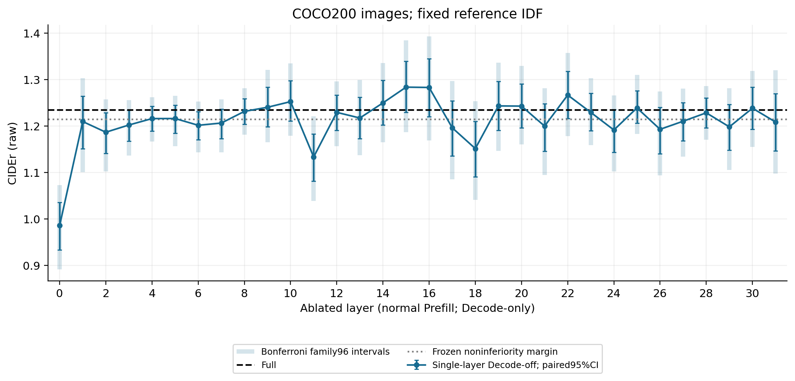
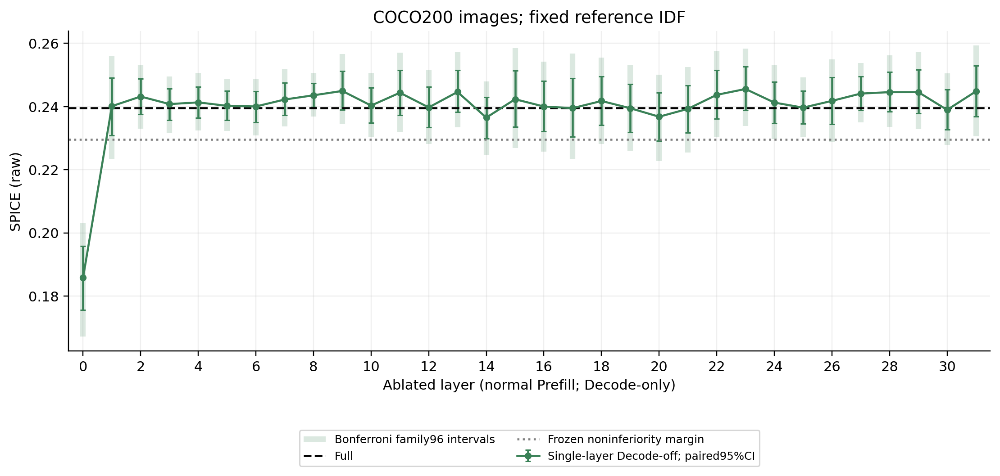
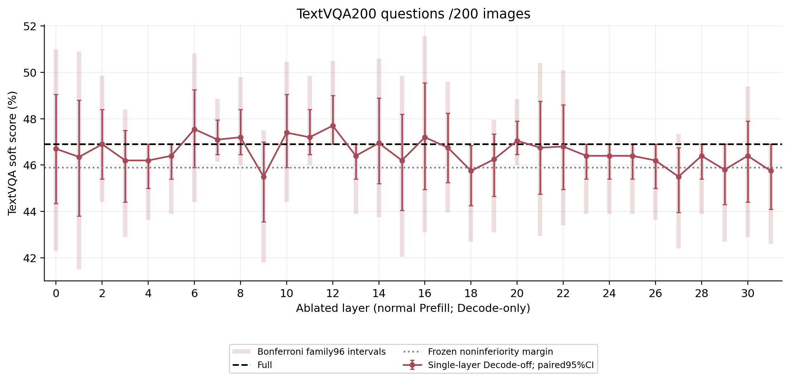
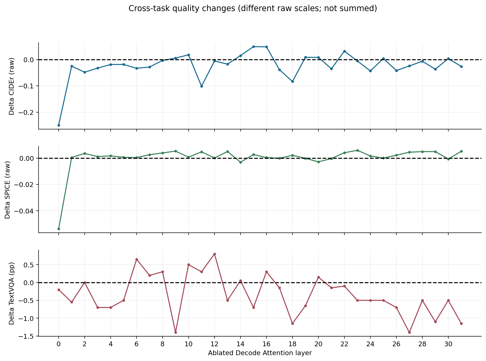
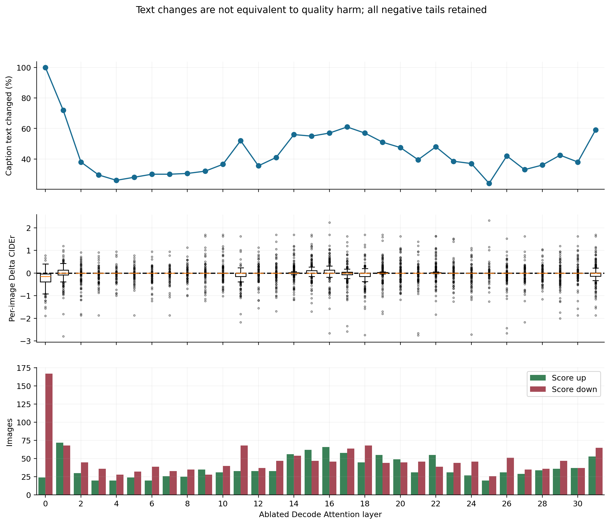
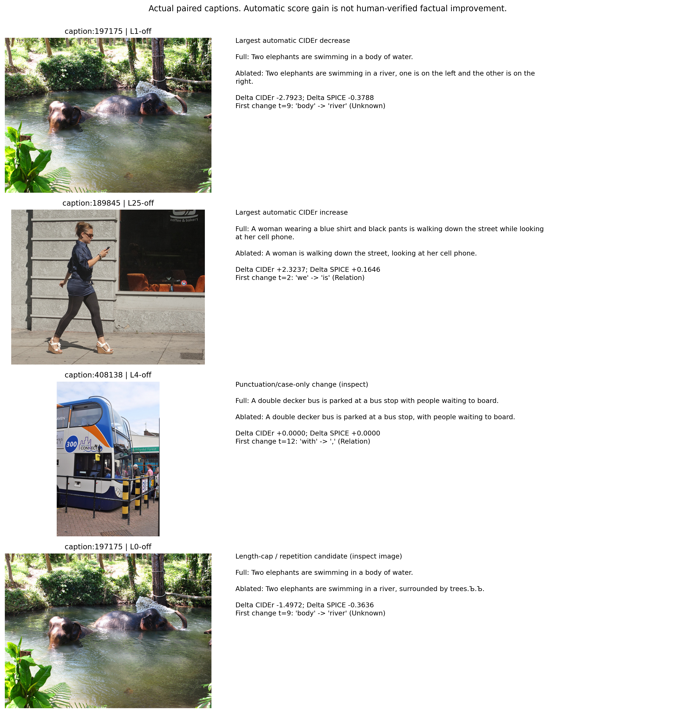

# 32层 Decode Attention 功能必要性与完整生成质量

**状态：正式400个样本、33条件、13,200条真实生成及官方评分全部完成。**

## 核心回答

1. COCO CIDEr平均下降最大的5层：L0, L11, L18, L2, L24；SPICE对应：L0, L14, L20, L30, L21。两指标不能互相替代，完整尾部和区间见CSV。
2. 两任务三端点均满足预设96项校正Bootstrap非劣效筛选的候选层：**无**。仅普通95%区间通过：无。这是探索候选，不等于安全证明。
3. 单步原生Token LogP与完整自由生成质量是不同观测；下面提供历史9/10个实测离散层的描述性相关，不能补造其余层单步结果，也不能把相关当成因果。
4. 仅建议将以上跨任务校正候选（若有）提交下一阶段独立研究决策。本轮没有进行任何多层联合消融；单层低损害不保证联合安全。
5. 200图探索、有限自动指标与稀有错误缺失，不能建立通用低损害或真实计算加速。普通区间包含0不是无损；校正筛选也不能取代独立确认。

补充：三端点联合筛选未通过不等于所有层均有害。校正区间整体低于0的层分别为：CIDEr L0, L11；SPICE L0；TextVQA 无。其它层可能是功效不足或指标分歧，应看逐层区间。
COCO L0-off出现176/200条64-Token截断，平均生成长度59.48；质量损失伴随显著的终止异常。这不等于已分离出视觉事实错误的因果贡献。

## 模型、数据、冻结协议

- 基线提交`a6bf615a6c515addd29fac508ea86ab8da12dc64`；冻结采集提交`9371a0bae4cf840b5868901e9db9f40cb2196067`；模型`LLaVA-1.5-7B@b234b804b114d9e37bb655e11cbbb5f5e971b7a9`，FP16/eager，Transformers4.49.0；未训练或改权重。
- GPU0已有外部任务，未占用、终止或等待抢占。只使用物理GPU1–3，每卡独立模型；同一样本33条件固定同卡。
- COCO200张图，排除历史1002个已用身份（包括Discovery、Token-role、Late Sources、Function Stage A/B/C及Smoke），另用1张独立Smoke。按固定种子20261030的输入哈希选样，不按输出筛选。
- TextVQA200题/200图，官方0.5.1验证集、每题完整10答案。可用本地不同图2740，历史未用1272，本次实际历史重叠0；另1图Smoke。
- 全部402图核查官方原始行、问题/参考答案、文件SHA256和解码RGB；不声称排除了所有感知近重复或数据分布偏差。来源、Prompt真实Token映射和划分先于GPU结果冻结。
- COCO Prompt：`Describe the image in one sentence.`；最多64 Token。TextVQA原Question+冻结短答模板，最多32 Token，无额外OCR。Greedy、原位置与RoPE、正常KV Cache，EOS=2。

- 解码沿用原流程skip_special_tokens=True及首尾strip，所有条件相同；不替换生成内容。完整原始Token IDs另行保留，文本变化率与Token变化率分别记录。

## 干预与Cache语义

- 全Prompt Prefill的32层Attention全部正常；第一个Token始终由Native Prefill产生。只从后续真实Decode开始，每一步将指定单层当前Query的`o_proj`输出置零。其他Attention、所有MLP/LayerNorm/残差保持正常。
- 使用真实cache_position、Prompt长度与该层历史Cache长度判定Decode，不只检查sequence_length=1。单Token Prefill CPU反例也覆盖。
- 经Smoke证明数值等价后，每图计算一次正常Prefill，再为33条件分别深复制完整Cache；无存储别名。每条生成消费自身真实预测前缀，不接Full后续Token。父Cache指针/形状逐条件检查、SHA逐图前后核对。
- 本轮是Attention输出更新消融，不是删除Transformer Block，不省去底层Attention计算，不报告速度收益。

## 正确性验证

- 16项CPU测试通过；目标32层、Hook异常清理、阶段判定、独立Cache、EOS/长度、固定选样、重复/哈希绑定及Bootstrap逻辑均覆盖。
- 另9项后处理/断点恢复测试通过。最初后处理测试因环境无SciPy而失败，已改为复用仓库原有相关函数；失败日志保留，没有安装/更改运行环境，也未修改GPU采集代码。
- 每张GPU均对独立COCO/TextVQA Smoke验证：cached Full与原生model.generate Token完全一致；32层No-op的全部生成步有效Logits精确一致；全部32条件的Prefill末位有效Logits/完整Cache精确一致；指定输出确为零，32层Attention与MLP仍执行；Hook/Input/父Cache无污染。
- L0/L14/L31进一步比较各自新算Prefill与共享Prefill的完整干预轨迹和Logits精确一致。三卡同样本Full Logits最大差异记录在gpu_smoke_validation.json，未放宽容差。
- 正式400图均保存33条件检查点、代码/数据/结果哈希、首Token、逐图父Cache/Input审计。全表无非有限分数、NaN/Inf/OOM或跳过失败样本。

## 官方评分与统计

Full：CIDEr **1.235110**，SPICE **0.239601**，TextVQA十答案软评分 **46.900%**。TextVQA不是严格二元准确率。

- 同一200图的COCO人工参考、PTBTokenizer、CIDEr IDF和SPICE评分器固定用于全部条件。评分器/Java模型SHA与相同参考fixture已验证。未添加没有基础设施的CHAIR指标。
- 按图片配对Bootstrap200,000次；TextVQA若多题同图按图片聚类（本次每图1题）。CIDEr区间基于固定参考IDF的逐图分数差，不在重采样中重定义IDF。
- 主比较集合预冻结为32层×3端点=96项。报告普通双侧95%及Bonferroni家族95%区间；极端分位数alpha/192，每尾约52.08个Bootstrap抽样，存在有限Monte Carlo误差；百分位Bootstrap并非严格有限样本保证。
- 非劣效阈值在本轮GPU结果之前冻结：原始CIDEr0.02、SPICE0.01、TextVQA0.01即1pp。判据为区间下界严格大于负阈值。完整负面结果保留，不以均值接近0宣告等价。
- 即便某层在200图中没有观测损害，退化的经验Bootstrap也不能给未出现的稀有错误建立安全上界。本轮不扩大数据或自动执行独立确认。

## 全32层实测质量

| layer | CIDEr | dCIDEr | SPICE | dSPICE | TextVQA_pct | TextVQA_dpp | all3_family_NI |
| --- | --- | --- | --- | --- | --- | --- | --- |
| L0 | 0.985591 | -0.249519 | 0.185832 | -0.0537688 | 46.7 | -0.2 | False |
| L1 | 1.20984 | -0.0252653 | 0.240117 | 0.000516694 | 46.35 | -0.55 | False |
| L2 | 1.18681 | -0.0482965 | 0.243163 | 0.00356217 | 46.9 | 0 | False |
| L3 | 1.20238 | -0.032733 | 0.240769 | 0.00116856 | 46.2 | -0.7 | False |
| L4 | 1.21622 | -0.0188904 | 0.241307 | 0.00170652 | 46.2 | -0.7 | False |
| L5 | 1.21633 | -0.0187756 | 0.24021 | 0.000609892 | 46.4 | -0.5 | False |
| L6 | 1.20179 | -0.0333205 | 0.240015 | 0.000414725 | 47.55 | 0.65 | False |
| L7 | 1.20655 | -0.0285591 | 0.242211 | 0.00261085 | 47.1 | 0.2 | False |
| L8 | 1.2317 | -0.00341105 | 0.243549 | 0.00394835 | 47.2 | 0.3 | False |
| L9 | 1.24056 | 0.00544944 | 0.244925 | 0.00532486 | 45.5 | -1.4 | False |
| L10 | 1.25274 | 0.0176351 | 0.2403 | 0.000699432 | 47.4 | 0.5 | False |
| L11 | 1.13346 | -0.101646 | 0.244366 | 0.00476586 | 47.2 | 0.3 | False |
| L12 | 1.22963 | -0.00547631 | 0.239709 | 0.000108853 | 47.7 | 0.8 | False |
| L13 | 1.21744 | -0.0176682 | 0.244608 | 0.00500695 | 46.4 | -0.5 | False |
| L14 | 1.25002 | 0.0149146 | 0.236485 | -0.00311565 | 46.95 | 0.05 | False |
| L15 | 1.28396 | 0.0488502 | 0.242307 | 0.00270686 | 46.2 | -0.7 | False |
| L16 | 1.28325 | 0.048139 | 0.239995 | 0.000394011 | 47.2 | 0.3 | False |
| L17 | 1.19637 | -0.0387387 | 0.23949 | -0.000110452 | 46.75 | -0.15 | False |
| L18 | 1.15154 | -0.0835714 | 0.241748 | 0.00214736 | 45.75 | -1.15 | False |
| L19 | 1.24349 | 0.00838286 | 0.239454 | -0.000146323 | 46.25 | -0.65 | False |
| L20 | 1.24311 | 0.00800154 | 0.236767 | -0.00283382 | 47.05 | 0.15 | False |
| L21 | 1.19998 | -0.0351266 | 0.239259 | -0.000341516 | 46.75 | -0.15 | False |
| L22 | 1.26694 | 0.0318346 | 0.243691 | 0.00409092 | 46.8 | -0.1 | False |
| L23 | 1.22955 | -0.00556167 | 0.245547 | 0.00594679 | 46.4 | -0.5 | False |
| L24 | 1.19163 | -0.0434824 | 0.241249 | 0.00164873 | 46.4 | -0.5 | False |
| L25 | 1.23919 | 0.00407635 | 0.239643 | 4.25504e-05 | 46.4 | -0.5 | False |
| L26 | 1.19306 | -0.0420469 | 0.241779 | 0.00217802 | 46.2 | -0.7 | False |
| L27 | 1.21054 | -0.02457 | 0.244091 | 0.00449039 | 45.5 | -1.4 | False |
| L28 | 1.22863 | -0.00648421 | 0.244551 | 0.00495049 | 46.4 | -0.5 | False |
| L29 | 1.19836 | -0.0367448 | 0.244563 | 0.00496228 | 45.8 | -1.1 | False |
| L30 | 1.23861 | 0.00349576 | 0.238934 | -0.000666225 | 46.4 | -0.5 | False |
| L31 | 1.20879 | -0.0263159 | 0.244787 | 0.00518687 | 45.75 | -1.15 | False |

## 层段分析

### 早层L0-L8

- CIDEr 本层段下降最大：L0: Δ=-0.249519, 普通95%CI[-0.301744,-0.199242], 96项校正区间[-0.343875,-0.161947]
- CIDEr 本层段下降最小：L8: Δ=-0.003411, 普通95%CI[-0.031100,+0.024187], 96项校正区间[-0.053952,+0.046543]
- SPICE 本层段下降最大：L0: Δ=-0.053769, 普通95%CI[-0.064049,-0.043760], 96项校正区间[-0.072431,-0.036501]
- SPICE 本层段下降最小：L8: Δ=+0.003948, 普通95%CI[+0.000174,+0.007834], 96项校正区间[-0.002771,+0.011035]
- TextVQA 本层段下降最大：L3: Δ=-0.700000, 普通95%CI[-2.500000,+0.600000], 96项校正区间[-4.000000,+1.500000]pp
- TextVQA 本层段下降最小：L6: Δ=+0.650000, 普通95%CI[-1.000000,+2.350000], 96项校正区间[-2.500000,+3.900000]pp
不能从这些单层结果推断相邻层联合关闭的效果；不同任务的敏感峰必须分别看待。

### 中层L14-L16

- CIDEr 本层段下降最大：L14: Δ=+0.014915, 普通95%CI[-0.032621,+0.063302], 96项校正区间[-0.070175,+0.101232]
- CIDEr 本层段下降最小：L15: Δ=+0.048850, 普通95%CI[-0.005556,+0.104341], 96项校正区间[-0.048010,+0.149390]
- SPICE 本层段下降最大：L14: Δ=-0.003116, 普通95%CI[-0.009762,+0.003401], 96项校正区间[-0.015079,+0.008385]
- SPICE 本层段下降最小：L15: Δ=+0.002707, 普通95%CI[-0.006051,+0.011689], 96项校正区间[-0.012753,+0.018865]
- TextVQA 本层段下降最大：L15: Δ=-0.700000, 普通95%CI[-2.850000,+1.300000], 96项校正区间[-4.850000,+2.950000]pp
- TextVQA 本层段下降最小：L16: Δ=+0.300000, 普通95%CI[-1.950000,+2.650000], 96项校正区间[-3.800000,+4.650000]pp
不能从这些单层结果推断相邻层联合关闭的效果；不同任务的敏感峰必须分别看待。

### 深层L26/L31

- CIDEr 本层段下降最大：L26: Δ=-0.042047, 普通95%CI[-0.094890,+0.005747], 96项校正区间[-0.141299,+0.039306]
- CIDEr 本层段下降最小：L31: Δ=-0.026316, 普通95%CI[-0.088221,+0.035051], 96项校正区间[-0.137694,+0.085540]
- SPICE 本层段下降最大：L26: Δ=+0.002178, 普通95%CI[-0.005176,+0.009569], 96项校正区间[-0.010794,+0.015309]
- SPICE 本层段下降最小：L31: Δ=+0.005187, 普通95%CI[-0.002833,+0.013256], 96项校正区间[-0.008983,+0.019703]
- TextVQA 本层段下降最大：L31: Δ=-1.150000, 普通95%CI[-2.800000,+0.000000], 96项校正区间[-4.300000,+0.000000]pp
- TextVQA 本层段下降最小：L26: Δ=-0.700000, 普通95%CI[-1.900000,+0.000000], 96项校正区间[-3.250000,+0.000000]pp
不能从这些单层结果推断相邻层联合关闭的效果；不同任务的敏感峰必须分别看待。

早层L0–L8：COCO两端点均通过校正筛选的层为无；TextVQA通过的层为L7, L8。
此前TextVQA L0–L2三层Decode窗口的损害不能被单层均值解释完毕；有无单层损害都不能证明三层联合无损。

L26完整生成：CIDEr变化-0.042047，SPICE变化+0.002178，TextVQA变化-0.700pp；其方向和区间应与历史视觉词单步LogP高敏感分别解释，不直接等同。
L31完整生成：CIDEr变化-0.026316，SPICE变化+0.005187，TextVQA变化-1.150pp；其方向和区间应与历史视觉词单步LogP高敏感分别解释，不直接等同。
## 生成变化、EOS与TextVQA长度

- coco_caption Full内容Token：均值16.335、中位数16.0、范围9–26；至少2个内容Token 200/200。Full EOS 200/200；32层总截断176/6400。
- textvqa Full内容Token：均值3.065、中位数2.0、范围1–32；至少2个内容Token 150/200。Full EOS 199/200；32层总截断34/6400。
- TextVQA按Full内容长度1、2–3、4+分组的评分、增减题数及文本变化见`textvqa_length_analysis.csv`。1内容Token题的Decode主要预测EOS；这种局限不能证明对一般多Token回答不重要。
- 更严格的后续内容审计：150/200题在t>=1存在非特殊且包含字母/数字的Token；50/200题后续仅EOS/空白/标点。此定义包含子词，不等于独立词数或人工语义判定。逐题证据见textvqa_full_decode_content_audit.csv。
- `caption_change_analysis.csv`与逐题表保存首个不同Token、原生词类/词和替换Token。词类沿用冻结词表，是事后诊断，不是随机词类因果效应；Unknown/多义/标点/EOS均保留。
- 分数提升不等于视觉事实改善，文本改变也不自动等于质量损害。提前EOS/短文本只描述，不当作性能或加速证据。

## 与历史预测敏感性的关系

- GQA首答案Token研究：Prefill P−1单次消融，先前L14–L16敏感；本轮所有Prefill完全正常，且任务为COCO/TextVQA，因此不是直接复现同一个量。
- Token-role Decode研究：在Full真实前缀上单步关闭一层，然后停止；其原生Token LogP变化不包含生成轨迹反馈。本轮在干预后自身前缀持续Decode并用最终任务指标评价。
- 历史9层Token-role与10层Late Sources的Whole-off均值，与本轮相同层的质量损失进行描述性Pearson/Spearman比较；不同图片队列、相互依赖的层，不能当成独立样本做因果或总体显著性推断。

| source | role | metric | layers | pearson | spearman |
| --- | --- | --- | --- | --- | --- |
| results/paper_rq1_late_attention_sources/source_ablation_per_token.csv | Function | CIDEr | 10 | -0.1671774630922576 | -0.06666666666666665 |
| results/paper_rq1_late_attention_sources/source_ablation_per_token.csv | Function | SPICE | 10 | -0.08786283915211876 | 0.0303030303030303 |
| results/paper_rq1_late_attention_sources/source_ablation_per_token.csv | Relation | CIDEr | 10 | -0.15542762667854762 | -0.07878787878787878 |
| results/paper_rq1_late_attention_sources/source_ablation_per_token.csv | Relation | SPICE | 10 | 0.10580483213977925 | -0.06666666666666665 |
| results/paper_rq1_late_attention_sources/source_ablation_per_token.csv | Visual | CIDEr | 10 | 0.4098922210622226 | 0.4787878787878787 |
| results/paper_rq1_late_attention_sources/source_ablation_per_token.csv | Visual | SPICE | 10 | -0.33485406914045535 | -0.4787878787878787 |
| results/paper_rq1_token_role_decode/per_token_layer_ablation.csv | Function | CIDEr | 9 | 0.1105315927313913 | 0.049999999999999996 |
| results/paper_rq1_token_role_decode/per_token_layer_ablation.csv | Function | SPICE | 9 | 0.13589135798398008 | -0.21666666666666667 |
| results/paper_rq1_token_role_decode/per_token_layer_ablation.csv | Relation | CIDEr | 9 | -0.38499480130834457 | -0.35 |
| results/paper_rq1_token_role_decode/per_token_layer_ablation.csv | Relation | SPICE | 9 | -0.3618388739683802 | -0.11666666666666665 |
| results/paper_rq1_token_role_decode/per_token_layer_ablation.csv | Visual | CIDEr | 9 | -0.06738970604020772 | 0.0 |
| results/paper_rq1_token_role_decode/per_token_layer_ablation.csv | Visual | SPICE | 9 | -0.3249670293412487 | -0.31666666666666665 |

## 真实案例与语义核查

Figure6按预定展示规则从全体配对中选自动指标最大下降、最大上升、分数接近但文本改变，以及截断/语义风险候选。完整排序在quality_win_loss_cases.csv；此处选择用于解释，不用于统计选样。
自动CIDEr/SPICE提升不构成人工确认。代理图像条件化复核见case_visual_review.md：最大CIDEr增益的L25-off主要省略与原图大体相容的服装细节，并非已证实纠正幻觉；公交车例仅增加逗号、核心语义不变；L0大象例存在重复字符/换行和未生成EOS的可核实异常。该复核不是独立人工盲审，不估计总体幻觉率。

## 图表

所有图PNG/PDF，L0–L31全部实测点，不平滑/插值；普通与家族区间在前三图分别显示。

## 结论边界与下一阶段

- 若开展下一阶段，优先预注册候选：无，先做独立确认，再考虑多层联合干预。没有通过校正阈值的层不能凭点估计认定安全。
- 本轮没有通过三端点共同筛选的层，因此不建议直接将任何层组合当作低损害策略。如果仅用于设计未来独立单层确认，L8/L12的COCO点估计变化较小且TextVQA通过本轮校正阈值，可作为探索线索；这不是冻结筛选通过，也不是联合消融证据。本轮不启动后续实验。
- 不同任务、生成长度、自动参考覆盖差异都可能导致层敏感性不同。单步预测敏感性、局部Attention关联、完整生成必要性和真实硬件加速必须分开。
- 本次只在冻结LLaVA-1.5-7B上进行400样本探索；不推广跨模型、不训练分类器、不执行来源裁剪、不做多层联合或计算加速。

## 可复现产物

`experiment_config.json`、`sample_manifest.json`、`execution_manifest.json`、每卡环境与日志、CPU/GPU验证、全部逐条件检查点、官方评分器输出、逐题CSV、Bootstrap统计、历史对照、六图PNG/PDF、失败清单、完成清单与哈希。
外置Smoke原始Logits仅用于审计，绝对路径和SHA在GPU验证记录中；不上传图像或模型权重。
