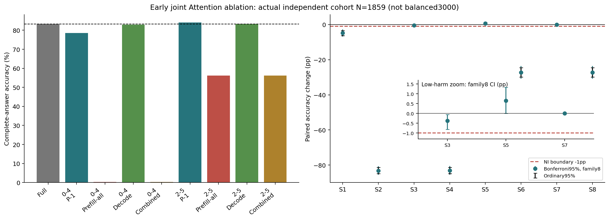
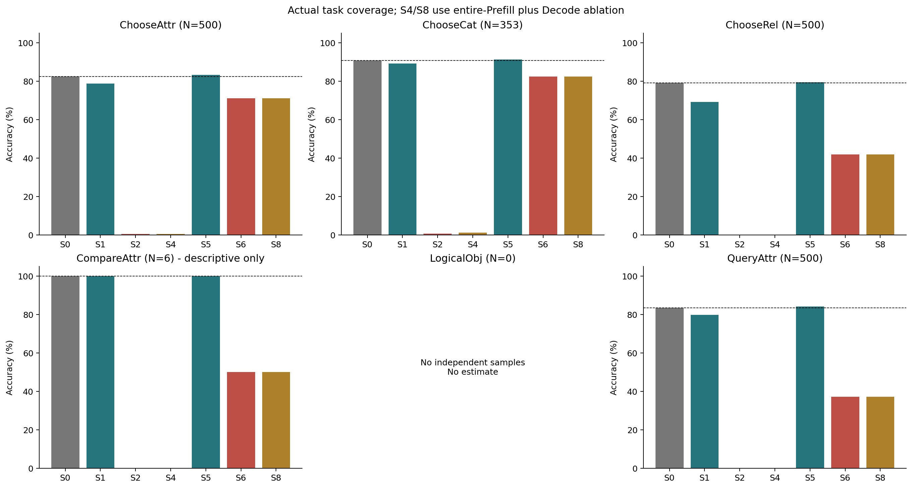
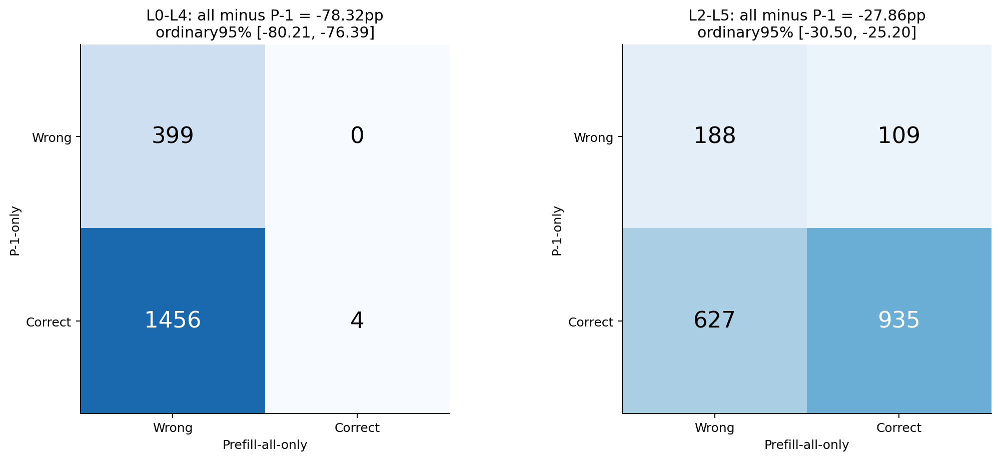
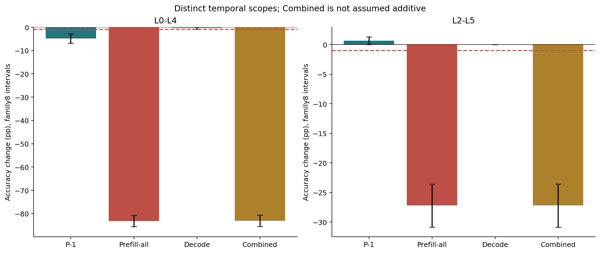
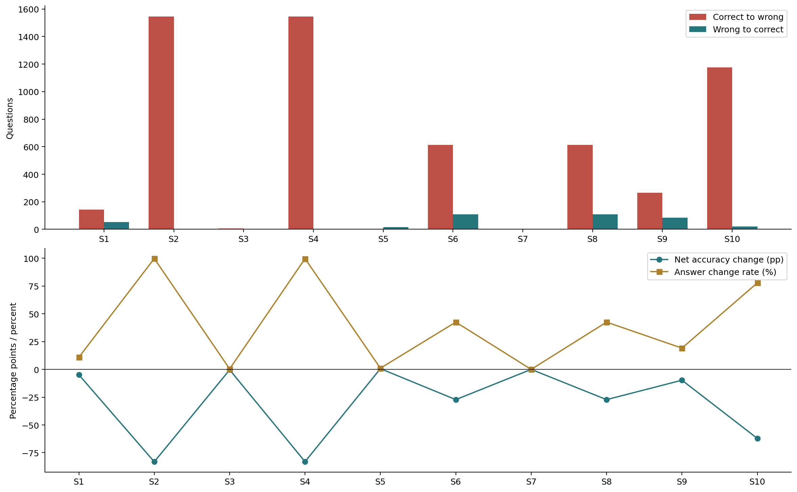
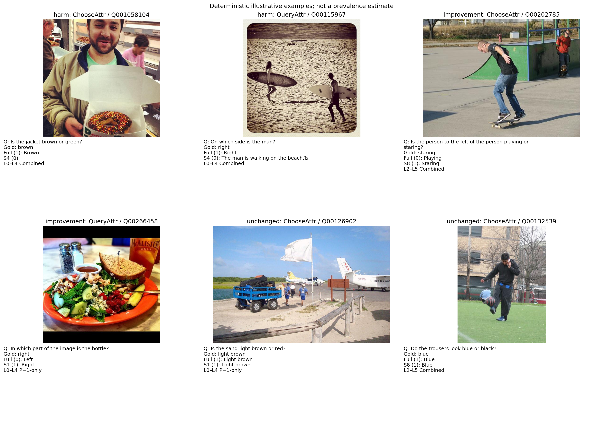

# Early-Layer Joint Attention Ablation for Short-Answer VQA

## 完成状态与边界

冻结核心矩阵已完成：1859题 × 11条件，共20449次真实完整生成。
**原计划六类各500题确认仍为 partial（独立样本不足）**：未补造、重复采样、混入训练集或回填历史图片。
LogicalObj 无独立题；CompareAttr 仅6题。总体是实际可用题目的加权混合，不能表述为六类平衡3000题结论。
历史排除规则较保守：排除了历史清单中已预留但可能未执行的图片。精确 ID/SHA256 去重不是感知近重复证明。

模型：LLaVA-1.5-7B `b234b804b114d9e37bb655e11cbbb5f5e971b7a9`；FP16/eager，Transformers4.49.0。
冻结采集代码：`86cf9bd64e1c45406e354f9d4786968bf03b5085`。物理GPU1/2/3，同图全部条件同卡；未使用/终止GPU0其他任务。
保留原短答案 Prompt、正常KV Cache、Greedy、最多32新Token、EOS=2和官方GQA主准确率转换。
同时安装多层 o_proj Hook；MLP/LayerNorm/残差正常；每条件独立Prefill及自己的真实生成前缀/Cache。
**这里是输出置零的功能消融，不是真实计算跳过；没有速度收益主张。**

## 核心研究判定

**本轮最重要的结果是否定“前五层联合低损害”，而不是证明前五层可删除。**

- **H1得到限定支持，而非普遍支持。** L0–L4 P−1-only下降4.84pp，143题由对变错、53题由错变对，family8校正区间为[−6.90, −2.82]pp。因此历史单层低敏感不能推广到这个五层联合条件，对该组合属于预设结论C。L2–L5 P−1-only则通过本批总体−1pp非劣效，但4个个体损害仍存在。
- **H2得到直接支持。** 同为L2–L5，P−1-only为84.02%，完整Prefill为56.16%；完整Prefill相对P−1的配对差为−27.86pp，family6区间[−31.44, −24.30]pp。局部Query低损害不能推广到完整Prefill，更不能推广到全程删除。
- **H3存在支持性的干预证据，但不完全归因。** L0–L1 Combined单独下降62.13pp，L2–L4 Combined下降9.74pp；L0–L4与L2–L5的四种同模式比较均为前者更差。两组层数和位置不同，不将全部差异归因于L0–L1。两组Combined均未通过非劣效。
- **预设结论B成立为有限比较：** L2–L5相对L0–L4更有希望，但仅局部P−1或本批Decode范围存在低损害证据，完整推理仍明显受损。**结论A不适用于L0–L4**，因为它连P−1-only都明显受损。**结论D仅能限定到S3/S5/S7的本批总体端点**，不是全程联合跳过方案通过。
- **通过NI不等于无损或提升。** S3下降0.38pp，校正区间[−0.81, −0.05]pp：存在小幅负向证据，但仍在预设1pp允许范围内。S5上升0.65pp，普通区间为正，但校正下界恰为0，不能声称多重比较校正后严格提高准确率。S7本批零翻转，退化Bootstrap区间不证明总体风险为零。

## 生成行为与具体风险

S2有1264个空答案、74次截断及67个重复启发式标记；S4相应为1323、119、122。这是完整Prefill干预后明显的回答/终止行为崩坏，不能只解释为视觉识别变差，因为所有Prompt Query（含BOS和模板文本）的早层Attention均被干预。

S3首Token未变，却出现后续子词错误，例如 `Short sleeved → Short sleevelled`、`Laptop → Laptopc`、`Coffee table → Coffice table`。因此短答案Decode不只是EOS，不应把首Token相同误报成完整答案无损。

S5的4个损害为：ChooseAttr `09360678` 的 `White → Black`，以及ChooseRel `07370829`、`161075419`、`02674441` 的 `Left → Right`。这不是零个体风险的方案，也不足以单凭这三个关系案例宣称系统性方向偏置。

S6和S8的1859题逐题正确性完全相同，但有6题文本不同；相同总体得分不等于相同生成轨迹，也不证明Prefill和Decode效应可加。

主要后续方向应限于独立确认L2–L5局部P−1或Decode功能消融；当前结果不支持直接实现前五层或L2–L5全程Attention删除。新增任务风险验证、其他模型与真实计算省略均未执行。

## 数据覆盖

| 任务 | 请求 | 实际题数 | 独立图片数 |
|---|---:|---:|---:|
| ChooseAttr | 500 | 500 | 471 |
| ChooseCat | 500 | 353 | 326 |
| ChooseRel | 500 | 500 | 420 |
| CompareAttr | 500 | 6 | 6 |
| LogicalObj | 500 | 0 | 0 |
| QueryAttr | 500 | 500 | 464 |

与历史图片ID/SHA256重叠为0；全部问题来自官方Balanced验证集，按输入哈希固定，不参考模型表现。
每题均保存生成Token、完整答案、归一化预测、评分和条件检查点；重跑评分/Token解码与保存结果逐一核对。

## 总体完整答案准确率

| 条件 | 准确率% | 相对Full pp | 普通95%CI pp | 校正95%CI pp | 对→错 | 错→对 | 校正NI |
|---|---:|---:|---|---|---:|---:|---|
| S0: Full | 83.38 | +0.00 | — | — | 0 | 0 | 不适用 |
| S1: L0–L4 P−1-only | 78.54 | -4.84 | [-6.31, -3.39] | [-6.90, -2.82] | 143 | 53 | 未通过 |
| S2: L0–L4 Prefill-all-only | 0.22 | -83.16 | [-84.91, -81.39] | [-85.58, -80.66] | 1546 | 0 | 未通过 |
| S3: L0–L4 Decode-only | 83.00 | -0.38 | [-0.69, -0.11] | [-0.81, -0.05] | 7 | 0 | 通过 |
| S4: L0–L4 Combined | 0.32 | -83.06 | [-84.81, -81.27] | [-85.48, -80.55] | 1544 | 0 | 未通过 |
| S5: L2–L5 P−1-only | 84.02 | +0.65 | [+0.21, +1.13] | [+0.00, +1.34] | 4 | 16 | 通过 |
| S6: L2–L5 Prefill-all-only | 56.16 | -27.22 | [-29.82, -24.58] | [-30.87, -23.58] | 614 | 108 | 未通过 |
| S7: L2–L5 Decode-only | 83.38 | +0.00 | [+0.00, +0.00] | [+0.00, +0.00] | 0 | 0 | 通过 |
| S8: L2–L5 Combined | 56.16 | -27.22 | [-29.82, -24.58] | [-30.87, -23.58] | 614 | 108 | 未通过 |
| S9: L2–L4 Combined | 73.64 | -9.74 | [-11.66, -7.81] | [-11.94, -7.53] | 265 | 84 | 未通过 |
| S10: L0–L1 Combined | 21.25 | -62.13 | [-64.47, -59.78] | [-64.79, -59.43] | 1176 | 21 | 未通过 |

200,000次按图配对Bootstrap，以图聚类的sum/count比率保留重复图片的题目权重。
主S1–S8共8比较，辅助S9/S10共2比较，各任务10×6共60比较，六个直接对比单独family6。使用双侧Bonferroni分位数区间；不同family之间不主张统一同时覆盖。
总体校正下界须严格高于−1pp；任务−3pp只用于异质性风险筛查，不是安全保证。
极端尾部分位数有Monte Carlo误差，不是精确有限样本覆盖保证；零翻转时Bootstrap退化，不能解释为总体风险为零。
题目级未校正精确McNemar另存CSV，仅描述；重复图片相关性不由该检验建模，主要推断使用图聚类Bootstrap。
普通区间包含0、不显著下降和得分相近，都不等于非劣效；总体通过也不能外推每类安全。

## 子任务完整结果

| 任务/题数 | 条件 | 准确率% | Δpp | 对→错 / 错→对 | 校正95%CI pp |
|---|---|---:|---:|---:|---|
| ChooseAttr/500 | S0 | 82.40 | +0.00 | 0 / 0 | — |
| ChooseAttr/500 | S1 | 78.80 | -3.60 | 33 / 15 | [-8.32, +1.00] |
| ChooseAttr/500 | S2 | 0.40 | -82.00 | 410 / 0 | [-87.57, -76.00] |
| ChooseAttr/500 | S3 | 81.20 | -1.20 | 6 / 0 | [-3.16, +0.00] |
| ChooseAttr/500 | S4 | 0.40 | -82.00 | 410 / 0 | [-87.57, -76.00] |
| ChooseAttr/500 | S5 | 83.20 | +0.80 | 1 / 5 | [-0.60, +2.64] |
| ChooseAttr/500 | S6 | 71.00 | -11.40 | 92 / 35 | [-18.90, -3.98] |
| ChooseAttr/500 | S7 | 82.40 | +0.00 | 0 / 0 | [+0.00, +0.00] |
| ChooseAttr/500 | S8 | 71.00 | -11.40 | 92 / 35 | [-18.90, -3.98] |
| ChooseAttr/500 | S9 | 74.80 | -7.60 | 68 / 30 | [-14.11, -1.17] |
| ChooseAttr/500 | S10 | 36.80 | -45.60 | 241 / 13 | [-53.84, -37.20] |
| ChooseCat/353 | S0 | 90.65 | +0.00 | 0 / 0 | — |
| ChooseCat/353 | S1 | 89.24 | -1.42 | 12 / 7 | [-5.71, +2.57] |
| ChooseCat/353 | S2 | 0.57 | -90.08 | 318 / 0 | [-95.09, -84.33] |
| ChooseCat/353 | S3 | 90.37 | -0.28 | 1 / 0 | [-1.69, +0.00] |
| ChooseCat/353 | S4 | 1.13 | -89.52 | 316 / 0 | [-94.59, -83.67] |
| ChooseCat/353 | S5 | 91.22 | +0.57 | 0 / 2 | [+0.00, +2.26] |
| ChooseCat/353 | S6 | 82.44 | -8.22 | 48 / 19 | [-15.83, -1.10] |
| ChooseCat/353 | S7 | 90.65 | +0.00 | 0 / 0 | [+0.00, +0.00] |
| ChooseCat/353 | S8 | 82.44 | -8.22 | 48 / 19 | [-15.83, -1.10] |
| ChooseCat/353 | S9 | 84.14 | -6.52 | 30 / 7 | [-12.61, -1.12] |
| ChooseCat/353 | S10 | 49.01 | -41.64 | 154 / 7 | [-51.42, -32.08] |
| ChooseRel/500 | S0 | 79.00 | +0.00 | 0 / 0 | — |
| ChooseRel/500 | S1 | 69.20 | -9.80 | 66 / 17 | [-15.75, -3.99] |
| ChooseRel/500 | S2 | 0.00 | -79.00 | 395 / 0 | [-85.19, -72.54] |
| ChooseRel/500 | S3 | 79.00 | +0.00 | 0 / 0 | [+0.00, +0.00] |
| ChooseRel/500 | S4 | 0.00 | -79.00 | 395 / 0 | [-85.19, -72.54] |
| ChooseRel/500 | S5 | 79.40 | +0.40 | 3 / 5 | [-1.43, +2.45] |
| ChooseRel/500 | S6 | 41.80 | -37.20 | 227 / 41 | [-46.65, -27.53] |
| ChooseRel/500 | S7 | 79.00 | +0.00 | 0 / 0 | [+0.00, +0.00] |
| ChooseRel/500 | S8 | 41.80 | -37.20 | 227 / 41 | [-46.65, -27.53] |
| ChooseRel/500 | S9 | 61.00 | -18.00 | 120 / 30 | [-25.54, -10.56] |
| ChooseRel/500 | S10 | 4.80 | -74.20 | 372 / 1 | [-80.71, -67.36] |
| CompareAttr/6 | S0 | 100.00 | +0.00 | 0 / 0 | — |
| CompareAttr/6 | S1 | 100.00 | +0.00 | 0 / 0 | [+0.00, +0.00] |
| CompareAttr/6 | S2 | 0.00 | -100.00 | 6 / 0 | [-100.00, -100.00] |
| CompareAttr/6 | S3 | 100.00 | +0.00 | 0 / 0 | [+0.00, +0.00] |
| CompareAttr/6 | S4 | 0.00 | -100.00 | 6 / 0 | [-100.00, -100.00] |
| CompareAttr/6 | S5 | 100.00 | +0.00 | 0 / 0 | [+0.00, +0.00] |
| CompareAttr/6 | S6 | 50.00 | -50.00 | 3 / 0 | [-100.00, +0.00] |
| CompareAttr/6 | S7 | 100.00 | +0.00 | 0 / 0 | [+0.00, +0.00] |
| CompareAttr/6 | S8 | 50.00 | -50.00 | 3 / 0 | [-100.00, +0.00] |
| CompareAttr/6 | S9 | 50.00 | -50.00 | 3 / 0 | [-100.00, +0.00] |
| CompareAttr/6 | S10 | 0.00 | -100.00 | 6 / 0 | [-100.00, -100.00] |
| LogicalObj/0 | 无独立数据 | — | — | — | — |
| QueryAttr/500 | S0 | 83.40 | +0.00 | 0 / 0 | — |
| QueryAttr/500 | S1 | 79.80 | -3.60 | 32 / 14 | [-8.24, +0.80] |
| QueryAttr/500 | S2 | 0.00 | -83.40 | 417 / 0 | [-88.73, -77.53] |
| QueryAttr/500 | S3 | 83.40 | +0.00 | 0 / 0 | [+0.00, +0.00] |
| QueryAttr/500 | S4 | 0.00 | -83.40 | 417 / 0 | [-88.73, -77.53] |
| QueryAttr/500 | S5 | 84.20 | +0.80 | 0 / 4 | [+0.00, +2.40] |
| QueryAttr/500 | S6 | 37.20 | -46.20 | 244 / 13 | [-54.49, -37.82] |
| QueryAttr/500 | S7 | 83.40 | +0.00 | 0 / 0 | [+0.00, +0.00] |
| QueryAttr/500 | S8 | 37.20 | -46.20 | 244 / 13 | [-54.49, -37.82] |
| QueryAttr/500 | S9 | 78.00 | -5.40 | 44 / 17 | [-10.76, -0.20] |
| QueryAttr/500 | S10 | 2.80 | -80.60 | 403 / 0 | [-86.41, -74.40] |

## 预设直接配对比较

| a−b | Δ准确率 pp | 普通95%CI | family6校正95%CI |
|---|---:|---|---|
| S1 − S5 | -5.49 | [-6.95, -4.04] | [-7.48, -3.56] |
| S2 − S6 | -55.94 | [-58.26, -53.64] | [-59.05, -52.84] |
| S3 − S7 | -0.38 | [-0.69, -0.11] | [-0.80, -0.05] |
| S4 − S8 | -55.84 | [-58.15, -53.53] | [-58.94, -52.72] |
| S2 − S1 | -78.32 | [-80.21, -76.39] | [-80.85, -75.73] |
| S6 − S5 | -27.86 | [-30.50, -25.20] | [-31.44, -24.30] |

同题、同任务、同模式的直接配对点估计和不一致数量另见taskwise_paired_comparisons.csv。该分解仅描述，不增加未预注册的显著性或非劣效结论。

## 研究问题

1. **L0–L4 联合P−1**：S1 Δ=-4.84pp，损害143题、纠正53题；总体校正NI False。只能描述当前独立可用样本。
2. **扩展完整Prefill**：S2 Δ=-83.16pp；S6 Δ=-27.22pp。S2−S1及S6−S5见直接配对表；不能把单Query低损害等同于整段Prefill冗余。
3. **全程L0–L4**：S4 Δ=-83.06pp，校正NI False。因此不能声称前五层Attention可安全删除。
4. **L2–L5对照**：S8 Δ=-27.22pp，校正NI False。四种同模式对比全部保留；两组分别5层和4层，不能将差异完全归因于L0–L1。辅助S9/S10也不消除所有层数混杂。
5. **任务异质性**：逐任务区间、损害数量及异常生成全部列出。CompareAttr六题统计功效极低、LogicalObj不可估计，不声称六类均无损。
6. **阶段边界**：S3/S7首Token严格保留Full，但完整答案可能因后续词或EOS改变。S3截断0题，S7截断0题；Combined不作Prefill与Decode可加性假设。

## 假说结论边界

D型有限证据：部分方案在实际独立可用GQA混合样本通过校正NI：S3, S5, S7。不等于所请求六类平衡确认完成。
A/B/C的具体支持须结合S1与S2/S4、S5与S6/S8的负向结果及直接配对区间，不以“单层低敏感”替代联合证据。
历史480题是探索性单层P−1生成，不能相加推断联合结果；原时间窗口Combined只改Prefill P−1，本轮Combined改全部Prefill，协议不同。
TextVQA历史L0–L2 Decode-only下降约4.78pp为已有风险反例，本轮没有复跑该任务，不能将GQA发现推广到所有短答案VQA。

## 正确性与资源

18项采集CPU测试、9项统计/汇总/终止边界CPU测试；三GPU各两个预设真实问题Smoke。Full与HF原生生成Token一致，全部11条件No-op有效Logits精确一致。
各条件独立HF生成驱动复核；S1多层P−1同时置零、S2全Prefill/正常Decode、S3原生Prefill/首Token、S4/S8全程指定层均检查。
32层Attention/MLP调用完整，未目标Query局部输出不变；各条件Cache独立；阶段用真实cache_position/长度定位。
跨三卡同题Full有效Logits和干预生成Token精确一致；正常及异常Hook清理通过；参数版本、输入哈希和第三方代码/模型文件绑定检查通过。
正式生成所有有效Logits检查有限；失败尝试如有全部保存在failure_inventory.json中，不隐藏已修复失败。

## 生成异常与案例

每条件保存EOS、长度、截断、重复Token与重复四元组标记、空答案。重复标记只是可复核启发式，不将其自动称为无意义文本。
见generation_anomaly_analysis.csv、逐题CSV及selected_cases.csv；每任务具体退化、改善及答案不变案例保留在task_error_cases.csv。

## 图表

## 未执行部分

POPE Adversarial、ScienceQA-IMG、TextVQA补充风险检查均未执行。优先完成并严格校验核心GQA，不声称跨数据集泛化。
原六类各500题确认因独立官方验证图像不足而未完成；不回填旧样本、不放宽NI、不追加层窗口或调参。
