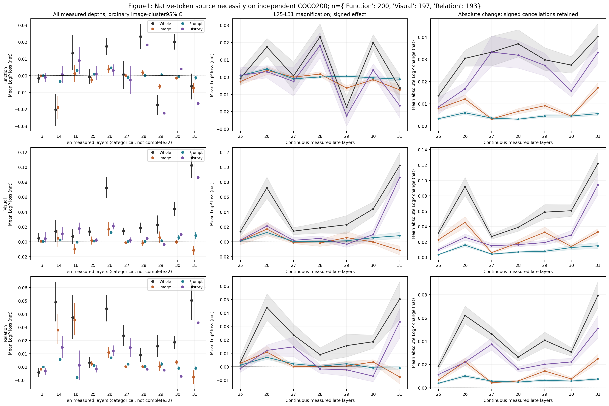
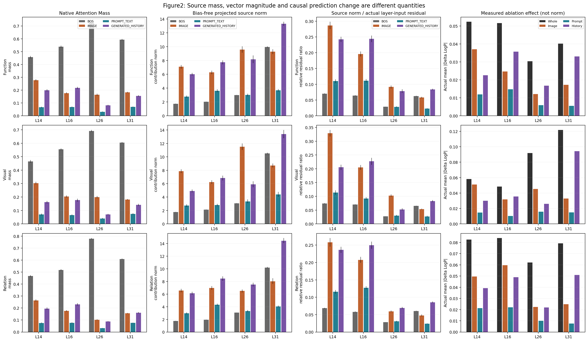
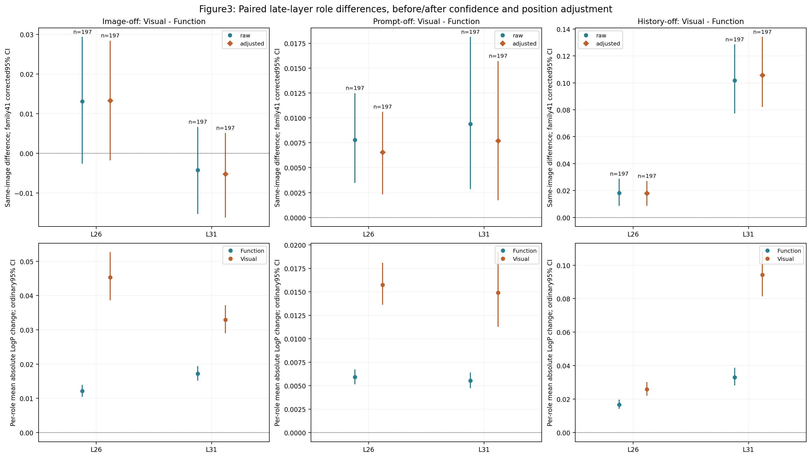
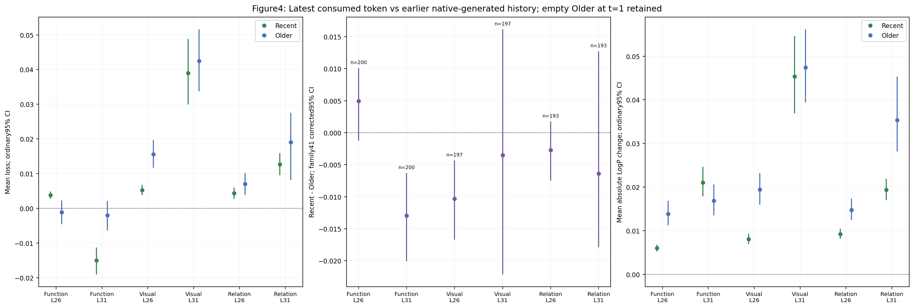
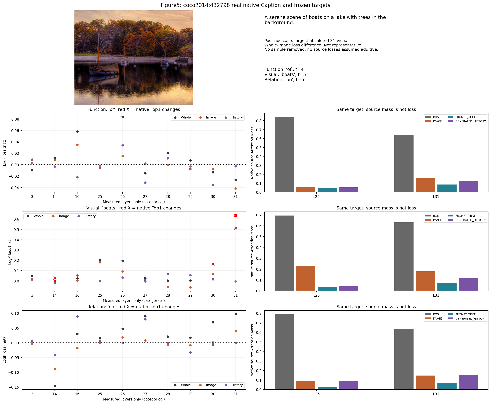

# Late-Layer Attention Source Decomposition

Status: complete independent200-image GPU study; 590 frozen native Decode targets; 27140 single-step interventions.
Collector commit: `195e65a7bbd327942c8118509be8b9ca3198b2a9`; target manifest SHA256: `1cb620e51cd9181fe0483d9225ad220eabda975bcedb5cf3490d056e0ae8f115`.

No training, freely continued ablation, complete-caption accuracy or acceleration claim.

## Independent Data and Protocol

Exact lexical target counts: `{'Function': 200, 'Visual': 197, 'Relation': 193}`. Alignment failures: 0. Missing roles are retained, not replaced.
200 new COCO IDs/byte-SHA/RGB identities, disjoint from earlier Observation2 sample/smoke and400 COCO Discovery images. Fixed original prompt, tokenizer/lexicons/priority, FP16/eager/Transformers4.49.0; Greedy cached generation, max64/EOS.
Every condition consumes native y[t-1] to predict native y[t], clones the same unmodified history and discards the altered cache. Native source observation gathers all10 layers in one extra unchanged forward per target, never repeats a whole Caption per condition.
BOS/image/prompt/history exactly partition visible keys. Recent is the just-consumed generated token, included in History; Older may be empty at t=1. Source subtraction uses original weights and Values, bias-free FP32 Wo projection, one nativeFP16 subtraction cast, with no new Softmax or mask.

## Measured Late-Layer Effects

| Role | Layer | Mode | Images | Mean loss | Ordinary95% CI | Mean absolute change | Top1 flip |
|---|---:|---|---:|---:|---|---:|---:|
| Function | 26 | Whole | 200 | 0.017414 | [0.012244, 0.022359] | 0.030419 | 4/200 |
| Function | 26 | Image | 200 | 0.003902 | [0.001416, 0.006257] | 0.012119 | 2/200 |
| Function | 26 | Prompt | 200 | 0.004673 | [0.003754, 0.005612] | 0.005936 | 2/200 |
| Function | 26 | History | 200 | 0.003112 | [-0.000482, 0.006669] | 0.016740 | 3/200 |
| Function | 26 | BOS | 200 | 0.004082 | [0.002933, 0.005232] | 0.006860 | 2/200 |
| Function | 26 | Recent | 200 | 0.003770 | [0.002761, 0.004799] | 0.005993 | 1/200 |
| Function | 26 | Older | 200 | -0.001169 | [-0.004574, 0.002250] | 0.013855 | 4/200 |
| Function | 31 | Whole | 200 | -0.006276 | [-0.014164, 0.001253] | 0.040229 | 6/200 |
| Function | 31 | Image | 200 | -0.007396 | [-0.010427, -0.004390] | 0.017232 | 5/200 |
| Function | 31 | Prompt | 200 | -0.001231 | [-0.002328, -0.000145] | 0.005548 | 3/200 |
| Function | 31 | History | 200 | -0.016514 | [-0.023519, -0.010247] | 0.033075 | 3/200 |
| Function | 31 | BOS | 200 | 0.017406 | [0.015216, 0.019633] | 0.019274 | 1/200 |
| Function | 31 | Recent | 200 | -0.014985 | [-0.019039, -0.011284] | 0.021032 | 1/200 |
| Function | 31 | Older | 200 | -0.002052 | [-0.006370, 0.002104] | 0.016842 | 3/200 |
| Visual | 26 | Whole | 197 | 0.072163 | [0.058129, 0.086560] | 0.091819 | 13/197 |
| Visual | 26 | Image | 197 | 0.016941 | [0.007962, 0.026258] | 0.045332 | 7/197 |
| Visual | 26 | Prompt | 197 | 0.012485 | [0.009967, 0.015151] | 0.015748 | 3/197 |
| Visual | 26 | History | 197 | 0.021048 | [0.016553, 0.025806] | 0.025925 | 7/197 |
| Visual | 26 | BOS | 197 | 0.015811 | [0.013338, 0.018335] | 0.018053 | 3/197 |
| Visual | 26 | Recent | 197 | 0.005278 | [0.003799, 0.006781] | 0.008074 | 1/197 |
| Visual | 26 | Older | 197 | 0.015586 | [0.011718, 0.019719] | 0.019416 | 7/197 |
| Visual | 31 | Whole | 197 | 0.102197 | [0.085617, 0.119230] | 0.121824 | 21/197 |
| Visual | 31 | Image | 197 | -0.011501 | [-0.017599, -0.005623] | 0.032966 | 3/197 |
| Visual | 31 | Prompt | 197 | 0.008155 | [0.004093, 0.012825] | 0.014898 | 2/197 |
| Visual | 31 | History | 197 | 0.086091 | [0.072193, 0.100754] | 0.094189 | 15/197 |
| Visual | 31 | BOS | 197 | 0.020622 | [0.016286, 0.024976] | 0.027023 | 5/197 |
| Visual | 31 | Recent | 197 | 0.038970 | [0.029942, 0.048847] | 0.045372 | 9/197 |
| Visual | 31 | Older | 197 | 0.042458 | [0.033754, 0.051596] | 0.047422 | 8/197 |
| Relation | 26 | Whole | 193 | 0.044109 | [0.034416, 0.054209] | 0.062140 | 7/193 |
| Relation | 26 | Image | 193 | 0.010861 | [0.006509, 0.015196] | 0.022311 | 3/193 |
| Relation | 26 | Prompt | 193 | 0.006980 | [0.005339, 0.008695] | 0.010013 | 1/193 |
| Relation | 26 | History | 193 | 0.012146 | [0.008153, 0.016234] | 0.021899 | 3/193 |
| Relation | 26 | BOS | 193 | 0.011558 | [0.009384, 0.013797] | 0.015017 | 3/193 |
| Relation | 26 | Recent | 193 | 0.004341 | [0.002744, 0.005981] | 0.009215 | 3/193 |
| Relation | 26 | Older | 193 | 0.007034 | [0.003897, 0.010140] | 0.014748 | 2/193 |
| Relation | 31 | Whole | 193 | 0.050316 | [0.035249, 0.063287] | 0.079162 | 12/193 |
| Relation | 31 | Image | 193 | -0.007632 | [-0.012760, -0.002672] | 0.024869 | 5/193 |
| Relation | 31 | Prompt | 193 | -0.000983 | [-0.002430, 0.000404] | 0.007540 | 0/193 |
| Relation | 31 | History | 193 | 0.033342 | [0.021349, 0.043349] | 0.050975 | 8/193 |
| Relation | 31 | BOS | 193 | 0.024961 | [0.020454, 0.029132] | 0.033914 | 4/193 |
| Relation | 31 | Recent | 193 | 0.012666 | [0.009523, 0.015867] | 0.019352 | 4/193 |
| Relation | 31 | Older | 193 | 0.019039 | [0.008114, 0.027488] | 0.035319 | 4/193 |

## Planned Primary Comparisons

41 contrasts were frozen before GPU outputs: source effects and History-source differences10; role differences raw/adjusted12; seven deep Whole means and six adjacent differences13; Recent-Older6. Ordinary and family41 Bonferroni percentile Bootstrap intervals use10,000 paired image resamples. Very small adjusted tail quantiles have finite Monte Carlo uncertainty; this is not an exact finite-sample guarantee. Other descriptive tables do not license additional significant findings.

| Contrast | Layer | Mode | Analysis | Estimate | Corrected95% CI | Images |
|---|---:|---|---|---:|---|---:|
| A_Visual_History_vs_zero | 26 | History | raw | 0.021048 | [0.013937, 0.028947] | 197 |
| A_Visual_Image_vs_zero | 26 | Image | raw | 0.016941 | [0.002163, 0.032693] | 197 |
| A_Visual_Prompt_vs_zero | 26 | Prompt | raw | 0.012485 | [0.008516, 0.017055] | 197 |
| A_Visual_History_minus_Image | 26 | History-Image | paired | 0.004107 | [-0.011555, 0.019304] | 197 |
| A_Visual_History_minus_Prompt | 26 | History-Prompt | paired | 0.008563 | [0.000964, 0.016619] | 197 |
| B_Visual_minus_Function | 26 | Image | raw | 0.013058 | [-0.002581, 0.029318] | 197 |
| B_Visual_minus_Function | 26 | Image | adjusted | 0.013297 | [-0.001770, 0.028367] | 197 |
| B_Visual_minus_Function | 26 | Prompt | raw | 0.007783 | [0.003470, 0.012478] | 197 |
| B_Visual_minus_Function | 26 | Prompt | adjusted | 0.006546 | [0.002329, 0.010613] | 197 |
| B_Visual_minus_Function | 26 | History | raw | 0.018128 | [0.008736, 0.028656] | 197 |
| B_Visual_minus_Function | 26 | History | adjusted | 0.017876 | [0.008696, 0.027030] | 197 |
| A_Visual_History_vs_zero | 31 | History | raw | 0.086091 | [0.063925, 0.110655] | 197 |
| A_Visual_Image_vs_zero | 31 | Image | raw | -0.011501 | [-0.021632, -0.001964] | 197 |
| A_Visual_Prompt_vs_zero | 31 | Prompt | raw | 0.008155 | [0.001952, 0.015833] | 197 |
| A_Visual_History_minus_Image | 31 | History-Image | paired | 0.097592 | [0.071128, 0.125074] | 197 |
| A_Visual_History_minus_Prompt | 31 | History-Prompt | paired | 0.077936 | [0.054866, 0.102989] | 197 |
| B_Visual_minus_Function | 31 | Image | raw | -0.004205 | [-0.015254, 0.006643] | 197 |
| B_Visual_minus_Function | 31 | Image | adjusted | -0.005196 | [-0.016166, 0.005118] | 197 |
| B_Visual_minus_Function | 31 | Prompt | raw | 0.009397 | [0.002864, 0.018136] | 197 |
| B_Visual_minus_Function | 31 | Prompt | adjusted | 0.007695 | [0.001743, 0.015716] | 197 |
| B_Visual_minus_Function | 31 | History | raw | 0.101792 | [0.077393, 0.128487] | 197 |
| B_Visual_minus_Function | 31 | History | adjusted | 0.105737 | [0.082144, 0.134073] | 197 |
| C_Visual_Whole_vs_zero | 25 | Whole | paired | 0.013692 | [0.002784, 0.024575] | 197 |
| C_Visual_Whole_vs_zero | 26 | Whole | paired | 0.072163 | [0.049419, 0.095916] | 197 |
| C_Visual_Whole_adjacent_difference | 26 | L26-L25 | paired | 0.058471 | [0.037370, 0.081451] | 197 |
| C_Visual_Whole_vs_zero | 27 | Whole | paired | 0.014231 | [0.006800, 0.022406] | 197 |
| C_Visual_Whole_adjacent_difference | 27 | L27-L26 | paired | -0.057931 | [-0.080978, -0.035827] | 197 |
| C_Visual_Whole_vs_zero | 28 | Whole | paired | 0.018615 | [0.006881, 0.030411] | 197 |
| C_Visual_Whole_adjacent_difference | 28 | L28-L27 | paired | 0.004383 | [-0.007675, 0.016827] | 197 |
| C_Visual_Whole_vs_zero | 29 | Whole | paired | 0.022830 | [0.004241, 0.044365] | 197 |
| C_Visual_Whole_adjacent_difference | 29 | L29-L28 | paired | 0.004216 | [-0.014447, 0.023057] | 197 |
| C_Visual_Whole_vs_zero | 30 | Whole | paired | 0.043921 | [0.027763, 0.060510] | 197 |
| C_Visual_Whole_adjacent_difference | 30 | L30-L29 | paired | 0.021091 | [-0.003518, 0.042441] | 197 |
| C_Visual_Whole_vs_zero | 31 | Whole | paired | 0.102197 | [0.074889, 0.129776] | 197 |
| C_Visual_Whole_adjacent_difference | 31 | L31-L30 | paired | 0.058276 | [0.031719, 0.085365] | 197 |
| D_Recent_minus_Older_Function | 26 | Recent-Older | paired | 0.004939 | [-0.001211, 0.010097] | 200 |
| D_Recent_minus_Older_Visual | 26 | Recent-Older | paired | -0.010308 | [-0.016719, -0.004338] | 197 |
| D_Recent_minus_Older_Relation | 26 | Recent-Older | paired | -0.002693 | [-0.007462, 0.001744] | 193 |
| D_Recent_minus_Older_Function | 31 | Recent-Older | paired | -0.012933 | [-0.020058, -0.006304] | 200 |
| D_Recent_minus_Older_Visual | 31 | Recent-Older | paired | -0.003487 | [-0.022112, 0.016143] | 197 |
| D_Recent_minus_Older_Relation | 31 | Recent-Older | paired | -0.006373 | [-0.017872, 0.012701] | 193 |

## Statistical Boundaries

Image, not head/layer/token, is the bootstrap unit. Word roles are conditioned on native Full outputs and inherited single-token lexicons. Controlled comparisons use same-image Function/Visual pairs, available Relation tokens, image fixed effects and Full LogP/entropy/absolute/relative time. Token length is1 by construction and is explicitly not estimated. Rank/condition and bootstrap-identifiability counts are audited. A CI spanningzero does not establish equivalence or a low-harm interval.
Norm, Mass and loss are distinct. Group projections can cancel; their intervention losses are nonlinear and cannot be summed to Whole loss. History may contain visual information, but History-off does not prove visual-to-text information transfer or strict semantic grounding.

## Correctness and Resource Use

All4 logical-shard smoke gates on physical GPUs1/2/3 passed; native model.generate tokens, no-op logits, native source-observer logits and every formal Full replay step are exact. 590 target parent-cache SHA checks passed; 5980 native decomposition audits passed unchanged/analytically extended rounding bounds. All 404 raw NPZ SHA256 files verified, 2266480285 bytes, stored locally with committed inventory. No silent skipped image, nonfinite value, OOM, input mutation or leaked hook was accepted. Model versions and installed Transformers source remain bound.
An initial GPU0 preflight refused an external compute task; see resource_event.json and original smoke console logs. The user then authorized three GPUs. Four original logical shards stay unchanged: GPU1 runs shards0/3, GPU2 shard1, GPU3 shard2. Old Smoke/bindings were archived, new Smoke rerun. No other process was terminated or altered; GPU0 was not used.

## Figures

See [research_summary.md](research_summary.md) for the eight Chinese research answers and [README.md](README.md) for exact reproduction/resume commands.
