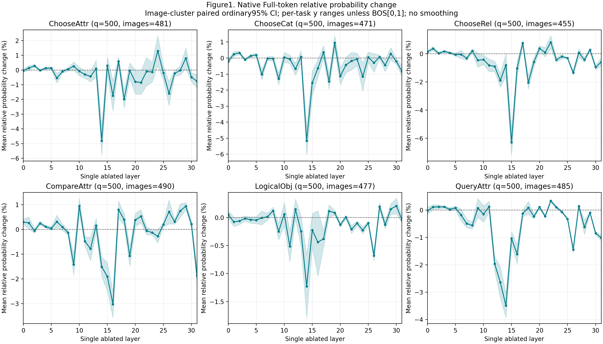
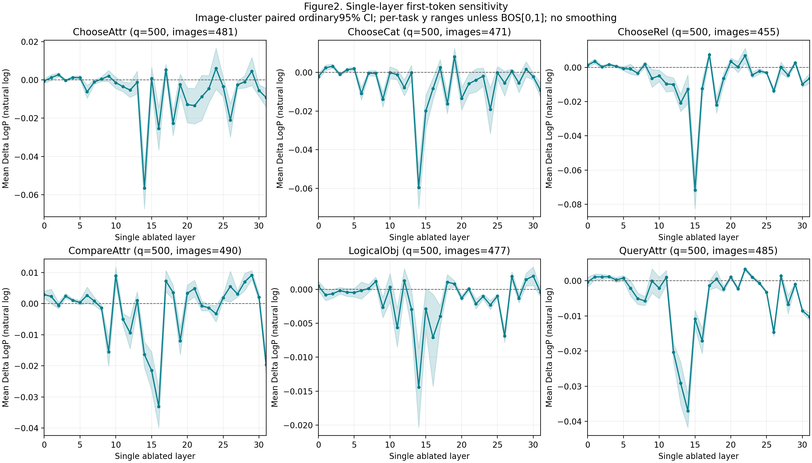
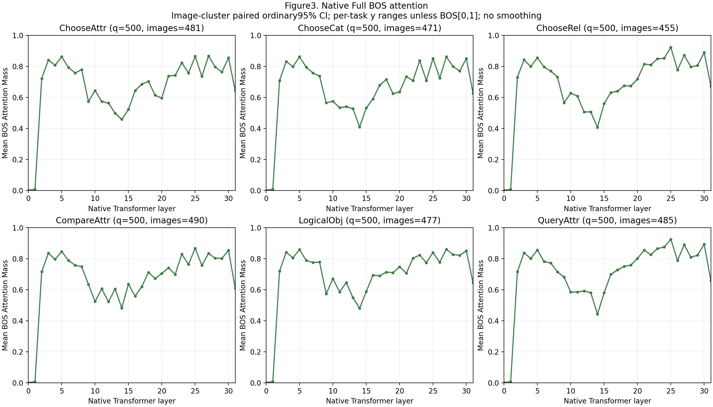
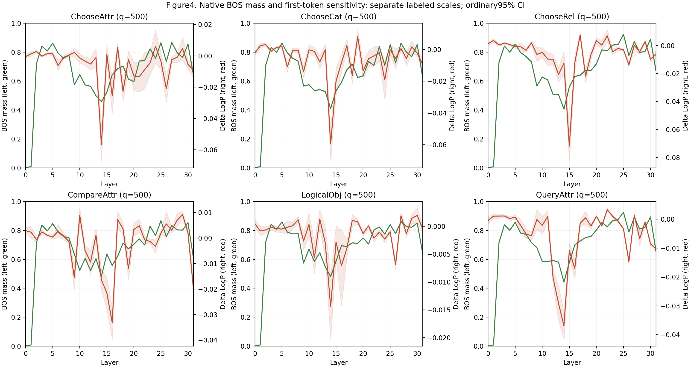
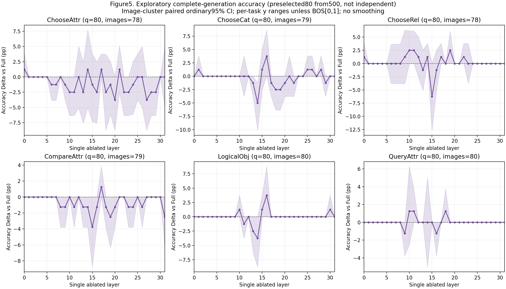
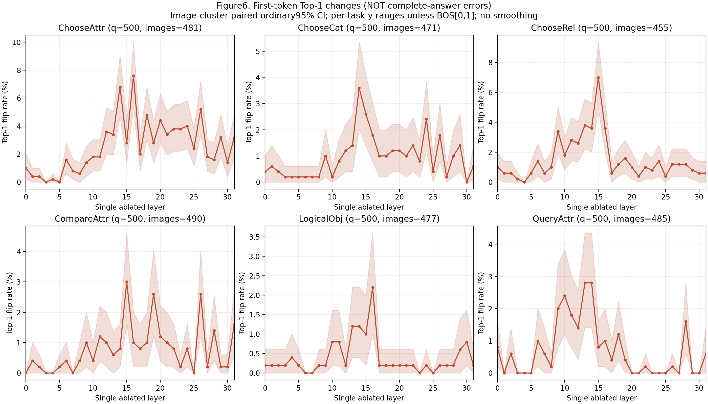
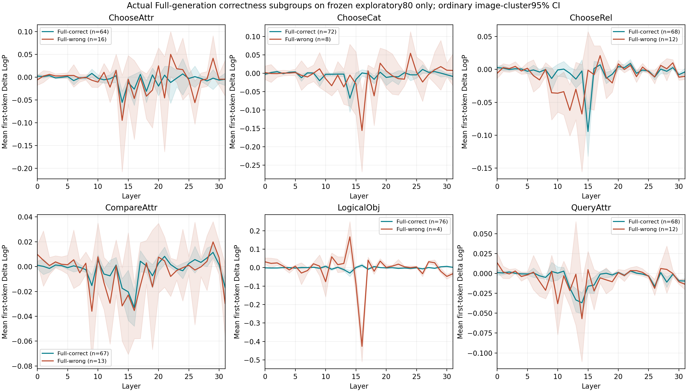

# Six-Task GQA Single-Layer Attention Output Ablation

Status: complete.

This is NOT a reproduction of source-to-target attention-edge knockout in Cross-modal Information Flow in Multimodal Large Language Models. Only one layer's entire Attention o_proj update at the original prompt P-1 is zeroed. All other queries/layers, MLP, LayerNorm, residual and weights remain native. This computes the Attention output before zeroing and provides no compute-skipping or speedup evidence.

Frozen code: `934335e78c8f3d1f11836dc815ded3d88b8b0884`; seed20261030; pinned LLaVA-1.5-7B FP16/eager/Transformers4.49.0.

## Samples and Provenance

All six categories use original official GQA Balanced validation, not author correct_question CSVs. ChooseAttr=chooseAttr; ChooseCat=categoryThatChoose/categoryThisChoose/objThisChoose; ChooseRel=relChooser; CompareAttr=twoCommon; LogicalObj=existThatOr; QueryAttr=positionQuery. Sampling and each80-question subset were hash-frozen before GPU output. Missing images were not replaced.

| Task | Main questions | Main images | Generation subset | Full generation accuracy | Most sensitive layer (mean Delta LogP) | Least changed layer (abs mean Delta LogP) |
|---|---:|---:|---:|---:|---|---|
| ChooseAttr | 500 | 481 | 80 | 80.00% | L14 (-0.05655) | L3 (-0.00025) |
| ChooseCat | 500 | 471 | 80 | 90.00% | L14 (-0.05958) | L10 (-0.00017) |
| ChooseRel | 500 | 455 | 80 | 85.00% | L15 (-0.07173) | L27 (0.00010) |
| CompareAttr | 500 | 490 | 80 | 83.75% | L16 (-0.03310) | L5 (0.00035) |
| LogicalObj | 500 | 477 | 80 | 95.00% | L14 (-0.01443) | L21 (0.00007) |
| QueryAttr | 500 | 485 | 80 | 85.00% | L14 (-0.03697) | L9 (-0.00009) |

There are 2409 unique image IDs globally, with within/across-task overlap. The exact overlap matrix and unequal per-worker task counts are in data_manifest.json. Every image stays on one GPU. Bootstrap resamples whole image IDs and uses cluster sum/count ratios to retain question weighting when images have unequal question counts.

## Completion and Correctness

- Main: 3,000 Native Full + 96,000 independent single-layer Prefill conditions; all32 layers per question.
- Generation: 480 Native Full + 15,360 single-layer conditions on the predefined80/task exploratory subset.
- Full native BOS mass: 96,000 layer/question rows, including all32 heads; no ablated attention substituted.
- Raw Full and all32 changed full-vocabulary FP32 logits are stored externally with committed paths/SHA256. All99,000 vectors were replayed for numerical metrics; see numerical_audit.json.
- No-op/native/observed/cached logits exact; all four GPUs passed the same-question predefined-tolerance Smoke comparison. Intervention affects one o_proj output and one true query, with32 native MLP calls. Inputs, parameter versions and Hook cleanup were checked.

## Curves

## Interpretation Boundaries

- Primary sensitivity is mean Delta LogP of the SAME native Full Top-1 token. Relative probability uses stable FP32 expm1; JS is full-vocabulary natural-log divergence. None is full-answer accuracy.
- Gold-first-token matching is recorded, including multi-token answers, but is not labeled full-answer correctness. Actual Full-correct/wrong plots use only the80 predefined questions with complete Full generation.
- BOS mass uses the tokenizer BOS ID located in each real input, post-softmax native rows, then head means. Layerwise mean/median/std/P5/P25/P75/P95 and ordinary image-cluster95% CIs are in CSV.
- Pearson/Spearman in bos_sensitivity_correlations.csv are descriptive across layer means and within-layer centered question rows. Repeated image/layer observations are not independent; no p-value or causal importance claim is made.
- All curves use real unsmoothed32-layer values with paired ordinary95% CIs. There are192 primary task-layer comparisons; the displayed CIs do NOT control that family. No multiplicity-significance, noninferiority, equivalence, or safe-removal claim is made from a zero/small/nonsignificant effect.
- The80-question generation subset is exploratory and drawn from the main500, not independent Confirmation. Each intervention occurs once at original Prefill P-1; later Decode is native and uses the condition's own cache.
- GQA score is verified official primary answer equality after the pinned LLaVA submission converter. No full GQA validity/plausibility/consistency leaderboard reproduction is claimed.
- Failed/missing checkpoints block aggregation. See failure_inventory.json for every preserved failure attempt; successful resume does not erase earlier failures. No result-based sample deletion is allowed.
