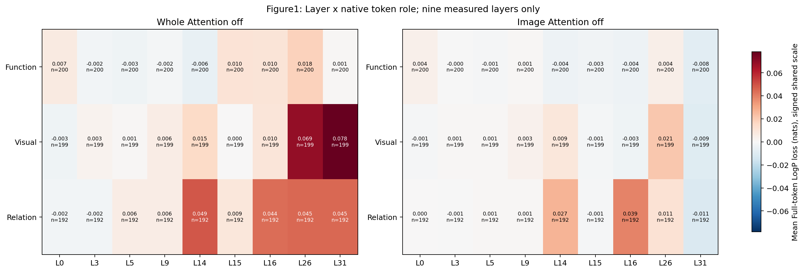
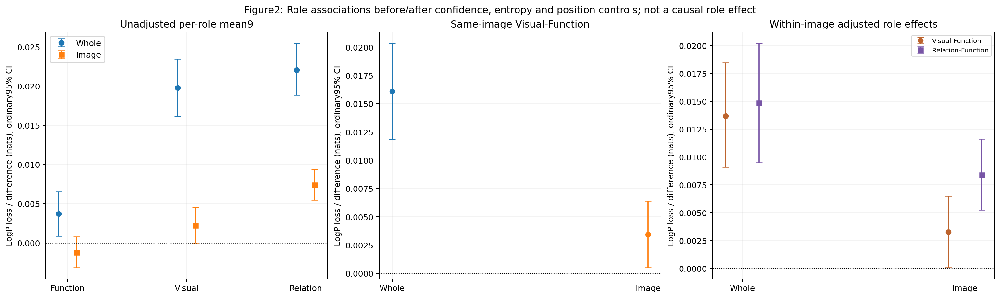
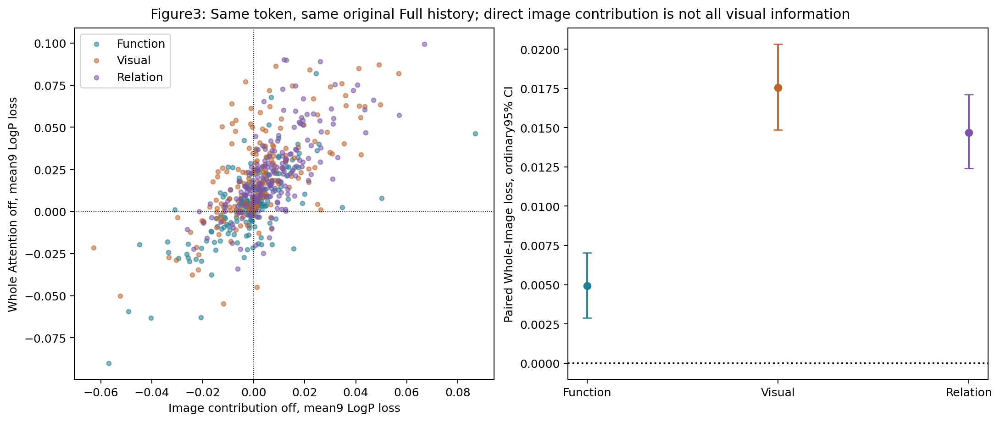
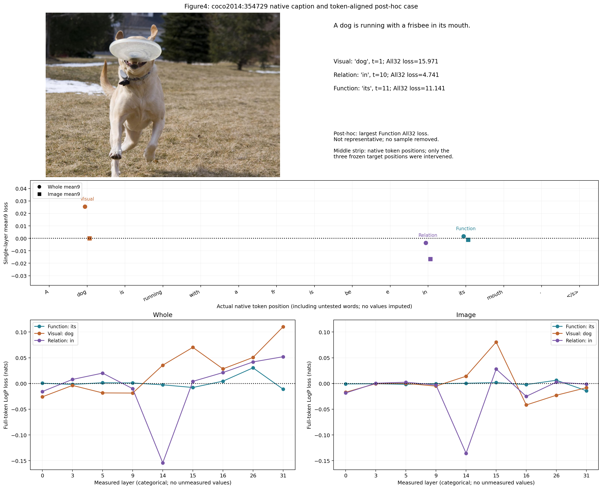
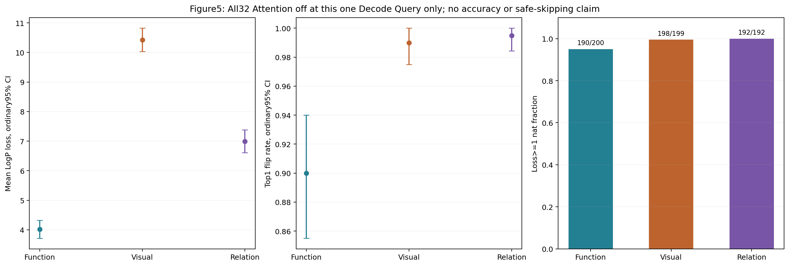

# Observation 2: Token-Dependent Decode Attention Necessity

Status: complete frozen200-image conditional mechanism study. No training, full-answer accuracy or speedup claim.

Collector commit: `13b2f575e0485dba89284d977855e34ab58b9701`. Exact selected positions: `{'Function': 200, 'Visual': 199, 'Relation': 192}`. Alignment failures: 0. All200 images retained; missing roles are not fabricated.

## Nine-Layer Mean Loss

| Mode | Role | Positions/images | Mean loss | Ordinary95% CI | Top1 flip (mean per-layer rate) |
|---|---|---:|---:|---|---:|
| Whole | Function | 200/200 | 0.003692 | [0.000855,0.006508] | 2.17% |
| Whole | Visual | 199/199 | 0.019759 | [0.016156,0.023445] | 3.69% |
| Whole | Relation | 192/192 | 0.022061 | [0.018878,0.025450] | 4.28% |
| Image | Function | 200/200 | -0.001233 | [-0.003152,0.000752] | 1.50% |
| Image | Visual | 199/199 | 0.002206 | [-0.000009,0.004509] | 2.62% |
| Image | Relation | 192/192 | 0.007380 | [0.005491,0.009353] | 2.49% |

## Planned Visual-Function Contrasts

| Mode | Analysis | Difference | Ordinary95% CI | Familywise95% CI (22) | Images |
|---|---|---:|---|---|---:|
| Whole | Same-image unadjusted | 0.016072 | [0.011840,0.020330] | [0.009728,0.022656] | 199 |
| Whole | Within-image adjusted | 0.013674 | [0.009071,0.018480] | [0.006642,0.020894] | 199 |
| Image | Same-image unadjusted | 0.003439 | [0.000513,0.006372] | [-0.001232,0.007913] | 199 |
| Image | Within-image adjusted | 0.003274 | [0.000070,0.006505] | [-0.001681,0.008224] | 199 |

## All32 Diagnostic

| Role | Mean loss | Flip | Loss>=1 nat | Near unchanged |
|---|---:|---:|---:|---:|
| Function | 4.013570 | 180/200 | 190/200 | 0/200 |
| Visual | 10.429300 | 197/199 | 198/199 | 0/199 |
| Relation | 6.990703 | 191/192 | 192/192 | 0/192 |

## Interpretation Boundaries

Full-token LogP loss and Top1 flip are not complete-answer accuracy. Lexicon Visual labels are ungrounded candidates. Roles are conditioned on native generation. Current-query Image removal preserves original weights/denominator and does not remove image information already stored in text states. Whole-Image differences are not an additive attribution.

Controls: native Full LogP, entropy, absolute/relative generation position; image fixed effects on matching Function/Visual-image cohort. Main token_length=1 is constant and excluded from regression, not falsely estimated. Cluster bootstrap uses whole images. The22-contrast family contains four global raw/adjusted mode contrasts and18 mode/layer contrasts; Relation comparisons are descriptive. No per-head/layer independence or universal safety conclusion. No unmeasured layer interpolation.

Full replay logits match saved native logits bit-exactly at every generated step. All interventions own cloned caches; parent SHA256 before/after every target, no alias/metadata mutation, no free continuation. Smoke compares original model.generate and verifies no-op, image-observer equality and FP16/FP32 propagated contribution bounds. No tolerance was fitted to the data.

See [research_summary.md](research_summary.md) for the Chinese eight-question interpretation and [README.md](README.md) for exact resume commands.

## Main Findings

The conditional Whole Visual-Function association remains after native confidence,
entropy, absolute/relative generation position and image fixed-effect adjustment.
Its positive familywise interval supports token-dependent **single-layer**
necessity in this selected lexical sample, not a causal effect of word class.
The strongest corrected per-layer differences are L26/L31; the result is not a
uniform extension of the GQA first-token midlayer peak. The Image global contrast
is weaker and its familywise interval includes zero. Relation/Action is mostly
prepositions/spatial terms, not a balanced action-word sample.

All32 is a strong counterexample to universal Function bypass: 190/200 Function
targets lose at least 1 nat, 180/200 change Top1, and none meet the frozen joint
near-unchanged rule. Twenty unchanged Function Top1 predictions do not imply
unchanged probabilities or distributions. For example, `of` at t=10 on
`coco2014:431432` retains Top1 with loss=-0.124126 but JS=0.313545.
Overall: H1 conditionally supported; H2 weaker/layer-dependent; H3 compatible but
not pathway-isolated; H4 not supported under the predeclared strict criterion.

## Validation and Observed Cost

Twelve collector and four statistical CPU tests passed. Four real GPU smoke tests
matched native cached generation and no-op logits exactly. All200 formal native
replays matched saved logits at every step; 591 parent-cache SHA checks passed.
No failed/omitted sample, nonfinite value, OOM, input mutation or leaked hook was
recorded. Weight versions and installed Transformers source bindings were intact.

The independent CPU delivery review verified476 original artifact hashes and404
raw-logit NPZ hashes, and exactly recomputed12 raw metric rows. The144 smoke image
decomposition checks passed frozen propagated FP16/FP32 bounds (max head-bound
ratio0.8862, projection-bound ratio0.0844), without adjusting tolerances.

Native captions averaged16.915 tokens, all200 reached EOS, none truncated. Mean
complete-caption generation was1.437s; smoke single-cached-step Whole/Image means
were0.0761/0.0806s. These have different units of work and are **not a speedup**.
Maximum worker times after model load: smoke21.73s, Full99.94s, ablation444.42s;
additional model loads, synchronization, freeze and analysis are not included.
All four worker processes exited and GPUs were released. See
`worker_performance.csv`, `delivery_review.json` and `raw_logits_manifest.csv`.

The original automatic report/inventory is retained in `audit/pre_delivery/`;
`final_completion.json` binds the final reviewed delivery, including this update.

