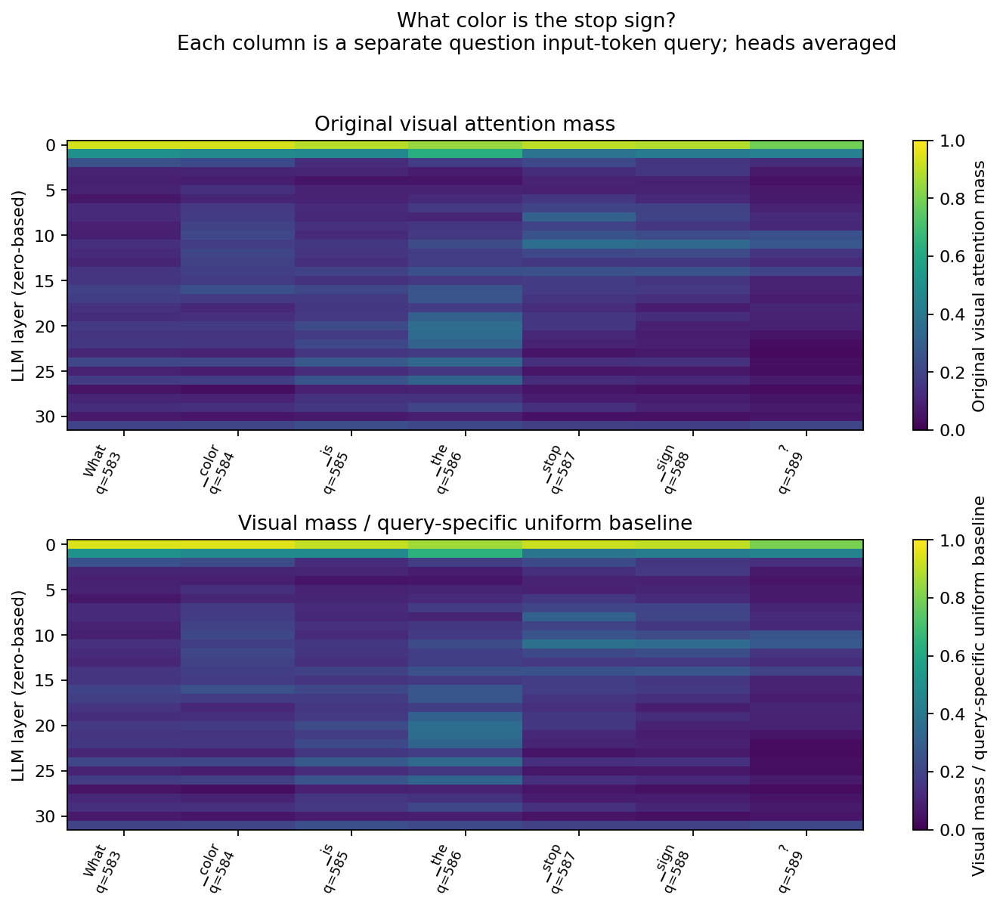
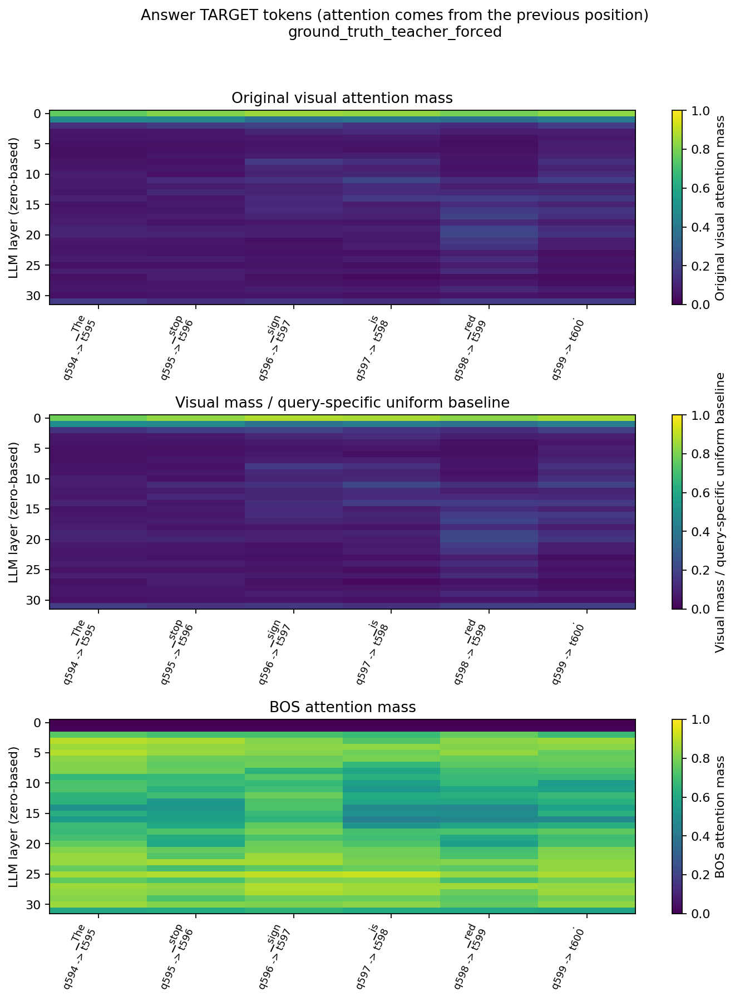
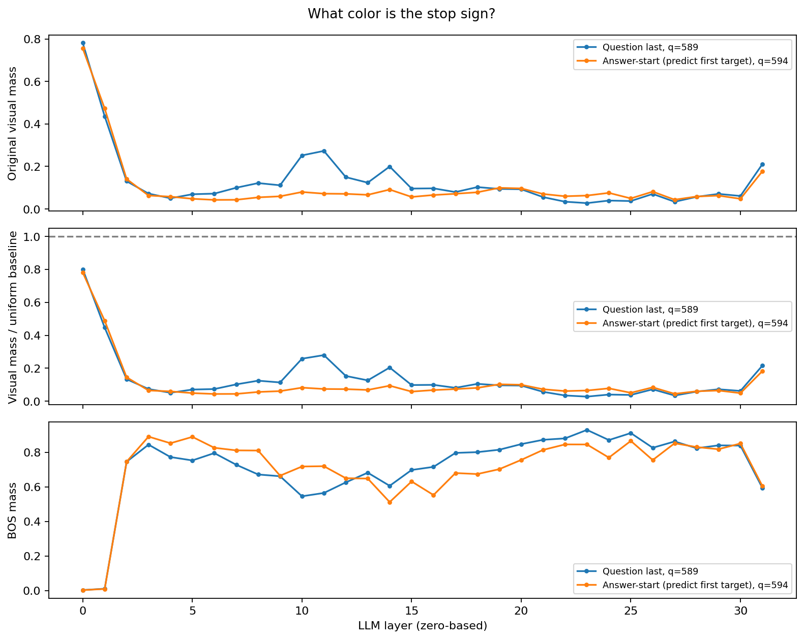
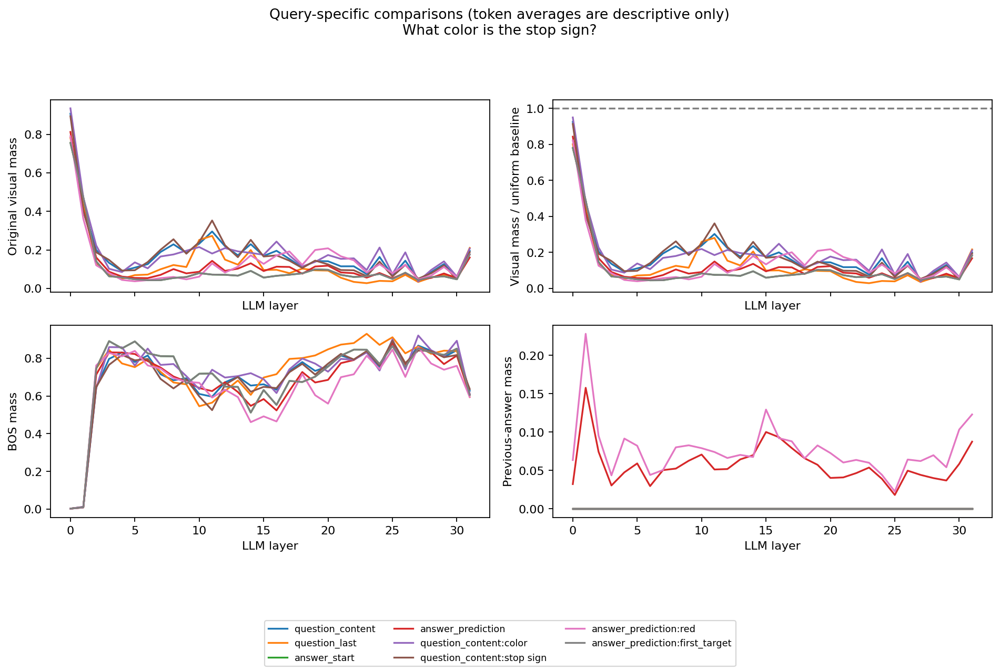
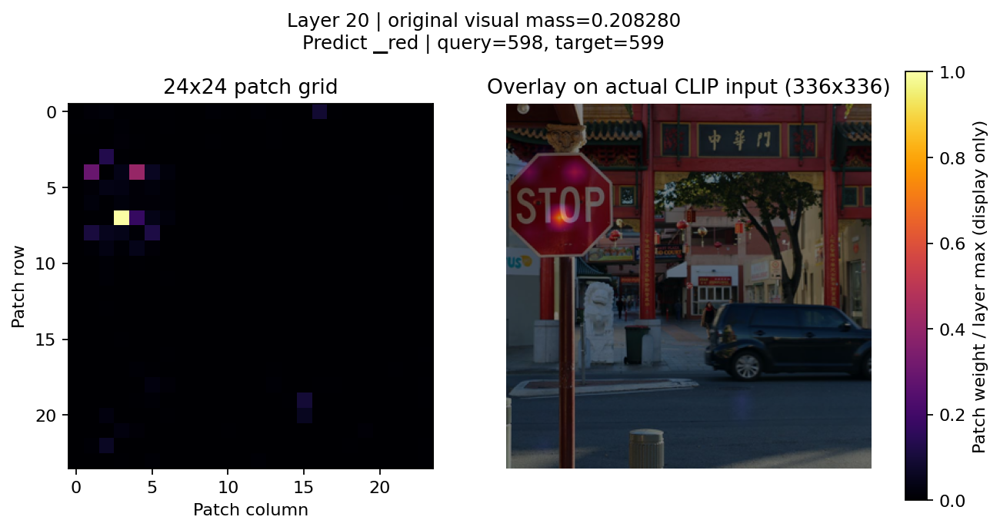
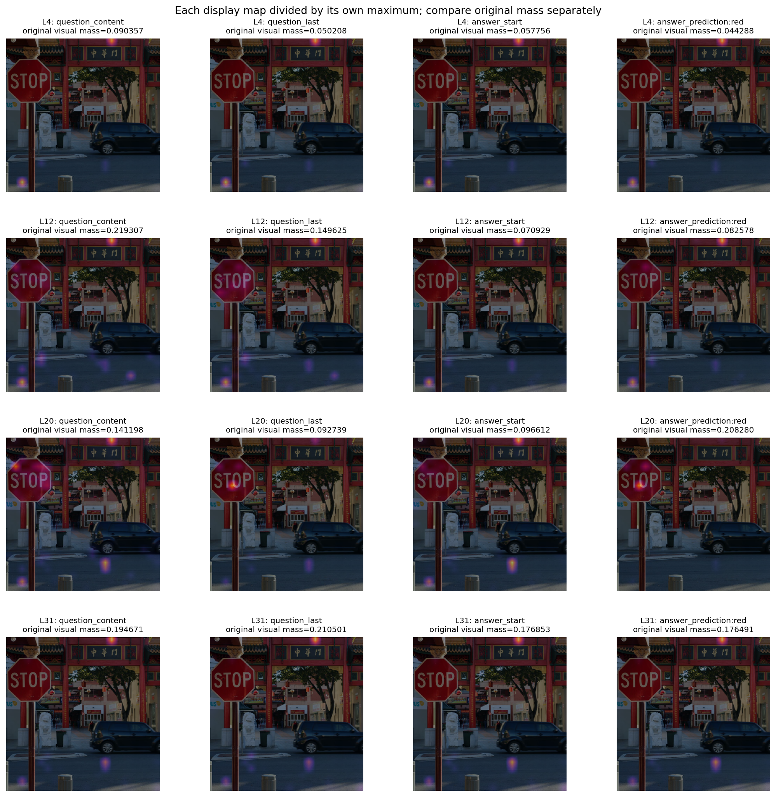
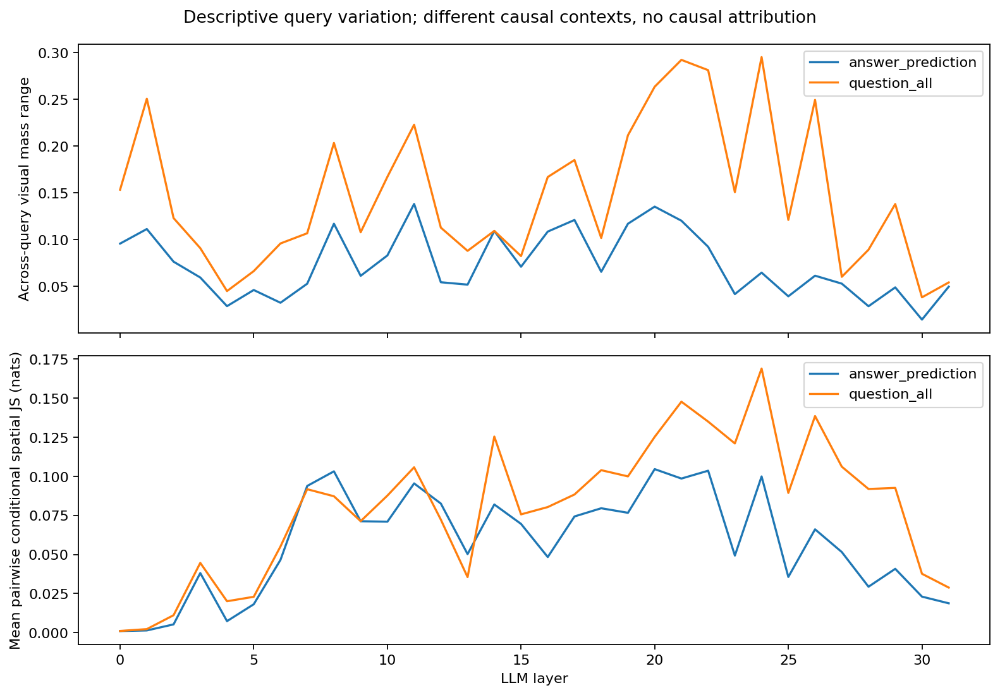
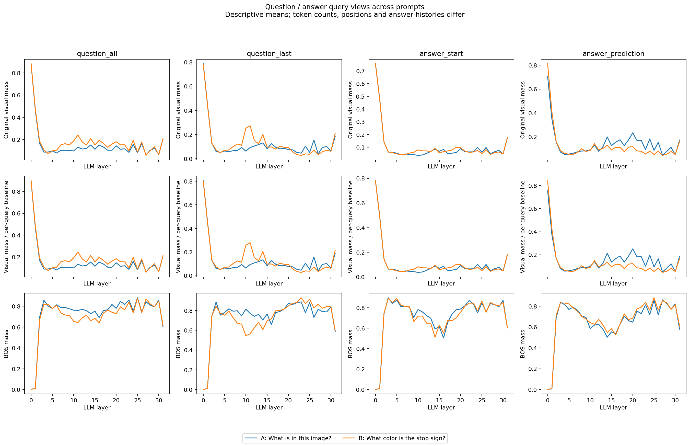

# Phase 2.1 实测报告：Question 与 Answer Prediction Attention

日期：2026-10-27（Asia/Shanghai）。本阶段完成；未实施 Attention Knockout、Token Pruning、Hook、Router 或训练。第一、第二阶段的既有代码和实验结果保持不变。

## 实验设置与来源

- 工程 `/home/zsy/ATE/vlm_research`，复用 `load_model()`、`prepare_inputs()` 和 Phase 2 的 Attention 统计、因果 Key mask、层汇总、空间绘图及分布距离函数，未修改旧脚本或第三方源码。
- Conda `vlm_research`；Python 3.11.18、PyTorch 2.6.0+cu124、Transformers 4.49.0、CUDA runtime 12.4，FP16、eager、eval、inference_mode、batch=1、use_cache=False，所有模型参数在一张 RTX 4090 的 cuda:0。没有创建环境、下载权重或安装/升级依赖。
- 模型 `llava-hf/llava-1.5-7b-hf`，revision `b234b804b114d9e37bb655e11cbbb5f5e971b7a9`。图片沿用第一阶段街景，视觉 Token 576，24×24；实际 CLIP 输入 336×336。
- A 问题：`What is in this image?`；答案直接读取 Phase 1 `results/validation.json` 的 `A_description`。来源标记 `model_generated`，重新编码 ID 与原生成 ID 去除 EOS 后逐项完全相同。
- B 问题：`What color is the stop sign?`；调用方参考答案 `The stop sign is red.`，来源标记 `ground_truth_teacher_forced`。该标签表示参考答案来源，不代表新增了外部真值验证或能力评测。
- A 的原始答案包含不能从图片明确确认的 fire hydrant；这里只沿用该生成轨迹，不把它当作事实标注。A 中的 red 修饰 building，B 中 red 对应 stop sign，不能把它们视为相同对象的单变量比较。

A 的实际答案：

> The image features a city street with a stop sign, a lion statue, and a red building. There is a black car driving down the street, and a person is walking nearby. The scene also includes a tree and a fire hydrant.

分析的是固定答案历史下的完整 Causal Forward；没有在本阶段调用 generate 或测量自由生成 Decode 轨迹。Teacher Forcing 的完整输入包含答案，但未来答案被因果 Mask 屏蔽。

## 三种 Query 定义

1. **Question → Image**：每个问题输入 Token 的当前位置 Query。问题字符范围由真实模板确定，Fast Tokenizer offsets 映射到原始 Token，再按实际 576 图像 Token 展开；整个展开序列的 ID 与 Processor 逐项核对。合并解码与问题逐字符完全一致，角色、BOS、分隔符、图像占位符都不算问题 Token。
2. **Answer-start → Image**：Query=P−1，即 `ASSISTANT:` 的最后一个 `:`，用来预测答案 a0。它不是第一个已生成答案 Token。
3. **Answer Prediction → Image**：答案 a_i 的目标位置=P+i，对应 Query=P−1+i。Query 本身是前一个已输入 Token。所有答案使用同一 Tokenizer、add_special_tokens=False；直接追加 IDs/mask，不重跑图像处理，不追加 BOS/EOS。

原始 Prompt IDs 与 attention_mask 前缀完全相同，pixel_values 保持同一对象。每个 Query 的 Key 组独立统计：visual、BOS、question、prompt_template、previous_answer，五组互斥并精确覆盖该 Query 的可访问 Key。prompt_text 与 other_text 是派生小计，不能重复加到五组中。

## 完整 Question Token 映射

### A：描述

| 序号 | 序列索引 | Token ID | Tokenizer Token | 问题内字符范围 | 可访问 Key | Uniform baseline |
| ---: | ---: | ---: | --- | --- | ---: | ---: |
| 0 | 583 | 5618 | `What` | [0,4) | 584 | 0.986301370 |
| 1 | 584 | 338 | `▁is` | [4,7) | 585 | 0.984615385 |
| 2 | 585 | 297 | `▁in` | [7,10) | 586 | 0.982935154 |
| 3 | 586 | 445 | `▁this` | [10,15) | 587 | 0.981260647 |
| 4 | 587 | 1967 | `▁image` | [15,21) | 588 | 0.979591837 |
| 5 | 588 | 29973 | `?` | [21,22) | 589 | 0.977928693 |

合并解码：`What is in this image?`，与输入问题完全一致。

### B：颜色

| 序号 | 序列索引 | Token ID | Tokenizer Token | 问题内字符范围 | 可访问 Key | Uniform baseline |
| ---: | ---: | ---: | --- | --- | ---: | ---: |
| 0 | 583 | 5618 | `What` | [0,4) | 584 | 0.986301370 |
| 1 | 584 | 2927 | `▁color` | [4,10) | 585 | 0.984615385 |
| 2 | 585 | 338 | `▁is` | [10,13) | 586 | 0.982935154 |
| 3 | 586 | 278 | `▁the` | [13,17) | 587 | 0.981260647 |
| 4 | 587 | 5040 | `▁stop` | [17,22) | 588 | 0.979591837 |
| 5 | 588 | 1804 | `▁sign` | [22,27) | 589 | 0.977928693 |
| 6 | 589 | 29973 | `?` | [27,28) | 590 | 0.976271186 |

合并解码：`What color is the stop sign?`，与输入问题完全一致。

B 的内容视图：color→Query 584；stop sign→Query 587、588。Question Last→589 (`?`)，Answer-start→594 (`:`)。A 的内容视图为 image→587，Question Last→588，Answer-start→593。

**因果解释限制**：color 所在 Query 尚不能访问后面的 stop sign 文本；stop Query 不能访问后面的 sign。整个输入并行 Forward 并不等于这些 Query 能读取完整问题。所有问题 Token 平均值只是不同可见历史下的描述性汇总，不应称作“完整问题的视觉注意力”。

## Answer Token 与预测 Query 的完整映射

B 的关键偏移：预测 red 的目标位置为 599，Query 为 **598（输入 is）**；Query 599 已经输入 red，它预测的是句点。

### B：颜色（6 个目标 Token）

| 答案序号 i | Token ID | 被预测 Token | Target Position | Query Position | Query 输入 Token | argmax 匹配目标 |
| ---: | ---: | --- | ---: | ---: | --- | --- |
| 0 | 450 | `▁The` | 595 | 594 | `:` | 是 |
| 1 | 5040 | `▁stop` | 596 | 595 | `▁The` | 是 |
| 2 | 1804 | `▁sign` | 597 | 596 | `▁stop` | 是 |
| 3 | 338 | `▁is` | 598 | 597 | `▁sign` | 是 |
| 4 | 2654 | `▁red` | 599 | 598 | `▁is` | 是 |
| 5 | 29889 | `.` | 600 | 599 | `▁red` | 是 |

### A：Phase 1 生成描述（50 个目标 Token）

| 答案序号 i | Token ID | 被预测 Token | Target Position | Query Position | Query 输入 Token | argmax 匹配目标 |
| ---: | ---: | --- | ---: | ---: | --- | --- |
| 0 | 450 | `▁The` | 594 | 593 | `:` | 是 |
| 1 | 1967 | `▁image` | 595 | 594 | `▁The` | 是 |
| 2 | 5680 | `▁features` | 596 | 595 | `▁image` | 是 |
| 3 | 263 | `▁a` | 597 | 596 | `▁features` | 是 |
| 4 | 4272 | `▁city` | 598 | 597 | `▁a` | 是 |
| 5 | 11952 | `▁street` | 599 | 598 | `▁city` | 是 |
| 6 | 411 | `▁with` | 600 | 599 | `▁street` | 是 |
| 7 | 263 | `▁a` | 601 | 600 | `▁with` | 是 |
| 8 | 5040 | `▁stop` | 602 | 601 | `▁a` | 是 |
| 9 | 1804 | `▁sign` | 603 | 602 | `▁stop` | 是 |
| 10 | 29892 | `,` | 604 | 603 | `▁sign` | 是 |
| 11 | 263 | `▁a` | 605 | 604 | `,` | 是 |
| 12 | 301 | `▁l` | 606 | 605 | `▁a` | 是 |
| 13 | 291 | `ion` | 607 | 606 | `▁l` | 是 |
| 14 | 24870 | `▁statue` | 608 | 607 | `ion` | 是 |
| 15 | 29892 | `,` | 609 | 608 | `▁statue` | 是 |
| 16 | 322 | `▁and` | 610 | 609 | `,` | 是 |
| 17 | 263 | `▁a` | 611 | 610 | `▁and` | 是 |
| 18 | 2654 | `▁red` | 612 | 611 | `▁a` | 是 |
| 19 | 5214 | `▁building` | 613 | 612 | `▁red` | 是 |
| 20 | 29889 | `.` | 614 | 613 | `▁building` | 是 |
| 21 | 1670 | `▁There` | 615 | 614 | `.` | 是 |
| 22 | 338 | `▁is` | 616 | 615 | `▁There` | 是 |
| 23 | 263 | `▁a` | 617 | 616 | `▁is` | 是 |
| 24 | 4628 | `▁black` | 618 | 617 | `▁a` | 是 |
| 25 | 1559 | `▁car` | 619 | 618 | `▁black` | 是 |
| 26 | 19500 | `▁driving` | 620 | 619 | `▁car` | 是 |
| 27 | 1623 | `▁down` | 621 | 620 | `▁driving` | 是 |
| 28 | 278 | `▁the` | 622 | 621 | `▁down` | 是 |
| 29 | 11952 | `▁street` | 623 | 622 | `▁the` | 是 |
| 30 | 29892 | `,` | 624 | 623 | `▁street` | 是 |
| 31 | 322 | `▁and` | 625 | 624 | `,` | 是 |
| 32 | 263 | `▁a` | 626 | 625 | `▁and` | 是 |
| 33 | 2022 | `▁person` | 627 | 626 | `▁a` | 是 |
| 34 | 338 | `▁is` | 628 | 627 | `▁person` | 是 |
| 35 | 22049 | `▁walking` | 629 | 628 | `▁is` | 是 |
| 36 | 20810 | `▁nearby` | 630 | 629 | `▁walking` | 是 |
| 37 | 29889 | `.` | 631 | 630 | `▁nearby` | 是 |
| 38 | 450 | `▁The` | 632 | 631 | `.` | 是 |
| 39 | 9088 | `▁scene` | 633 | 632 | `▁The` | 是 |
| 40 | 884 | `▁also` | 634 | 633 | `▁scene` | 是 |
| 41 | 7805 | `▁includes` | 635 | 634 | `▁also` | 是 |
| 42 | 263 | `▁a` | 636 | 635 | `▁includes` | 是 |
| 43 | 5447 | `▁tree` | 637 | 636 | `▁a` | 是 |
| 44 | 322 | `▁and` | 638 | 637 | `▁tree` | 是 |
| 45 | 263 | `▁a` | 639 | 638 | `▁and` | 是 |
| 46 | 3974 | `▁fire` | 640 | 639 | `▁a` | 是 |
| 47 | 27246 | `▁hyd` | 641 | 640 | `▁fire` | 是 |
| 48 | 21867 | `rant` | 642 | 641 | `▁hyd` | 是 |
| 49 | 29889 | `.` | 643 | 642 | `rant` | 是 |

B 的 6 个目标、A 的 50 个目标在本次 Teacher Forcing 中均与对应位置 argmax 一致；这仅用于轨迹功能核对，不是模型能力或人工答案正确性评测。A 的生成结束 EOS 未作为本阶段目标，答案没有额外 BOS。

## 32 层原始统计与文件

A 的 Transformer Attention 每层为 `[1,32,644,644]`，B 为 `[1,32,601,601]`，均返回 32 层。A 有 56 个唯一 Query（6 个问题 + 50 个预测位置），B 有 13 个唯一 Query（7+6）；Answer-start 与预测 a0 共用一份权重。

- A：`description/head_statistics.csv` 共 57,344 行；B：`head_statistics.csv` 共 13,312 行。每行包含 Layer、Head、Query、目标 ID/文本/位置、五组质量、各组 Key 数、均匀基线、D、R、视觉条件熵、Top-58 Patch 原始质量与条件份额。
- D=M_visual/(N_visual/N_accessible)；R=(M_visual/N_visual)/(M_nonvisual/N_nonvisual+1e-12)。两者都沿用 Phase 2 定义，但使用各自 Query 的可访问 Key 数。B 的 color 基线为 576/585，预测 red 为 576/599，不能统一套用 576/595。
- 条件视觉熵先将视觉权重除以视觉总质量，再计算 -Σp ln p；Top-10% 使用 ceil(57.6)=58 Patch，保留其条件份额。BOS 独立，不当成普通文本。
- `selected_query_attention.npz` 保存原始 FP16 `[32,32,N_unique_query,N_sequence_keys]`，只保存所选 Query 行，没有全层完整 S×S 矩阵。通过两次 np.take 可取出 `[32,32,N_question,576]` 或答案预测的视觉权重。
- `position_metadata.json`、Question/Answer mapping CSV 保存完整索引与来源；逐 Query / 逐视图汇总、九层空间图、原始 Grid、Head 热图以及跨问题图均保留。文件说明与命令见 [README](../../README.md)。

## B：Question Last、Answer-start 与语义目标比较

下表为 32 个 Head 的平均原始视觉质量。stop sign 为两个 Query 的无权重平均；这些列具有不同上下文和基线。

| 层 | color 输入 Query | stop/sign 输入 Query 均值 | Question Last (?) | Answer-start / 预测 The | 预测 red |
| ---: | ---: | ---: | ---: | ---: | ---: |
| 0 | 0.934831 | 0.893438 | 0.781526 | 0.755446 | 0.790038 |
| 4 | 0.085135 | 0.092969 | 0.050208 | 0.057756 | 0.044288 |
| 8 | 0.176418 | 0.255349 | 0.121638 | 0.054379 | 0.059659 |
| 12 | 0.209264 | 0.224328 | 0.149625 | 0.070929 | 0.082578 |
| 16 | 0.243354 | 0.171660 | 0.096882 | 0.065487 | 0.171337 |
| 20 | 0.173517 | 0.125039 | 0.092739 | 0.096612 | 0.208280 |
| 24 | 0.212300 | 0.139157 | 0.039361 | 0.075548 | 0.125947 |
| 28 | 0.095508 | 0.078905 | 0.056884 | 0.058402 | 0.066592 |
| 31 | 0.207222 | 0.188396 | 0.210501 | 0.176853 | 0.176491 |

- 不同问题 Token 的视觉访问不同。例：L16 color 的视觉质量 0.243354，而 Question Last 为 0.096882；这不代表 color 的语义贡献更强，因为位置与可见前缀不同。
- Question Last 与 Answer-start 不可替代：L12 分别为 0.149625、0.070929，L24 为 0.039361、0.075548，大小关系随层变化。
- 预测 red 与预测 The 不同：L20 原始视觉质量分别为 0.208280、0.096612，D 分别约 0.2166、0.0998；red 的 BOS 质量 0.559341，The 为 0.755753。预测 red 时已有答案质量为 0.072521，因此不能简单把 BOS 减少全部解释成“转移给视觉”。
- 差异并非所有层都成立：L4 预测 red 的视觉质量 0.044288，低于预测 The 的 0.057756；L31 二者接近，分别 0.176491、0.176853。

### 预测 red 的空间分布

预测 red 的 `[0,4,8,12,16,20,24,28,31]` 层均已输出独立 Grid/叠图和原始概率。L20 最大 Patch 为 (row=7,col=3)，位于处理后图片的 STOP 标志区域；L16 最大 Patch 为 (4,1)。但 L12、L24、L31 仍以 (0,16) 背景 Patch 为最大值。这是空间分布观察，没有人工 ROI 或分割掩码，不量化目标定位正确率，也不证明这些 Patch 对答案必要。

所有底图均来自实际 pixel_values 反归一化，并与 Phase 2 保存的 CLIP 输入逐像素一致；不使用原始 1300×876 的坐标直接叠图。颜色各自按最大值缩放，仅供查看空间形状，标题标注原始质量，不能用亮度比较不同层总视觉关注。

## Query 特异性的层级规律

新增统计对每个 Query 的 Head 平均视觉图分别条件化，计算同一类型所有 Token 两两之间的 JS（自然对数）和 TV。它只描述视觉集合内部形状差异，已舍弃原始总质量；不同 Query 的可见历史也不同。图中另列原始视觉质量最大值−最小值。

| 样本 / Query 类型 | 0–3 层平均两两 JS | 4–11 | 12–23 | 24–31 | JS 最大层 |
| --- | ---: | ---: | ---: | ---: | ---: |
| A / question_all | 0.004782 | 0.023479 | 0.051811 | 0.051855 | 22 |
| A / answer_prediction | 0.007242 | 0.080693 | 0.163981 | 0.106721 | 14 |
| B / question_all | 0.014772 | 0.067690 | 0.100800 | 0.094182 | 24 |
| B / answer_prediction | 0.011454 | 0.063304 | 0.076557 | 0.045622 | 20 |

B 的答案预测 Query 的空间分布差异在中层更大、深层平均减小；但 B 的 Question Query 差异峰值反而在 L24，A 的 Question 在 12–23 与 24–31 的平均 JS 几乎相同。**不支持把“深层不再体现 Query 差异”当成普遍规律。**许多中深层的 BOS 质量依然很高，普通文本与 BOS 必须分开讨论。

A/B 的问题长度、Query 位置、答案内容和目标 Token 数不同，A 预测 50 个目标、B 仅 6 个；比较视图均值时还混入 Token 组成差异。即使 D 做了可访问 Key 计数归一化，也未消除这些混杂因素。

## 数值排查与 Phase 2 一致性

首次 B Smoke Test 因跨长度 Attention 超出最初阈值而主动停止。已检查 installed Transformers 4.49.0 的 LLaMA 默认位置编码和因果 Mask 实现：无 cache 时 position_ids 为从 0 开始的 cache_position；Prompt 前缀位置不变。随后引入 **相同长度但把全部答案替换为 padding 并遮蔽的 Prompt 控制**：它的前缀因果 Mask、Prompt 最后位置 logits 和 Attention 与 Teacher Forcing 完全相同。答案的内容与 mask 改变不会影响可见前缀，而序列长度改变会带来 FP16 计算差异；未修改第三方源码或 Attention。

| 比较 | A | B |
| --- | ---: | ---: |
| 原始 Prompt 视觉行 vs Phase 2 最大差异 | 0.000000000000 | 0.000000000000 |
| Teacher vs 原始 Prompt 最后 logits 最大差异 | 0.015625000000 | 0.015625000000 |
| Teacher vs 原始 Prompt 最后 Attention 最大差异 | 0.003173828125 | 0.002197265625 |
| Teacher vs 原始 Prompt 最后 Attention 最大行 L1 | 0.006723284721 | 0.005699217319 |
| Teacher vs Phase 2 视觉行最大差异 | 0.000366210938 | 0.000366210938 |
| Teacher vs Phase 2 非视觉行最大差异 | 0.003173828125 | 0.002197265625 |
| 等长度 masked control vs Teacher logits 最大差异 | 0.000000000000 | 0.000000000000 |
| 等长度 masked control vs Teacher 前缀 Attention 最大差异 | 0.000000000000 | 0.000000000000 |

B 的独立诊断将最大差异定位在 L27 / Head 7 / Key 591（`SS` 模板子词）：权重从 0.26171875 到 0.263916015625，差 0.002197265625。B 的视觉行最大差异只有 0.0003662109375。详见 [shape_diagnostic.json](shape_diagnostic.json)；最初严格阈值未通过的事实仍保留在每个 `forward_consistency.json` 中，未伪装成逐元素相同。

验证标准：保留严格诊断 atol=5e-4、rtol=5e-3；跨长度比较使用 atol=3e-3、rtol=5e-3，同时要求整行 L1≤0.02、第一目标 argmax 不变、等长度 masked control 精确一致。Logits 使用 atol=0.02、rtol=0.002。A 的绝对最大概率差异约 0.003174，满足绝对+相对联合阈值，最大行 L1 为约 0.006723。这里的容差依据实际隔离实验解释，不是忽略不一致；无法给出所有输入通用的 FP16 误差保证。

| 正确性项目 | 结果 |
| --- | --- |
| Question Token 字符覆盖、拼接与实际 Processor IDs | A/B 均精确通过 |
| 原始 Prompt IDs/mask 前缀不变、pixel_values 同一对象 | 通过 |
| BOS 数量 / 视觉 Token 数量 | 1 / 576 |
| 答案目标与 Query 的 P−1+i 对齐 | 全部通过，red 明确为 q598→t599 |
| 所选 Query 对未来/不可访问 Key 的权重 | 全部严格为 0 |
| 权重和最大绝对误差 A/B | 0.000370085239 / 0.000341713428，阈值 0.002 |
| 完整 Attention 矩阵及 logits 的 NaN/Inf | 均无 |
| 五组互斥完备、分组质量与原始 Query 权重及 CSV 一致 | 全部通过 |
| 相关单元/归档核验测试 | 17 项全部通过 |

测试输出：[unit_test_results.txt](unit_test_results.txt)，文件核验摘要：[artifact_validation.json](artifact_validation.json)。独立归档测试读取所有 70,656 条逐 Head 记录，按真实 Key 重新计算五组质量，检查因果性、所有 Query 行和及映射；没有只检查 Head 平均。

## 真实时间与 GPU 显存

以下为已成功完整运行的测量。CUDA 同步后的 Forward 不包含加载、CPU 统计或绘图。Prompt 控制是冷启动，不能拿它与后续 Teacher Forward 的时间比评价优化。整次耗时为原始成功运行，不含后续离线新增的 Query 特异性统计/重绘与跨问题绘图。

| 项目 | A | B |
| --- | ---: | ---: |
| 加载秒 | 8.435929 | 8.174069 |
| 原始 Prompt Forward 秒 | 0.497122 | 0.546812 |
| Teacher-forced Forward 秒 | 0.110071 | 0.084897 |
| 等长度 masked control Forward 秒 | 0.088338 | 0.084044 |
| Teacher 完整矩阵校验与 Query CPU 拷贝秒 | 0.301975 | 0.271712 |
| 原始成功运行总秒（不含模型加载） | 22.548028 | 10.064979 |
| 加载后 allocated MiB | 13473.647949 | 13473.647949 |
| Teacher Forward allocated 峰值 MiB | 14428.085938 | 14312.113770 |
| Teacher + 校验 allocated 峰值 MiB | 14459.923828 | 14344.943359 |
| 三次 Forward/校验最大 allocated 峰值 MiB | 14459.923828 | 14344.953125 |
| 三次 Forward/校验最大 reserved 峰值 MiB | 15304.000000 | 15206.000000 |
| 清理输入/Attention 后 allocated MiB | 13505.653320 | 13505.652832 |

显存包含完整驻留模型；驱动侧进程显存为采样值，不当作真实峰值。GPU 大矩阵在每层抽出所选 Query 行后释放，CPU/磁盘保留 FP16 小型行和必要汇总，不量化、不 offload。两个样本的成功 Forward 均无 OOM。

### 后续复跑遇到外部 GPU 占用

在两个样本成功并保存后，最终复跑时 GPU 0 新进程 2265913 占用约 16–17 GiB；B 和 A 在 **模型加载阶段** 分别发生 OOM（尚未进入实验 Forward）。GPU 1 同时也有其他任务，没有切换或终止任何进程，没有更换权重/环境。失败记录单独归档为各样本的 `diagnostics/final_rerun_model_loading_oom.json`，元数据 `latest_gpu_rerun` 明确标注；此前成功数据和测量未被覆盖。当前完整实验与离线核验均已完成；若要再次运行 CLI，应先确保单张 GPU 有约 15 GiB 以上的空闲显存并留有余量。

## 下一阶段建议（仅设计，未实施）

1. 优先以 B 的 q598→red 为固定目标，并用 q594→The、Question Last q589（输入 `?`）与 Question Content q584（输入 `color`）作描述性参考，不能把不同目标/历史直接当成严格因果对照。关注 L12、L16、L20，同时保留 L24、L28、L31 作为后层对照，避免只挑最显著图。
2. 若用户授权 Knockout，可在固定 Query/Layer/相同完整上下文下比较同数量视觉 Patch 的不同选择（较高注意力、随机、较低注意力），多次随机对照；BOS 与模板/已有答案另设控制，控制整体可访问 Token 数与归一化变化。具体干预定义需先明确，不能从低 Attention 自动推断安全删除。
3. 比较固定目标 red 的 log-probability、竞争颜色词的 logit margin，再核对整句轨迹；不要把归一化热图亮度或单次回答正确性当作效应。Teacher Forcing 与实际生成实验应分别记录。
4. 扩充图片、问题与颜色属性，加入处理后坐标系的对象 ROI / 反事实图像，控制 Prompt 长度和位置。先验证干预实现与 Mask 数值，再讨论视觉必要性；本阶段没有执行任何一项干预。

## 解释边界

本阶段确认不同 Question Token、Answer-start 与答案预测位置具有不同的 Attention 层级/空间分布。单张图片、两条问题、固定答案、不同可见历史和 FP16 误差限制了可推广性。Head 平均可能掩盖差异，条件化视觉图可能放大低总质量的空间热点，BOS 质量不能当作普通文本信息吸收。

**Attention Probability 不等于因果贡献；本结果不证明视觉信息已经被文本完全吸收，不证明某层以后可安全移除视觉 Token。Phase 2.1 完成后停止。**
