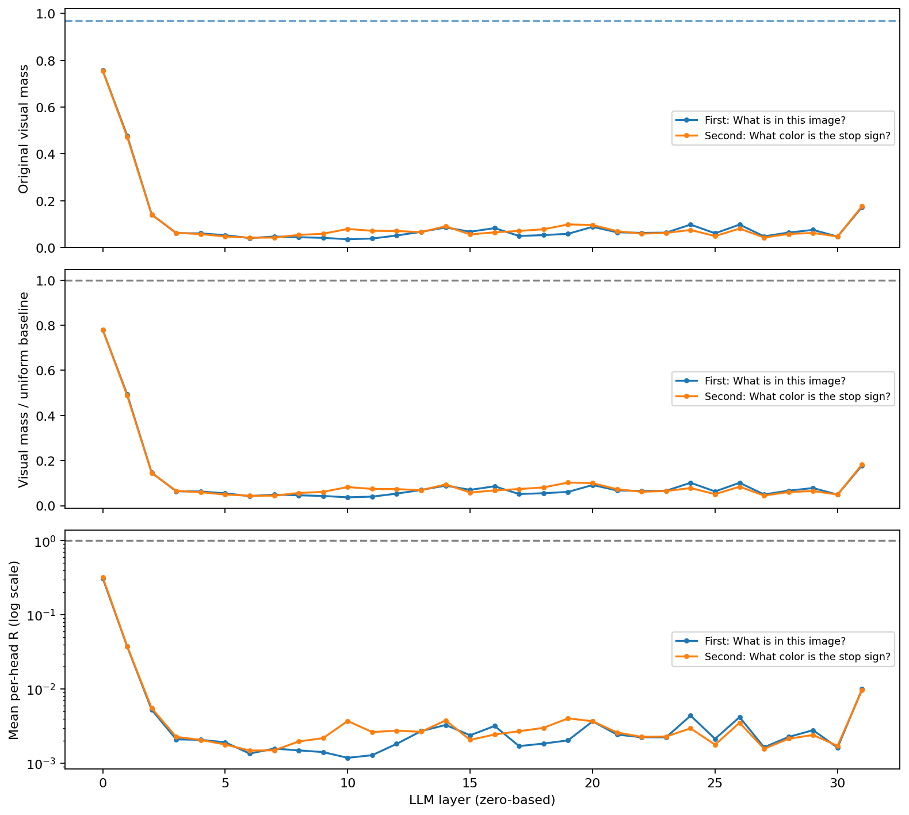
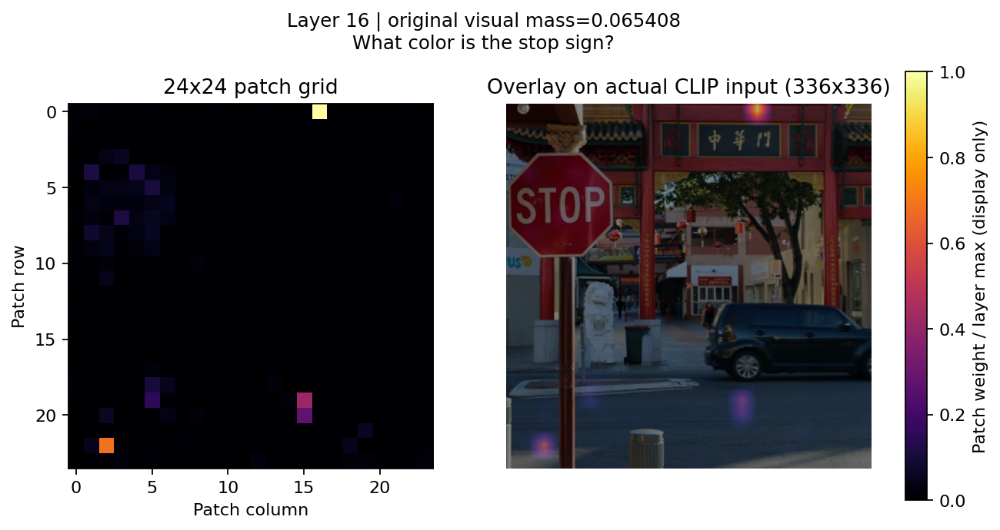
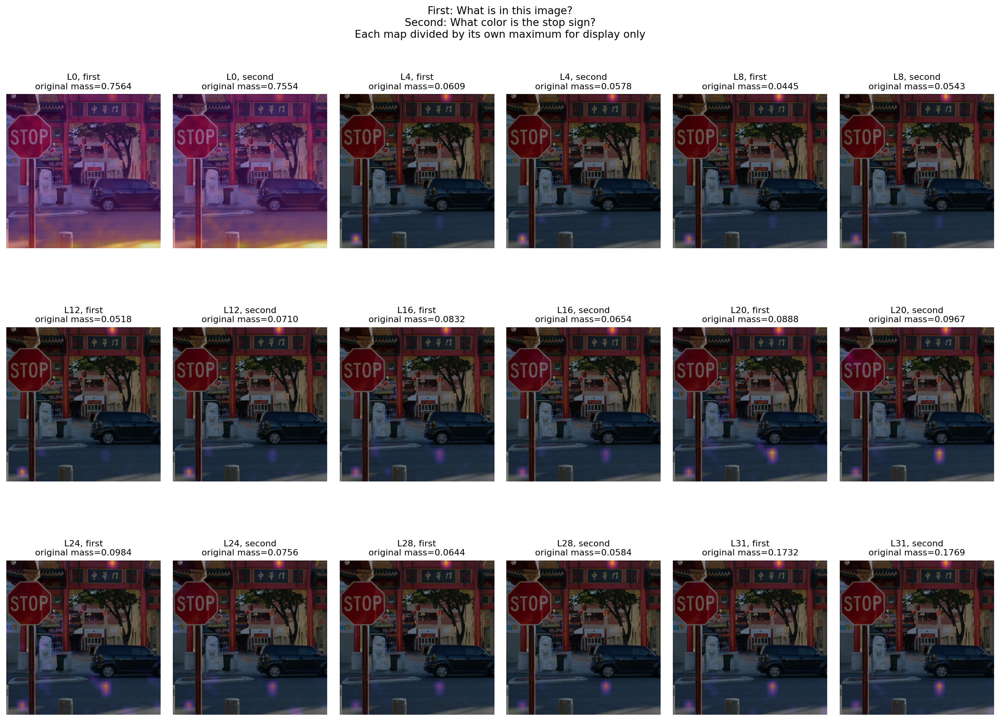
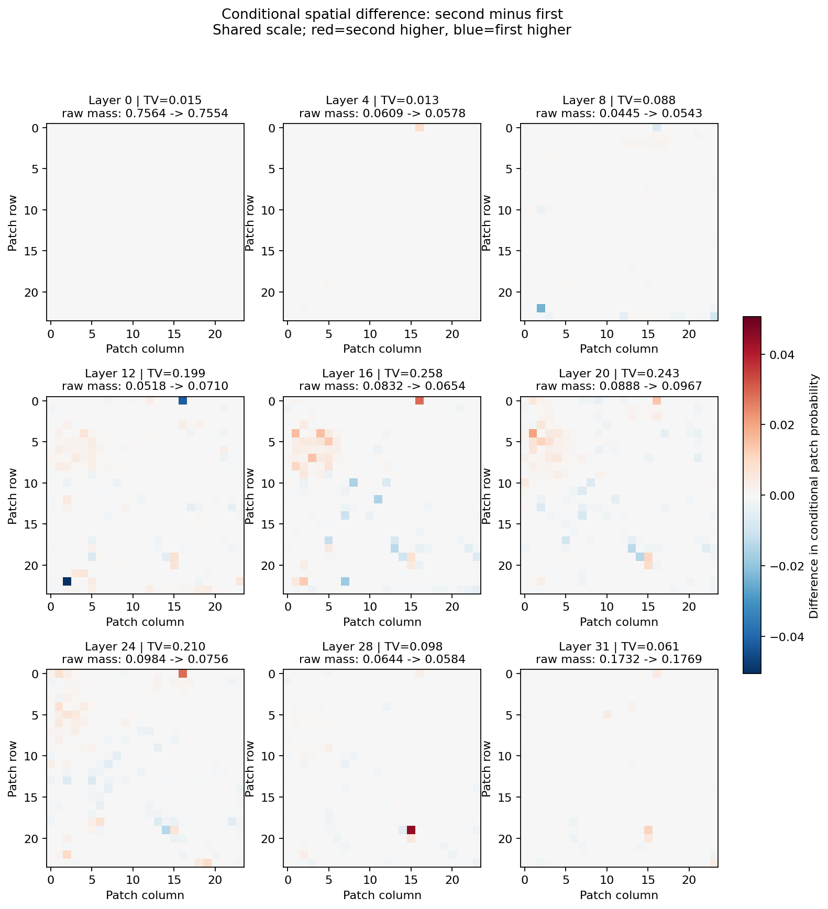

# 第二阶段实测报告：Prompt Prefill Text-to-Visual Attention

日期：2026-10-27（Asia/Shanghai）。第二阶段完成；本报告仅包含描述性 Attention 观察，未开展 Attention Knockout。

## 实验与复现边界

- 沿用 Conda `vlm_research`：Python 3.11.18、PyTorch 2.6.0+cu124、Transformers 4.49.0、CUDA runtime 12.4；NVIDIA driver 595.99.02。未重建环境、下载模型、安装或升级任何依赖。`pip check` 通过。
- 模型 `llava-hf/llava-1.5-7b-hf`，revision `b234b804b114d9e37bb655e11cbbb5f5e971b7a9`，7,063,427,072 参数。所有 FP16 参数驻留单张 RTX 4090 的 cuda:0，视觉/语言均为 eager，eval + inference_mode。
- 仅使用物理 GPU 0；物理 GPU 1 正在运行另一个任务，未操作。全部推理显式离线。
- 原有 `vlm_common.py`、`inference.py`、`inspect_model.py`、`validate.py`、依赖锁文件和 `configs/model.json` 均未修改。新脚本直接复用 `load_model()`、`prepare_inputs()`。
- 使用第一阶段本地街景图 `test_images/example.jpg`，原始 1300×876，来源见 [SOURCE.md](../../test_images/SOURCE.md)。
- 问题 A：`What is in this image?`；问题 B：`What color is the stop sign?`。
- 完整 Prompt Forward、batch=1、`use_cache=False`，未调用 generate，没有 Decode Token Attention 或 Hook。

## 形状、索引与数值验收

| 项目 | A：图像描述 | B：标志颜色 |
| --- | --- | --- |
| LLM Attention 层数 | 32 | 32 |
| 第 0–31 层各层完整形状 | [1,32,594,594] | [1,32,595,595] |
| Query 索引 / Token | 593 / `:`，id=29901 | 594 / `:`，id=29901 |
| 视觉 Key 索引（含首尾） | 5–580，共 576 | 5–580，共 576 |
| 当前 Query 可访问 Key | 594 = 576+18 | 595 = 576+19 |
| 实际投影视觉特征 | [1,576,4096] | [1,576,4096] |
| 均匀视觉基线 | 0.969696970 | 0.968067227 |
| 32×32 个 Query 行的最大权重和绝对误差 | 0.000304222107 | 0.000304520130 |
| 完整 Attention 矩阵有限、非负 | 全部通过 | 全部通过 |
| Attention 开关：完整 logits 最大/平均差异 | 0 / 0 | 0 / 0 |
| Attention 开关：全部位置 argmax、下一 Token argmax | 完全相同 | 完全相同 |
| 下一 Token（不是完整生成答案） | `The`，id=450 | `The`，id=450 |

权重和在 CPU FP64 中累加，验收阈值为绝对误差 0.002，考虑 eager softmax 最终返回 FP16 概率。视觉精确索引来自真实 input_ids 比较 image_token_index=32000；不是通过字符串长度估算。每层形状和误差分别记录在两个 `attention_statistics.json` 的 `validation.layers` 中。

对照使用同一模型实例、同一输入、相同 use_cache=False；唯一不同的是 output_attentions。比较了整个 Prompt 的词表 logits，而非只比较生成字符串。全部 logits 有限且逐元素完全一致，最后位置也一致。不存在 Attention 开关导致最终预测改变的证据。

已检查安装版本的 `modeling_llava.py`、`modeling_llama.py`、`modeling_clip.py`：LLaVA 按 image mask 的顺序填入投影后的图像特征，并返回 language_model 的 attentions；CLIP patch embedding 通过 flatten(2).transpose(1,2) 按行展开，CLS 位于最前并在 default 特征选择中移除。eager 使用同一 softmax/矩阵乘法路径；未修改第三方库。

## 统计量定义

- 所有计数仅包括当前 Query 实际可访问的 Key：attention_mask 非零且 key_index≤query_index。非视觉集合包含 BOS、问题文本、角色模板、分隔符与 Query 自身；它不等同于纯自然语言单词集合。
- 原始视觉质量 Mv=Σ视觉权重；非视觉质量 Mn=Σ其他可访问权重；二者之和约为 1。
- Uniform baseline B=Nv/(Nv+Nn)，本次视觉 Token 占约 97%。视觉密度 D=Mv/B，以 1 为均匀参考。
- R=(Mv/Nv)/(Mn/Nn+1e-12)，以 1 为视觉/非视觉每 Token 等密度参考。每层曲线画 mean_head(R)，不是先平均质量再求比。
- 视觉条件熵 H=-Σp ln p，其中 p=a_visual/Mv；同时保存 H/ln(Nv)。它衡量视觉集合内部集中度，不是全体 Key 的熵。零质量的未定义熵有显式标志。
- Top-10% 使用 ceil(0.1×576)=58 个 Patch（约 10.07%），逐 Head 选择最大权重，保存其原始质量及视觉内部条件份额。
- 层曲线/空间图为 Head 平均；曲线的 SD 是 Head 离散程度，不是置信区间。各 Head 可有显著差异。

## 各层质量与归一化曲线

以下为各层 32 个 Head 的平均值，所有层编号从 0 开始。D 为相对均匀密度，R 为逐 Head 密度比的平均。完整标准差、熵、Top-10% 与逐 Head 数值见 CSV/JSON。

| 层 | A Mv | B Mv | A D | B D | A R | B R |
| ---: | ---: | ---: | ---: | ---: | ---: | ---: |
| 0 | 0.756388 | 0.755446 | 0.780025 | 0.780365 | 0.311911 | 0.322851 |
| 1 | 0.478111 | 0.472636 | 0.493052 | 0.488226 | 0.037393 | 0.037709 |
| 2 | 0.141473 | 0.140685 | 0.145894 | 0.145326 | 0.005259 | 0.005521 |
| 3 | 0.061914 | 0.063232 | 0.063849 | 0.065318 | 0.002101 | 0.002269 |
| 4 | 0.060932 | 0.057777 | 0.062837 | 0.059683 | 0.002068 | 0.002064 |
| 5 | 0.053134 | 0.047633 | 0.054795 | 0.049204 | 0.001919 | 0.001789 |
| 6 | 0.040910 | 0.042556 | 0.042189 | 0.043960 | 0.001350 | 0.001484 |
| 7 | 0.047501 | 0.042973 | 0.048985 | 0.044390 | 0.001578 | 0.001494 |
| 8 | 0.044511 | 0.054315 | 0.045902 | 0.056106 | 0.001493 | 0.001967 |
| 9 | 0.041744 | 0.059373 | 0.043049 | 0.061332 | 0.001415 | 0.002183 |
| 10 | 0.035883 | 0.079775 | 0.037004 | 0.082407 | 0.001184 | 0.003712 |
| 11 | 0.038798 | 0.071865 | 0.040010 | 0.074236 | 0.001286 | 0.002636 |
| 12 | 0.051760 | 0.070993 | 0.053377 | 0.073335 | 0.001825 | 0.002749 |
| 13 | 0.067542 | 0.066309 | 0.069652 | 0.068497 | 0.002710 | 0.002657 |
| 14 | 0.086152 | 0.091228 | 0.088844 | 0.094237 | 0.003286 | 0.003785 |
| 15 | 0.067974 | 0.056505 | 0.070098 | 0.058369 | 0.002382 | 0.002067 |
| 16 | 0.083234 | 0.065408 | 0.085835 | 0.067565 | 0.003182 | 0.002442 |
| 17 | 0.049935 | 0.071310 | 0.051496 | 0.073662 | 0.001703 | 0.002703 |
| 18 | 0.053471 | 0.078370 | 0.055142 | 0.080955 | 0.001843 | 0.003006 |
| 19 | 0.059189 | 0.099227 | 0.061038 | 0.102500 | 0.002036 | 0.004034 |
| 20 | 0.088768 | 0.096698 | 0.091541 | 0.099887 | 0.003671 | 0.003682 |
| 21 | 0.065505 | 0.070349 | 0.067552 | 0.072670 | 0.002437 | 0.002597 |
| 22 | 0.063146 | 0.059649 | 0.065120 | 0.061617 | 0.002241 | 0.002270 |
| 23 | 0.064038 | 0.062927 | 0.066039 | 0.065002 | 0.002236 | 0.002289 |
| 24 | 0.098426 | 0.075566 | 0.101502 | 0.078059 | 0.004387 | 0.002957 |
| 25 | 0.061119 | 0.049404 | 0.063029 | 0.051034 | 0.002133 | 0.001779 |
| 26 | 0.098351 | 0.081441 | 0.101425 | 0.084128 | 0.004187 | 0.003518 |
| 27 | 0.048195 | 0.043366 | 0.049702 | 0.044797 | 0.001643 | 0.001568 |
| 28 | 0.064428 | 0.058358 | 0.066441 | 0.060283 | 0.002260 | 0.002142 |
| 29 | 0.075689 | 0.062779 | 0.078055 | 0.064850 | 0.002795 | 0.002408 |
| 30 | 0.047348 | 0.047543 | 0.048828 | 0.049111 | 0.001625 | 0.001716 |
| 31 | 0.173207 | 0.176859 | 0.178620 | 0.182693 | 0.009973 | 0.009702 |

- 第 0 层两者 Mv 约 0.756，第 1 层约 0.47，第 2 层约 0.14，随后降低并波动，第 31 层回升至约 0.17；不是随层数单调衰减。
- A 在第 10 层达到最低平均质量 0.035883；B 在第 6 层最低为 0.042556。第 10 层 B 比 A 增加 0.043892，约 4.39 个百分点；第 19 层也上升，但第 16、24、26 层 B 反而更低。
- 所有层的 Head 平均 D 和 R 都低于 1，不能把第 0 层 75% 的视觉质量解释成高于 Token 数量的偏好。逐 Head 仍有例外：两个问题都在第 0 层 Head 7、24 出现 R>1；不能将层平均结论推广到每个 Head。

## 空间恢复与问题差异

CLIP 实际处理为短边 Resize 至 336 后 Center Crop 到 336×336。叠图采用真实输入 pixel_values 反归一化，包含 FP16 量化与 uint8 舍入，避免原图坐标错配。576 Patch 恢复为 24×24；每个可视化面板标出该层原始 Mv，显示时仅除以本层最大 Patch 权重。未叠图的精确 24×24 PNG 与原始概率 NPY 同时保存。

指定的 9 层均保存独立空间图。下图展示问题 B 的第 16 层，原始视觉质量只有 0.065408，不能因显示归一化后的亮点而称其整体视觉关注很高。

为比较空间形状，先将 Head 平均的原始视觉图各自除以总质量得到 p、q，再计算 TV=0.5Σ|p−q|、JS（自然对数）及余弦相似度。差值图使用共同的对称色标，方向为 B−A，不能比较各自单独拉伸后的颜色深浅。该条件化会舍去总质量，因此必须结合上面的 Mv 曲线。

| 层 | 条件空间 TV | JS（nats） | 余弦相似度 |
| ---: | ---: | ---: | ---: |
| 0 | 0.015357 | 0.000222 | 0.999251 |
| 4 | 0.012986 | 0.000183 | 0.999862 |
| 8 | 0.088187 | 0.007342 | 0.997298 |
| 10 | 0.300623 | 0.084141 | 0.908614 |
| 12 | 0.198625 | 0.037653 | 0.988934 |
| 14 | 0.453110 | 0.182384 | 0.796647 |
| 16 | 0.257669 | 0.070590 | 0.957720 |
| 20 | 0.242632 | 0.051281 | 0.947715 |
| 24 | 0.209938 | 0.036284 | 0.949646 |
| 28 | 0.098123 | 0.009396 | 0.981731 |
| 31 | 0.061404 | 0.003053 | 0.996837 |

- 初层问题间空间分布接近：L0 TV=0.015357，L4 TV=0.012986；全 32 层中差异最大的 L14 TV=0.453110、JS=0.182384。质量差异最大层与空间形状差异最大层不同。L31 又较接近，TV=0.061404。
- 差值图在部分中层的 STOP 标志附近显示相对权重增加，但没有人工物体掩码、ROI 标注或定位能力评测，不能据此量化对象识别效果。
- 多个选定层的最大 Patch 位于网格 (row=0,col=16)，而非 STOP 标志；L4 最大值在 (22,2)。例如 A 的 L20 最大值在 (19,15)，B 则在 (0,16)。这些背景/边缘热点和问题间共有的热点均保留，未通过阈值裁掉以美化结果。
- 两个问题长度也相差 1 Token，Query 虽然都是 `:`，位置不同。因此比较混合了语义、文本分词与位置因素，并非严格的单变量因果实验。

## 显存与运行时间

计时使用 CUDA synchronize。Forward 只计模型调用，不含加载、输入处理、CPU 拷贝、logits 比较、统计或绘图。整次运行总时长包含这些工作。对照为首个冷 Forward，Attention Forward 在其后，不能将两者耗时比视为性能结论。

| 项目 | A：描述 | B：颜色 |
| --- | ---: | ---: |
| 模型加载秒 | 4.519153 | 4.165362 |
| 输入处理秒 | 0.023493 | 0.020720 |
| 对照 Forward 秒（不返回 Attention，冷启动） | 0.586496 | 0.280632 |
| Attention Forward 秒 | 0.080989 | 0.081595 |
| 逐层完整有限性校验与聚合秒 | 0.125796 | 0.123413 |
| 原始绘图秒 | 1.644866 | 1.597716 |
| 原始整次运行秒（不含加载） | 4.031372 | 2.587788 |
| 加载后 allocated MiB | 13473.648 | 13473.648 |
| Attention Forward allocated 峰值 MiB | 14307.294 | 14307.708 |
| Attention + 校验 allocated 峰值 MiB | 14322.857 | 14323.187 |
| Attention + 校验 reserved 峰值 MiB | 14434.000 | 14434.000 |
| 清理输入/Attention 后 allocated MiB | 13505.648 | 13505.648 |

最大 allocated 峰值为 13.987487 GiB，包含驻留权重。B 验证后 nvidia-smi 本进程显存采样 14,924 MiB，含 CUDA 上下文及缓存，是采样值而非连续峰值。没有 OOM；未采用 Hook 回退、量化或 CPU offload。Forward 返回 32 层矩阵后，逐层聚合并解除引用，只保存 [32,32,576] 视觉 Query 行、相应非视觉行和选定 Head 平均 Grid，没有保存全部 S×S 矩阵。

图像与曲线曾离线重新排版（增加每 Head R 色标、对数 R 轴），未重新执行 Forward；单问题 JSON 中 `artifact_refresh` 记录重绘耗时，原始测量不被覆盖。两个问题分别单独启动进程，清理后的活跃显存相同；这不是长期显存泄漏实验。

## 异常、解释边界与验证

- **BOS 集中**：A 在 L2–30 的 Head 平均 BOS 质量约 0.5043–0.8981；B 约 0.5119–0.8906。L4 分别为 0.842072、0.852264。非视觉仅 18/19 个 Key，其中 BOS 占比较大，使 R 很小；这不是统计计算的除数错误。它与 attention sink 现象相符，但本阶段没有验证其机制。
- **视觉背景热点**：反复出现相同背景 Patch，可能与视觉特征、位置和当前模板 Query 的注意力行为有关；没有进行特征范数分析或因果干预，不能确定成因。已检查展开顺序、特征数、预处理坐标及 logits 一致性，没有证据表明是索引错位。
- **FP16 行和误差**：最大约 3.05e-4，在既定阈值内，符合低精度概率存储的舍入范围。
- **Processor 提示**：继续使用第一阶段已验证的慢图像 Processor / fast tokenizer 组合，出现与第一阶段相同的 use_fast 默认值提示；未修改 Processor 或升级依赖。
- 无 NaN/Inf、CUDA OOM 或模型 Forward 异常；最终 5 项解析单元测试全部通过。覆盖 padding/因果计数、均匀参考、高质量低密度、集中/零质量、非法概率，以及相同/不相交空间分布的解析距离。
- [artifact_validation.json](artifact_validation.json) 核对每问题 1024 条统计与保存的 Query 概率相符、Grid 为真实 Head 平均、24×24 PNG 尺寸、CLIP 输入尺寸及 logits 一致。

## 文件入口与复现

- B：本目录 `attention_statistics.csv/json`、`layer_statistics.csv`、三类逐层/Head 曲线和九组空间图。
- A：[description/attention_statistics.json](description/attention_statistics.json) 及同名图表。
- 两问题：[comparison/question_comparison.csv](comparison/question_comparison.csv)、[JSON](comparison/question_comparison.json) 和三幅对比图。
- 命令及全部统计定义见 [工程 README](../../README.md) 的“第二阶段”一节。

## 阶段结论

第二阶段要求的 32 层 Attention 提取、逐 Head 统计、预处理坐标对齐的空间可视化、数值对照与两个问题比较均已完成。结果只描述本图、本 Prompt、最后模板 Token 的 Self-Attention Probability。**这些观察不证明视觉信息已被文本吸收，不证明某层以后可安全删除视觉 Token，也不替代对多 Head 输出、残差路径或因果贡献的分析。**本阶段完成后停止，不自动实施 Attention Knockout。
