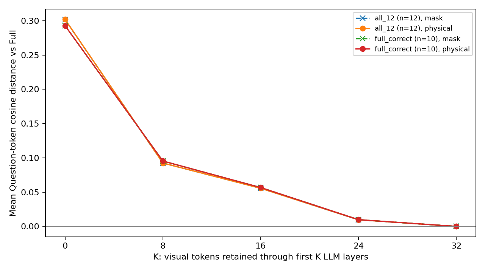
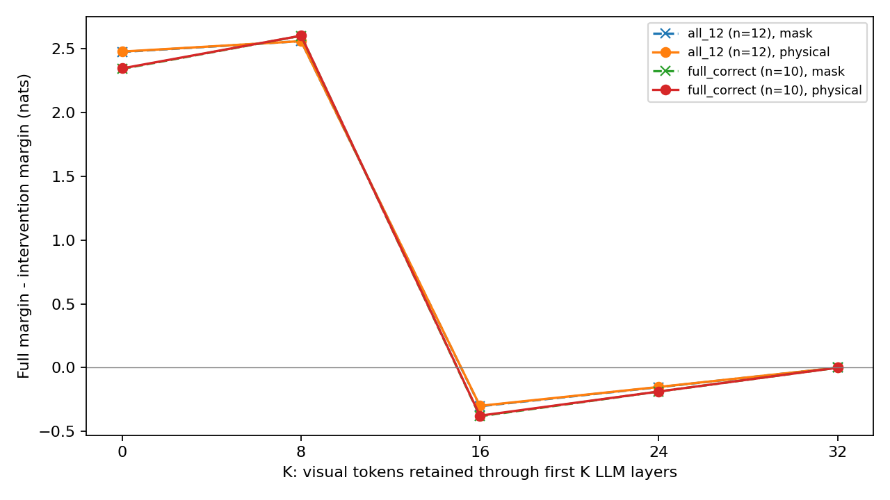

# Phase 3.1 — Physical Visual Exit Pilot

日期：2026-10-28（Asia/Shanghai）。**12 张不同 GQA 图片的 Full / Mask Exit / Physical Exit 小规模实验完成；Mask/Physical 等价性全部通过，止于本阶段。**

## 数据与固定协议

官方 ChooseRel CSV 固定于 `FightingFighting/cross-modal-information-flow-in-MLLM` revision `c9a1111dac4baa175f67716fab473789320187c0`。固定种子 20261028；按 question_id,img_id 排序，先打乱 left 池选择 6 张唯一图片，再打乱 right 池选另外 6 张；不使用模型输出或图片可用性筛选。CSV 共 964 条、785 张图片，排除非 left/right 类型后采样。
服务器 `/data/wdy/datasets/MMEB-V2/image-tasks/MMEB/GQA/` 已有全部选中图片；尺寸与 CSV 一致，记录 SHA256、原始行哈希及 question_id/img_id/候选项。没有下载图片压缩包、替换样本或修改他人数据。文件来自本地 GQA 副本，未额外与官方 ZIP 的 JPEG 字节比对。
上游 CSV 名称含 correct_question，本身已预选；当前 Full 不保证都正确。因此固定报告全部 12 条及本次 Full 正确的 10 条，不把这批样本当作无偏 GQA 评测。
数据与哈希见 [manifest](../../configs/phase3_1_data/manifest.json)，来源见 [SOURCES](../../configs/phase3_1_data/SOURCES.md)。官方论文代码早已包含 Visual Exit，本实验不主张首次提出，也不冒称 DyVTE 完整复现。

## 物理退出与数值正确性

沿用 LLaVA-1.5-7B 官方 HF 转换权重、revision `b234b804b114d9e37bb655e11cbbb5f5e971b7a9`，Python 3.11.18 / PyTorch 2.6.0+cu124 / Transformers 4.49.0 / CUDA runtime 12.4；FP16、eager、eval、inference_mode、单 GPU 0、batch=1、use_cache=False。没有升级、训练、量化或 offload。
Full 使用原模型 Forward；Mask Exit 复用 Phase 3 pre-hook；Physical Exit 使用独立本地 Decoder 循环。在进入 L_K 之前切除 input_ids 实际定位的全部 576 个视觉 hidden states，同时切片 causal mask 的 Query/Key 维度、原始 position_ids、cache_position 与原始 RoPE cos/sin。保留包括 Prompt 模板、问题、答案在内的全部非视觉位置；不重新编号，不替换模型方法，不改参数或第三方源码。K=32 不切片。
本轮真实输入长度为 603–608；退出后为 27–32。每次实际调用均保存 32 层序列长度、Mask 形状、逻辑位置哈希和原始输出位置映射，并独立复核。K=0 从 L0 起不再包含视觉位置；仍运行 CLIP/projector，不能把它解释为已跳过视觉前端。
容差在模型运行前固定于 [preregistration.json](preregistration.json)：logits allclose atol=0.10、rtol=0.003，所有有效文本 Token cosine distance ≤1e-4、relative RMSE ≤0.01，候选完整 log P 差≤0.10 nats、Margin 差≤0.15 nats。CPU FP32 的 logits 采用更严格的 atol=2e-6、rtol=2e-5；未依据本轮结果放宽。

| 检查 | 实测结果 |
| --- | ---: |
| 所有样本 K=32 vs 原生 Full（Mask、Physical） | hidden/logits torch.equal，误差 0 |
| Mask/Physical 最大有效文本 logits 差 | 0.08593750 |
| Mask/Physical 最大有效文本 cosine distance | 3.27290254e-05 |
| Mask/Physical 最大文本 relative RMSE | 0.00811397 |
| 完整候选 log P 最大差（nats） | 0.02895899 |
| Margin 最大差（nats） | 0.01562500 |
| 首样本 K=0 改变图像 Tensor 的文本 hidden/logits 差 | 0 |

所有比较均在事先容差内。差异与形状变化后的 FP16 GEMM/softmax 舍入一致；CPU FP32 对照通过，位置/RoPE/Mask/Token 映射通过，不能把这些小差异解释为新的视觉机制。无 NaN/Inf、CUDA OOM 或 Hook 残留。12 项新增 CPU 测试、合计 56 项回归测试和 pip check 通过；源文件哈希未变。完整校验见 [validation_summary.json](validation_summary.json)。

## Question 和 Answer 的实际结果

Question 复用 Phase 2.1 的真实 Token 定位，取最终 RMSNorm 后的 Question Token hidden states，与 Full 逐 Token 计算 cosine distance，再对样本内部 Token 平均、最后对样本平均。提取来自共同长度的第一个候选（left）Teacher-forced Forward；因果 Mask 保证问题无法读取未来候选答案。隐藏状态距离不是语义失败指标。
Answer 使用原问题/Chat Template；候选固定 left/right，分别对完整候选 Token 序列累加条件 log P，不加 EOS。两候选在相同长度下比较；本批 left/right 都为单 Token，多 Token 情况另有解析测试。Margin=正确候选 log P−错误候选 log P；Margin>0 为候选正确，平局算错；Margin Drop=Full Margin−干预 Margin。此处候选正确率不是自由生成准确率。

下表为 Physical Exit；Mask 曲线与之接近，原始值完整保存在 CSV/JSON。

| K | 全部12条 Question drift | 全部12条 Margin Drop | 候选正确数 | Full正确10条 Question drift | Full正确10条 Margin Drop | 子集正确数 |
| ---: | ---: | ---: | ---: | ---: | ---: | ---: |
| 0 | 0.301943 | +2.479167 | 6/12 | 0.292842 | +2.347656 | 6/10 |
| 8 | 0.092493 | +2.561198 | 6/12 | 0.095375 | +2.603906 | 6/10 |
| 16 | 0.055628 | -0.299154 | 10/12 | 0.056705 | -0.376172 | 10/10 |
| 24 | 0.009675 | -0.151042 | 10/12 | 0.009859 | -0.186719 | 10/10 |
| 32 | 0.000000 | +0.000000 | 10/12 | 0.000000 | +0.000000 | 10/10 |

Full 原本正确 10/12；另两条 `05323839`、`0947467` 的 gold 均为 right，Full Margin 分别为 -0.234375、-0.9765625，保留在全部样本结果中，没有丢弃或替换。
K=0/8 时全部候选预测都偏向 left，因此在平衡集上是 6/12，Full-correct 子集上是 6/10。K=16/24 保留全部 10 条原本正确样本的候选正确性，但不意味着逐 Token 表征或概率保持。K=16 全部样本 Question drift≈0.05563，Margin Drop 平均为负；部分样本的 Margin 改善，另一些仍下降。例如 `01777354` K16 Margin Drop=+0.273438；不能用负的整体均值声称所有样本都改善。
正确答案的原始完整序列概率很小：Full 的跨样本平均约 4.642e-7；K16 Physical 约 3.102e-7。模型还可能更倾向其他开头、大小写或长回答，原始序列概率不能当作候选正确率。JSON 同时保存 raw sequence probability 和在两个候选内部归一化的概率，二者不可混用。

## 全部固定样本

| question_id | img_id | gold | Full Margin | Full候选正确 |
| --- | --- | --- | ---: | --- |
| 11805465 | 2324322 | left | +2.230469 | True |
| 071031845 | 2401381 | left | +4.132813 | True |
| 15776543 | 2319436 | left | +5.308594 | True |
| 15735967 | 2354241 | left | +5.238281 | True |
| 18501941 | 2371511 | left | +6.515625 | True |
| 03538462 | 2383313 | left | +5.191406 | True |
| 05323839 | 2406689 | right | -0.234375 | False |
| 0947467 | 2363706 | right | -0.976562 | False |
| 05579936 | 2407807 | right | +1.453125 | True |
| 0330197 | 2394928 | right | +0.777344 | True |
| 01777354 | 2323091 | right | +0.335938 | True |
| 04812589 | 2362973 | right | +2.589844 | True |

逐问题文本、位置映射、每个 Question Token 距离、候选评分及逐层计算长度见 [per_sample_results.json](per_sample_results.json)，120 行配对汇总见 [CSV](per_sample_results.csv)。原始 Full 指标保存在每个样本 metadata.full_candidates/full_margin 中。

## 实际计算开销（诊断测量）

模型加载 9.453 秒，加载后 allocated 13473.648 MiB；本次完整墙钟时间（加载、校验、全部比较、绘图）50.527 秒。264 次正式 Forward 加 1 次 K0 图像变化控制；不含回归测试、离线审计或 Git 同步。

| 模式 | K | Forward 数 | 平均秒/Forward | 峰值 allocated MiB |
| --- | ---: | ---: | ---: | ---: |
| full | 32 | 24 | 0.115816 | 13774.254 |
| mask | 0 | 24 | 0.136115 | 13774.966 |
| mask | 8 | 24 | 0.118579 | 13774.966 |
| mask | 16 | 24 | 0.118082 | 13774.966 |
| mask | 24 | 24 | 0.108171 | 13774.966 |
| mask | 32 | 24 | 0.106228 | 13774.261 |
| physical | 0 | 24 | 0.057671 | 13566.010 |
| physical | 8 | 24 | 0.066054 | 13623.094 |
| physical | 16 | 24 | 0.080940 | 13623.094 |
| physical | 24 | 24 | 0.091999 | 13623.094 |
| physical | 32 | 24 | 0.099907 | 13641.222 |

全程 allocated 峰值 13774.966 MiB，reserved 峰值 13862 MiB，均为 PyTorch 口径。逐次时间与峰值在 JSON 中。未进行专门预热或同一样本重复测量，均值跨不同样本，首个 Full Forward 明显更慢；不能据此宣称稳定加速比或 Decode 加速。计时还包括 CLIP/projector、Mask Hook 验证/克隆、位置哈希与观测开销。Full/Mask 为读取最终 hidden states 调用 output_hidden_states=True，而 Physical 仅保留最后状态；诊断存储开销也影响显存对比，不能把全部差异归于视觉删除。
GPU 实验进程已退出，GPU 0 恢复约 75 MiB 占用、24006 MiB 可用；未终止或干扰 GPU 1 的任务。

## 结论与边界

本次建立了真实物理删除路径，并在相同文本原始逻辑位置下验证其与 Mask Exit 的数值高度一致。当前 12 张图上 K16/24 能保持 Full 已正确样本的二选一判断，但 Question 表征仍变，Margin 非单调、样本间有反例。样本量小且上游已预选，没有完整 GQA 评测、独立重复或显著性检验，不能确定可通用的安全退出层或把表征漂移视为理解失败。CLIP center crop 沿用现有 Processor，本轮不进行 ROI/裁剪消融。
物理退出不是本项目首次提出；参考 [Cross-modal Information Flow](https://github.com/FightingFighting/cross-modal-information-flow-in-MLLM) 与 [DyVTE](https://github.com/DoubtedSteam/DyVTE)，这里仅建立固定 K、无 KV Cache 的 Prefill/Teacher-forcing 诊断。
完成后停止；未训练 Router、未扫描 Directed Attention 完整路径、未做逐生成步退出/Decode、ROI 或滑动窗口。Phase 1–3 代码和结果均保持不变。
