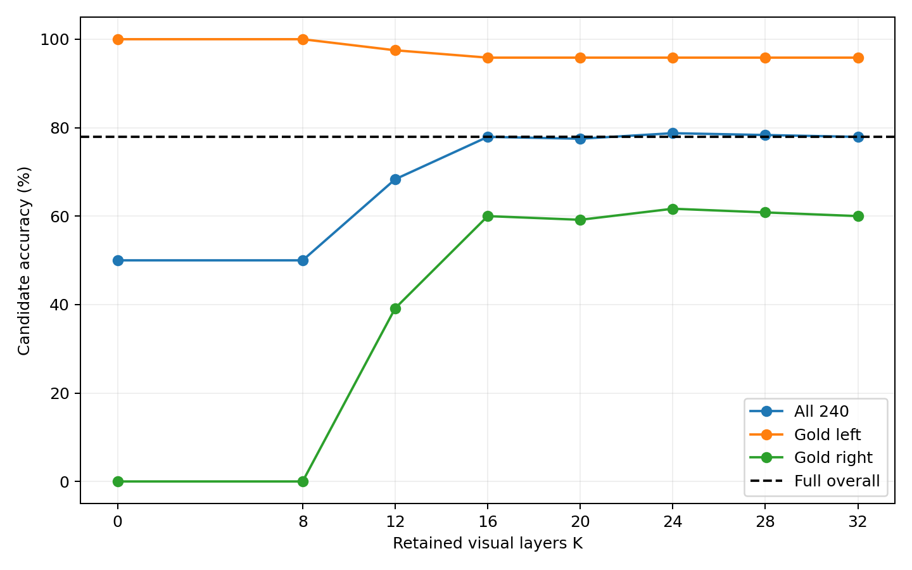
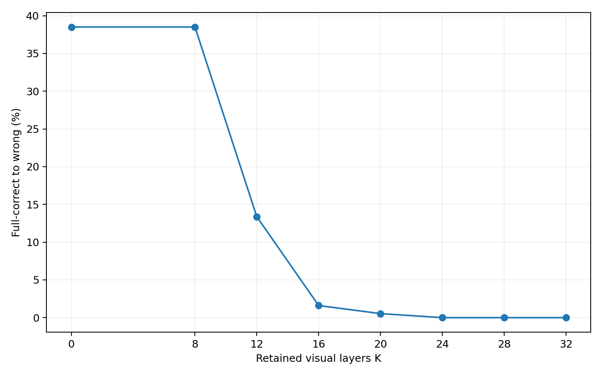
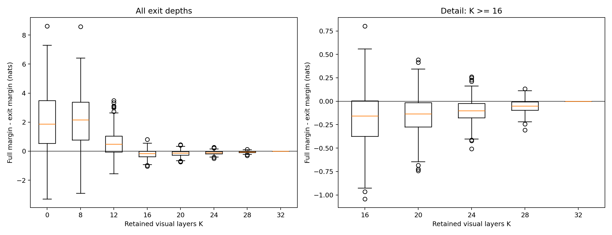
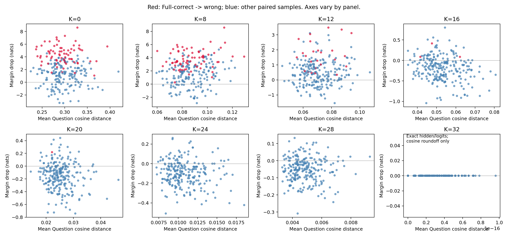

# Phase 3.2 — Fixed-K Physical Visual Exit（240 图实测完成）

日期：2026-10-28（Asia/Shanghai）。在既有 RTX 4090 GPU 0 上完成 240 张新增独立 GQA 图片、8 个 K 的真实 7B 配对实验。**K16 净正确率与 Full 相同，但 3 条原对变错、3 条原错变对；K24 在本批保留全部 Full-correct 判断。** 没有提出新退出方法，止于 Phase 3.2。

## 数据冻结与复现范围

复用官方 Cross-modal Information Flow 仓库 revision `c9a1111dac4baa175f67716fab473789320187c0` 的 `GQA_val_correct_question_with_relChooser_ChooseRel.csv`，源 CSV SHA256 `0bbc45d9c9b609409f30d7ecf9be6f2957347c4cdcc5480b531ae0b8ef5282c0`。964 条、785 张图片，含其他关系类型；仅取有效 left/right 二选一。

种子 20261029；按字符串 question_id,img_id 排序，使用 Python Random 依次打乱 left、right 池；共享已用图片集合，每类选前 120 张，排除 Phase 3.1 的全部 12 张图。没有使用模型输出、预测正确性或图片可用性筛选，也没有缺失后替换。冻结的 240 张图全部已存在 `/data/wdy/datasets/MMEB-V2/image-tasks/MMEB/GQA/`，JPEG 解码完整、尺寸与 CSV 一致；未下载图片包或模型。逐条记录 ID、原问题、gold/错误候选、源行哈希、图片路径/尺寸/SHA256。

[Manifest](manifest.json) 在任何 GPU 实验前生成，SHA256 `93c518eb079c82124566ba7b41e9a5ccff3f4a41f38ed752fe20ea81516d4cc5`。Smoke 为固定选择顺序中前 12 left + 前 12 right；12 张等价性验证图为原 Phase 3.1 全部样本，不计入新增 240 图。

**限制：上游 correct_question 数据已预筛选，不代表无偏 GQA 全集。** 当前 Full 仍有 53 条错误，全部保留；只另外统计 Full-correct 子集，不重采样。图片来自本地 MMEB GQA 副本，文件哈希确定本轮字节，但未独立认证与官方 ZIP 完全相同。CLIP resize/center crop 沿用既有 Processor，未做 ROI 或裁剪消融。

## 模型与评分协议

保持 Python 3.11.18 / PyTorch 2.6.0+cu124 / Transformers 4.49.0 / CUDA runtime 12.4；驱动 595.99.02。LLaVA-1.5-7B HF revision `b234b804b114d9e37bb655e11cbbb5f5e971b7a9`（7,063,427,072 参数），FP16/eager、eval/inference_mode、batch=1、无 KV Cache、无 offload。全部模型分片 SHA256、代码/安装源码/环境和实验绑定见 [experiment_config.json](experiment_config.json)。环境与权重均未重装、升级或重新下载。

**复用且未改动 Phase 3.1 physical_exit.py。** 在进入 L_K 前切除实际 image_token_index 对应的 576 个 hidden states，同时切片原 causal mask 两轴、position_ids/cache_position、原 RoPE cos/sin；非视觉文本包括模板、Question、候选答案和 padding 保留，逻辑位置不重编号。K32 不删除，Full 是原生模型 Forward。K0 仍运行视觉前端，但语言层从 L0 开始没有视觉位置；不能冒称跳过 CLIP 或完成 Decode 加速。

Answer 原 Prompt/Chat Template 不变，候选顺序固定 left/right；分别 Teacher-forcing，对完整候选序列（不加 EOS）累加全词表条件 logP，Margin=logP(gold)−logP(wrong)，Drop=Full Margin−Exit Margin。**严格 Margin>0 才算正确，平局算错。** 本批两个候选各 1 Token，多 Token 评分由既有 CPU 测试覆盖。此处是二选一候选准确率，不能视为自由生成 GQA 准确率。原始 gold 序列概率与两个候选内归一化概率分别保存，不能混用。

Question 复用 Phase 2.1 已验证定位；比较最终 RMSNorm 后真实 Question Token hidden states，先逐 Token cosine distance、再样本内平均。来自第一个候选的等长 Forward；因果 Mask 防止 Question 读取未来候选。删除前后按原始位置对齐。隐藏距离不等于理解失败。

## 执行顺序与正确性

先通过 62 项 CPU 回归（原有 56 + 新增 6）及 pip check，再依次完成 24 图 Smoke、12 图 Mask/Physical 复核和 240 图正式运行。新增测试覆盖 K12/20/28 的真实长度和数值等价、排除/平衡/确定性采样、检查点错配/篡改/重复/不完整拒绝，以及净准确率掩盖翻转的解析反例。

| 检查 | 结果 |
| --- | --- |
| 240 图 Physical K32 vs 原生 Full | 逐有效文本 hidden/logits torch.equal，误差 0 |
| 24 图 K0 改变 pixel_values | 全部文本 hidden/logits 完全相同 |
| 24 图退出后再运行原生 Full | 全部 hidden/logits 完全相同，无污染 |
| 24 图 Smoke vs 正式运行 | Margin、gold logP、Question drift 逐条逐 K 精确相同 |
| 真实长度 | 候选 Forward 原长 602–613；K<32 的后续层为 26–37，减少 576 |
| 12 图 × 8K × 2候选 Mask/Physical | 192 组全部通过原容差 |
| 最大文本 logits 误差 | 0.08593750 |
| 最大文本 cosine / relative RMSE | 3.27290254e-05 / 0.00811397 |
| 候选 logP / Margin 最大误差（nats） | 0.02895899 / 0.01562500 |
| 与 Phase 3.1 共同 K 的 Margin 差 | 0（12 图全部历史对照） |
| 第三方源码 | LLaMA/LLaVA 文件哈希与 Phase 3.1 相同 |
| 异常 | 无 NaN/Inf、OOM、Hook 残留或输入/参数修改 |

容差原样沿用 Phase 3.1：FP16 logits atol=0.10/rtol=0.003，文本 cosine≤1e-4、relative RMSE≤0.01，完整候选 logP 差≤0.10 nats、Margin 差≤0.15 nats；未因本轮结果放宽。CPU FP32 更严格。12 图验证说明这些样本上的数值一致性，不意味着所有 FP16 形状变化都逐位等价；K32 精确一致则在全部 240 图验证。详见 [correctness_validation.json](correctness_validation.json)。

## Accuracy 与配对翻转

Full=187/240（77.9167%），固定 Full-correct=187、Full-wrong=53。下表所有 K 使用相同 240 图；翻转率的分母是 Full-correct 187，而非 240。

| K | 全部正确/240 | 准确率 | 相对Full（pp） | left /120 | right /120 | Full-correct保留/187 | 原对→错 | 原错→对 | 条件翻转率 |
| --- | --- | --- | --- | --- | --- | --- | --- | --- | --- |
| 0 | 120 | 50.0000% | -27.9167 | 120 | 0 | 115 | 72 | 5 | 38.5027% |
| 8 | 120 | 50.0000% | -27.9167 | 120 | 0 | 115 | 72 | 5 | 38.5027% |
| 12 | 164 | 68.3333% | -9.5833 | 117 | 47 | 162 | 25 | 2 | 13.3690% |
| 16 | 187 | 77.9167% | +0.0000 | 115 | 72 | 184 | 3 | 3 | 1.6043% |
| 20 | 186 | 77.5000% | -0.4167 | 115 | 71 | 186 | 1 | 0 | 0.5348% |
| 24 | 189 | 78.7500% | +0.8333 | 115 | 74 | 187 | 0 | 2 | 0.0000% |
| 28 | 188 | 78.3333% | +0.4167 | 115 | 73 | 187 | 0 | 1 | 0.0000% |
| 32 | 187 | 77.9167% | +0.0000 | 115 | 72 | 187 | 0 | 0 | 0.0000% |

K16 的 187/240 并不代表没有损伤：原本正确的 3 条变错，同时另 3 条变正确，两个方向恰好抵消；其中 2 条 Margin 严格由正变负，1 条变为 0，按预定规则算错。K20 的 186/240 是 1 条原对变错，无反向改善。K24 的 189/240 保留 187/187，另有 2 条原错变对；这只是本批计数，未做独立重复或总体显著性检验，不称为通用性能提升。

在本批上，K24 比 K16 更稳定：错误翻转 0 vs 3、P95 和最大正向 Margin Drop 更小、Question Drift 更小。但 K24 仍改变表征与分数，不是无损证明。

## Answer Margin 分布与具体反例

| K | Mean Drop | Median | P90 | P95 | 最大正向Drop | Drop>0 | 正→负 | 正→0 |
| --- | --- | --- | --- | --- | --- | --- | --- | --- |
| 0 | +2.040902 | +1.861328 | +5.031250 | +5.717578 | 8.609375 | 80.83% | 72 | 0 |
| 8 | +2.046729 | +2.166016 | +4.429688 | +5.152930 | 8.578125 | 83.75% | 72 | 0 |
| 12 | +0.566406 | +0.488281 | +1.586719 | +2.198828 | 3.484375 | 72.50% | 25 | 0 |
| 16 | -0.184782 | -0.158203 | +0.157031 | +0.282812 | 0.800781 | 25.42% | 2 | 1 |
| 20 | -0.149723 | -0.134766 | +0.109375 | +0.172656 | 0.441406 | 19.58% | 1 | 0 |
| 24 | -0.100016 | -0.101562 | +0.054688 | +0.109570 | 0.261719 | 17.92% | 0 | 0 |
| 28 | -0.052393 | -0.050781 | +0.027344 | +0.055078 | 0.132812 | 21.25% | 0 | 0 |
| 32 | +0.000000 | +0.000000 | +0.000000 | +0.000000 | 0.000000 | 0.00% | 0 | 0 |

K16/20/24 的平均 Drop 都为负，但分别有 61/240、47/240、43/240 条 Drop>0；不能声称所有样本改善。最大 Drop 的部分样本本来就错误，必须区分“分数进一步退化”和“原对变错”。K16 最大 +0.800781 的 `16312698`（nightstand/sheet）从 −5.347656 到 −6.148438，本来就错；K24 同一条仍有 +0.261719 Drop。K0/8 更严重，最大 Drop 达约 8.6 nats。

以下是 K16/20 **全部**原对变错样本；没有据此修改评测集。

| K | question_id | 原问题 | gold | Full Margin | Exit Margin | Drop | Question Drift |
| --- | --- | --- | --- | --- | --- | --- | --- |
| 16 | 0216546 | Is the metal knife to the left or to the right of the plate? | right | +0.070312 | -0.015625 | +0.085938 | 0.062147 |
| 16 | 02310173 | Is the umbrella to the right or to the left of the man? | right | +0.085938 | +0.000000 | +0.085938 | 0.041574 |
| 16 | 05480434 | Is the elephant to the left or to the right of the car? | right | +0.140625 | -0.273438 | +0.414062 | 0.047607 |
| 20 | 05480434 | Is the elephant to the left or to the right of the car? | right | +0.140625 | -0.078125 | +0.218750 | 0.022164 |

本轮受影响的具体问题是 knife/plate、umbrella/man、elephant/car 的左右关系，全部 gold=right，Full Margin 仅 0.0703–0.1406。它们是近决策边界反例；当前不足以推断某类物体天然更难退出。knife 的负 Margin 和 umbrella 的平局特别接近零，应视为 FP16/评分精度敏感案例，不能用极小差异宣称新视觉机制。没有运行 FP32 7B 精度消融，亦未放宽任何容差。

## Left/right 偏好

Full 的 left 为 115/120（95.8333%），right 为 72/120（60.0000%），240 条预测中 163 条偏向 left（67.9167%）。K0/8 全部预测 left，平衡标签集准确率为 50%；这种“部分样本 K0 就正确”不证明模型无需图像。K16 同组准确率与 Full 相同，但 right 组内部有 3 条损失、3 条改善；K20 right 减为 71，K24 为 74。存在本协议内明显 left 偏好，不能外推为整个 GQA 的普遍偏好；语言先验、问题构成及视觉预处理等因素未被本轮隔离。

## Question Drift 与 Answer 的关系

| K | 平均Question Drift | Median Drift | Drift–Drop Pearson（同K，240条） |
| --- | --- | --- | --- |
| 0 | 0.297324 | 0.292810 | -0.0446 |
| 8 | 0.087562 | 0.085408 | +0.1559 |
| 12 | 0.070871 | 0.069251 | +0.0691 |
| 16 | 0.052897 | 0.051788 | -0.2331 |
| 20 | 0.025201 | 0.024813 | -0.1259 |
| 24 | 0.010875 | 0.010291 | -0.1182 |
| 28 | 0.004901 | 0.004733 | -0.0257 |
| 32 | 0.000000 | 0.000000 | 未定义（Drop恒为0） |

图中各面板使用各自坐标范围以显示尾部，不能直接比较不同面板的斜率。红色包含按预设规则算错的平局。K32 hidden/logits 精确相同；cosine 约 1e-16 是 float64 计算舍入，不是实际表征变化。

在测试的离散 K 网格上，240/240 条的平均 Question Drift 均随 K 增大非增；但这不保证答案单调改善。同一 K 内 Drift–Drop 相关性弱或为负，例如 K16/20/24 分别 −0.2331/−0.1259/−0.1182，不支持把“大 Drift”直接当作“大 Margin Drop”预测器，更不能宣称因果。

有相对小 Drift 仍错翻的例子：K16 umbrella/man 的 Drift=0.041574，低于该 K 的下四分位 0.046942；K20 elephant/car 为 0.022164，低于下四分位 0.022209。也有高 Drift 仍稳定的例子：K16 `0688862` Drift=0.080680，而 Margin 从 +0.976563 到 +1.328125。K16 上四分位的 Full-correct 样本中，50 条仍正确。分位定义、逐 Token 距离和全部个案分别保存在 [drift_analysis.json](drift_analysis.json)、检查点和 [degradation_cases.csv](degradation_cases.csv)。

事后观察“从某个被测试 K 起所有更深 K 均正确”的最早网格位置，Full-correct 187 条分别为：K0=115、K12=47、K16=22、K20=2、K24=1；Full 本来错误 53 条没有这样的 K。这里 K0 的 115 条全部 gold=left，受到明显标签先验影响。它是使用 gold 标签和全网格结果得到的事后诊断，不是可部署 Router 标签，也不证明连续层范围或新样本安全。

## 实际计算开销

正式实验 4320 次 Forward（480 次 native Full + 每个 K 各 480 次 Physical）；每个样本的两候选分别执行。正式阶段墙钟 412.775 秒，包含本地权重/图片哈希审计、模型加载、CPU 评分/检查点和 GPU Forward，不含 CPU 回归、离线绘图、Git；Smoke 56.465 秒、12 图等价性验证 56.773 秒，三阶段约 526.012 秒。正式加载 4.397 秒，加载后 allocated=13473.648 MiB。

| 模式 | K | Forward数 | 平均秒/Forward | 中位秒/Forward | 峰值allocated MiB | 峰值reserved MiB |
| --- | --- | --- | --- | --- | --- | --- |
| native_full | 32 | 480 | 0.086023 | 0.085576 | 13776.610 | 13860.000 |
| physical | 0 | 480 | 0.040905 | 0.040726 | 13566.010 | 13860.000 |
| physical | 8 | 480 | 0.051646 | 0.051560 | 13623.304 | 13860.000 |
| physical | 12 | 480 | 0.057229 | 0.057102 | 13623.304 | 13860.000 |
| physical | 16 | 480 | 0.062714 | 0.062646 | 13623.304 | 13860.000 |
| physical | 20 | 480 | 0.068281 | 0.068279 | 13623.304 | 13860.000 |
| physical | 24 | 480 | 0.073884 | 0.073868 | 13623.304 | 13860.000 |
| physical | 28 | 480 | 0.079467 | 0.079442 | 13623.304 | 13860.000 |
| physical | 32 | 480 | 0.085664 | 0.085636 | 13642.333 | 13860.000 |

正式实验 allocated 峰值 13776.610 MiB，reserved 峰值 13860 MiB。K<32 时各层实际长度和原始位置哈希保存于每个候选的 layers trace；K32 保持 602–613，其他 K 只在边界后的层缩短为 26–37。

**这些是诊断耗时，不宣称稳定加速比。** 没有独立预热/同样本重复测量，且运行有固定样本/K 顺序；计时含 CLIP/projector、位置哈希、观测与同步。Full 为读取末状态开启 output_hidden_states，Physical 只保留最后状态，显存口径也受诊断存储影响。没有测逐生成步 Decode 或端到端生成加速。只使用 GPU0；未终止其他 GPU 任务。资源、加载与逐阶段 stdout 见 logs/。

## 与 DyVTE 的联系、边界和下一步判断

阅读 [DyVTE NeurIPS 2025 正式论文](https://proceedings.neurips.cc/paper_files/paper/2025/file/f60d4225745fb682bd088b63dcbbe52d-Paper-Conference.pdf) 第 3 节固定层删除、Fig.3 讨论及第 5 节评价协议，PDF 哈希/来源见 [paper_reference.json](paper_reference.json)。原文描述 GQA 第24层删除对 7B/13B 分别有约“0.5% / 0.6%”性能下降。本轮较晚退出比早退稳定、不同样本事后可保留的最早 K 有差异，在现象上相似；本轮 K24 净正确率反而增加 0.8333 pp，与论文数字并不一致，也不构成反驳或严格复现。

差异在于：本轮只有上游预筛选、left/right 平衡的 240 图，原样 Prompt 的完整候选 logP，无 cache 的 Prefill/Teacher-forcing；论文使用 GQA 基准评价，并另外研究学习式动态退出。不能把本轮 77.9% 二选一与论文 GQA 全基准准确率直接比较，也没有复现其 Router、训练、Decode 或速度协议。

**实际观察：** K16 保持总体正确率却损失 3 条 Full-correct；K24 在这批更稳定但分数/表征仍变，存在显著左右偏好；平均改善掩盖尾部退化，Drift 不足以单独解释答案翻转。

**可能解释：** 小 Full Margin 的样本更容易跨过决策边界，语言先验与保留视觉计算共同影响候选评分；只是描述性一致，不是已隔离的机制。

**尚未证明：** 文本已吸收完整视觉信息、任何统一 K 可安全用于新样本/其他任务、Drift 是因果指标、K24 普遍优于 Full、存在稳定推理加速。本批最值得后续研究的是“低 Margin 的 right 关系题与退出风险如何区分于标签先验，以及 Drift 较小但仍翻错时应依据什么信号”。结果支持继续研究 sample-adaptive 退出的必要性问题，但不足以证明某种 adaptive 方法有效。未实施任何下一阶段方法。

## 文件与恢复

- `manifest.json`：冻结选择、来源和图片哈希；`experiment_config.json`：版本、权重/源码哈希、协议和原容差。
- `per_sample_results.csv/json`：完整 240×8=1920 行；Full 分数在每行配对保存，native Full 测量和逐 Token 距离/映射/层长在 `checkpoints/run/<question_id>.json`。
- `summary_by_k.csv/json`：准确率、方向子集、保持/翻转、Margin 分位数与 Drift；`degradation_cases.csv`：K16/20/24 全部 720 条问题文本和分数。
- `correctness_validation.json`、`smoke_production_consistency.json`、`third_party_source_unchanged.json`：正确性、重复阶段一致性及源码核验。
- 四张核心 PNG、`compute_diagnostics.csv`、`sample_diagnostics.json`、`drift_analysis.json`、logs/ 与分阶段原子检查点。

运行顺序/命令见项目 README。每个已完成样本以 JSON checksum 和完整实验 binding 校验；错 Manifest、代码/模型、sample ID、候选映射、重复 K 或不完整行会拒绝续跑。只提交完整样本，临时文件不算完成，不覆盖既有样本检查点；不要删除 Manifest 重新选样本。冻结代码更新后不允许静默沿用旧结果，应使用本次提交的同版本代码恢复。原 Phase1–3.1 文件与结果保持不变。

**完成后停止于 Phase 3.2。没有训练 Router、Decode、扩展到其他数据集、ROI、滑窗或模型结构修改；自动 GPU 轮询仍关闭。**
