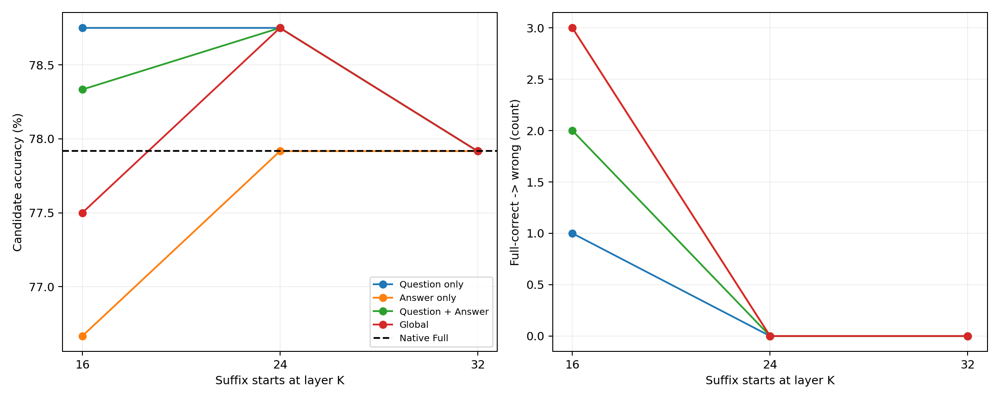
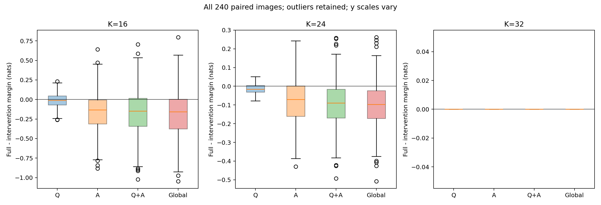
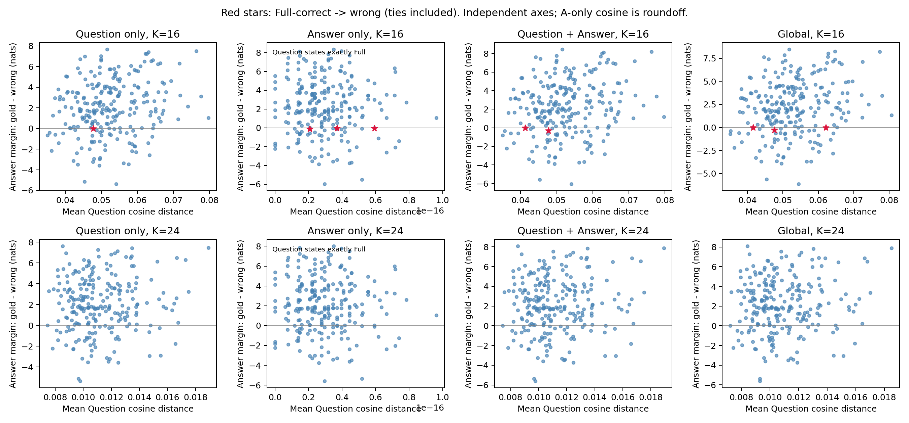

# Phase 3.3 — Directed Suffix Visual Attention Knockout

## 完成状态与协议

2026-10-28，真实 RTX 4090 GPU0 已完成同一冻结240图的全部配对实验：原生Full + 四种阻断×K16/24/32，共3120行、6240次正式Forward。72项CPU回归、8图7B Smoke及所有正式样本正确性门通过。没有修改Phase1–3.2的Python/结果、环境、权重或第三方源码，没有重新采样、重新下载模型、训练、物理删除、Decode或KV Cache；本轮在Phase3.3停止。

Python3.11.18、PyTorch2.6.0+cu124、Transformers4.49.0、CUDA12.4、驱动595.99.02；官方LLaVA1.5-7B HF revision `b234b804b114d9e37bb655e11cbbb5f5e971b7a9`，FP16/eager，batch1、eval/inference_mode、use_cache=False。完整配置/模型与代码SHA256见 `experiment_config.json`，环境实测见 `logs/*environment.json`。

数据逐字节复制自Phase3.2 Manifest，SHA256 `93c518eb079c82124566ba7b41e9a5ccff3f4a41f38ed752fe20ea81516d4cc5`。仍为240张独立本地GQA图，left/right各120，原Prompt、候选顺序、图像哈希、真实Question与候选Token映射全部核对。来源ChooseRel CSV已被上游筛选，不是无偏GQA全体；固定seed20261029是历史采样元数据，本轮没有再抽样。

Mask行是target Query，列是source Key。从L_K阻断至L31：Q-only只选真实Question；A-only只选P−1，预测单Token候选left/right，不选已输入答案P；Q+A为二者不重叠的并集；Global复用Phase3全部合法后图像文本Query。全部576个视觉Token及所有原始位置仍参与32层计算，没有加速意义。

沿用完整候选序列条件logP、全词表归一化和原评分实现；FP16 logits转double计算log_softmax。Margin=logP(gold)−logP(wrong)，Drop=Full Margin−干预Margin，严格Margin>0正确，平局错误。候选序列概率与二候选归一化概率是不同量，均单独记录；这不是自由生成GQA准确率或校准置信度。

## 真实总体统计

下面分母固定240，Full-correct固定187、Full-wrong固定53；left/right列是正确数量。Drop单位nats。Question取最终RMSNorm后的真实Question Token逐TokenCosine Distance均值。

| 条件 | K | 正确/240（%） | left/120 | right/120 | 原对→错 | 原错→对 | Mean Drop | Median Drop | P95 Drop | Max正Drop | Question Drift |
|---|---:|---:|---:|---:|---:|---:|---:|---:|---:|---:|---:|
| Full | 32 | 187 (77.9167) | 115 | 72 | 0 | 0 | 0.000000 | 0.000000 | 0.000000 | 0.000000 | 0.000000 |
| Q-only | 16 | 189 (78.7500) | 115 | 74 | 1 | 3 | -0.009147 | -0.009766 | 0.136719 | 0.230469 | 0.052429 |
| Q-only | 24 | 189 (78.7500) | 115 | 74 | 0 | 2 | -0.013981 | -0.015625 | 0.023438 | 0.050781 | 0.011233 |
| Q-only | 32 | 187 (77.9167) | 115 | 72 | 0 | 0 | 0.000000 | 0.000000 | 0.000000 | 0.000000 | 0.000000 |
| A-only | 16 | 184 (76.6667) | 115 | 69 | 3 | 0 | -0.150667 | -0.132812 | 0.273828 | 0.640625 | 0.000000 |
| A-only | 24 | 187 (77.9167) | 115 | 72 | 0 | 0 | -0.074414 | -0.070312 | 0.117578 | 0.242187 | 0.000000 |
| A-only | 32 | 187 (77.9167) | 115 | 72 | 0 | 0 | 0.000000 | 0.000000 | 0.000000 | 0.000000 | 0.000000 |
| Q+A | 16 | 188 (78.3333) | 115 | 73 | 2 | 3 | -0.161784 | -0.148438 | 0.312500 | 0.707031 | 0.052429 |
| Q+A | 24 | 189 (78.7500) | 115 | 74 | 0 | 2 | -0.094434 | -0.089844 | 0.109766 | 0.257813 | 0.011233 |
| Q+A | 32 | 187 (77.9167) | 115 | 72 | 0 | 0 | 0.000000 | 0.000000 | 0.000000 | 0.000000 | 0.000000 |
| Global | 16 | 186 (77.5000) | 115 | 71 | 3 | 2 | -0.184505 | -0.158203 | 0.290234 | 0.796875 | 0.052897 |
| Global | 24 | 189 (78.7500) | 115 | 74 | 0 | 2 | -0.099723 | -0.097656 | 0.102148 | 0.261719 | 0.010876 |
| Global | 32 | 187 (77.9167) | 115 | 72 | 0 | 0 | 0.000000 | 0.000000 | 0.000000 | 0.000000 | 0.000000 |

K16下相对Full准确率变化：Q-only +0.8333pp，A-only −1.2500pp，Q+A +0.4167pp，Global −0.4167pp。Full-correct翻错率分别为1/187、3/187、2/187、3/187（0.5348%、1.6043%、1.0695%、1.6043%）。K24所有条件保留187/187 Full-correct；Q、Q+A、Global额外改善2条，A-only没有改善。K32所有四条件与Full有效文本hidden/logits精确相等。

所有非控制条件Mean Drop为负，不能解读成逐样本改善。例如K16 Q/A/QA/Global仍有108/58/67/61条Drop>0；最大正退化见表。A-only K16平均Margin提高，但3条原对变错且无原错变对；这直接说明均值不能替代错误翻转分析。

left分组始终115/120；right在K16分别74/69/73/71，相对Full72/120。Full预测left163条，A-only K16预测left166条；这批翻错均为gold right，既有明显标签/答案偏好仍是解释限制，不能把结果推广为所有视觉问答的路径规律。

## 三个历史K16翻错问题

下表为正确减错误候选的Margin，零为错误平局。问题和完整概率见 `historical_three_cases.csv/json`。

| question_id | Full | Q-only K16 | A-only K16 | Q+A K16 | Global K16 |
|---|---:|---:|---:|---:|---:|
| 0216546 | +0.0703125 | +0.0546875 | +0.0156250 | +0.0156250 | -0.0156250 |
| 02310173 | +0.0859375 | +0.0468750 | +0.0312500 | +0.0000000 | +0.0000000 |
| 05480434 | +0.1406250 | -0.0234375 | -0.1406250 | -0.3046875 | -0.2890625 |

- `0216546`：metal knife相对plate（gold right）。两个单路径及Q+A都保留正Margin，只有Global翻错；Q+A与Global差0.03125nats，提示额外模板/其他文本Query连接也可能影响当前预测，但幅度较小，不能定位具体替代通路。
- `02310173`：umbrella相对man（gold right）。单独阻断Q或A仍正确，联合阻断降为0；与互相补偿/冗余贡献的可能性相容。因为落在精度敏感的零边界，不能据此证明两个独立视觉信息存储通道。
- `05480434`：elephant相对car（gold right）。Q、A、QA、Global全部翻错；A的负Margin比Q更大，QA退化更大，但干预效果并不简单相加。K24四条件全部恢复正确。

A-only还有两条新翻错 `051025435`（batter/catcher）和 `111015440`（man/spoon），其Full→A-only Margin分别为+0.09765625→−0.0625、+0.0703125→−0.0390625，而Global仍答对。因此单独阻断并不普遍优于Global。所有这些样本均保留在完整队列，没有事后筛选。

## Question/Answer路径、非加性与其他文本

**实际观察：** 本队列K16的A-only比Q-only带来更多Full-correct损失（3比1）和更大的P95/最大正Margin Drop（0.273828/0.640625比0.136719/0.230469）。在“错误翻转与退化尾部”这一口径下，答案预测Query的后缀直接视觉访问更敏感；平均Drop却为负，不能说该路径对所有样本都起正向作用，或声称普遍层次机制。

**实际观察：** A-only的Question hidden与Full逐元素相同，但答案仍能翻错。Q+A的Question hidden与Q-only精确相同，但两者答案不同。这是在固定前向图下对不同目标Query的干预，不需要用Question表征损坏解释全部答案变化。Q-only的Mean Drift K16约0.05243、K24约0.01123；Q+A同值，Global约0.05290/0.01088；A-only与K32约3e−17仅为Cosine算术舍入，hidden本身完全一致。

Drift–Drop描述性Pearson在K16 Q/QA/Global为−0.0538/−0.1971/−0.2329，K24为−0.0629/−0.0936/−0.1123。没有稳定的正向“漂移越大退化越大”关系。A-only的舍入残差不应用于解释相关性。既有Question漂移与答案正确性应分别报告，不能把Hidden距离直接当作理解失败或退出风险判定器。

**实际观察：** 非加性残差 `Drop_QA−Drop_Q−Drop_A` 的最大绝对值在K16/24分别0.078125/0.0390625nats，不能假设两个干预效果相加。`02310173`的两个单阻断各自正确但联合失败，与保留其中一路可能有帮助相容，尚不是路径补偿机制的证明；没有做中介分析或额外路径定位。

**实际观察：** K16有2条Q+A正确而Global错误：`0216546`和Full原错的`04993832`；没有反方向分类差异。K24两者分类一致，但Margin仍不同。额外Global Drop（Global Drop−QA Drop）K16均值−0.022721，P95 +0.070508，最大+0.15625；K24为−0.005290/+0.019727/+0.039063，方向混合。保留其他文本到视觉的连接可在部分样本改善预测，也可降低Margin，不宜统称全为有益补偿。

**可能解释而非证明：** Phase3.2 K16的整体准确率接近Full掩盖了样本差异；本轮进一步表明后缀中Question的直接视觉访问、答案预测位点的直接访问以及剩余模板/文本位点可有不同且非单调的贡献。不能据此声称视觉信息已全部被Question吸收，或某层后可以安全删除视觉Token。

## 正确性与精度敏感例外

72项CPU测试覆盖精确Mask修改方向/范围、非目标Mask不变、Suffix、Clone、P−1、因果位置、输入/参数不变、Hook清理（含异常）和续跑校验。8张固定Smoke对四条件×三K×两候选实际审计192次Attention Forward、6144层矩阵：目标权重严格0，最大行和误差0.0004067421；形状正确，无NaN/Inf、未来或padding访问。完整记录见 `test_report.md`、`correctness_validation.json`及检查点。

全部240张确认历史Full logP精确相同，全部K32有效文本hidden/logits精确Full；A-only更早Question状态不变、QA与Q-only Question状态相同；Smoke后原生Full精确恢复；Smoke与正式对应分数/Drift精确相同。逐层Hook审计确认32层均保留原始位置和完整序列，只有K以后Mask Clone并修改。正式过程中没有OOM/异常或Hook泄漏。

Global与当次Physical的8图Smoke对照最大有效文本logits差0.03515625，Cosine4.21743e−6，相对RMSE0.00309182；与全部240图历史Physical的候选logP最大差0.03044244nats、Margin最大差0.015625nats。均在Phase3.1原容差内：logits atol0.10/rtol0.003、Cosine1e−4、相对RMSE0.01、候选logP0.10、Margin0.15；没有根据本轮结果放宽。

**必须保留的精度差异：** 历史Physical K16正确187条，而本轮Global为186条。唯一分类差异是`04993832`（black car相对woman，Full Margin−0.046875）：历史Physical Margin+0.0078125，本轮Global=0，Q+A=+0.015625。差异在预注册容差内，但足以把极低正Margin变为错误平局；不能强行报告Global与历史Physical完全相同的正确率，也不能将其当作新的通路机制。所有历史三条Full-correct翻错在本轮Global仍然存在。未开展FP32全模型对照，细小Margin个案保留不确定性。

## 真实计算开销与交付

所有条件序列长度始终602–613，32层均保留576个视觉Token。正式墙钟1083.881秒（含配置/哈希审计、加载、6240次Forward、同步、GPU采样、CPU打分与检查点），模型加载4.103678秒，加载后allocated13473.648MiB。正式峰值allocated13778.161MiB、reserved13898MiB；额外返回全部Attention的Smoke峰值allocated14467.481MiB，Smoke墙钟46.962秒。

正式单Forward平均秒：Full0.098479；K16 Q/A/QA/Global为0.159488/0.160239/0.160113/0.159032；K24为0.137239/0.135544/0.136321/0.131909。中位数分别见 `compute_diagnostics.csv`；例如K16四条件约0.098–0.099秒。观测方式包含Mask验证/Clone/Hook，同步与共享机器负载也影响耗时，未做独立预热和重复测量，只是诊断记录，不声称稳定速度差异或推理加速。实验进程已经退出，GPU后快照见日志；没有终止其他程序或恢复自动轮询。

主要文件：`manifest.json`、`experiment_config.json`、`per_sample_results.csv/json`（3120行）、`summary_by_condition.csv/json`、`paired_path_comparisons.csv`、`path_comparison_summary.json`、`historical_three_cases.csv/json`、`global_vs_historical_physical.csv`、`compute_diagnostics.csv`、`correctness_validation.json`、完整检查点和运行/资源日志。

图3红星为Full-correct→wrong，蓝点为其他样本，各面板坐标独立；A-only横轴约1e−16只显示Cosine舍入，不表示隐藏状态真的发生变化。图2各K纵轴不同，K32所有Drop严格0。

## 与参考论文的关系及停止边界

参考 *Cross-modal Information Flow in Multimodal Large Language Models*（CVPR2025，arXiv2411.18620v2），已核对官方`methods.py`行列掩码和`informationFlow.sh`。原文采用9层窗口、基线所预测答案概率的相对变化；本轮采用K..31后缀、真实Question及P−1、gold/wrong完整候选logP Margin，不能当作论文机制结论的严格复现。参考文件和SHA256见 `reference.json`。

本轮只完成定向后缀诊断。支持继续提出“低Margin right样本的直接答案访问与其他文本连接如何共同影响输出”的研究问题，尚未证明补偿通路具体位置、视觉完整融合、统一安全退出深度或训练方法有效。未扩展ROI、Router、KV Cache、Decode、训练、其他数据集或滑动窗口；等待用户下一阶段指令。
