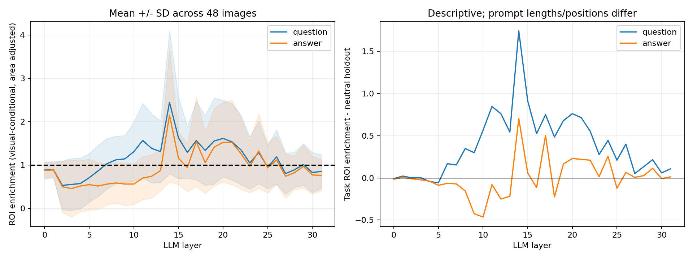
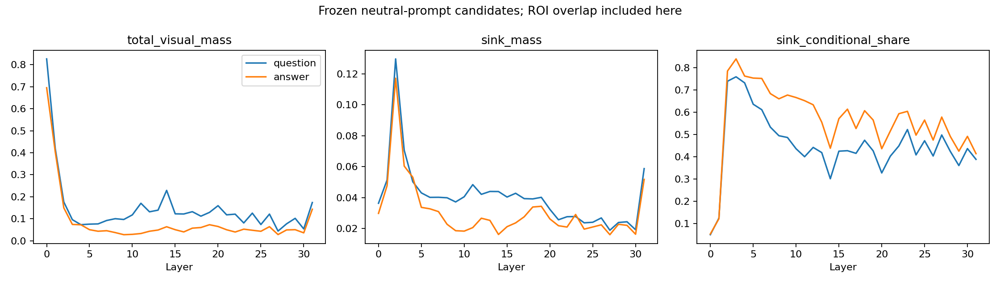
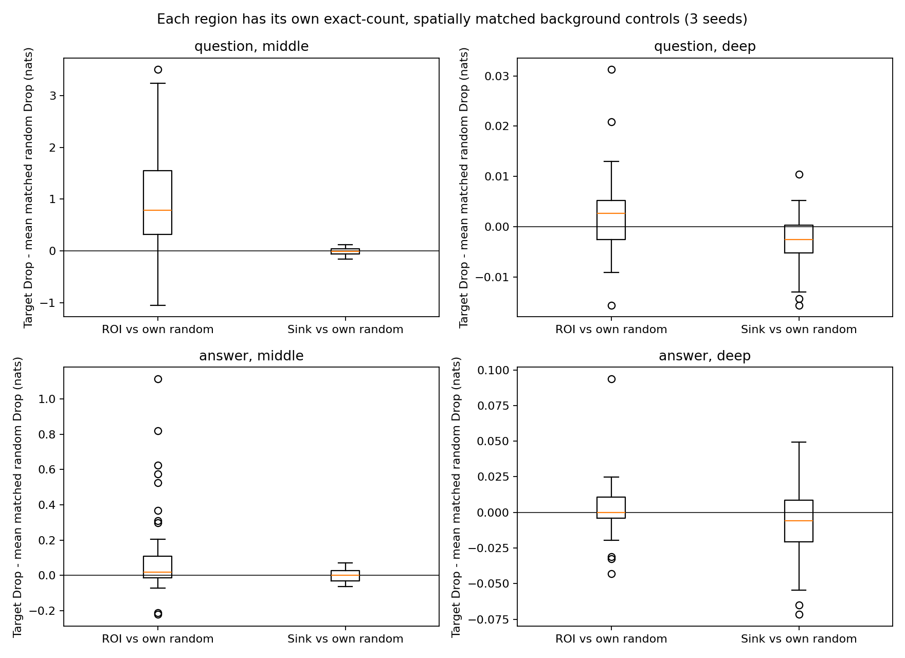

# Phase 3.4 — ROI vs Attention Sink Causal Diagnostic

## 完成状态与假设判定

2026-10-28：已完成真实Processor的240图ROI审计、48张预固定主样本和5张独立案例的Attention观察、3图7B Smoke、全部小规模定向Mask实验及五案例数值敏感性检查。83项CPU回归在GPU之前通过，补充统计/案例隔离测试后最终85项通过。完成后停止，不训练Sink Gate/Router，不扩展240图全组合、Decode、KV Cache或模型结构。

H1只得到**有条件的支持**：中层真实Question Query存在ROI面积富集，且阻断这一连接集合对Margin的损伤明显大于同数量背景对照；但不是所有图/Head/Query都如此，Sink候选本身的Attention密度仍远高于ROI，不能说中层普遍“只看ROI而非Sink”，更不能将全部候选当作无关位置。

H2的强表述**未获支持**：深层Sink视觉内占比没有普遍高于中层，跨图Sink Attention与Full Margin关系弱。深层定向Sink阻断相对随机对照有很小的平均Margin改善，但没有主队列正确率收益，也没有恢复K24 Physical Exit改善的两条历史问题。不能由此宣称Sink是Physical Exit改善的原因。

## 文献核对与模型

已读四篇原文并审查官方InformationFlow.py的xywh→xyxy、blockdesc2range_patches()及utils.py的create_mask_with_bbox()/Patch排列。详见 `source_review.md` 与 `references.json`，记录PDF/源码SHA256。SAGE的arXiv备注具体是**Accepted to EMNLP 2026 Findings**；ECCV文献完整标题为 *When Sinks Help or Hurt: Unified Framework for Attention Sink in Large Vision-Language Models*。本轮不是上述论文的严格复现，不导入其结论，也不执行其中训练或Attention引导算法。

环境和权重沿用：Python3.11.18、Torch2.6.0+cu124、Transformers4.49.0、CUDA12.4、驱动595.99.02、RTX4090 GPU0；LLaVA1.5-7B HF revision b234b804b114d9e37bb655e11cbbb5f5e971b7a9，7,063,427,072参数，FP16/eager、batch1、eval/inference_mode、use_cache=False。未重装环境、下载模型、修改旧阶段Python/结果或第三方源码，未终止其他GPU进程。

## ROI映射、样本冻结与面积控制

完全复用Phase3.2的240张GQA ChooseRel图及官方CSV对象1/2框。实际Processor为shortest_edge=336、BICUBIC、336×336 Center Crop。使用真实resize所得整数长边，分别计算x/y比例，再减floor裁剪偏移；原框采用连续半开xywh，对Patch有正面积交集即归入ROI。保存每个对象的裁后框、可见面积比例、每Patch覆盖比例、Patch中心落框敏感性集合。真实CLIPVisionEmbeddings测试验证行优先 `r*24+c`，去CLS后576个Token与实际输入索引一致。

240/240图重新构造的pixel_values与实际Processor逐元素一致。独立审计结果：**215图两对象均有可见Patch，24图只有一个，1图两者都不可见**；与用户预审一致，但这里由实际代码验证。14张代表性三联图见 `roi_overlays/`，含原图框、实际裁剪和Patch Overlay，覆盖主样本面积分位及部分/全部裁出案例。

在任何GPU预测前写定规则：两对象各≥2 Patch，ROI并集4..192 Patch，较大/较小对象Patch数≤16；五个指定历史案例单独排除于主集合。几何排除110/240，理由可重叠：对象少于2 Patch25、一个/两个完全裁出25、并集面积越界83、面积比过大28；剩余130中有3张属于历史案例，主采样池left64/right63。按qid排序、固定Random(20261030)先left后right打乱，各取24，**不是按答案正确性/本轮结果筛选**。完整主48ID与240图几何记录冻结于manifest.json。

主ROI平均82.958 Patch，范围14–183；非ROI Sink平均13.417。每个目标各自有三种seed3401/3402/3403的精确同数量随机背景对照，池排除两个对象ROI与全部候选Sink；优先同一6×6 Patch空间bin，不足时贪心选择最近bin。主Sink对照100%同bin；ROI对照平均61.61%同bin，平均bin曼哈顿距离0.414，最大3，因此不是完美的空间匹配，可能仍有位置/上下文混杂。

独立案例 `0216546` 的ROI并集510、背景不足以选择510个控制Patch，12个ROI随机组合明确不可用；该例只展示未匹配ROI效应，不做其ROI-vs-random结论。全部主样本控制均可用，没有更换图或改变ROI。

ROI是对象**边界框**而非语义分割，包含框内背景；框外也可能存在其他相关对象和场景信息。“Background”不自动等于无关，更不自动等于Sink。几何筛选改变分布；主48的Full只有33/48（68.75%），left24/24、right9/24，与历史240图Full187/240不同，不能直接横比性能。

## Sink候选如何定义和冻结

中性提示固定为 `Describe this image.`、`What can be seen in the image?`、`Summarize the scene.`。前两个用于识别，第三个只检查稳定性。每图每个发现提示有两个视图：真实Question Token行的均值、最后Prompt Token P−1。每层先跨Head平均原始视觉Attention，再条件化到576视觉Patch。

某Patch在一视图中若有≥8/32层同时满足：视觉条件概率≥5/576且位于top58（固定索引解决平局），则该视图称持续热点。四个发现视图中≥3个满足者为候选；不偏好早/中/深层，不使用ROI、答案、Margin或干预输出。第三提示要求其Q/A两视图各持续≥8层，仅计算Jaccard/保留率，**不据此删改候选**。规则在任何Attention运行前写入preregistered_protocol.json；实际集合与随机控制在全部因果评分前冻结于sink_manifest.json。

主样本候选每图7–20个，中位数14；第三提示Jaccard中位0.8667。23/48图的候选与ROI有交集，平均1个交集Patch；单独记录全部交集，因果Sink条件只阻断**非ROI候选**。跨样本位置不是完全固定：最常见Patch575出现26/48图，574为16/48、572为13/48；详见sink_coordinate_frequency.png。候选是操作性定义的持续热点，不是已证明的无关Sink。

额外记录每层/Head的K/V投影范数及原始层输入激活。按ICLR论文相同维度1415/2533计算signed最大值除RMS的phi（tau20只作描述，不重设候选）：非ROI Sink的平均phi在中/深层为19.70/18.85，ROI约2.07/3.30，背景1.99/3.54；候选中约32.09%的patch-layer达到phi≥20。K/V范数并非最高：例如中层候选K/V均值12.61/3.27，ROI18.85/4.48，背景18.95/4.31。持续高Attention与异常维度激活相容，却不能据此将所有候选都分类为同一来源或纯噪声。

## Attention观察结果

每个图/层/Head保存真实Question行的均值和P−1行，形状[32,32,2,576]；Question组先平均各Token行，随后计算非线性熵/富集，不能当作每Token熵的均值。Head等权、图等权。ROI Enrichment=(ROI Mass/Visual Mass)/(N_ROI/576)；表中的比例是逐Head计算后平均，不能用均值质量之比替代。

| Query | 窗口 | ROI富集 | ROI富集>1图数 | ROI原始质量 | Sink原始质量 | Sink视觉内占比 | Sink面积富集 |
|---|---|---:|---:|---:|---:|---:|---:|
| question | middle | 1.4896 | 33/48 | 0.03476 | 0.04200 | 0.4256 | 17.64 |
| question | deep | 0.9782 | 15/48 | 0.01636 | 0.02741 | 0.4239 | 17.61 |
| answer | middle | 0.9183 | 16/48 | 0.00792 | 0.02114 | 0.6071 | 25.14 |
| answer | deep | 0.9316 | 15/48 | 0.00797 | 0.02393 | 0.4923 | 20.46 |

Sink质量含ROI交集；非ROI部分另外保存。中层Q的Patch中心敏感性ROI富集为1.646，也高于1；中层A约1.018，说明对边界选Patch的定义更敏感。中层Q有ROI富集但仅33/48图高于1，中层A仅16/48；深层Q/A各15/48。Task相对第三中性Prompt的富集差在部分中层Q较大，但提示长度、Token内容/位置均不同，只作描述性对照。

深层Q总视觉质量0.09667，低于中层0.13864；A为0.05802，高于中层0.04193。Sink视觉内占比Q约0.426→0.424，A约0.607→0.492，**不符合深层普遍更集中于这些候选的预期**。深层Sink条件占比与Full Margin的Pearson Q=−0.0140、A=+0.0347，未见稳定负相关。中层分别−0.1089/−0.1059，也不足以推断因果。

32层曲线、各Head热图、条件熵/HHI/top58集中度、ROI top58覆盖及原始质量均已输出。注意候选按持续高Attention定义，本来就会在发现Prompt中显著；第三Prompt稳定性和实际任务行可减轻同一观测的循环论证，但不能证明无关性。

## 定向Mask因果实验

只测试L8–15和L24–31，分别Question-only、Answer-only；没有为了结果追加联合或其他窗口。行是target Query、列为source Image Key；A正确定位P−1，而非输入答案P。继承已验证的Mask Clone/Hook机制，选择对应视觉Key子集，保留576个视觉状态与原始位置、所有32层，**不属于加速或Physical Exit**。

仍用原Prompt、原候选顺序和完整候选条件logP，gold−wrong为Margin，Drop=Full−干预，严格>0正确、平局算错；当前左右均一Token。以下主48统计分母完全相同，Full-correct33、Full-wrong15。负Drop为Margin改善；最后一列=目标Drop−三种同数量随机Drop均值，正值表示目标阻断更伤害预测，负值表示相对随机更有利。不同目标之间Patch数不同，不能按原始Drop直接排名ROI/Sink重要性。

| Query | 窗口 | 阻断目标 | 正确/48 | 原对→错/原错→对 | Mean Drop | Median Drop | P95 Drop | 相对各自随机对照的额外Drop |
|---|---|---|---:|---:|---:|---:|---:|---:|
| question | middle | roi | 33 | 1/1 | +0.908122 | +0.730469 | 3.025000 | +0.966309 |
| question | middle | sink_nonroi | 33 | 0/0 | -0.015218 | -0.017578 | 0.093359 | -0.014025 |
| question | deep | roi | 33 | 0/0 | +0.000732 | +0.000000 | 0.007812 | +0.001845 |
| question | deep | sink_nonroi | 33 | 0/0 | -0.002523 | -0.000000 | 0.007812 | -0.002903 |
| answer | middle | roi | 33 | 0/0 | +0.103597 | +0.015625 | 0.593359 | +0.109185 |
| answer | middle | sink_nonroi | 33 | 0/0 | -0.001790 | +0.000000 | 0.062500 | -0.001546 |
| answer | deep | roi | 33 | 0/0 | -0.001302 | -0.001953 | 0.020703 | +0.002848 |
| answer | deep | sink_nonroi | 33 | 0/0 | -0.009521 | -0.007812 | 0.031250 | -0.008653 |

**较可靠的主结果：** 中层Q→ROI比匹配背景多损失0.966309nats（图级bootstrap均值95%区间[0.623043,1.301634]），中层A→ROI额外Drop0.109185（[0.042860,0.183522]）。这支持指定对象连接集合在本队列中对预测有作用；中层Q→ROI有一原对变错、一原错变对相互抵消，所以最终正确率没变。损失案例09430662的Margin从+2.5859375变为−0.1640625。全部ROI/Sink目标条件的分组正确数仍是left24/24、right9/24；中层Q→ROI的一损一益均发生于right组，净准确率掩盖了配对翻转。三随机对照仅中层Q→randomROI seed3401为right10/24，其余均right9/24，left均24/24；各条件完整分组表见causal_summary.csv。

**较弱的深层结果：** 非ROI Sink的相对随机额外Drop Q=−0.002903、A=−0.008653，名义bootstrap区间分别[−0.004395,−0.001491]、[−0.015599,−0.001871]。但改善量小、没有任何主样本分类收益，且“自身Margin改善并优于全部三个随机seed”的样本只有Q15/48、A23/48，不是普遍稳定改善。名义区间未多重比较校正，不能绕过FP16精度、数据选择和对照匹配限制来确认普遍有害机制。深层ROI的相对随机均值也很小且区间跨0。

## 五个历史案例（不进入48图主估计）

以下深层窗口与K24后缀层相同，但干预目标不同；表内均为正确答案Margin，0仍判错。

| question_id | Full Margin | 历史Physical K16 | 历史Physical K24 | 深层Q→Sink阻断 | 深层A→Sink阻断 |
|---|---:|---:|---:|---:|---:|
| 04132006 | -0.0078125 | -0.0156250 | +0.0312500 | +0.0000000 | -0.0078125 |
| 15133706 | -0.0312500 | +0.0234375 | +0.0390625 | -0.0234375 | -0.0312500 |
| 0216546 | +0.0703125 | -0.0156250 | +0.0625000 | +0.0703125 | +0.0625000 |
| 02310173 | +0.0859375 | +0.0000000 | +0.0859375 | +0.0859375 | +0.0937500 |
| 05480434 | +0.1406250 | -0.2734375 | +0.1484375 | +0.1406250 | +0.1406250 |

前两条是K24 Physical原错变对：04132006（Full−.0078125→Physical+.03125），15133706（−.03125→+.0390625）。单独阻断深层非ROI Sink没有将任一问题恢复为正确：Q条件分别0（错误平局）、−.0234375；A条件仍−.0078125、−.03125。因此**未重现Physical Exit的两例改善**，不能把小幅负Drop或弱Margin平局当作Sink有害的证明。

中层对照的全部四种区域干预Margin：

| question_id | 中层Q→ROI | 中层A→ROI | 中层Q→Sink | 中层A→Sink |
|---|---:|---:|---:|---:|
| 04132006 | -1.6406250 | +0.0156250 | -0.1093750 | -0.0234375 |
| 15133706 | -3.9648438 | -0.0703125 | -0.1250000 | -0.0703125 |
| 0216546 | -2.7500000 | -0.2812500 | +0.0625000 | +0.0546875 |
| 02310173 | -0.2890625 | +0.0312500 | +0.0390625 | +0.0468750 |
| 05480434 | -2.2109375 | +0.1484375 | +0.1093750 | +0.0937500 |

中层Q→ROI对五例均有较大损伤，而非ROI Sink效应较小且方向不一；但ROI遮蔽Patch更多，必须结合各自随机控制，不能直接按幅度当作相同强度实验。04132006的中层A→ROI反而变成+.015625，也是弱Margin、非Sink特异的改善。0216546的ROI达510且一个对象可见面积仅约18.5%，不具备与主样本相同面积/空间可比性。

后3条是K16 Physical原对变错；深层小范围干预本身不能定位其L16–23或其余文本路径的贡献。保留其中所有Attention、ROI、候选/随机对照和概率，详见historical_cases.csv/json及attention_overlays/，不据这五例估计总体效应。

## 数值正确性、FP16和计算开销

GPU前83项、最终85项CPU测试通过，覆盖实际Processor奇数缩放/裁剪、连续框面积守恒、真实CLIP patch flatten、Sink规则深度对称/阈值/留出、控制精确数量和重现、真实Mask行列/窗口/非目标不改/Clone、空集Sham、Hook异常清理、流式Attention与原生输出一致、Question因果不变量、统计公式和案例不混入主统计。

3图真实7B Smoke审计96次选定Attention Forward、3072层矩阵，目标Attention严格0，最大行和误差0.000383377；53图观察的最大行和误差0.000414848。全部观察的Attention开启/关闭预测及Question hidden精确一致，Full分数与Phase3.2精确一致；Smoke和正式同样本分数精确一致；A-only不改变更早Question hidden，所有干预后再原生Forward精确恢复。无NaN/Inf或OOM，无Hook残留。Mask只改指定连接，softmax会重新分配其余概率，最终效应不能当作被删权重的线性贡献。

五案例额外固定55个Full/深层ROI/Sink/随机Sink条件，用相同FP16主干的最终隐藏状态和复制的未修改权重做CPU FP32 LM head投影；最大Margin变化0.00826836nats，55/55未改变二选一分类。不过某些微小“相对随机”效应方向发生变化，如05480434的A→Sink额外Drop从+.002604变成−.001205；这说明细微效应不应被赋予强机制解释。检查仅隔离最终投影舍入，**没有完整FP32主干复验**，不能认证所有FP16差异可靠。评分本来就用double log_softmax；部分约1e−15的Drop来自浮点相消，原始值保留，不能计作有意义的改善。

所有|Full或干预Margin|≤0.15的条件打弱Margin标记，不从主样本中剔除，也未因此调整Sink/ROI/标签/阈值。此前Phase3.1容差和Phase3.3历史结果不变。

真实耗时：Attention观察62.923秒、Smoke33.560秒、正式阻断416.054秒（采用各阶段完成门内计时，包含资源预检/加载/评分/同步/采样/检查点，初始配置校验另计）；有限FP32输出投影检查7.912秒为加载完成后的测量。正式模型加载5.185571秒，加载后allocated13473.648MiB。观察/Smoke/正式阻断记录的最大allocated13641.403MiB、reserved13736MiB。部分时期GPU0有其他占用，资源快照均保留，没有终止进程。本轮53图Prompt长度602–609，teacher-forcing加入单Token候选后实际序列603–610（随问题变化），所有576视觉Token始终保留，没有独立预热/重复计时，不报告稳定加速比。

正式1696个目标组合中12个案例ROI随机组合不可用，实际1684个干预配对+53个Full，共1749行；主48全部组合完整。仅正式阶段实际3527次Forward（Full每图2次、每个可用干预2次、清理后Full每图1次）。不把缺失案例对照写成成功，也没有运行240图全组合。

首次观察启动在模型加载前因resource_preflight返回dict被误解包为tuple而停止；已修正调用，保留失败日志、初始配置和说明，未产生任何GPU结果或改变数据/规则。之后全部GPU阶段成功。这一软件错误与假设检验结果无关。

## 交付与结论边界

- 几何：manifest.json、roi_mapping_audit.csv/json、14张ROI三联图。
- 观察：attention_rows/只保存所需Q组/P−1行及小型范数/激活数组；head_attention_statistics.csv.gz共108544条（gzip CSV保留全部字段）、sample_layer_attention.csv、layer_attention_summary.csv、Head热图、曲线、集中度/稳定性/空间分布和9张Attention Overlay。没有保存完整S×S矩阵。
- 因果：per_sample_results.csv/json共1749行、causal_summary.csv/json、paired_target_random.csv、paired_effect_summary.json、两张因果分布图、完整检查点/逐层Hook审计。
- 案例与数值：historical_cases.csv/json、precision_sensitivity.csv/json、precision_paired_sink_random.csv、correctness_validation.json、observation_validation.json、compute_diagnostics.csv及日志。

最终回答：中层Question存在部分稳定ROI富集及大于匹配背景的Mask效应；不能概括所有Query或排除Sink热点。深层候选不普遍比中层更显著，也未见稳定的负Margin相关。深层Sink定向阻断有很小、Query依赖的平均改善，未带来准确率收益，案例不能解释Physical Exit两例恢复。Attention相关性、指定Mask干预效应和Physical Exit整体效应是三个不同对象；目前不证明视觉信息已完全融合、候选均有害、某层安全退出或Gate/Router应如何设计。本阶段到此停止。
