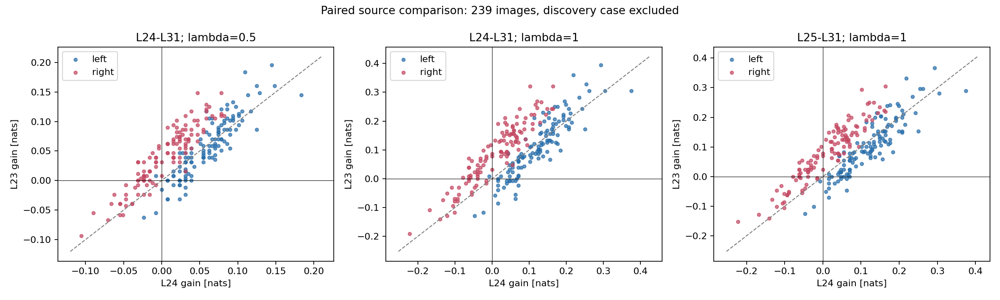
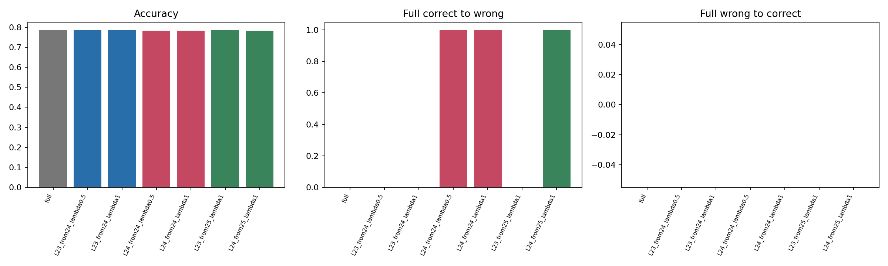
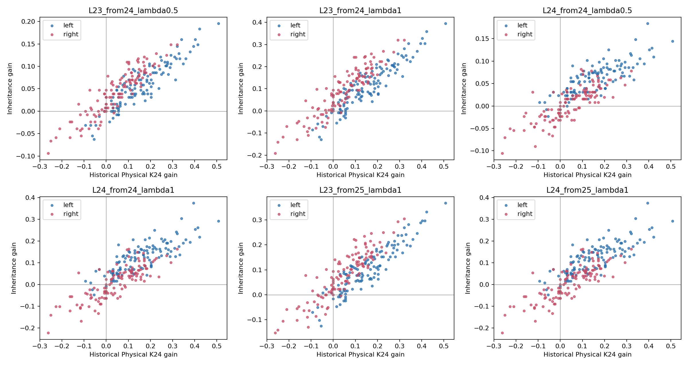
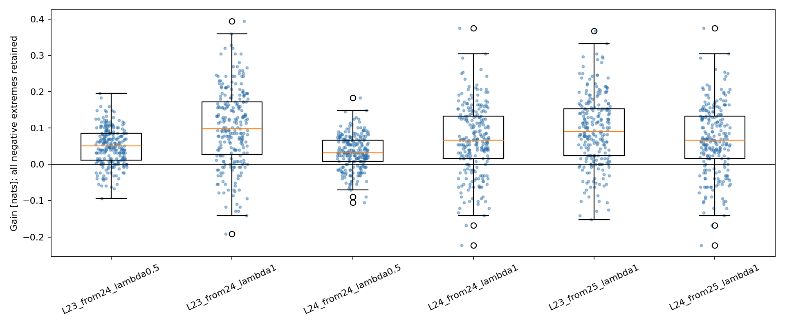

# Phase 3.6: 240-image Attention inheritance validation

Status: completed. Four frozen 60-image shards passed; one master aggregation.
Frozen implementation: `0d323e1bb3eb6f91443854e90242150b04e9eaf1`. Primary analysis excludes 15133706 (n=239).
The separate 187-image subgroup had no Phase3.4 task Attention cache. The other cached images are not automatically previously intervened examples.
All 240 fresh Full references are from their own image; historical differences are retained. No training, decoding or physical rerun.

| Condition | Accuracy | Harmed | Recovered | Mean gain | 95% paired CI | Positive gain | Absolute correct logP gain |
| --- | ---: | ---: | ---: | ---: | --- | ---: | ---: |
| L23_from24_lambda0.5 | 0.7866 | 0 | 0 | +0.049572 | [+0.043246, +0.055864] | 194/239 | -0.129813 |
| L23_from24_lambda1 | 0.7866 | 0 | 0 | +0.100876 | [+0.087996, +0.113788] | 195/239 | -0.219082 |
| L24_from24_lambda0.5 | 0.7824 | 1 | 0 | +0.032868 | [+0.027115, +0.038523] | 182/239 | -0.112226 |
| L24_from24_lambda1 | 0.7824 | 1 | 0 | +0.066586 | [+0.054802, +0.078077] | 183/239 | -0.223978 |
| L23_from25_lambda1 | 0.7866 | 0 | 0 | +0.091642 | [+0.079808, +0.103475] | 196/239 | -0.185814 |
| L24_from25_lambda1 | 0.7824 | 1 | 0 | +0.066586 | [+0.054802, +0.078077] | 183/239 | -0.223978 |

## Research Questions

- L23_from24_lambda0.5: positive margin gain in 194/239, harmed 0 Full-correct images; left/right mean gain +0.057064/+0.042017. Physical Pearson/Spearman 0.8773342037091424/0.8544191668544799 (bootstrap intervals in aggregate.json).
- L23_from24_lambda1: positive margin gain in 195/239, harmed 0 Full-correct images; left/right mean gain +0.111589/+0.090074. Physical Pearson/Spearman 0.8700666933551522/0.845308528643795 (bootstrap intervals in aggregate.json).
- L24_from24_lambda0.5: positive margin gain in 182/239, harmed 1 Full-correct images; left/right mean gain +0.060091/+0.005416. Physical Pearson/Spearman 0.8389355981987516/0.8196372155211319 (bootstrap intervals in aggregate.json).
- L24_from24_lambda1: positive margin gain in 183/239, harmed 1 Full-correct images; left/right mean gain +0.122005/+0.010701. Physical Pearson/Spearman 0.846567049898723/0.8274216423690349 (bootstrap intervals in aggregate.json).
- L23_from25_lambda1: positive margin gain in 196/239, harmed 0 Full-correct images; left/right mean gain +0.103092/+0.080095. Physical Pearson/Spearman 0.8659787571558916/0.8396180587140802 (bootstrap intervals in aggregate.json).
- L24_from25_lambda1: positive margin gain in 183/239, harmed 1 Full-correct images; left/right mean gain +0.122005/+0.010701. Physical Pearson/Spearman 0.846567049898723/0.8274216423690349 (bootstrap intervals in aggregate.json).
- Matched from24_lambda0.5: L23 minus L24 mean gain +0.016704, 95% paired CI [+0.012846, +0.020545], wins/losses/ties 161/70/8.
- Matched from24_lambda1: L23 minus L24 mean gain +0.034290, 95% paired CI [+0.026118, +0.042544], wins/losses/ties 156/79/4.
- Matched from25_lambda1: L23 minus L24 mean gain +0.025056, 95% paired CI [+0.017585, +0.032558], wins/losses/ties 147/86/6.

Evidence is not confined to the discovery case for: L23_from24_lambda0.5, L23_from24_lambda1, L24_from24_lambda0.5, L24_from24_lambda1, L23_from25_lambda1, L24_from25_lambda1. This does not establish a universal mechanism.
Any continuation requires a new explicit protocol. Do not choose an after-the-fact best lambda, claim equivalence to Physical Exit, or interpret relative ranking gain as absolute correct-answer probability gain.

All 240 supplemental results, the uncached 187 subgroup, Full-correct/Full-wrong/weak-margin strata, lambda directions, paired flips and exact paired statistics, tail losses and bootstrap correlations are in aggregate.json and per_sample.csv.
Bootstrap resamples images with all conditions paired (5000 fixed-seed repetitions). Intervals are exploratory and not multiplicity adjusted. Ties are incorrect. No head/layer is an independent sample.

