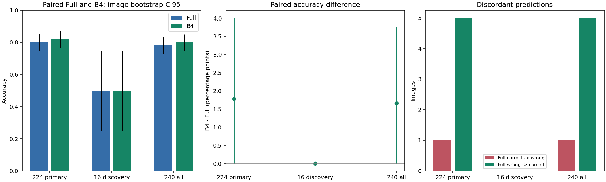
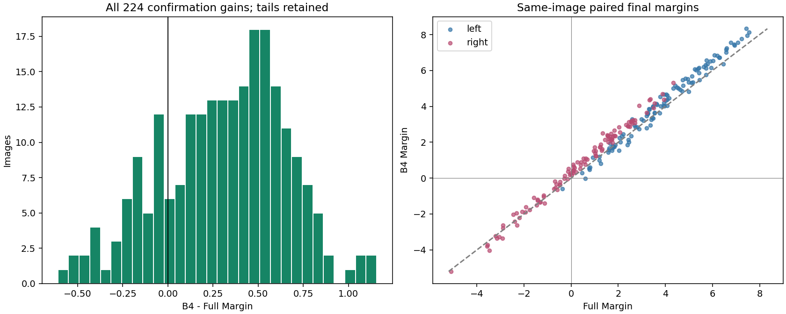
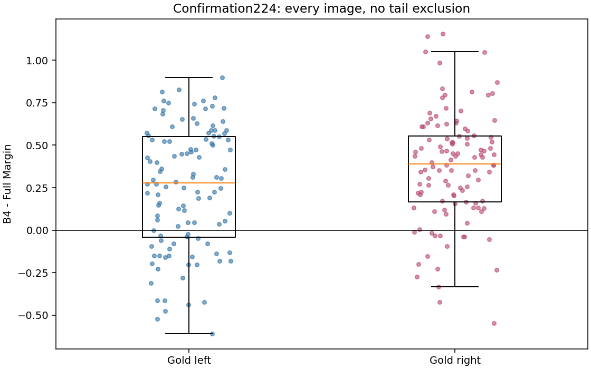
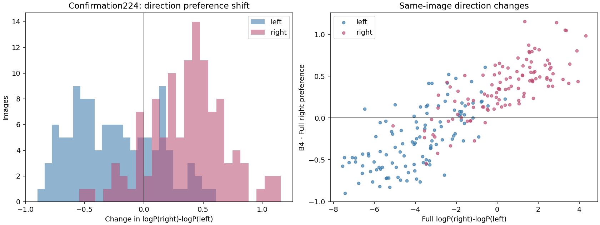
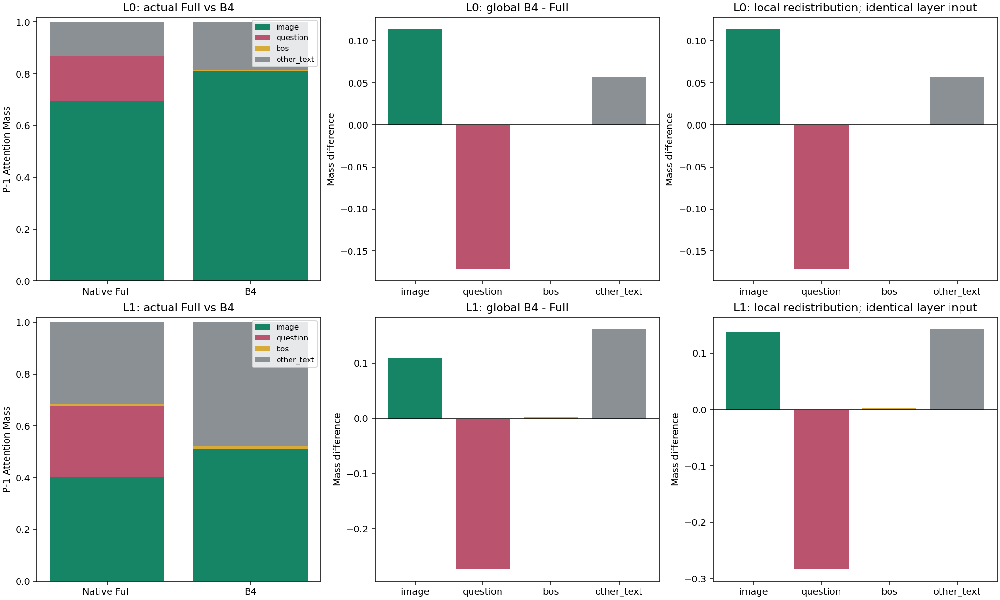

# Phase 3.7B: Independent Full vs B4 Validation

**Status: completed.** All 240 original images were paired on physical GPU0 in this run; confirmation224 is primary, discovery16 and all240 supplementary.
Base `f1e661fd228ec600e5a63b3016d68bd2fde64940`; executed frozen code `4f9ff439f18a4c60722ab86e225c30816bc717b0`. FP16/eager LLaVA-1.5-7B, Transformers4.49.0, original prompt and complete candidate scoring; no EOS. Ties are wrong.

Only conditions: C0 Native Full and C1 unmodified Phase3.7 B4 (P-1 Query -> real Question Keys blocked only in L0/L1). No training, new mask, layer/strength scan, decode, KV cache, exit or other dataset.

## Frozen Cohorts and Inference

All original Phase3.2 240 distinct images; string question_id order. Primary: exact complement of original Phase3.7 16 image IDs (224); discovery16 and all240 supplementary. No new sampling or output filtering.
Question IDs remain strings including leading zeroes. Every image SHA256, actual input/Question/P-1/BOS mapping, candidate token and original source is frozen before formal GPU scoring. The upstream correct_question ChooseRel cohort is preselected; these results are not unbiased GQA-population estimates. The 224 images are disjoint from the 16 B4 discovery images, not a newly sampled external dataset.
20,000 image-paired bootstrap resamples, fixed seed 20261029 plus deterministic cohort/subset label hash; percentile CI95. All paired quantities use the same sampled image indices. Exact two-sided McNemar uses only discordant classifications. Confirmation224 accuracy difference/McNemar is primary; subgroup and other metric intervals are descriptive without multiplicity adjustment. No head or layer is an independent sample.

## Full vs B4

| Cohort | Full correct / N | B4 correct / N | Accuracy difference pp [CI95] | Correct->wrong | Wrong->correct | Exact McNemar p |
| --- | ---: | ---: | --- | ---: | ---: | ---: |
| confirmation224 | 180/224 | 184/224 | +1.785714 [+0.000000, +4.017857] | 1 | 5 | 0.21875 |
| discovery16 | 8/16 | 8/16 | +0.000000 [+0.000000, +0.000000] | 0 | 0 | 1 |
| all240 | 188/240 | 192/240 | +1.666667 [+0.000000, +3.750000] | 1 | 5 | 0.21875 |

### Primary Confirmation224 Metrics

| Metric | Estimate [paired CI95] |
| --- | --- |
| mean_gain | +0.309623 [+0.264194, +0.354701] |
| median_gain | +0.351562 [+0.273438, +0.429688] |
| mean_absolute_gain | +0.393293 [+0.360873, +0.426060] |
| p5_gain | -0.280078 [-0.421875, -0.195312] |
| p95_gain | +0.803516 [+0.742188, +0.871094] |
| mean_gold_logp_change | +1.420711 [+1.375188, +1.467053] |
| mean_wrong_logp_change | +1.111089 [+1.054887, +1.168009] |
| mean_right_minus_left_change | +0.058995 [-0.000645, +0.119860] |

Gold/wrong LogP changes are signed changes of absolute full-vocabulary conditional log probabilities, not absolute values and not a two-choice normalized probability. Positive mean Margin Gain alone is not accuracy improvement.

177/224 confirmation images have positive Gain,47 have negative Gain, and none have zero Gain. Thus the Margin effect is not confined to the original16, but it is not uniformly harmless. Only six classifications are discordant; the exact McNemar test remains p=0.21875. The percentile accuracy interval includes zero at its lower boundary, not evidence of a strictly positive accuracy effect.

### Left / Right and Full-Correct / Full-Wrong

| Primary subgroup | N | Full correct | B4 correct | Harmed | Recovered | Mean Gain [CI95] | Mean right-left shift |
| --- | ---: | ---: | ---: | ---: | ---: | --- | ---: |
| left | 112 | 111 | 110 | 1 | 0 | +0.250628 [+0.183942, +0.316232] | -0.250628 |
| right | 112 | 69 | 74 | 0 | 5 | +0.368617 [+0.307757, +0.428816] | +0.368617 |
| full_correct | 180 | 180 | 179 | 1 | 0 | +0.362522 [+0.311198, +0.413716] | +0.048112 |
| full_wrong | 44 | 0 | 5 | 0 | 5 | +0.093217 [+0.015714, +0.169569] | +0.103516 |

### Every Classification Flip

| Question ID | Gold | Full Margin | B4 Margin | Gain | Transition |
| --- | --- | ---: | ---: | ---: | --- |
| 00784767 | right | -0.265625 | +0.132812 | +0.398438 | wrong->correct |
| 04993832 | right | -0.054688 | +0.195312 | +0.250000 | wrong->correct |
| 10326583 | left | +0.601562 | -0.007812 | -0.609375 | correct->wrong |
| 15133706 | right | -0.031250 | +0.273438 | +0.304688 | wrong->correct |
| 16907668 | right | -0.136719 | +0.382812 | +0.519531 | wrong->correct |
| 19772878 | right | -0.109375 | +0.523438 | +0.632812 | wrong->correct |

All flips are in the frozen confirmation224; discovery16 has none. The familiar15133706 case remains included exactly as its frozen group membership specifies; no post-hoc exclusion or special weighting is introduced. This is B4-disjoint confirmation, not a previously untouched external dataset. At the harmed10326583, gold absolute LogP rises by+0.956824 but wrong LogP rises more (+1.566199), illustrating why absolute probability gain is not correctness improvement. The final harmed Margin is weak/near zero, so numerical precision remains relevant rather than suppressed.

### Worst Primary Losses (All Retained)

| Question ID | Gold | Full Margin | B4 Margin | Gain |
| --- | --- | ---: | ---: | ---: |
| 10326583 | left | +0.601562 | -0.007812 | -0.609375 |
| 12353852 | right | -3.480469 | -4.027344 | -0.546875 |
| 19151820 | left | +2.382813 | +1.859375 | -0.523438 |
| 09654198 | left | +2.031250 | +1.554688 | -0.476562 |
| 17407668 | left | +1.257812 | +0.820312 | -0.437500 |
| 15394126 | left | +2.445312 | +2.023438 | -0.421875 |
| 15562494 | right | -2.921875 | -3.343750 | -0.421875 |
| 13764143 | left | +3.351563 | +2.937500 | -0.414063 |
| 1378410 | left | +3.195312 | +2.781250 | -0.414062 |
| 02697656 | right | -2.292969 | -2.625000 | -0.332031 |

## Attention Mass and Redistribution

Actual Full/B4 mass is compared within each image. Local redistribution separately holds the actual layer input fixed. In L1, B4 hidden input can already differ because of L0; its local-native replay is not global Native Full. Image, Question, BOS and other valid text keys are disjoint and exhaustive. Every P-1 raw attention row and per-head mass is saved.

| Layer | Key group | Full mass | B4 mass | Actual change [CI95] | Local same-input redistribution |
| --- | --- | ---: | ---: | --- | ---: |
| L0 | image | 0.696219 | 0.810403 | +0.114185 [+0.113330, +0.115085] | +0.114185 |
| L0 | question | 0.171317 | 0.000000 | -0.171317 [-0.172517, -0.170180] | -0.171317 |
| L0 | bos | 0.002532 | 0.002926 | +0.000393 [+0.000390, +0.000397] | +0.000393 |
| L0 | other_text | 0.129932 | 0.186671 | +0.056739 [+0.056425, +0.057070] | +0.056739 |
| L1 | image | 0.403180 | 0.512835 | +0.109655 [+0.108237, +0.111081] | +0.137611 |
| L1 | question | 0.273608 | 0.000000 | -0.273608 [-0.275023, -0.272215] | -0.283345 |
| L1 | bos | 0.009117 | 0.011295 | +0.002178 [+0.002112, +0.002244] | +0.002895 |
| L1 | other_text | 0.314094 | 0.475870 | +0.161776 [+0.160621, +0.162941] | +0.142838 |

## Seven Research Answers

1. **Does B4 improve accuracy on the 224 previously untested images?** Full 180/224 (80.3571%) versus B4 184/224 (82.1429%); paired difference +1.785714 [+0.000000, +4.017857] pp, exact McNemar p=0.21875. The observed accuracy difference is positive, but the primary bootstrap interval does not establish a strictly positive effect and the exact test does not reject equal error rates at0.05. Accuracy improvement is not confirmed; do not replace this endpoint with a favorable mean Margin.
2. **Are Full errors corrected?** 5 previously wrong/tied images become correct. The current-Full-wrong subgroup is reported separately, not removed from the denominator.
3. **Are Full-correct images harmed?** 1 become wrong/tied. Tail losses and the Full-correct subgroup remain visible; correction counts alone are insufficient.
4. **Does the discovery effect reproduce?** Original16 mean Gain +0.130127; independent rerun +0.130127, median +0.046875, accuracy 8/16 -> 8/16. The original positive signed mean reproduces descriptively. Maximum absolute archived-versus-current raw prediction-logit difference across all16 Full/B4 is 0. These cross-run FP16 differences are recorded, not suppressed or used to relax exact same-run controls.
5. **Is this mainly a right-candidate preference shift?** Accuracy gains are entirely right-side corrections (5), with one left-side loss. However, gold-left and gold-right mean Margin Gains are both positive (+0.250628/+0.368617): right-minus-left shifts leftward by-0.250628 in the gold-left group and rightward by+0.368617 in the gold-right group. This is not the pattern of a single uniform rightward shift explaining all Margin gains. The overall rightward shift is only+0.058995, with CI95[-0.000645,+0.119860] including zero. Full left accuracy is already111/112 versus69/112 on right, leaving very different correction headroom. Therefore the observed accuracy benefit is concentrated on right, but a global right-bias explanation is not established, and neither improved semantic grounding nor its absence is proven by these two candidates.
6. **Does B4 increase actual P-1 Image Attention?** Actual paired Image Mass changes: L0 +0.114185 [+0.113330, +0.115085]; L1 +0.109655 [+0.108237, +0.111081]. The largest positive local redistribution target is image in L0 and other_text in L1. Compare these BOS/other-text increments with Image rather than assuming a visual destination. A mechanical probability redistribution is not proof of better visual information use.
7. **Does this support delayed Question->Answer reading?** Margin improvement generalizes descriptively beyond the original16, but the primary accuracy evidence does not establish a reliably positive improvement; the proposed delayed-reading mechanism remains unconfirmed. This intervention tests direct P-1->Question access only in the first two layers. Other template-text positions can already carry Question information and remain readable by P-1, so B4 does not enforce absence of all Question-to-answer information flow until L2. Later layers can still read Question directly. Compensation, lexical/logit shifts and alternative paths are possible. This experiment does not establish that text is irrelevant, that all early interaction is unnecessary, or that globally delayed reading is a generally better mechanism.

## Correctness and Reproducibility

CPU acceptance and two-image GPU smoke precede formal scoring. Smoke requires new diagnostic runner logits/observations to be exactly equal to the original Phase3.7 B4 computation in the same run. Formal audits: 30720 layer/candidate records and 960 local masked records.
Per image: dynamic mappings; target weights zero; all32 Question decoder states and final RMSNorm exact Full; no-op valid-text logits exact Full; restored Full exact; original causal/non-target local connections and L2-L31 masks preserved; 576 visual tokens retained. Input/parameter versions and hook footprint checked every forward, full parameter+buffer byte hashes before/after stage, installed Transformers source hashes unchanged. No accepted NaN/Inf/OOM/partial sample. Original ROW_ATOL=.002 unchanged.
Historical RTX4090 Full is used only for a numerical-difference audit, never as the paired control. Discovery16 archived logits and scores are compared in discovery_replication.csv. Resume accepts only hash-bound complete checkpoints, with no duplicate count or silent override. Failed attempts, if any, remain partial and must be disclosed, not counted as additional images.

All147 CPU tests (18 focused) pass. There were no failed GPU attempts or accepted partial samples in this run. Formal stage wall time is719.5398seconds excluding model loading/pre-stage hashing, not a stable performance benchmark. Physical GPU0 is back to27MiB display-only usage, with no active compute process; no GPU1-3 job was terminated.

The historical-versus-current Full audit is explicit in numerical_audit.json: mean absolute Margin difference0.0120768, maximum0.140625, and one correctness difference at04132006 (historical-0.0078125 -> current+0.015625). Thus current all240 Full is188 correct, not historical187; all treatment comparisons use current Full. This cross-hardware/run difference is recorded without relaxing any exact same-run control or original ROW_ATOL.

### Reviewed Publication

Scientific aggregation ran once. The original generated report and artifact gate passed verification and are preserved byte-for-byte as machine_report.md and aggregation_validation_generated.json. Human review adds the explicit six-flip table, clarifies directional/accuracy interpretation and records numerical caveats; no scoring, bootstrap, sample selection, plots or raw observations change. publication_review.json records the documented publication-only changes, preserved scientific hashes and visual checks. The finalized summary_validation.json seals these files after all logs close. Use --verify-existing for read-only verification; do not reaggregate.

## Artifacts

manifest.json; per_sample_results.csv (240 wide paired rows); per_condition_results.csv (480 rows); summary.json; statistics_ci95.csv; discovery_replication.csv; acceptance/; smoke/; run/; summary_validation.json. Raw NPZ contains prediction vocabulary logits, P-1 attention rows, per-head four-way mass, local native mass and P-1 hidden states; compressed audits preserve both candidates and all-layer Question hashes.
Executed source/configuration, actual package/Python/GPU environment and immutable original-file hashes are recorded. Reproduce on the frozen code commit in a fresh output directory; --verify-existing permits a result-only descendant commit without rerunning the experiment.

**Research stop:** Full/B4 only; GPU resources released after execution. No additional intervention or automatic merge is authorized.
