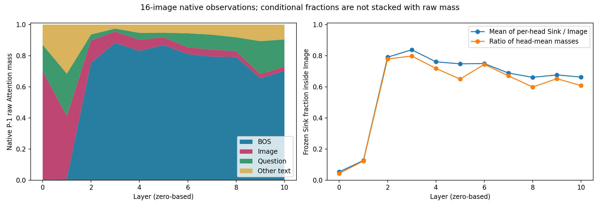
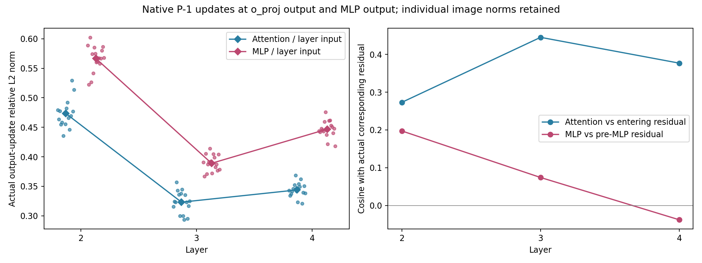
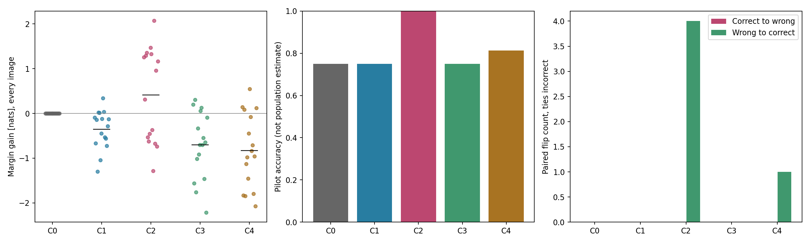
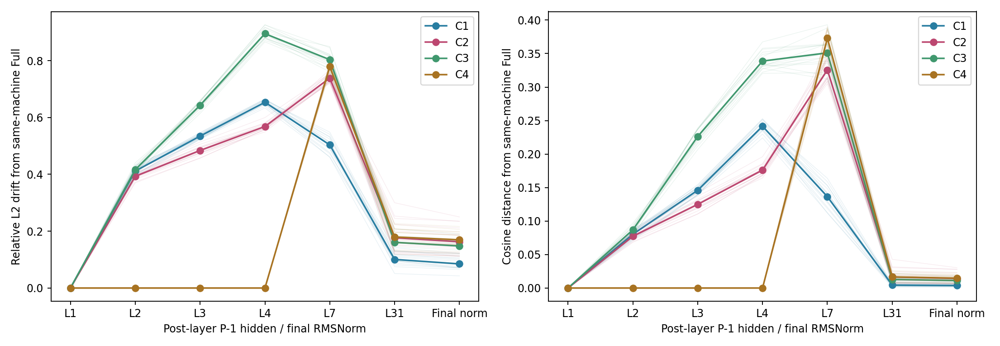

# Phase 3.8: L2-L4 Attention Sink and Computational Stability

Status: **completed, 16/16 frozen images, C0-C4 only**. This is a small mechanism pilot, not an overall accuracy benchmark.
Frozen implementation: `d0da03a848b8825941ec9f4d5df2461f87c6b0bf`. Only physical GPU1 was used. GPU0 worktree, source, branch and results were not modified.

## Selection and Protocol

Eight left and eight right images are selected deterministically from the frozen Phase3.4 main48; discovery15133706 and the other historical cases are excluded. Right strata use historical Full correctness, never current intervention effects. Full selection rules, image/source hashes and frozen Sink/ROI intersections are in manifest.json.
LLaVA-1.5-7B, FP16/eager, Transformers4.49.0, fixed model revision, original prompt and complete candidate conditional scoring. Every sequence retains all576 image tokens and original positions. P-1, BOS and Question locations are verified dynamically against original mappings.
C1/C4 zero only P-1 o_proj output before Attention residual addition; MLP runs normally. C2 zeroes only P-1 MLP output before its residual addition. C3 masks all P-1 keys except causal BOS before softmax; output projection, residual and MLP remain active. BOS-only renormalizes to1 and is neither a bypass nor a mass-matched control.

## Outcomes

| Condition | Correct /16 | Mean / median gain | Min / max gain | Correct to wrong / wrong to correct | Mean gold absolute LogP change |
| --- | ---: | --- | --- | --- | ---: |
| C0: Native Full | 12/16 | +0.000000 / +0.000000 | +0.000000 / +0.000000 | 0 / 0 | +0.000000 |
| C1: L2-L4 Attention bypass | 12/16 | -0.352051 / -0.214844 | -1.300781 / +0.343750 | 0 / 0 | -2.134816 |
| C2: L2-L4 MLP bypass | 16/16 | +0.409424 / +0.634766 | -1.281250 / +2.074219 | 0 / 4 | +2.701367 |
| C3: L2-L4 BOS only | 12/16 | -0.703857 / -0.673828 | -2.214844 / +0.308594 | 0 / 0 | -1.643362 |
| C4: L5-L7 Attention bypass | 13/16 | -0.827881 / -0.898438 | -2.070312 / +0.546875 | 0 / 1 | -2.761251 |

Ties are incorrect. Gold absolute LogP uses the full vocabulary, not a two-candidate renormalization. Small or positive Margin changes are not capability improvement. All negative samples are preserved.

| Condition | Left correct /8; mean Gain | Right correct /8; mean Gain |
| --- | --- | --- |
| C0 | 8/8; +0.000000 | 4/8; +0.000000 |
| C1 | 8/8; -0.267578 | 4/8; -0.436523 |
| C2 | 8/8; -0.544922 | 8/8; +1.363770 |
| C3 | 8/8; -1.009766 | 4/8; -0.397949 |
| C4 | 8/8; -1.272461 | 5/8; -0.383301 |

## Eight Research Questions

1. **Can L2-L4 Attention be skipped with little impact?** C1 mean Gain -0.352051, range [-1.300781,+0.343750], flips 0/0. Report these magnitudes and individual examples, not an equivalence claim: no equivalence margin or population power was established.
2. **MLP versus Attention?** C2 mean Gain +0.409424 versus C1 -0.352051; C2 flips 0/4. Updates have different norms/directions below. This intervention comparison does not measure intrinsic module importance under matched perturbation sizes.
3. **Does BOS-only preserve behavior?** C3 mean Gain -0.703857, range [-2.214844,+0.308594], flips 0/0. The sole legal key really has probability1, but K/V and BOS hidden are not edited. Functional similarity must be judged from scores and drift, not high native BOS mass alone.
4. **Is L2-L4 special compared with L5-L7?** C1 mean Gain -0.352051 versus C4 -0.827881; paired C1-C4 mean difference +0.475830. Same three-layer count is controlled; this is not a scan or a universal depth claim.
5. **Does high BOS mass mean a large update?** Across16 images, the descriptive Pearson correlation of each image's mean L2-L4 BOS mass with its mean Attention/layer-input norm ratio is 0.09551862403899088. See actual raw mass and output-vector norms below. A probability mass is not a vector contribution: Values, output projection, direction and residual scale all matter. Source vector norms cannot be added.
6. **Do early hidden changes recover later?** The following all-image summaries compare post-L4 drift with final RMSNorm drift. A smaller later cosine drift or retained answer can indicate compensation, but does not prove early interaction was unused. Different residual scales and final normalization preclude comparing raw L2 magnitudes as if they were the same coordinates.
| Condition | Mean L4 relative L2 / cosine | Mean final relative L2 / cosine | Images with lower final cosine drift than L4 |
| --- | --- | --- | ---: |
| C1 | 0.653491 / 0.241563 | 0.084891 / 0.003744 | 16/16 |
| C2 | 0.568284 / 0.176164 | 0.162760 / 0.014284 | 16/16 |
| C3 | 0.894891 / 0.338828 | 0.148183 / 0.011147 | 16/16 |
| C4 | 0.000000 / 0.000000 | 0.169690 / 0.014753 | 0/16 |

7. **Stable computation hypothesis?** C1 causes no correct-to-wrong flips in these16 images, which is limited pilot evidence of answer retention, not numerical equivalence or proof that Attention is unnecessary. C3 retains all initially correct pilot answers, but its nonzero score/hidden effects still need inspection; this does not identify a BOS stabilization mechanism. C2/C1 differ in both sublayer and actual update size, so their relative damage cannot establish intrinsic importance. H2 is not uniquely identified: BOS-only tests a particular sufficiency intervention, not BOS necessity or a mass-matched stability control. Neither high sink mass nor later compensation demonstrates a passive stage. The strong no-new-interaction interpretation must be constrained by the actual causal losses, not assumed.
8. **Why not delete most image/text tokens?** Interventions affect one query at three layers, not the token representations, other queries, K/V storage or other layers. Removing tokens changes all those computations, positions and normalization. No token deletion, decoding or other task was tested.

## Actual Native Updates at L2-L4

| Layer | BOS / Image raw mass | Sink raw / mean headwise Image fraction | Attention norm / layer-input norm | MLP norm / layer-input norm | MLP / pre-MLP norm | Attention / MLP cosines |
| --- | --- | --- | --- | --- | --- | --- |
| L2 | 0.754158 / 0.144518 | 0.113470 / 0.790317 | 1.219352 / 0.473340 | 1.459083 / 0.566466 | 0.465186 | 0.273087 / 0.197367 |
| L3 | 0.882666 / 0.072342 | 0.058339 / 0.838247 | 1.198996 / 0.323156 | 1.443978 / 0.389019 | 0.329792 | 0.445226 / 0.074081 |
| L4 | 0.831241 / 0.071297 | 0.051777 / 0.760704 | 1.620984 / 0.343910 | 2.105761 / 0.446861 | 0.380699 | 0.376848 / -0.037973 |

Raw BOS/Image/Question/other-text masses partition keys. Sink raw mass is a subset of Image, not another additive partition. Sink conditional fraction is mean of headwise ratios; ratio of head-mean masses is separately saved. Native vectors are measured at actual o_proj and MLP outputs, and relative/cosine residuals are explicitly labeled. Layer hidden states are post-layer; final_norm is separately post-final RMSNorm.

## Reviewed Interpretation

The strong interpretation of H1 is **not established**. C1 preserves all16
Full answer decisions, but changes all16 Margins, decreases12 of them,
reduces mean Margin by0.352051 nats and reduces mean absolute gold LogP
by2.134816 nats. Its native Attention updates are not tiny: projected
update/input-residual norm ratios are0.473340,0.323156,0.343910 at L2-L4.
Thus decision retention is not evidence of nearly unchanged computation.

C2 is contrary to an assumed MLP-necessity pattern: all four original
right-label errors become correct and all16 gold absolute LogPs increase.
Yet seven individual Margins decrease, left mean Gain is-0.544922 and
right mean Gain is+1.363770. This is a directional, outcome-dependent
pilot result, not general ability improvement or proof that MLP is useless.
The historical correctness-stratified sample is not a population estimate.
The effect is retained as observed; no extra condition or sample was added
to explain or optimize it.

C3 is sufficient to retain this pilot's original answer decisions, but
is **not numerically equivalent** to Full: mean Gain is-0.703857, worst
Gain is-2.214844, and mean gold LogP change is-1.643362. Native BOS mass
of0.754-0.883 does not justify replacing the full update by BOS-only.
H2's stabilizing-function interpretation remains unresolved: this is a
BOS-only sufficiency manipulation, not a BOS necessity or mass-matched
control. Native image/Sink masses are descriptive, not evidence of useless
visual information or a direct decomposition of output-vector contributions.

L2-L4 Attention bypass has a less negative mean Margin Gain than the
same-length L5-L7 bypass by0.475830 nats. However C4 recovers one error
while C1 recovers none. Hence the metrics do not support a uniform claim
that either three-layer window is safer or uniquely a passive stage.

There is clear attenuation of **normalized hidden drift**, not exact
recovery: in C1 mean L4 relative L2 drift is0.653491 and mean final-norm
drift is0.084891; mean cosine distance falls from0.241563 to0.003744,
with a reduction in all16 images. All16 answer decisions are retained,
but no C1 Margin is exactly unchanged. Later compensation is consistent
with these observations and limits an inference of early irrelevance.
C2/C3 also show reduced later angular drift while retaining materially
different final scores. Raw L2 norms across depths must not be interpreted
as direct evidence of recovery because residual scale and RMSNorm differ.

The descriptive image-level BOS-mass/update-ratio correlation is only
0.095519. Attention mass by itself does not predict a large residual
update here. Its uncertainty is not estimated by treating48 layer rows
or hundreds of heads as independent images.

Overall, this pilot supports **robust answer decisions with compensable
hidden perturbations under some single-query sublayer interventions**,
not a proven no-information-interaction or BOS-stability mechanism. Keep
the Attention observation, vector update, causal intervention and final
decision claims separate. All tokens, all other queries and later layers
remain present, so safe token deletion does not follow. Stop after this
pilot; no expansion, new window, Physical Exit, training or decoding was run.

The untouched generated report is preserved as report.generated.md. The
summary generator wrote its terminal completion line after recording the
console hash. The original manifest is retained in
summary_validation.generated.json; the exact one-line append is documented
in artifact_finalization_audit.json. Final sealing updates only the report
and finalized console hashes, never measurements, scores, frozen source or
numeric acceptance tolerances.

## Integrity and Limits

CPU regression: 121 tests, no skips. Two real GPU smoke images pass before16 formal images. All actual model state_dict tensor hashes agree before/after each GPU stage; temporary hooks, input tensors and installed third-party source remain unchanged. L1 and all causally earlier text states remain bitwise Full; candidate P-1 predictions agree. Final Native Full restoration is exact. No successful-run sample is missing or duplicated.
Historical/current Full numerical differences are recorded per image, not used to fit tolerance or select data. The10 package pins and canonical model files are preserved; actual Python patch/hardware are saved. Baseline weights/data/model configuration and Phase2-3.7 files are not modified.
No confidence interval over heads/layers is used. The16 selected images and historical correctness strata are not a representative population accuracy evaluation. Full per-image scores, hidden drifts, headwise raw rows and logs are retained. No additional research condition is introduced.

