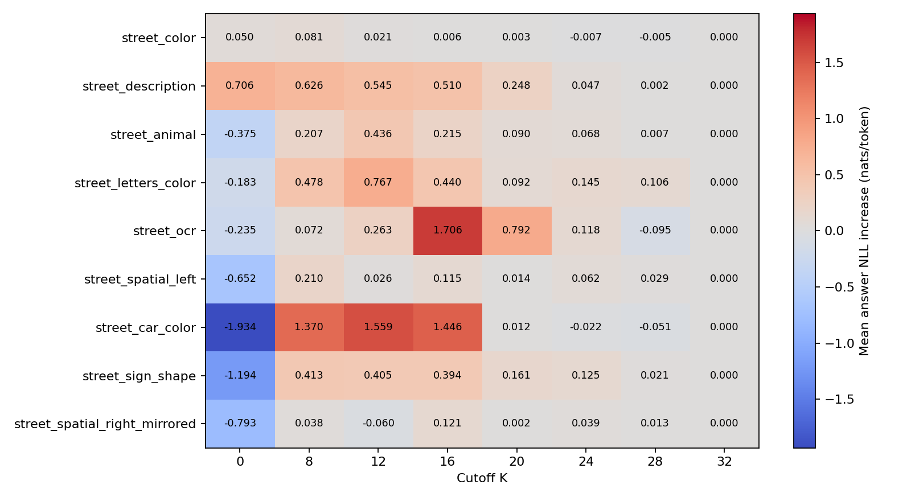
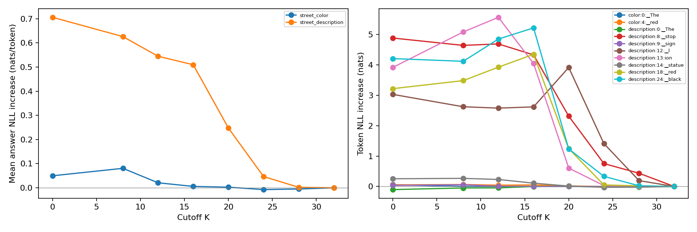

# Phase 3：Layer-wise Visual Attention Knockout 实测报告

2026-10-27（Asia/Shanghai）。**真实 7B GPU 校验与现有 9 条 QA × 8 个 cutoff 全部完成。实验停在 Phase 3。**

用户在 GPU 0 释放后明确要求“开始继续phase3”。本次为手动启动，取消的 cron 轮询保持关闭。第一、二、2.1 阶段代码、配置和实测结果未改动；准备阶段的 CPU 测试和资源阻塞报告完整保存在 [准备阶段历史报告](phase3_preparation_report.md)。

## 实验设置与结果入口

完整运行目录：[manual_gpu_20261027_2310](manual_gpu_20261027_2310/phase3_report.md)。配置、版本、权重位置、全部完成标记见 [run.json](manual_gpu_20261027_2310/run.json)。
模型为 `llava-hf/llava-1.5-7b-hf`，revision `b234b804b114d9e37bb655e11cbbb5f5e971b7a9`，7,063,427,072 参数。复用原 `load_model()`、`prepare_inputs()`，全部参数 FP16、cuda:0（物理 GPU 0），eager、eval、inference_mode、batch=1、use_cache=False。Python 3.11.18、PyTorch 2.6.0+cu124、Transformers 4.49.0、CUDA runtime 12.4；没有创建环境、下载或升级。
单图 576 个视觉 Token。K=[0,8,12,16,20,24,28,32]；层索引 >=K 时，用当前 Transformers 4.49.0 LLaMA eager 的 pre-hook 克隆 additive causal mask，只将合法的后图像文本 Query→视觉 Key 连接置为 -inf。包含问题、模板、Answer-start 和已输入答案；不改模型参数、位置、视觉 Query 或其他连接合法性。
固定答案 Teacher Forcing；答案 NLL 不含 Prompt/EOS，KL 使用完整词表 KL(Full || Knockout)，float64 CPU log-softmax。每条样本所有 K 的图片、Prompt、答案和序列长度相同。颜色样本 red 仍为 Target 599、Query 598（输入 is）。候选按完整序列累加条件 log P，包括 light blue；候选间统一右 padding 长度、共享此前答案前缀，不计候选之后的后缀。

## 真实模型正确性

- 返回 32 层 Attention；首颜色样本所有矩阵为 `[1,32,601,601]`，尺寸由实际输入审计。
- 单层阻断检查、K=0 全层和 K=16 后 16 层阻断通过；被阻断权重严格为零，未来/padding 权重为零，最大所有行归一化误差 0.000381589。
- K=32 no-op Hook 与无 Hook 的全部 logits 最大绝对差 **0**；全部正式样本 K=32 的答案分布均与各自无 Hook 基线完全一致。
- 视觉及之前 Query Attention 哈希不变，cutoff 之前层完整 Attention 哈希不变；正常退出后无 Hook 残留，output_attentions 开关对照 logits 误差 0。
- GPU 全程无 CUDA OOM 或 NaN/Inf，未使用 KV Cache，未保存完整 Attention 矩阵。仅出现沿用 checkpoint 慢速图像 Processor 的提示，保持既有预处理方式，没有切换 fast Processor。
- 原图/镜像相同问题的 K=0 候选 left/right log P 逐项完全相同（误差 0），符合全层阻断后该文本条件不再依赖图像的控制预期。
- 44 项 CPU 回归测试通过（含旧阶段测试和 watchdog 测试），`pip check` 通过。测试不是 7B GPU 实验的替代。
证据：[7B 校验 JSON](manual_gpu_20261027_2310/samples/street_color/correctness_validation.json)、[回归测试](manual_gpu_20261027_2310/regression_tests.txt)、[成果完整性审计](manual_gpu_20261027_2310/artifact_validation.json)。

## 不同 cutoff 的答案损失

下表为相对 Full 的 mean answer NLL increase，单位 nats/token；负值表示该固定参考答案的平均 NLL 下降。

| 样本 | K=0 | K=8 | K=12 | K=16 | K=20 | K=24 | K=28 | K=32 |
| --- | ---: | ---: | ---: | ---: | ---: | ---: | ---: | ---: |
| street_color | 0.0498 | 0.0807 | 0.0208 | 0.0058 | 0.0027 | -0.0073 | -0.0049 | 0.0000 |
| street_description | 0.7058 | 0.6260 | 0.5446 | 0.5095 | 0.2476 | 0.0467 | 0.0022 | 0.0000 |
| street_animal | -0.3750 | 0.2073 | 0.4364 | 0.2149 | 0.0903 | 0.0681 | 0.0067 | 0.0000 |
| street_letters_color | -0.1826 | 0.4784 | 0.7665 | 0.4403 | 0.0920 | 0.1455 | 0.1059 | 0.0000 |
| street_ocr | -0.2348 | 0.0722 | 0.2630 | 1.7057 | 0.7917 | 0.1179 | -0.0950 | 0.0000 |
| street_spatial_left | -0.6522 | 0.2101 | 0.0265 | 0.1147 | 0.0137 | 0.0617 | 0.0289 | 0.0000 |
| street_car_color | -1.9342 | 1.3703 | 1.5593 | 1.4458 | 0.0115 | -0.0216 | -0.0508 | 0.0000 |
| street_sign_shape | -1.1941 | 0.4135 | 0.4048 | 0.3935 | 0.1608 | 0.1251 | 0.0208 | 0.0000 |
| street_spatial_right_mirrored | -0.7926 | 0.0375 | -0.0602 | 0.1212 | 0.0019 | 0.0388 | 0.0132 | 0.0000 |





原颜色问题整体变化较小：K=16 的 Δmean NLL=0.005807，red 的概率从 Full 0.973505 降至 0.925347；K=0 时仍有 0.923992。STOP 通常为红色，不能把这看作强图像依赖证据。red 相对最强颜色竞争候选的 log P Margin 从 Full 6.671875 降到 K=0 的 4.109375，始终为正。
描述任务明显更敏感：K=16 的 Δmean NLL=0.509531，K=24 为 0.046651，K=28 为 0.002213。然而 K=28 的 stop Token ΔNLL 仍为 0.435381，说明全句平均接近基线不保证每个视觉词都稳定。
## 普通词与视觉词、非单调现象

描述任务 K=16 下，首个 The 的 Δtoken NLL=-0.001202，而 stop、red（修饰 building）、black（修饰 car）分别为 +4.329492、+4.347718、+5.217661 nats。lion 被分成 ▁l 和 ion；必须查看两个 Token，不能只按单一字符串统计。这些是该固定轨迹中的个例，不能概括所有普通词/视觉词。
不少曲线非单调，且 K=0 反而降低整体 NLL。例如汽车颜色 K=0 Δmean NLL=-1.934183，而 K=16 为 +1.445778；OCR 在 K=0 为 -0.234787，K=16 升至 +1.705725。
整体改善不能等同于视觉语义改善。石狮样本 K=0 mean NLL 下降 0.374953，但 ▁l 的 NLL 升高 1.079403；首词 A 和句点的 NLL 下降抵消了视觉词的恶化。原图空间答案也类似：K=0 mean NLL 下降 0.652170，但 left 的 NLL 升高 0.613153。
新增短答案的 Full 绝对 NLL 偏高：White 首 Token log P≈-8.7667，Black≈-9.5475，OCR 的 ▁ST≈-9.3493；汽车 Black 的完整词概率约 7.14e-5。参考答案的简短句式、首词大小写和模型回答风格可能影响绝对分数，汽车颜色还存在黑/蓝反光歧义。固定历史下候选比较和同输入不同 K 的变化可以报告，但不能把它们当作自由生成正确率。没有另改答案去寻找更好曲线。

## 镜像配对和候选评分

原图与水平镜像使用同一问题，参考分别是 To the left. / To the right.。Full 的正确方向 Margin 分别为 +2.906250 / +3.921875；K=0 为 +0.062500 / -0.062500。K=0 对相同词的 log P 在两图完全一致，说明此控制中图像区别已被干预消除；保留前 16 层后，两图 Margin 分别为 +3.125000 / +4.453125。
K=8 原图 Margin=-0.109375、镜像=+0.062500，呈现弱 right 偏好；这也说明平均参考 NLL 与方向区分能力不能混为一谈。此配对只有一个原始场景，镜像还会反转文字，不是独立自然配对图，不用于 OCR。

## 与历史 Attention Mass 的关系

离线表 [historical_attention_vs_knockout.csv](manual_gpu_20261027_2310/historical_attention_vs_knockout.csv) 将 Phase 2.1 同一预测 Query 的后缀各层 head-mean visual mass 求和，与本次 token ΔNLL 对照。求和值不是概率；历史 FP16 Forward 序列形状不同，不能声称是本次精确重测。
K=16 时，原颜色 red 的后缀 mass 和约 2.0775、Δtoken NLL≈0.0507；描述中的 red 后缀 mass 和约 3.6270、Δtoken NLL≈4.3477。K=28 时，描述 stop 后缀 mass 和约 0.6615、Δtoken NLL≈0.4354，而描述 red 后缀 mass 和约 0.5542、Δtoken NLL≈0.0210。Attention 规模和预测变化不存在可从这些样本直接读取的一一对应关系。
这不是单层独立干预：每个 K 同时改变多个层，且影响其他文本 Query 的后续传播。不能将相邻 K 差异直接归因于某层的唯一视觉贡献，也不能按 Attention Mass 大小推断因果重要性。

## 资源与耗时

- 模型加载 4.660 秒；加载后 allocated 13473.648 MiB，驱动进程采样 13938 MiB。
- 全程校验峰值 allocated **14344.958 MiB**；正式 Forward 峰值 allocated 13649.285 MiB，reserved 最大 14544.000 MiB。allocated 与 reserved 是不同口径，驱动采样也不同。
- 正式主样本/候选/无 Hook 基线共 217 次 Forward；单次同步耗时 0.0819–0.1256 秒，总计 19.623 秒。
- 完整 GPU 实验墙钟时间（含加载、校验、全部样本、绘图）**42.201 秒**；不包括后续离线汇总、回归测试或 Git 同步。计时包含 Hook 检查/克隆开销，未测推理加速。
- GPU 实验进程结束后 GPU 0 恢复约 75 MiB 占用、24,006 MiB 可用、0% 利用率；GPU 1 的其他任务未操作。
逐次测量见每样本 metrics.json、all_samples.csv 和 comparison_summary.json。

## 解释边界与停止点

现有样本中，不少指标在 K=24/28 附近接近 Full，可把这些深度列为未来扩展数据时需要检验的候选范围；**没有确定统一的 Visual Fusion Saturation Depth**。例如白字问题 K=28 的 Δmean NLL 仍为 +0.105852，而描述平均虽接近 Full，stop Token 仍有可见差异。没有预注册容忍阈值、独立多图或统计显著性检验，不能作安全截止判断。
9 条 QA 实际仅来自 1 张街景和水平镜像，问题高度相关；新增答案按用户“你自己确认吧”由 AI 目视核验，human_verified=false，不冒称人工标注。原描述包含未证实的 fire hydrant；STOP 红色语言先验强；汽车标签有歧义。
干预改变了直接视觉访问，也会引起 softmax 重分配、文本状态传播变化及分布外效应。即使 NLL 接近 Full，也只说明这些固定答案历史下的边际预测变化较小；不能证明文本已吸收全部视觉信息、安全删除视觉 Token、真实生成不受影响或实际加速。
本次已完成现有小规模配置的 GPU 验证与全部曲线/CSV/JSON。人工独立标注和多张自然配对图的限制仍保留。**在 Phase 3 停止，不开展 Question-only/Answer-only、Decode 干预、Token Pruning、Router 或训练。**

## 复现与离线绘图

```bash
# 只读取已完成结果，不加载模型或使用 GPU
/home/zsy/.conda/envs/vlm_research/bin/python compare_knockout.py \
  --run-dir results/phase3_knockout/manual_gpu_20261027_2310
/home/zsy/.conda/envs/vlm_research/bin/python knockout_probe.py --replot-only \
  --output-dir results/phase3_knockout/manual_gpu_20261027_2310
```

重新执行 GPU 实验时必须使用新的 output-dir，保持现有结果不覆盖；使用原 README 中的离线环境与单卡命令。
