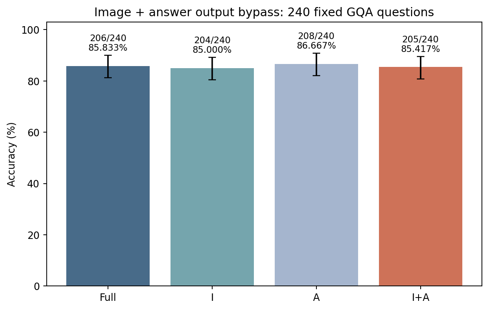
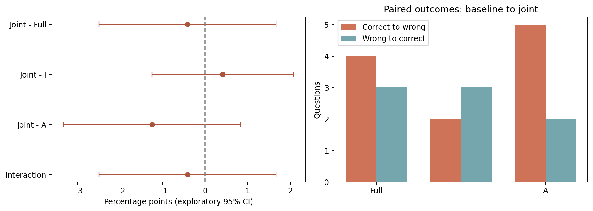
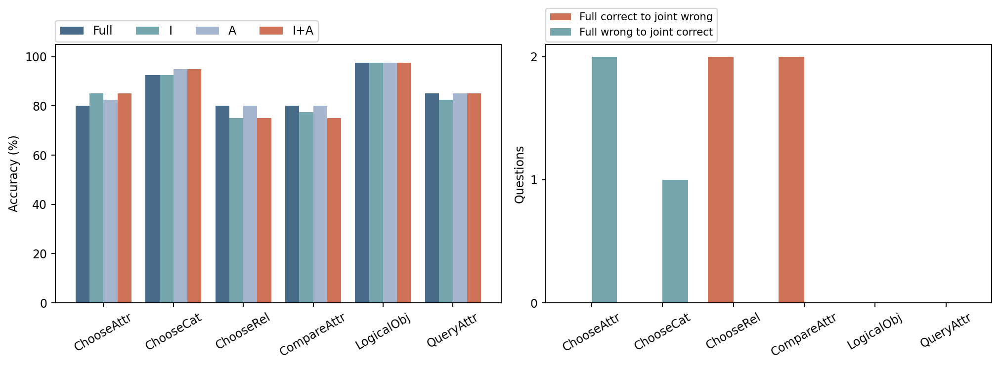

# 实验四：I+A Joint Bypass——保留关键文本 Query 的联合 Attention 输出消融

**COMPLETE：新增 240 条 I+A 自由生成；复用固定历史 Full/I/A 各 240 条。Smoke 不计入正式结果。**

## 最终回答

在这批历史复用的 240 题探索样本上，I+A 正确 205/240（85.417%），相对 Full -0.417 个百分点；Full 正确→联合错误 4 题、错误→正确 3 题。联合独有损害 1 题（0.417%，探索性 95% CI [0.000, 1.250]）。交互 joint−I−A+Full 为 -0.417 个百分点，95% CI [-2.500, 1.667]。
**结论：在本批探索样本上，可以在不直接消融关键 Prefill 文本 Query（R）的同时，联合关闭图像 Query 与答案 Query 的 Attention 输出更新，并维持接近 Full 的总体准确率；结果支持有限的可组合低敏感性，但存在真实受损和一例联合独有损害，尚不能称为安全、无损或已通过非劣效。** R 的后续状态可能间接受影响；这是输出消融证据，不能等同于物理计算可跳过或真实加速。任何接近 Full 的净准确率都必须与真实损害、纠正和联合独有损害共同解释；区间跨零不能证明等价、非劣效或没有交互。

## 四条件结果

|条件|来源|正确/240|Accuracy|ΔFull pp|Full 对→错|Full 错→对|EOS|空/截断/重复|
|---|---|---:|---:|---:|---:|---:|---:|---|
|Full|历史复用|206|85.833%|+0.000|0|0|240|0/0/0|
|I-Bypass|历史复用|204|85.000%|-0.833|4|2|240|0/0/0|
|A-Bypass|历史复用|208|86.667%|+0.833|2|4|240|0/0/0|
|I+A-Bypass|本轮新增|205|85.417%|-0.417|4|3|240|0/0/0|

## 配对比较与交互

Image SHA256 整簇配对 Bootstrap，seed=20261102，20,000 次，所有比较和独有损害比例使用同一组抽样。普通探索性双侧 95% 百分位区间，无多重比较确认性声明。

|比较|差值 pp|95% CI pp|基线对→联合错|基线错→联合对|
|---|---:|---|---:|---:|
|I+A - Full|-0.417|[-2.500, +1.667]|4|3|
|I+A - I-Bypass|+0.417|[-1.250, +2.083]|2|3|
|I+A - A-Bypass|-1.250|[-3.333, +0.833]|5|2|
|I_role = joint-I-A+Full|-0.417|[-2.500, +1.667]|||

## 三种科学情况的判读

联合相对 Full 的区间及交互区间均跨零；该模式与情况 A 的可组合低敏感性相容，但这里没有预设等价界值，不能把该描述当作等价或非劣效验收，也不能排除实际损害和额外联合效应。
情况 C 所关心的联合独有损害为 1/240；完整问题、图像哈希、Gold、四组答案与 Token 保存在 joint_unique_harm_cases.csv。独有损害与总体净变化分别报告，不以纠正题抵消其存在，也不凭单例推断普遍机制。

联合独有损害实例：`09342899`（CompareAttr），问题为“What do the cooking pot and the stove have in common?”。Gold 为 `material`，Full/I/A 均回答 Material，联合回答 `Color`。这只是已观察到的行为变化，不构成特定 Token 机制证据。

## 六任务结果

|任务|Full|I|A|I+A|联合受损/纠正（相对 Full）|
|---|---:|---:|---:|---:|---|
|ChooseAttr|80.0%|85.0%|82.5%|85.0%|0/2|
|ChooseCat|92.5%|92.5%|95.0%|95.0%|0/1|
|ChooseRel|80.0%|75.0%|80.0%|75.0%|2/0|
|CompareAttr|80.0%|77.5%|80.0%|75.0%|2/0|
|LogicalObj|97.5%|97.5%|97.5%|97.5%|0/0|
|QueryAttr|85.0%|82.5%|85.0%|85.0%|0/0|

## 干预定义与因果边界

仅在 0-based L2–L5 的 self_attn.o_proj 输出行置零。同一次完整 Prefill 联合处理 576 个原始 Image Query 与原始 P−1；每个真实 Decode Query（含预测 EOS 的步骤）继续置零。每条联合答案从自己的完整 Prefill 开始，不拼接历史 Cache。R 和其他 Query 不被 Hook 直接修改，全部 MLP、Residual、其他层、Attention Mask、视觉来源访问与 KV 更新保持原生执行。
“保留 R”仅指未直接消融 R 输出；I 状态改变后，R 在后续层的输入、Hidden 与 KV 可间接变化。不能声称中继完全不受影响、R 是唯一写入位置或已经确定视觉记忆机制。I/R/A 数量不同，不能把总体 Accuracy 差异解释为单位 Query 贡献。
这是功能输出消融，没有跳过 QKV、Attention 或 KV 存储；未实现或测得真实加速、显存收益。本批 240 题是历史复用的探索样本，不是独立确认集。已有 A-Skip + Text-Only（e005bb5c5cb5e14ca6eff46181c5d238b2ae879c）消融的是直接视觉来源访问，不是本轮 I+A 联合，未混入评分。

## 冻结、审计与资源

历史基准 Commit：`8d12f8c05f2b246d029ec4d9ffe45d1f857fa947`；本轮冻结执行源码 Commit：`33bbffff06bbe80fa7aa7e7eabc7325402fdc9cb`。原 Manifest 字节和输入映射原样复制，实际 SHA256 为 `258c32d470270829e126ae9abf3a030dbc1485b2f329fdfc326f4d6e9b3e686c`。任务书抄写的 59 位字符串不是有效完整 SHA256，沿用历史协议的已验证原文件记录，没有重新采样或改变 Prompt。
CPU 验收 22 项通过。GPU 在三道固定题上验证 HF/Full/No-op 全部返回有效 Logits 的 torch.equal、新旧 Full/I/A 全步 Logits 精确一致、已保存历史首 Token 数组与完整 Token 一致；显式 logits_to_keep=1，不放宽容差。联合目标、R 不直接修改、32 层 MLP、独立 Cache 及真实位置、输入/参数版本、正常和异常 Hook 清理通过。
720 条历史记录在正式前与分析时重验输入、评分、检查点、完整交付文件及实际服务器原始首 Token 数组 SHA256；240 条新增记录从 Token、文本、评分、原始首 Token、Hook 与 Cache 事件回放。所有首 Token 指标严格相等；模型文件完整 SHA256 在冻结前和采集后校验。
仅使用物理 GPU2（UUID `GPU-a50cb044-679e-9a05-557d-4ddbd19ac3c6`），只暴露该卡为 cuda:0，一份模型串行采集。GPU0/1 上的其他进程未被终止或干预。进程退出后才生成 GPU 释放审计；实时占用以新检查为准。
原始数组位于服务器资源目录，路径和 SHA256 绑定在检查点和 validation.json；数组未上传 GitHub。Smoke 和必要回放不计入新增 240 条正式答案。

## 结果图

## 下一步建议与停止边界

下一项建议是在预声明可接受损害界值和样本量后，用新的独立确认集复核 I+A 的净损害、真实受损率和联合独有损害；这仅为建议，本轮不设计或执行下一轮。未扩样、训练 Router、执行 Qwen、开发 Kernel 或剪枝 KV。

交付编辑说明：最终报告补充明确结论与独有损害实例；Accuracy 图将数值标签移至误差线之外，任务图使用整数计数并统一配色。该步骤只读取已保存统计，不改变冻结执行源码、检查点、数组或统计值。脚本为 finalize_delivery.py。
