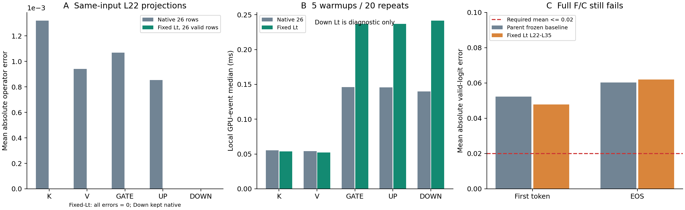
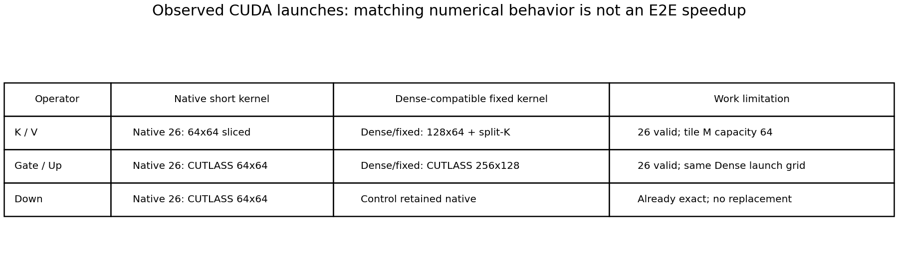

# Qwen3-VL C3-V2：L22 BF16 GEMM Kernel诊断

最终状态：**PARTIAL_REPAIR**。已找到能让26个有效文本行的L22 K/V/Gate/Up投影与冻结Dense BF16参考逐位一致的cuBLASLt配置；完整C3-V2仍未通过原始Logits门槛，两张GPU独立复核一致。本轮已经停止，没有运行其余Smoke、Accuracy或E2E Benchmark。

## 固定输入与审计

基线Commit为`a1a99c88c0db9244ef280017f297d9c5b5e75bbe`。只使用GQA `06905471`，图像4712，问题“Are there any cars or trains?”；原生Processor产生122个Prefill位置，其中96个Image、26个Text。模型为Qwen3-VL-8B-Instruct，revision `0c351dd01ed87e9c1b53cbc748cba10e6187ff3b`，BF16/Eager、Torch 2.6.0+cu124、Transformers 4.57.6，bs=1、Greedy、最多32 Token、`logits_to_keep=1`。没有改Prompt、图片、权重、mRoPE、DeepStack或精度。

启动前核验本地/远端分支、历史交付、活动进程、磁盘以及GPU UUID。用户本轮明确授权最多两张空闲GPU。GPU3负责有限候选诊断，GPU2仅复核固定候选及关键完整模型结论；未使用GPU0/1、未终止其他进程。现有模型文件与历史结果的字节SHA核验通过，历史目录未写入。本地main保持`7970be981e3462560cb66d83e1014eaa1b1ebdae`；交付前远端main为`e89c8acce6e674ecfbd2c8acad57faf71bf4d547`，本任务仅推送独立分支，不更新main。

CPU回归27项全部通过。两卡均通过cuBLASLt整数算子Smoke、冻结Dense投影复现、Native/No-op有效Logits严格相等；新生成Native、F、W22-functional、B的全部有效Logits和完整Token与历史严格相等。新C的带Probe与无Probe重复逐位一致，Hook恢复。原生输入的完整字典及Tensor SHA与冻结Manifest严格匹配。此前已建立的HF对照继续以字节未变的源码及严格复现Native向量为绑定，本轮没有另跑一次HF `generate`。

执行源码分阶段Commit及文件SHA均保留：局部诊断`6f6e3364030f8f1f33ae25408ba8ffeb5c2ffa7c`；L22接入`af8243ff98`的完整SHA见对应Manifest；逐层延续`8090b70f065568bb728e9f65cd04090b5876ebab`；最终全层固定配置`b9fd7fe2e33d7ca453eea31513740e5dc24ecffd`；第二卡仅增加有限证据归档`30cdc346eac0dc847e7865f7762cbb2872f1e42e`。中间未通过的完整结果全部保留，未按Logits分数挑选“最优”作用层。

## 1．122行和26行确实调用不同Kernel吗？

**是，来自真实PyTorch Profiler CUDA事件，而非仅看算法名推断。** Nsight Systems/Compute未安装；本轮未安装工具或修改系统，使用已有Profiler/CUPTI，共保留两卡66条CUDA Kernel事件和原始Chrome Trace的路径/SHA。

| 算子 | 原生26行 | Dense122行及固定配置26行 |
|---|---|---|
| K/V | `ampere_bf16_s16816gemm_bf16_64x64_sliced1x2_ldg8_f2f_stages_64x5_tn` | `ampere_bf16_s16816gemm_bf16_128x64_ldg8_f2f_stages_32x6_tn`，另有独立`splitKreduce_kernel` |
| Gate/Up | CUTLASS `64x64_64x6`，另有独立split-K归约 | CUTLASS `256x128_32x3` |
| Down | CUTLASS `64x64_64x6` | Dense为Ampere `128x64`；原生26行本就逐位相等，最终不替换 |

K/V固定配置为algo=6、tile=18、splitK=5、reduction=4、swizzle=1、stages=12；Gate/Up为algo=21、tile=24、splitK=3、reduction=1、swizzle=0、stages=9。具体数值是本机cuBLASLt 12.4.5的配置枚举，不应当解释为跨版本稳定接口。

K/V的Dense网格`[8,2,5]`变为固定Physical的`[8,1,5]`，主Kernel和归约Kernel名称相同，网格随有效M变化。Gate/Up的固定Physical与Dense具有**相同Kernel、相同`[8,6,3]`网格及相同256线程block**。完整名称、grid、block、寄存器、共享内存、流和Trace SHA见[gemm_kernel_profiles.csv](gemm_kernel_profiles.csv)。

## 2．最早差异是什么，哪些结论仍不确定？

原始最早差异仍是**L22 K投影**。在完全相同输入行、权重和BF16类型下，原生122行与26行选择不同CUDA Kernel；固定Dense兼容配置并只提交26行后，输出与冻结参考完全相同。这是Shape相关Kernel选择会改变该算子BF16结果的直接干预证据。

Profiler证实了不同tile、不同启动几何，以及K/V是否额外执行split-K归约；显式Lt配置也保留了splitK/reduction枚举。**没有测得cuBLAS内部逐条乘加/累加顺序、部分和的全部中间精度或硬件指令计数**。不能仅由名称推断具体哪一次内部舍入造成某个BF16位差，也不能声称所有不同Kernel都会导致不同结果：Down就是不同Kernel但输出相同的反例。

## 3．是否找到仅有26个有效行的匹配实现？

**在投影的有效输入/输出语义上找到了。** 任务目录内的C++桥接显式复用Dense描述符得到的第一个兼容Lt配置，实际Matmul只接收`M=26`的输入和输出描述符，不恢复96个图像Hidden、不预存Dense输出、不改Logits。Dense122计算仅用于诊断参考。权重没有转换或复制成FP32。

但“26个有效行”**不等于硬件只执行26行乘加**。Kernel有内部tile尾部容量：K/V观察到64行M tile容量，Gate/Up为128；后者的启动网格与Dense相同，没有证据表明它减少了实际Tensor Core工作。记录中的`input_padding_rows=0`只指没有分配Padding Hidden，不能解读为内部没有补齐/谓词屏蔽。确切已发出指令FLOPs未测得；[physical_flops_audit.json](physical_flops_audit.json)区分有效矩阵`2MNK`、tile容量、split-K归约及未知的硬件工作。

只测试了候选类1中预先限定的最多两个Lt配置；第二配置未优于第一。因为类1已逐位匹配局部参考，预先规定的13+13分块和单一Triton候选没有运行，旧负面候选没有重复。没有AutoTune或新的层选择搜索。

## 4．L22四个投影改善多少？

以下为GPU3对冻结完整26行输出的比较；GPU2复核原始数组逐位相等。

| 算子 | 原生26行Max误差 | 原生26行Mean误差 | 不同元素数 | 固定Lt后Max / Mean / 不同元素 |
|---|---:|---:|---:|---:|
| K | 0.0625 | 0.0013187608 | 9,329 | 0 / 0 / 0 |
| V | 0.015625 | 0.0009400321 | 10,694 | 0 / 0 / 0 |
| Gate | 0.03125 | 0.0010685199 | 111,343 | 0 / 0 / 0 |
| Up | 0.03125 | 0.0008545677 | 124,898 | 0 / 0 / 0 |
| Down（对照） | 0 | 0 | 0 | 最终保留原生，不增加修复 |

完整RMSE、相对L2、不同元素比例、差异坐标，以及输入/权重/输出SHA与stride均已交付。词表大小的Logits向量与算子小型BF16位证据可用纯CPU脚本重算。

## 5．完整F/C结果和剩余障碍

先只修L22，看到该层输出严格相等、L23相同归一化输入的K投影不同，才延续同一配置；依此推进到L26。此时L26的Attention AV差异开始传播到残差，阻止了下一层输入的严格相等。随后分别使用冻结F的原输入验证L27–L35：36个同输入K/V/Gate/Up投影中，固定Lt全部逐位匹配参考，原生投影确有误差，才对这些层执行**一次相同固定配置**的完整模型检验。没有修改Attention实现以处理新AV障碍。

| 对照 | 首Token Max | 首Token Mean | EOS Max | EOS Mean | 判定 |
|---|---:|---:|---:|---:|---|
| 历史F/C（修复2的BF16基线，审计复用） | 0.484375 | 0.0523297191 | 0.3125 | 0.0601911135 | 未通过 |
| 本轮F/B（两卡新生成） | 0 | 0 | 0 | 0 | 逐位相等 |
| 本轮W22-functional/P（固定Lt L22–L35） | 0.25 | 0.0329650566 | 0.25 | 0.0390211642 | 未通过Mean门槛 |
| **本轮F/C（固定Lt L22–L35，两卡一致）** | **0.734375** | **0.0478183404** | **0.500000** | **0.0620242506** | **未通过** |

原门槛为所有有效步Mean≤0.02、Max≤0.5、Top1和完整Token一致、无NaN/Inf。新C首Token还超过Max门槛，EOS的Mean也不合格；不是“接近通过”。所有路径完整输出均为`no`加EOS，Token IDs为`[2152,151645]`，Top1相同、正常EOS、无空答案、无截断和非有限Logits，但这些不能代替数值门槛。

局部投影严格一致后，首个内部差异变为Prefill **L22 AV**：Max `7.4505805969e-9`、Mean `6.9961133512e-14`，该微差没有传播到L22层输出。**第一个不一致的Prefill层输出在L26**：其AV Max `0.0001220703125`、Mean `1.1462432115e-9`，o_proj Max `0.00390625`，残差Max `0.015625`，层输出Max `0.03125`。由于Frozen Dense注意力拥有更长但被禁止的Image列，而Physical持有紧凑Key，AV归约形状仍不同。该观察定位了一个未解决的计算差异；不能仅凭相关链条断言它独自解释全部最终误差，后续层也可能继续引入形状敏感差异。

实际小型Tensor证据、精确坐标、逐层指标及首差异记录分别见`component_difference_coordinates.json`、`first_divergence.json`、各`full_*`目录。没有放宽`torch.equal`或验收容差。原固定题未通过，剩余冻结Smoke未运行。

## 6．物理优化是否仍存在？

是：Prefill在L22前从122行实际Gather为26行；L22–L35的各层只接收26行Hidden；L1–L6的P−1 Attention仍跳算，真实Decode不调用其Q/K/V/O投影，全部MLP/Norm/Residual继续执行。DeepStack仍在原0/1/2层、mRoPE沿用原绝对位置。持久KV不保存Image行，L1–L6没有持久KV；本题EOS预测时其他30层各27个有效文本KV，live bytes合计3,317,760，预分配capacity bytes为7,004,160。

历史Early和Decode Dummy Zero Key修复保留，Dummy实际概率严格为0且没有持久化。Early临时零Key增加QK/AV计数11,894,784 FLOPs，Decode临时补96列零K/V增加47,185,920 FLOPs。临时注意力矩阵恢复较长Key维度的代价已计入；不能把持久KV压缩当成没有额外计算。投影硬件tile尾部工作另行披露，不能以逻辑26/122比例推算加速。

## 7．局部性能代价

只做5次预热、20次CUDA Event重复，以下是GPU3局部中位数，含调用实现的分配/调度影响，不是完整E2E。真实Profiler事件耗时另列，不能与这份重复微基准混用。

| 算子 | 原生26行ms | 固定Lt 26行ms | 变化 |
|---|---:|---:|---:|
| K | 0.055248 | 0.053568 | −3.0% |
| V | 0.053952 | 0.052272 | −3.1% |
| Gate | 0.146032 | 0.236768 | +62.1% |
| Up | 0.145808 | 0.236736 | +62.4% |

固定Lt共享8MiB临时workspace，另分配26行输出，没有权重精度转换。Gate/Up的延迟与Dense近似，符合相同启动网格的观察；本轮不能声称GEMM更省或E2E加速。Down只作诊断，固定Lt反而更慢，最终保持原生。

## 8．能否进入Accuracy/E2E？

**不能按当前验收进入。** 本轮确认了一个可修复的投影Kernel选择问题，同时确认只修这些投影不足以使完整C过门槛，而且Gate/Up存在显著局部性能代价。状态为`PARTIAL_REPAIR`；这既不是严格BF16完整匹配，也不是Accuracy下降的证明。没有执行正式Accuracy、E2E、其他Smoke、训练、退出深度搜索或新的Attention修复搜索。

原始大Tensor和Chrome Trace留在服务器独立目录`/data/lk/ATE-resources/experiments/qwen3vl_c3v2_l22_kernel_diagnosis/`，路径/字节数/SHA见`raw_tensor_index.json`；GitHub只包含索引、逐算子统计、32通道BF16片段和完整有效Logits小型NPZ，不包含模型权重或所有原始Tensor。复核方法见[reproduction/README.md](reproduction/README.md)。两张GPU的任务进程均已退出，释放时各约27MiB；这是交付时记录，不保证之后持续空闲。到此停止。
