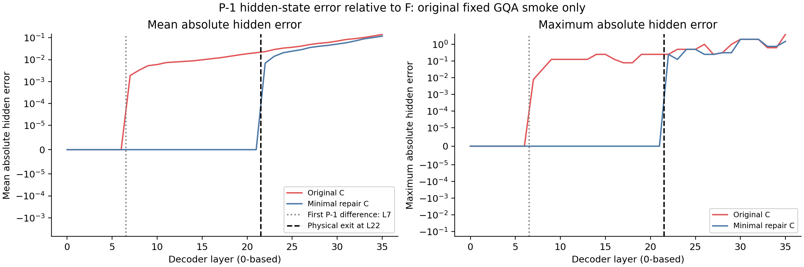
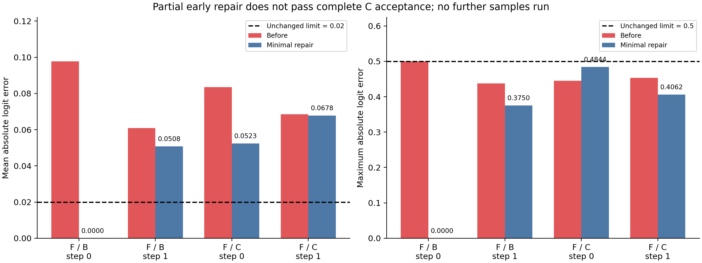

# Qwen3-VL C3-V2：逐层数值定位与最小修复结果

本轮结论为 **`ROOT_CAUSE_IDENTIFIED_REPAIR_FAILED`**。已在两张GPU上严格复现原始失败，定位到两条独立的计算形状敏感路径：早期物理Attention跳算首先在 **L1的Attention概率×V（AV）乘法**产生差异；隔离视觉退出时，首先在 **L22的K投影**产生差异。一个保留真实物理删减的最小修复消除了早期Prefill差异，但完整C的平均Logits误差仍超过0.02，未获得进入正式质量或性能评测的资格。

## 冻结范围与执行身份

- 基线交付：`1cd2534f7a79ac7b3c746d17ceb19e823cf53ab3`；原始执行源码：`dae5207d016acea8225f236ce3b81285d3d8bd90`。
- 本轮分支：`codex/qwen3vl-c3v2-numerical-debug`，独立工作目录：`/data/lk/ATE-worktrees/qwen3vl-c3v2-numerical-debug`。
- 第一张卡诊断源码：`31b5f7f009d86d10d25943cfaa46d28ed7044697`；第二张卡全Head重点探针源码：`2347e02289d3bd9fe9428dd297ee813bc61752d8`；最小修复执行源码：`0afe3ac482bd142cb2e0cb8b714cea741e85b36c`。各版本文件SHA见三个source_manifest。
- 模型：Qwen3-VL-8B-Instruct，revision `0c351dd01ed87e9c1b53cbc748cba10e6187ff3b`；BF16、Eager、Transformers4.57.6、Torch2.6.0+cu124，batch1，Greedy，最多32 Token，`logits_to_keep=1`。
- 只运行原始固定问题 `06905471` / image4712：`Are there any cars or trains?`，122个Prefill位置，96个图像位置，26个文本位置。没有加入其他输入。模型、图像、Prompt、Processor及原位置均保持冻结。
- 本轮用户明确授权“最多两张空闲GPU，先单卡后双卡”。先GPU3、再GPU2独立复核，最后GPU3测试一个最小修复；未使用GPU0/1。绝对预算起点13:24:06 UTC，GPU新任务截止14:54:06 UTC，交付截止15:24:06 UTC，未重置。

## 原失败复现和物理因素隔离

F是密集计算的功能性C3参考，L1–L6计算后将P−1/Decode的Attention输出更新置零；B保留视觉Hidden行，但真实跳算这些Query；W22-functional与P具有相同的功能性读图权限，前者保留Hidden行，后者在L22前退出视觉行；C同时包含退出和跳算。W22-functional仅作为P的严格匹配参考，不将其冒充相对Native的纯单因素实验。执行路径见`execution_paths.csv`。

两卡的所有基线完整有效Logits向量和生成Token严格一致；以下数值由完整词表Logits计算，step0预测首Token，step1预测EOS。

| 对照 | step | Max abs | Mean abs | RMSE/相对L2及Top20 |
|---|---:|---:|---:|---|
| F / B | 0 | 0.5000000 | 0.0977548063 | 见factor_isolation.csv及Shard JSON |
| F / B | 1 | 0.4375000 | 0.0608516596 | 同上 |
| W22-functional / P | 0 | 0.3750000 | 0.0554122403 | 同上 |
| W22-functional / P | 1 | 0.3750000 | 0.0857554749 | 同上 |
| B / C | 0 | 0.4375000 | 0.0519079380 | 同上 |
| B / C | 1 | 0.3750000 | 0.0560906157 | 同上 |
| F / C | 0 | 0.4453125 | **0.0834809989** | 同上 |
| F / C | 1 | 0.4531250 | 0.0686066002 | 同上 |

原始F/C首步失败被精确复现，平均误差阈值始终为≤0.02，最大误差≤0.5，Top1及完整Token要求100%。所有路径都生成`[2152,151645]`（no+EOS），但回答相同不足以通过数值验收。两个因素都能独立造成超过阈值的差异；它们经过后续非线性层相互作用，不能将表中误差相加，或解释成各自贡献百分比。

## 最早差异及传播

**早期跳算：L1 AV。** L0及L1共同位置的输入、Norm、Q/K/V、Q/K Norm、mRoPE、有效分数与概率均逐位相同。物理路径删除P−1的Attention计算，使原先122×122的计算变为121×121；最早的不同出现在AV输出。保留文本位置共有4个不同元素，最大差`6.103515625e-05`，平均差`9.010545642951229e-10`，RMSE`2.132545660060714e-07`。实际对应位置101“Are”、114“ short”、118换行、119 assistant起始标记，具体Head/Channel见`first_difference_coordinates.json`。这些只是数值坐标，不是Token功能重要性结论。

后续误差被放大，文本范围首次超过预声明的诊断标记mean>1e−3出现在L3 q_norm。该标记仅帮助定位，不替代验收阈值。P−1因为L1–L6更新被置零，其Layer输出直到L6仍相同；到L7首次因读取已出现微差的文本中继而不同，max0.0078125、mean0.0018812120。因此，只观察P−1会漏掉真正最早的L1分歧。

**视觉退出：L22 k_proj。** 在W22/P及B/C中，L22共同文本行的输入、Attention前Norm以及Q投影均严格相同；K投影在122行与26行计算下首次不同。W22/P的K差max0.0625、mean0.0013147170；B/C为mean0.0013140222。后续V、MLP和层输出继续传播差异。比较时只保留真实文本行，没有将已退出的图像行计为误差。

所有36层的模块证据、P−1与文本范围分开保存。L1和L22的Attention探针覆盖全部32个Head；其他层固定保留Head0/16/31的文本Query分数和概率，Hidden/投影等按实际形状保存。逐层重放采用原始QK完整形状，且确认重放概率与实际返回概率严格相同。五条路径在探针开启/关闭时，全部有效Logits均严格`torch.equal`。

## 为什么归因为计算形状，而非已发现的语义错误

本轮对同一输入张量做算子Shadow，未用不同上下游状态代替同输入比较：

1. L1同输入的121行物理Attention重现AV差异；增加一个永远因果禁用的零K/V列后恢复逐位一致。FP32仅用于诊断时该AV对照也一致。
2. L22同一输入中的共同文本行，122行与26行BF16 K/V/gate/up投影不同。例如K的mean差约0.00131876、max0.0625；V约0.00094003；gate约0.00106852；up约0.00085457。同输入Q/o/down在所测L22/L23一致。对应FP32形状误差明显更小，详细值在`bf16_shape_sensitivity.csv`。
3. 记录到`allow_bf16_reduced_precision_reduction=True`、TF32关闭。证据足以定位BF16算子对形状的敏感性，但没有做CUDA内核Profiler，不能据此声称已查明具体cuBLAS内核或内部求和顺序。

运行时共同位置的Mask许可、position_ids、mRoPE cos/sin及三路DeepStack注入严格一致。360项条件×层×生成步的KV审计确认：Prefill存储的旋转K/V等于对应投影的文本Gather，Decode追加不改旧前缀，逻辑位置正确，跳算L1–L6无持久KV。36层MLP/Norm/Residual均继续执行；真实正常退出和异常退出的Hook恢复均通过CPU检查。

**未发现这些固定执行路径上的Mask、Cache索引、mRoPE、DeepStack语义错误。** 这是当前输入及已采集范围的结论，不能排除所有输入上的其他问题。CompactKV删除本来不可访问的图像Key在数学权限上正确，但会改变矩阵归约长度；语义正确不等于BF16逐位一致。剩余Decode差异尚未逐算子完整定位，不将其全部武断归到某个已知内核。

## 最小修复：早期Prefill有效，完整候选失败

只尝试一个真实物理修复：L1–L6仍只投影121个Query/K/V行，P−1从未投影；为AV保持原Key长度，临时附加一个全零、永远被Mask禁止的K/V列。该列Attention概率严格0，不存入持久KV。Decode在这六层仍完全跳过Attention，L22仍退出96个视觉Hidden行，没有恢复几乎全部密集计算，也没有改变BF16。

| 对照 | step | 修复前Mean | 修复后Mean | 修复后Max | 原阈值通过 |
|---|---:|---:|---:|---:|---|
| F / B | 0 | 0.0977548063 | **0.0000000000** | 0 | 是 |
| F / B | 1 | 0.0608516596 | 0.0508070588 | 0.375000 | 否 |
| F / C | 0 | 0.0834809989 | **0.0523297191** | 0.484375 | 否 |
| F / C | 1 | 0.0686066002 | **0.0677602813** | 0.406250 | 否 |

早期修复后，F/B的整个Prefill首步Logits完全相同，强化了L1 AV归约形状归因；完整C的首个有效差异移动至L22 k_proj。B在真实Decode仍有差异，完整C两步的mean均未过线。本轮没有将局部成功报告为整体成功。

另在冻结的算子诊断中检查了转置GEMM、列主序输入、32/64行分块四种BF16表达形式，未找到同时恢复L22/L23 K/V/gate/up同输入一致性的方案，因此没有把这些形式追加为完整修复候选。原始问题失败后立即停止扩大输入；没有跑其余最短/中位/最长Smoke，没有正式Accuracy或E2E评测。

分析元数据有一次明确修正：早期探针按Key长度将修复中新增的零列误标为原P−1。CPU对齐时将其改标为`DUMMY_ZERO_KEY (-1)`，只比较共同真实Key；原始张量未改写。24处记录修正见`repair_dummy_key_alignment.json`。原始未Mask的死Key分数不应当作有效连接分歧，也不代表模型位置语义错误。

## 物理执行与资源

实际执行记录显示，修复C的L1–L6 Prefill Q/K/V及o_proj为121行，只有QK/AV额外增加一列零Key；真实Decode这些层没有Q/K/V/o_proj/QK/AV调用。L22–L35 Hidden为26行，实际K/V投影及MLP均处理26行。三路DeepStack仍位于原生注入点。没有Dense fallback。

生成EOS所需的最后实际前向后，F的KV live/capacity均为18,137,088 bytes；C及修复C的live为3,317,760 bytes、capacity7,004,160 bytes。CompactKV逻辑长度123、每非跳算层live27个文本位置、capacity57，跳算六层为0。这是本输入下的真实语言KV容器计数，**不是整模型峰值显存或加速测量**。临时零Key的QK/AV开销已计入物理执行审计。

GPU3首次诊断worker驻留16.020437秒，GPU2复核15.429707秒，GPU3修复12.028237秒，合计43.478381秒。该时间包含加载、探针CPU拷贝与写盘，既不是纯GPU内核耗时，也不是E2E性能基准。CPU实现、审计、作图和交付耗时另计；任务绝对起点和截止见time_budget.json。两卡自己的进程均已退出，最终释放状态见`gpu_release_audit.json`；未终止他人进程。

## 验证与证据使用

12项诊断CPU测试、4项修复CPU测试通过，真实CPU上下文正常/异常清理通过；两卡Native/No-op全部有效Logits严格相同，Native与官方HF完整Token及有效Logits严格相同。最终CPU独立重算全部12行配对Logits指标，检查三版源码与各自Git Commit、旧报告/STOP/Checkpoint未变、固定图像SHA、外部张量SHA、主分支未变以及全部图表和CSV/JSON。

复用旧冻结模型Manifest与路径启动后，交付阶段又对全部权重、Tokenizer、Processor等文件完整逐字节SHA复核；`model_hash_revalidation.json`明确记录该完整重哈希的时间，不将它伪称为本轮GPU启动前已执行的完整重哈希。

Git提供两个可离线复算的压缩数组：`arrays/effective_logits.npz`保留完整有效Logits；`arrays/first_divergence_evidence.npz`保留L1、L22首差异关键张量，BF16通过int16位重解释无损保存。原始逐层`.pt`数组仍在服务器`/data/lk/ATE-resources/experiments/qwen3vl_c3v2_numerical_debug/`，路径、大小、SHA见`raw_tensor_index.json`，**不声称这些大型原始数组包含在GitHub**。复算方法见`reproduction/README.md`。

## 对六个问题的直接回答

1. **首个分歧在哪里？** 原F/C为L1 AV乘法；隔离视觉退出为L22 k_proj。修复后完整C的首个有效分歧移动到L22 k_proj。
2. **两项优化各带来多少差异？** 原问题首步F/B mean0.0977548063，W22/P mean0.0554122403，B/C mean0.0519079380，F/C mean0.0834809989；这些为受控匹配对照，不能相加分摊。
3. **是否有已发现的语义错误？** 已核验范围没有发现Mask、Cache内容/索引、mRoPE或DeepStack错误；分析侧Dummy-Key标签问题已修正并单独披露。
4. **形状能否解释主要差异？** 同输入BF16 Shadow与临时零Key恢复实验支持这一解释；内部CUDA内核尚未定位，Decode残余没有完成逐算子定位。
5. **保持物理删减能否达到原门槛？** 所测最小修复保留删减，但完整C未达到。不能据本次失败断言任何未来实现都不可能达到。
6. **是否可进入正式质量/性能评测？** **不可以。** 原固定输入的mean误差仍失败，剩余Smoke未获放行。

下一步如另获独立任务授权，最有价值的是研究紧凑KV下Decode归约以及L22投影的BF16数值稳定实现，在保持真实删行的前提下重验原门槛。本轮没有执行这些后续工作，也没有放宽阈值。
