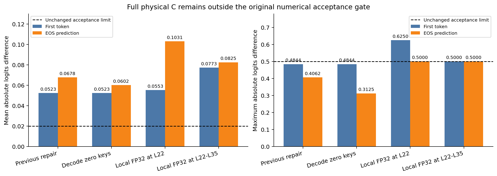

# Qwen3-VL C3-V2剩余数值误差修复

**最终状态：`PARTIAL_REPAIR`。** 原固定输入上的Decode残余差异已局部修复：F/B首Token和EOS两步的全部有效Logits在两张GPU上均严格相同。L22视觉退出后的投影差异仍未解决；完整C两步mean误差为 **0.0523297191 / 0.0601911135**，超过原门槛0.02。因此未运行其余长度Smoke，不具备进入正式Accuracy或E2E测试的条件。

## 1. 冻结范围与执行身份

基于上一轮交付`fe142bf2a5e0187e352591c699b4e977c40cb41c`，独立分支`codex/qwen3vl-c3v2-numerical-repair2`，工作树`/data/lk/ATE-worktrees/qwen3vl-c3v2-numerical-repair2`。上一轮源码、报告和原始张量均未改写。

模型固定Qwen3-VL-8B-Instruct revision `0c351dd01ed87e9c1b53cbc748cba10e6187ff3b`，BF16/Eager、Transformers4.57.6、Torch2.6.0+cu124，batch1、Greedy、最多32 Token、`logits_to_keep=1`。仅局部FP32候选明确改变四类投影的临时计算精度，原始参数保持BF16，输出再转回BF16；这些候选均失败，未作为最终选择。

只使用冻结问题`06905471`，图片4712，`Are there any cars or trains?`；Prefill122位置、Image96、文本26。所有路径生成`[2152,151645]`（no+EOS）；两个有效预测步包括EOS，均纳入门槛。没有读取或生成正式评测集预测，没有搜索层集合、退出深度或Token规则。

本轮再次获得用户明确授权“最多两张空闲GPU，先单卡后双卡”。先在GPU3完成复现、定位和少量修复，再在GPU2独立复核原问题上的最小修复。GPU0/1当时有其他任务，未使用、未终止其进程。模型/Processor/Tokenizer全部文件在本轮GPU运行前完成逐字节SHA复核，旧结果Artifact索引也已复核。

源码冻结：

- Phase1复现、Decode定位和独立算子对照：`788cae76233a80af744ea044f408a6d8cc52084c`。
- Phase2三个固定候选及独立复核：`77465e4e3a3c83c13fb274318afc431f7e6b01d2`。
- 精确文件SHA与引用模块见`source_manifest.json`和`source_manifest_phase2.json`；候选在运行前记录于`phase2_candidates_frozen.json`。

## 2. 上一轮结果严格复现

完整保留上一轮L1–L6 Prefill的单个死零Key修复，不重搜早期策略。本轮单卡重新生成F/B/W22-functional/P/C，原生Native、No-op与官方HF有效Logits严格相同；F/B/C与上一轮原始有效向量严格相同。

| 上一轮修复起点 | 首Token Mean abs | EOS Mean abs |
|---|---:|---:|
| F/B | 0 | 0.0508070588 |
| W22-functional/P | 0.0554122403 | 0.0857554749 |
| F/C | 0.0523297191 | 0.0677602813 |

F是固定Dense功能性C3参考；B只含真实答案阶段Attention跳算、保留视觉Hidden；W22-functional与P为视觉退出的权限匹配对照；C含跳算和退出。没有改变参考F的精度或计算路径。

## 3. Decode真正的第一个分歧

在相同原始输入和相同生成前缀下，逐层采集所有36层Decode算子；每次记录均在有/无探针时验证全部有效Logits严格一致。Decode每层采集全部32个Head，只有一个真实Query，不保存无必要的大型完整Prefill Attention矩阵。

**F/B首次不同发生在L12的AV乘法。** 此前Layer输入、Norm、Q/K/V、Q/K Norm、mRoPE后Q/K、共同合法Key的有效分数和概率均严格相同。L12 AV仅一个输出元素不同：Head0、Channel52，参考`−0.000194549560546875`，物理路径`−0.00019359588623046875`，最大差`9.5367431640625e−07`、mean`2.3283064365386963e−10`。后续层将此微差放大为EOS mean0.0508070588。

F的Key物理长度123，其中96个图像Key已禁止访问；CompactKV只有27个实际文本Key。共同K/V内容和逻辑许可正确，数学上删除零权重项等价，但BF16 AV归约形状不同。不是根据最终Logits猜测AV，而是在QK、概率相同的情况下观察到AV成为首处分歧。

W22-functional/P由于没有跳算L1–L6，Decode首差异更早出现在L1 AV；完整F/C则与F/B一样先在L12 AV出现不同，随后还叠加Prefill阶段的L22缓存投影差异。

## 4. Decode最小修复与额外代价

根据上述证据，只在真实Decode的非跳算层，为紧凑K/V按原始逻辑位置临时插入96列全零图像Key/Value，并将其Mask为`−inf`。真实文本K/V拷贝到原位置；Dummy概率严格0，逻辑位置不变，不写入持久Cache。L1–L6仍不执行任何Decode Q/K/V/o_proj/QK/AV；Prefill早期死Key修复继续保留。

修复后原问题的 **F/B两步完整Logits严格相同**，两张GPU复核向量也逐位相同。共同文本K/V与F的Gather在所有非跳算层、两步都相同，说明该输入的独立Decode归约误差确实被消除。

这项修复不是免费操作：每个活动Decode层临时Key维度从27恢复到123，QK/AV恢复这些零列的计算。30个活动层共增加 **47,185,920个QK/AV矩阵FLOPs**，使该步合计由13,271,040增加到60,456,960。每层临时完整K/V张量对为503,808 bytes，较27位置增加393,216 bytes；这些是短暂张量，不是持久KV。没有据此报告实际加速或整模型峰值显存收益。

仍保留的真实物理删减包括：六层答案Attention完全跳算、L22前退出96个视觉Hidden、L22–L35只处理26个文本Hidden、持久KV只保存文本。恢复的是活动层的部分归约工作，不能把它写成“完全保持原先的全部Attention算量收益”。

## 5. L22投影：局部FP32没有恢复冻结Dense结果

用完全相同的保留输入行，将122行Dense投影与26行物理投影比较。L22、L23检查K、V、gate、up、down；追加L24–L35相同输入的K/V/gate/up检查，48/48项都存在BF16形状差异，因此才执行后续层范围候选。没有重复旧转置、列主序、32/64行Padding方案。

独立算子候选限于局部FP32后转BF16、原26行BF16批量GEMM、目标算子关闭BF16 reduced-precision reduction。关键结果：

| L22算子 | 原26行BF16 Mean差 | 局部FP32→BF16 Mean差 |
|---|---:|---:|
| K | 0.0013187608 | 0.0013187308 |
| V | 0.0009400321 | 0.0009395124 |
| gate | 0.0010685199 | 0.0008644819 |
| up | 0.0008545677 | 0.0006948797 |

局部FP32没有修复K/V；虽减小部分MLP投影差异，但没有让整个模型更接近冻结Dense BF16参考。原26行BF16 bmm与普通GEMM结果相同；关闭reduced-precision reduction也未解决K/V。Down原本同输入逐位相同，FP32反而引入小差异，因此没有将Down加入完整候选。

这说明“更高精度”不自动意味着“更接近既有BF16 Dense执行结果”。本轮没有替换F为FP32参考，也没有放宽门槛或恢复122行投影。

## 6. 完整C回归结果及全部负面候选

预先固定门槛始终为每个有效生成步mean≤0.02、max≤0.5、Top1及完整Token100%一致、无NaN/Inf。下表采用最终选择的最小候选`decode-zero-key`：

| 对照 | 首Token Mean / Max | EOS Mean / Max | 全部有效步通过 |
|---|---:|---:|---|
| F/B | **0 / 0** | **0 / 0** | 是，仅原固定输入 |
| W22-functional/P | 0.0554122403 / 0.375 | 0.0552117303 / 0.500 | 否 |
| F/C | **0.0523297191 / 0.484375** | **0.0601911135 / 0.312500** | **否** |

完整C三个候选的实测值全部保留：

| 候选 | 首Token Mean / Max | EOS Mean / Max |
|---|---:|---:|
| Decode零Key | 0.0523297191 / 0.484375 | 0.0601911135 / 0.312500 |
| L22 K/V/gate/up局部FP32 + Decode零Key | 0.0553168952 / **0.625000** | 0.1030901745 / 0.500000 |
| L22–L35四投影局部FP32 + Decode零Key | 0.0772986338 / 0.500000 | 0.0825463682 / 0.500000 |

FP32候选未同时改善完整C两步mean，部分还违反max0.5，因此依据冻结规则保留最小零Key候选作为局部成果，不采用FP32候选。P路径的对应负面结果、RMSE、相对L2和Top20都保存在完整JSON及CSV，没有只展示改善项。

零Key修复后，完整C的Prefill首差异仍为L22 k_proj，Decode首差异移至L22的合法Key Attention分数，反映此前Prefill的L22 K/V差异已写入Cache。这与独立B路径的Decode已严格恢复一致并不矛盾，不能将B通过推断为C通过。局部FP32候选的首个Prefill差异同样仍是L22 k_proj。

单次原始C运行中，L22局部FP32共4次调用，GPU事件合计约1.60ms；L22–L35共56次调用，约22.30ms。各自临时权重转换累计416MiB与5.6875GiB，均是累计转换字节量，不是峰值或持久参数。记录包括转换和投影操作，但只有一次诊断测量，不是经过重复、预热和调度控制的延迟Benchmark，不能据此声称性能改善。

## 7. 正确性、原始证据与资源释放

CPU阶段先通过24项测试，新增Decode零Key逻辑后共27项通过；另用随机小型36层CPU Qwen，确认正常和注入异常退出都恢复Hook、Attention/mRoPE及投影forward补丁。没有用小模型结果替代真实8B数值验证。

真实模型验证包括：Native/No-op/HF有效Logits严格一致；上一轮修复向量复现；全部探针只读；两卡最小修复的Native、F、B、C向量逐位一致；1008个Cache快照检查原位置、旧前缀不变及晚层K/V与实际投影一致；36层MLP/Norm/Residual执行完整；mRoPE共同位置、三路DeepStack及新Dummy概率检查通过。全部26行配对Logits指标从原数组独立复算相同。

`actual_matrix_shapes.csv`按实际临时补零维度修正QK/AV形状和FLOPs。原引擎观察点位于补零包装之前，其记录作为`engine_shape_records_before_zero_padding`原样保留，不能把其中27列误称为修复后实际123列。瞬时Dummy Key在探针元数据中使用独立负ID，不伪装成原始Image KV。

Git中提供完整有效Logits压缩数组及首处分歧的BF16位精确小型张量；大型原始Tensor在服务器`/data/lk/ATE-resources/experiments/qwen3vl_c3v2_numerical_repair2/`，路径、Shape/Dtype来源、大小和SHA索引齐全。没有声称全部大型`.pt`文件包含在GitHub。可复算入口见`reproduction/README.md`。

GPU3两次worker驻留分别14.172599秒、18.434147秒；GPU2独立复核10.381980秒，总计42.988726秒，包括模型加载、CPU拷贝和写盘，不是纯内核时间或E2E性能基准。GPU实际工作在北京时间22:40:57前结束，两卡进程已退出，资源释放见`gpu_release_audit.json`。CPU分析和交付时间另计。GPU0/1他人任务未被操作，main未修改。

## 8. 六个问题的直接回答

1. **L22 BF16投影修复了吗？** 没有。所测局部FP32与两种26行BF16路径均未恢复冻结Dense K/V数值，完整C未过门槛。
2. **Decode最早差异在哪里、修复了吗？** 独立F/B最早在L12 AV。原固定输入上通过临时零Key对齐归约后，两步完整Logits在两卡均严格相同；未外推到其他输入。
3. **完整C误差多少？** 最小候选首Tokenmean0.0523297191、max0.484375；EOS mean0.0601911135、max0.3125，mean均失败。
4. **真实跳算和视觉退出是否保留？** 是，六层Attention仍缺席，L22以后只有26个真实Hidden行，持久KV压缩不变。
5. **有明显额外代价吗？** 有，临时零Key恢复活动Decode层的完整Key归约长度；局部FP32还涉及转换与额外计算，已单独计数和记录。
6. **能进入正式Accuracy/E2E吗？** **不能。** 本轮状态只能是`PARTIAL_REPAIR`，不能写成`REPAIR_PASSED`。

本轮在三个针对性候选后停止；没有执行其余长度Smoke、正式Accuracy、E2E、层搜索或新模型工作。若未来另立任务，核心障碍是以真正紧凑的投影计算匹配冻结Dense BF16数值，而不是继续增加接收Token或搜索Attention层。
