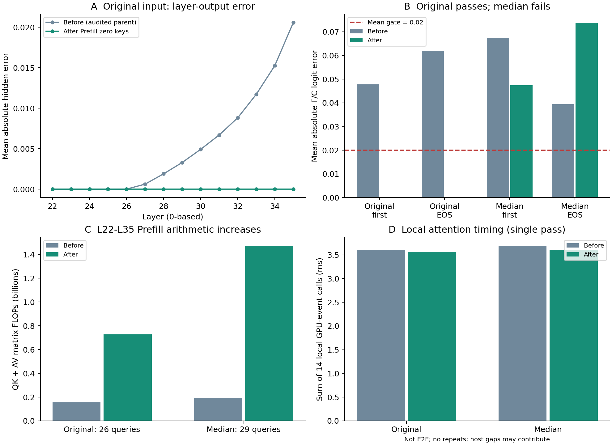

# Qwen3-VL C3-V2：最后一轮Prefill AV数值修复

最终状态：**PARTIAL_REPAIR**。临时补回被屏蔽的零Image K/V后，固定问题`06905471`的完整F/C首Token与EOS Logits均逐位一致，L26层输出差异消失；但随后中位长度Smoke `02497673`仍未通过，首次差异已提前到L22原生Q投影。两张GPU独立复核得到相同的全部有效Logits。本轮按停止规则结束，未运行最长Smoke、正式Accuracy或E2E Benchmark，也不继续追求严格BF16一致性。

## 固定配置与执行边界

基于Commit `0fe03aa1bb1923aee8b234ab3dccf59d7b21deb3`，新工作树为`/data/lk/ATE-worktrees/qwen3vl-c3v2-prefill-av-final`，分支为`codex/qwen3vl-c3v2-prefill-av-final`。既有结果、原始Tensor和main均未修改。GPU执行源码冻结于`19de4599c46f24c46caefbcebce643e72bfeafb1`，文件SHA见`source_manifest.json`。

沿用Qwen3-VL-8B-Instruct，revision `0c351dd01ed87e9c1b53cbc748cba10e6187ff3b`，BF16/Eager，Torch 2.6.0+cu124、Transformers 4.57.6，batch=1、Greedy、自然EOS、最多32 Token、`logits_to_keep=1`。使用原Processor、Prompt、图片、mRoPE和DeepStack，没有下载或安装依赖。

保留L1–L6真实Attention跳算及其Early Dummy Zero Key修复、Decode Zero Key修复，以及L22–L35已有固定cuBLASLt K/V/Gate/Up投影。F仍是**Dense功能性C3参考**，不能与Native Full混淆；Native用于独立HF/No-op数值校验。

用户对本轮明确授权最多两张空闲GPU。启动前重新核对UUID、显存和活动进程：GPU3先测试，GPU2仅复核固定结论。执行中GPU0/1出现了其他任务，始终未使用、抢占或终止它们。只在`/data`工作，开始时可用磁盘约61GB，设有20GiB停止阈值。

## 唯一新增修复

仅在物理退出路径的L22–L35 Prefill Attention内，按原始绝对Key位置临时创建全零K/V，将真实文本K/V放回各自原位置，并将新增Image列严格置为`-inf`。非Image列的Mask逐位保持原值。固定题保留26个真实Query，Key长度由26临时恢复为122；96个Image Hidden没有重新投影或执行MLP。

新增零K/V只供本次Attention调用使用，不写入CompactKV。返回的Attention Context保持原计算值；仅将供既有审计器检查的概率数组映射回紧凑Key顺序。GPU实测新增Image列的概率严格为0，非目标Mask、文本K/V均严格相等。

没有动用额外的AV Kernel/归约候选：原固定题完整Logits已经精确匹配；第二题的首次差异发生在Q投影、早于QK和AV，额外AV配置不能针对这个首次差异。没有扩大为Q投影修复、退出层搜索或其他策略搜索。

## 完整Logits结果

两张卡对以下每一份有效向量、完整生成Token均逐位相等。数值为全词表所有有效生成步，包含EOS预测，没有只比较Top-K。

| 样本 | 阶段 | 首Token Mean | 首Token Max | EOS Mean | EOS Max | F/C门槛 |
|---|---|---:|---:|---:|---:|---|
| 06905471，122位置/96 Image/26 Text | 补零前，原方案严格复现 | 0.0478183404 | 0.734375 | 0.0620242506 | 0.500000 | 未通过 |
| **06905471** | **补零后** | **0** | **0** | **0** | **0** | **逐位相等** |
| 02497673，221位置/192 Image/29 Text | 补零前，本轮新生成 | 0.0673324838 | 0.343750 | 0.0394774601 | 0.250000 | 未通过Mean |
| **02497673** | **补零后** | **0.0474725328** | **0.312500** | **0.0738004223** | **0.500000** | **未通过Mean** |

原门槛保持Mean≤0.02、Max≤0.5、Top1及完整Token相同、无NaN/Inf。第二题首Token有所改善，EOS反而变差，不能把局部恢复描述为普遍修复。

两个样本的F/B在两步上均为0误差，说明原有跳算和Decode修复得到保留。固定题的W22-functional/P补零后两步也均为0误差；第二题该对照的Mean为0.0510259904/0.0395316593，同样不合格。完整值及Top1见[logits_comparison.csv](logits_comparison.csv)。

原固定题输出Token为`[2152,151645]`（`no`、EOS）；中位长度题为`[8676,151645]`（`short`、EOS）。F/C完整Token和Top1一致，均自然EOS，无空输出或截断。但“答案相同”不能替代Logits门槛，本轮也没有据此估算Accuracy。

冻结最长题`02287196`为700位置、672 Image、28 Text。按照冻结的遇到未通过Smoke即停止规则，第二题失败后未运行该题；因此绝不能标记全部Smoke通过。

## L22–L35逐层定位

固定题补零后，L22–L35的全部保留文本层输出均与F逐位相等，包含P−1。关键L26对照如下。

| L26，保留文本范围 | 补零前Max | 补零后Max |
|---|---:|---:|
| QK（非Image有效Key）、Softmax | 0 | 0 |
| Attention AV | 0.0001220703125 | 0 |
| o_proj | 0.00390625 | 0 |
| Attention Residual | 0.015625 | 0 |
| Layer Hidden输出 | 0.03125 | 0 |

**并非所有内部AV元素都逐位相等。** 固定题的L22仍有1个AV元素差异，Max `7.4505805969e-9`、Mean `6.9961133512e-14`；该差异在后续投影/残差处消失，没有传播到L22层输出或最终有效Logits。本轮没有放宽内部相等检查，也没有把这项差异隐藏为0。

第二题的L22 Layer Input和Input Norm严格相等，而原生`q_proj`首先不同：Max `0.125`、Mean `0.0016664818`、不同元素40,112个。它比较的是221行Dense路径与29行物理路径中的相同文本输入行，Q投影并不属于已有四项固定Lt投影。此后QK、Softmax、AV和Hidden均受影响，L22层输出Max为0.25。这里定位到的是一个更早的数值障碍，不能将后续AV差异全归因于补零不足。

本轮未对第二题Q投影做新Kernel Profiling，也未据此断言具体内部乘加顺序或执行Kernel名称。首次差异、真实坐标及所有层段见`first_divergence.json`和[layerwise_errors.csv](layerwise_errors.csv)。

QK与Mask逐层比较使用原始逻辑位置对齐的非Image Key列：被完全Mask的Image列在Dense中可能有非零QK分数，在补零路径中则为0，这些无效列本来就不要求Mask前分数相等。Softmax后的Image概率另行严格验证为0。前后Trace的复用与新生成标签分开保留。

## 真实计算与临时显存代价

以下QK+AV FLOPs按实际调用的矩阵维度计算，**包含对补零列执行的乘法**，并非只计有效文本列；每层为`4×B×Heads×Q×K×HeadDim`。它仍不是硬件计数器测得的精确Tensor Core指令FLOPs，Kernel内部tile尾部工作与既有固定Lt代价保持原来的限制。

| 样本 | 真实Query数 | Key数前→后 | L22–L35 QK+AV FLOPs前→后 | 新增FLOPs |
|---|---:|---:|---:|---:|
| 06905471 | 26 | 26→122 | 155,058,176→727,580,672 | 572,522,496 |
| 02497673 | 29 | 29→221 | 192,905,216→1,470,070,784 | 1,277,165,568 |

固定题后段Attention矩阵算术增至原来的4.69倍；中位长度题为7.62倍。Query始终是26/29个真实文本位置，未恢复Image Query，也未增加持久Image KV。

| 临时/峰值记录，GPU3 | 06905471 | 02497673 |
|---|---:|---:|
| 每层新分配补零K/V、Mask、索引总字节数 | 506,264 | 918,266 |
| 每层概率数组字节数前→后 | 43,264→203,008 | 53,824→410,176 |
| Eager重复头K/V字节数前→后 | 425,984→1,998,848 | 475,136→3,620,864 |
| 整请求Peak Allocated字节数前→后 | 17,593,321,984→17,600,326,656 | 17,679,196,160→17,686,569,472 |

每层字节数是具体分配规模，不是把14层之和当成同时存在的峰值；Softmax、分数数组及Allocator生命周期还会影响实际峰值。请求峰值包含完整模型，来自本轮单次运行，不能代表稳定的显存基准。

在无Probe的重复验证请求中，以CUDA Event记录每层Attention本体，14次调用耗时之和为：固定题3.608896→3.564704ms，中位题3.685344→3.603232ms。**这些是单次局部记录，没有重复置信区间，可能包含Host调度间隙，也不包括补零准备的全部代价。不能由这些微小差异宣称变快。** 本轮没有E2E Benchmark。

既有Early/Decode补零开销继续披露：固定题分别新增11,894,784/47,185,920矩阵FLOPs，中位题为21,626,880/94,371,840。完整数值、实际张量Shape和逐层耗时见[prefill_costs.csv](prefill_costs.csv)及[physical_cost_summary.csv](physical_cost_summary.csv)。

## 正确性与资源审计

- 36项CPU测试通过，包含新增补零位置、`-inf`、非目标Mask、输入不变与零概率测试，以及既有位置/Cache/修复回归。
- 两题、两卡的Native/No-op和原生HF `generate`全部有效Logits严格`torch.equal`，完整Token相同；各条件独立新建Cache。
- 固定题的历史F和修复前C完整有效向量严格复现；修复后有Probe/无Probe重复严格相等，Hook清理正确。
- 输入Prompt、Token IDs、Image布局和所有输入Tensor SHA与冻结记录一致；模型全部保持BF16。模型文件及历史Artifact前后字节SHA复核。
- mRoPE的cos/sin及位置ID在真实保留绝对位置上逐位一致，DeepStack三层的特征和视觉Mask逐位一致；没有重编号或改变视觉预处理。
- L22–L35仍只有26/29行Hidden、56次原方案Lt投影；L1–L6仍跳过答案Attention，所有MLP、Norm和Residual完整保留。
- 持久KV不增加Image行。固定题有效KV为3,317,760字节、容量7,004,160字节，中位题为3,686,400/7,372,800字节。原固定题文本KV数值也与Dense保留位置严格相等；第二题因数值失败，不能宣称KV值相等，但布局、绝对位置及更新语义正确。

GPU2/3任务进程均已退出，释放审计时显存各约27MiB；GPU0/1的其他进程原样保留。释放记录只反映当时状态，不保证未来空闲。

## 交付与最终判定

本轮验证了一个有效但有计算代价的Prefill补零修复：**它确实消除了固定题L26处向后传播的差异，并让该题完整C与F逐位一致；它没有使完整冻结Smoke集合通过。** 第二个输入已经暴露出更早的原生Q投影数值差异，所以最终状态为`PARTIAL_REPAIR`，不是`REPAIR_PASSED`。

按照用户要求，停止继续追求严格BF16一致性，不申请或执行正式Accuracy/E2E，不追加Q投影修复、Kernel/层搜索、训练或其他实验。

完整有效Logits的BF16位数组随Git交付，可纯CPU重算全部Max/Mean及Token判据。大Tensor和完整逐层证据存放在`/data/lk/ATE-resources/experiments/qwen3vl_c3v2_prefill_av_final/`，Git仅保存索引、SHA与小型完整Logits归档，不包含全部大Tensor。复核方法见[reproduction/README.md](reproduction/README.md)。
